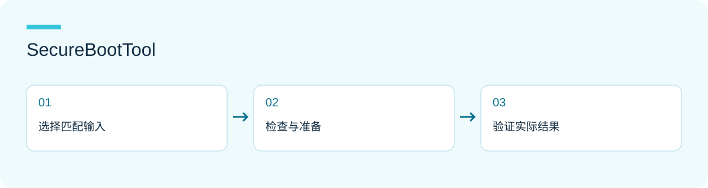





SecureBootTool 属于较早的 Rockchip 安全工具链，随附应用说明覆盖签名、eFuse 配置、固件升级和测试。不能把它包装成所有当前 ArmSoM 板卡都能直接使用的安全方案。

## 先核对原文平台

2016 年 V1.2 应用说明列出 RK3126、RK3128、RK3228、RK3288、RK3368，并在当时方案中要求 miniloader 2.19、U-Boot 2.17 或更新版本。这些数字不是其他现代 SDK 的统一最低要求。文件位于 Linux 资料目录，也不能单独证明程序的主机架构。

## 分清四个阶段

1. **设计**：确定 SoC 安全机制、密钥保管、升级签名与恢复策略。
2. **准备**：生成或加载项目认可的密钥，使用匹配工具签名每个必要启动文件。
3. **验证**：在恢复路径仍可用时检查签名，验证启动与升级链路。
4. **配置设备**：只能按产品专用流程提交公钥哈希或启用一次性状态，普通刷机不能替代这一过程。

## 验收记录应包括什么

记录硬件版本、SDK、ROM/Loader 方案、密钥标识、签名产物哈希、配置状态与恢复结果，秘密密钥另行保管。GUI 显示成功不证明全部启动阶段均已认证。

## 新平台使用新依据

现代 Linux 平台应对照关联的新版 Linux Secure Boot 指南和板卡 BSP，不能混用旧 GUI 步骤与新 OTP 布局、证书格式。本文定位为归档工具的理解与迁移参考，不编造通用熔丝烧录教程。

## 适用范围与验证状态

本文依据本次工具包及原始资料整理。使用前核对具体板卡、SoC、载板、SDK/BSP 与主机架构。本次未执行烧录、生产配置、寄存器写入或硬件测试；提供下载不代表所有 ArmSoM 产品均支持。

## 工具下载、版本与 SHA-256

下载对应压缩包，校验哈希后完整解压。Linux PinDebug 分卷请先按链接中的说明还原；下方该项哈希对应合并后的完整文件。

| 主机 / 版本 | 下载包 |
|---|---|
| Host to verify / 1.85 | [SecureBootTool_v1.85_foruser.zip](https://raw.githubusercontent.com/ArmSoM/rockchip-tools/main/downloads/secureboot-tool/SecureBootTool_v1.85_foruser.zip) |

**SecureBootTool_v1.85_foruser.zip — SHA-256**

```text
d241ccc7503a3202c68a036f51cdd7f5d2db2a7594eb749ec19e2ffb2c67681a
```

[GitHub · catalog.json](https://github.com/ArmSoM/rockchip-tools/blob/main/catalog.json) · [SHA256SUMS](https://github.com/ArmSoM/rockchip-tools/blob/main/SHA256SUMS)

## 资料依据与原图

- SecureBootTool_v1.85_foruser.zip; Rockchip Secure Boot Application Note V1.2 (2016)
- [原始 PDF: Rockchip Secure Boot Application Note_v1.2_20160202.pdf](https://raw.githubusercontent.com/ArmSoM/rockchip-tools/main/manuals/094883c784c1.pdf)

## 继续阅读相关流程

- [Rockchip Secure Boot 完整应用指南：签名、eFuse、OTP 与验证](/zh/articles/105-rockchip-secure-boot/)
- [Rockchip Linux Secure Boot 完整开发指南](/zh/articles/203-rockchip-linux-secure-boot/)
- [rk_sign_tool 与 sign_tool：Rockchip 固件签名和校验流程](/zh/articles/rockchip-tool-rk-sign-tool/)
- [EfuseTool 1.42：建立可追溯的安全启动配置工位](/zh/articles/rockchip-tool-efuse-tool/)
- [Rockchip 工具下载与使用指南索引](/zh/articles/rockchip-tools-download-guide/)

## 查找准确的 ArmSoM 板卡资料

板卡、载板与接口要求先以产品手册为准。以下链接是平台参考，不表示该归档工具已在这些产品上验证。

[ArmSoM Docs](https://docs.armsom.org/) · [Sige7](https://www.armsom.org/sige7) / [Docs](https://docs.armsom.org/armsom-sige7) · [CM5](https://www.armsom.org/cm5) / [Docs](https://docs.armsom.org/armsom-cm5)


