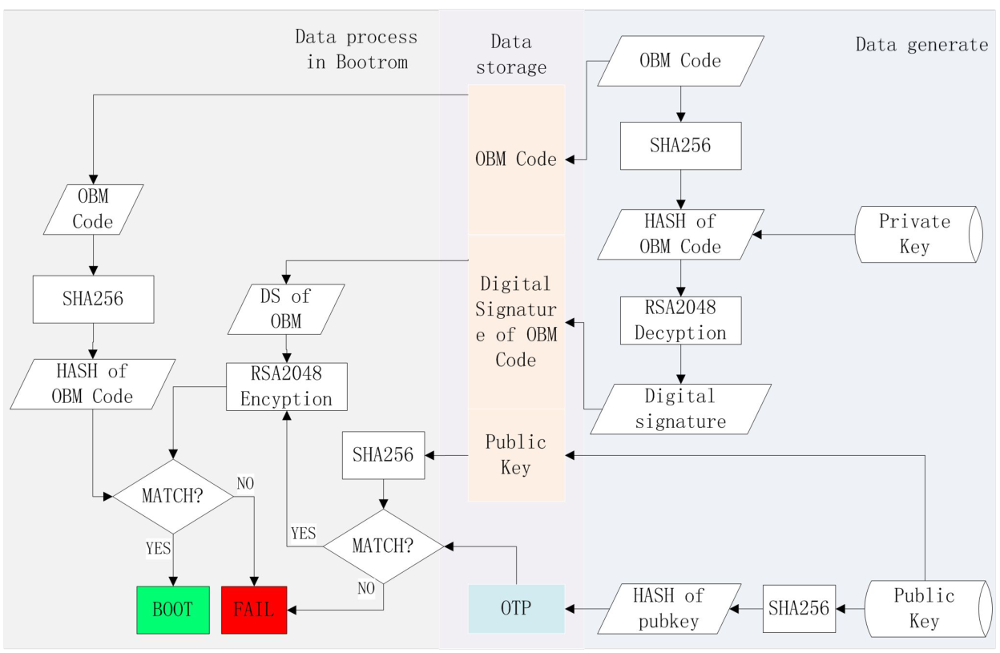
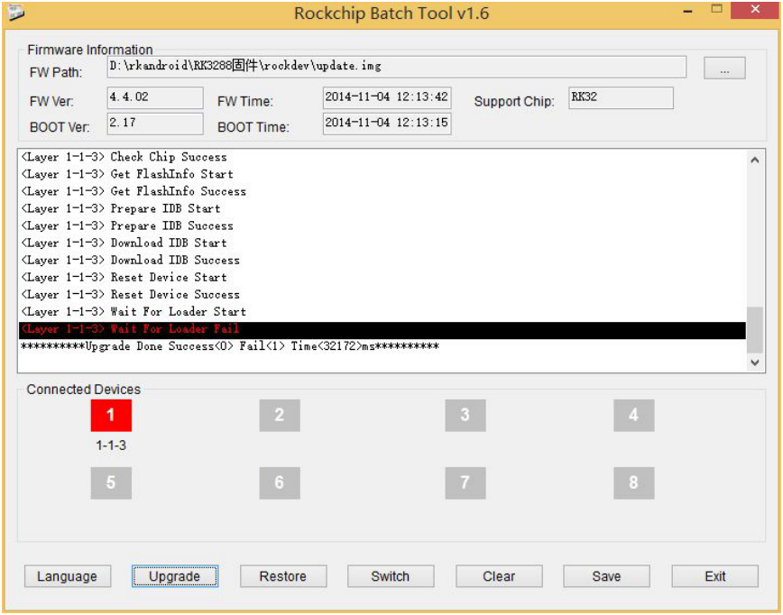




## 历史 Secure Boot 应用说明 V1.2

这份 2016 年手册列出 RK3126、RK3128、RK3228、RK3288、RK3368；不是 RK35xx 通用配置。原稿功能包括 Secure Boot ROM、SHA256/SHA160、RSA2048/RSA1024、OTP 验证 RSA 公钥、Secure Boot Rockusb 升级。最低版本：Miniloader 2.19、U-Boot 2.17、EfuseTool 1.35、SecureBootTool 1.75、RKBatchTool 1.8。

### 1. 信任链与签名配置

原图展示 ROM、启动镜像及后续启动阶段的验证关系，保留在下方。Windows 工具先选择芯片，3188 之前的旧芯片选择 others；再选 eFuse 级或软件方案。原文列 3128、3288、3228、3368 支持 eFuse 级，其他旧芯片不支持。此处“加密”是原工具界面用语，不应据此混淆签名验证与固件保密。

3188 及之前旧芯片使用 loaderex=false、1024 位 key；3128/3288/3228/3368 使用下列配置，并满足上面的 Loader、U-Boot 版本。Key 只支持 1024 或 2048。

```ini
[Options]
Loaderex=true
Key=2048
```

### 2. 生成、保存和加载 RSA Key

原文要求每款机器只生成一次密钥，此后固件一直使用该对 key，并另做备份。点击生成、确认并保存，再从保存位置加载；支持 OpenSSL 生成的 `.pem` RSA2048。丢失密钥会使后续签名升级不可用，可能导致设备无法恢复。不要把示例截图里的密钥流程当作生产密钥托管方案。

### 3. 固件准备和签名

boot.img、recovery.img 都必须包含 kernel。原稿终端截图以 RK3288 Android 4.4 演示以下命令和输出；NAND 固件还需包含 miniloader 与 uboot.img。加载保存的 RSA key 后选择并签名固件，保留成功结果。原文连续两个小节都标 3.5，本文按操作顺序整理。

```text
./mkimage.sh ota
TARGET_PRODUCT=rk3288
TARGET_HARDWARE=rk30board
system filesystem is ext4
make ota images...
create boot.img with kernel... done.
create recovery.img with kernel... done.
create misc.img.... done.
```

### 4. eFuse 烧写流程

打开 eFuse 工具，选择用于生产的已签名固件，点击启动；裸机上电连接 USB 后进入 `maskromrockusb`，工具会自动烧写，支持一拖多。RK312X 需治具为 eFuse 单独供电；RK3288 PCBA 已有该供电，软件控制，无需另供。正式批量前先烧一台，再用量产工具升级完整签名固件并验证全部功能。eFuse 属不可逆设备配置，不能在普通板卡上照图试写。

### 5. 固件升级与验证

使用匹配的量产工具升级已签名固件。原稿明确：未烧写 eFuse 不会启用该 Secure Boot。负向验证写入未签名固件时，应无法启动、停在 `maskromrockusb`，升级 loader 后工具报错；下方保留原截图，不能将截图当作 ArmSoM 实测。

### 6. 常见错误

eFuse 烧录报错时检查供电是否正常、设备是否已经烧写过。不要反复写入来试错；保存 key、固件版本、目标芯片和执行记录，再按对应芯片资料核对。

## 适用范围与验证状态

本文依据本次工具包及原始资料整理。使用前核对具体板卡、SoC、载板、SDK/BSP 与主机架构。本次未执行烧录、生产配置、寄存器写入或硬件测试；提供下载不代表所有 ArmSoM 产品均支持。

## GitHub 工具目录、版本与 SHA-256

打开 GitHub 对应目录后选择所需平台和版本，再校验文件哈希并完整解压。下方链接均为仓库目录入口。

[前往 GitHub 对应工具目录](https://github.com/ArmSoM/rockchip-tools/tree/main/downloads/secureboot-tool)

| 平台 / 版本 | 文件 | SHA-256 |
|---|---|---|
| Host to verify / 1.85 | `SecureBootTool_v1.85_foruser.zip` | `d241ccc7503a3202c68a036f51cdd7f5d2db2a7594eb749ec19e2ffb2c67681a` |

[GitHub · catalog.json](https://github.com/ArmSoM/rockchip-tools/blob/main/catalog.json) · [SHA256SUMS](https://github.com/ArmSoM/rockchip-tools/blob/main/SHA256SUMS)

## 资料依据与原图

- Rockchip Secure Boot Application Note_v1.2_20160202.pdf

### 原手册操作界面与图示

界面图保留原手册语言；中文使用中文原稿，英俄德优先使用英文原稿，无英文原图的新增界面仍为中文。图中的值是手册示例，不是当前板卡实测。



Rockchip Secure Boot Application Note_v1.2_20160202.pdf · p. 5


Rockchip Secure Boot Application Note_v1.2_20160202.pdf · p. 6


Rockchip Secure Boot Application Note_v1.2_20160202.pdf · p. 7


Rockchip Secure Boot Application Note_v1.2_20160202.pdf · p. 7


Rockchip Secure Boot Application Note_v1.2_20160202.pdf · p. 7


Rockchip Secure Boot Application Note_v1.2_20160202.pdf · p. 9


Rockchip Secure Boot Application Note_v1.2_20160202.pdf · p. 10


Rockchip Secure Boot Application Note_v1.2_20160202.pdf · p. 11


Rockchip Secure Boot Application Note_v1.2_20160202.pdf · p. 12


Rockchip Secure Boot Application Note_v1.2_20160202.pdf · p. 13


Rockchip Secure Boot Application Note_v1.2_20160202.pdf · p. 14


Rockchip Secure Boot Application Note_v1.2_20160202.pdf · p. 15


Rockchip Secure Boot Application Note_v1.2_20160202.pdf · p. 16


Rockchip Secure Boot Application Note_v1.2_20160202.pdf · p. 17


Rockchip Secure Boot Application Note_v1.2_20160202.pdf · p. 18


Rockchip Secure Boot Application Note_v1.2_20160202.pdf · p. 20


Rockchip Secure Boot Application Note_v1.2_20160202.pdf · p. 21



Rockchip Secure Boot Application Note_v1.2_20160202.pdf · p. 22

## 继续阅读相关流程

- [Rockchip Secure Boot 完整应用指南：签名、eFuse、OTP 与验证](/zh/articles/105-rockchip-secure-boot/)
- [Rockchip Linux Secure Boot 完整开发指南](/zh/articles/203-rockchip-linux-secure-boot/)
- [rk_sign_tool 与 sign_tool：Rockchip 固件签名和校验流程](/zh/articles/rockchip-tool-rk-sign-tool/)
- [EfuseTool 1.42：建立可追溯的安全启动配置工位](/zh/articles/rockchip-tool-efuse-tool/)
- [Rockchip 工具下载与使用指南索引](/zh/articles/rockchip-tools-download-guide/)

## 查找准确的 ArmSoM 板卡资料

板卡、载板与接口要求先以产品手册为准。以下链接是平台参考，不表示该归档工具已在这些产品上验证。

[ArmSoM Docs](https://docs.armsom.org/) · [Sige7](https://www.armsom.org/sige7) / [Docs](https://docs.armsom.org/armsom-sige7) · [CM5](https://www.armsom.org/cm5) / [Docs](https://docs.armsom.org/armsom-cm5)


