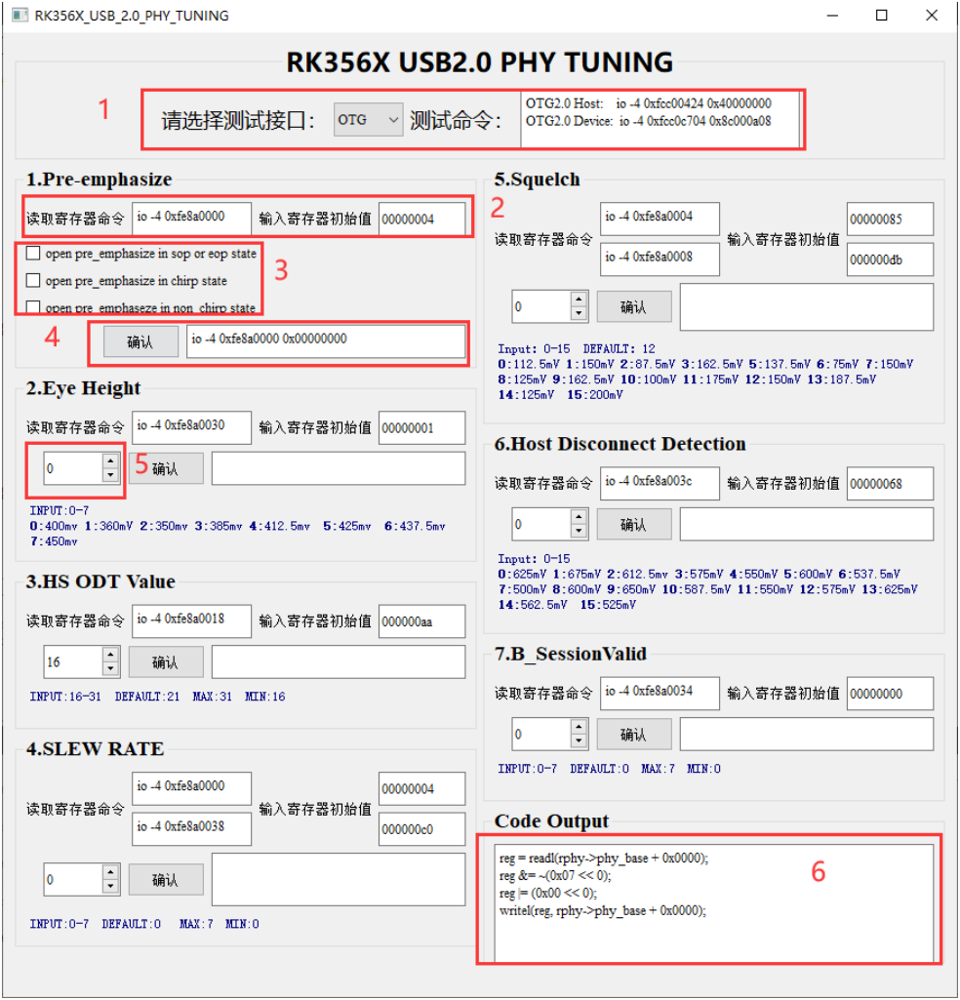
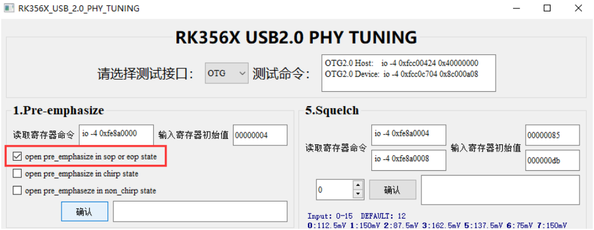
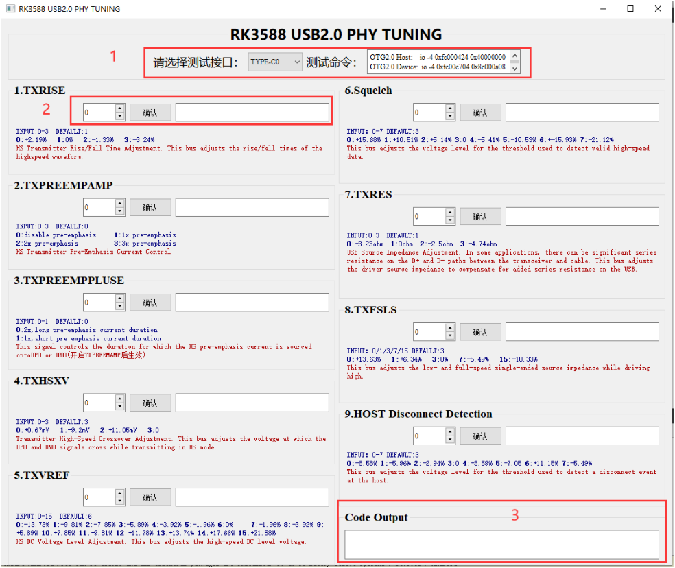
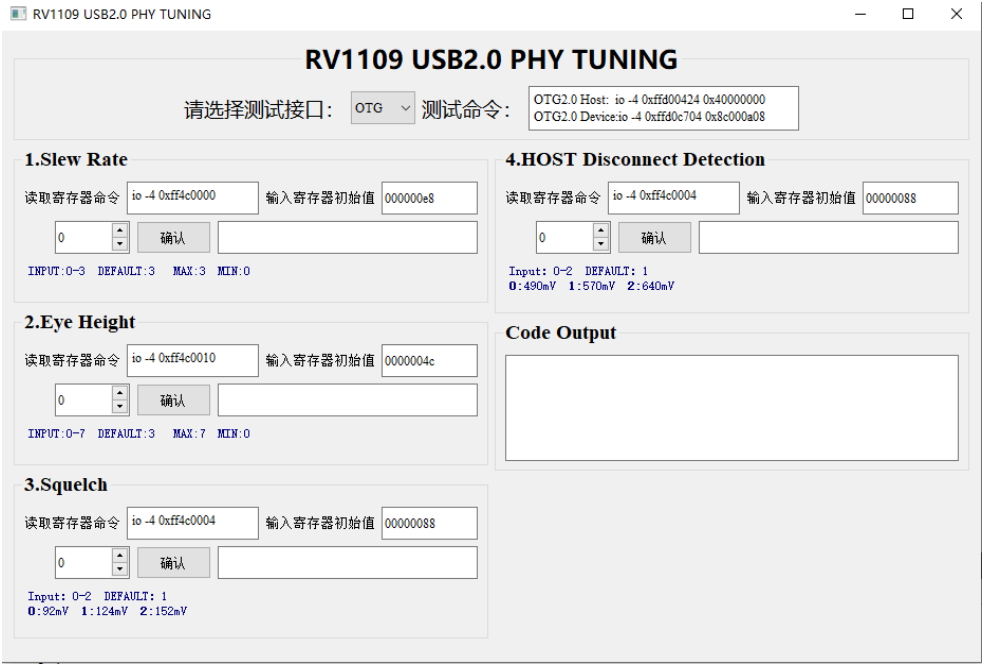




## USB SQ Tool V1.4.0 完整技术参考

以下按工具包中的 V1.4.0 手册整理。其共同技术章节与本站已校对 V1.8.0 教程复用，并按旧版范围筛选；不能将新版平台列表反推为旧工具支持。USB2.0 主列表包含 RK3588/RK3588S、RK3568/RK3566/RK3562/RK3528、RK3399、PX30/PX30S、RK3308/RK3308B-S、RK3326/RK3326S、RK3228、RK3288、RK3328、RV1103/RV1106；RK3328 仅 OTG/HOST，不含 USB3 U2PHY。USB3.1 列 RK3528/RK3562/RK3566/RK3568/RK3588。原文后续另讨论 RK3036/RK312X、RV1109/RV1126，主列表与正文覆盖差异原样注明。Windows 界面按平台、端口、测试命令、参数、确认、Code Output 顺序操作。先改善线缆、阻抗、供电等硬件，再对照眼图逐步调节，数值不是越大越好。

原稿 RK3562 示例以 `]` 结束，下面保留并提示它不是可直接编译代码；所有省略号都是原稿插入位置示意，不是完整驱动补丁。配图均为 V1.4.0 中文原图。

<figure style="margin:1.6rem 0">
<a href="/assets/rockchip-tools/manuals/0ec9ef065fdc/p04-f01.png" target="_blank" rel="noopener" aria-label="查看完整图片"></a>
<figcaption style="margin-top:.6rem;font-size:.9em;line-height:1.55"><strong>图 1：选择 USB 平台和 PHY 类型</strong></figcaption>
</figure>

### 1. RK3399 USB2.0 Tuning 界面说明

RK3399 USB2.0 支持 TYPE-C0、TYPE-C1、HOST0、HOST1 共四种类型接口,RK3399 界面的 Tuning 可以分为以下几个步骤:

<figure style="margin:1.6rem 0">
<a href="/assets/rockchip-tools/manuals/0ec9ef065fdc/p05-f01.png" target="_blank" rel="noopener" aria-label="查看完整图片"></a>
<figcaption style="margin-top:.6rem;font-size:.9em;line-height:1.55"><strong>图 2：RK3399 USB2.0 PHY 调整界面</strong></figcaption>
</figure>

1. 在红色方框 1 左侧选择所需要测试的接口,红色方框1右侧的测试命令框会自动生成对应的 SQ 测试命令。

2. 在红色方框 2 中选择对应的参数,Pre-emphasize 参数选择与其他 Tuning 项不同,通过打钩的方式选择预加重的参数,其他的 Tuning 项是通过类似红色方框4中的控件获取参数,手动输入或者点击上下按键均可改变参数值,参数输入范围以及参数的描述在每个 Tuning 项中均有提供。

3. 点击红色方框 3 中的” 确认“按键,按键右侧的框中会生成对应的 io 命令,并且红色方框 5 中的 Code Output部分会生成对应的参考代码。

| 调整参数 | 描述 |
| --- | --- |
| Pre-emphasize | 调整 HS Tx 预加重 |
| Slew Rate | 调整 HS Tx 眼图的 slew rate |
| Compensation Voltage | 调整 HS Tx 电压校准点,调高校准点可以提高 USB 眼图的高度 |
| Compensation Current | 调整 HS Tx 电流校准点,调高校准点可以提高 USB 眼图的高度 |
| Pre-emphasize Strength | 调整 HS Tx 预加重强度 |
| Bypass ODT &amp; Driver Strength | Bypass comp 电路中的电阻自动调整电路,可以调整 USB 眼图的高度 |
| Squelch | 调整 HS Rx 的噪声阈值 |
| HOST Disconnect Detection | 调整 HS 断开检测阈值,只用于 HOST |

### 2. RK3568 USB2.0 Tuning 界面说明

RK3568 USB2.0 支持 OTG、HOST1、HOST2、HOST3 共四种类型接口,RK3568 界面的 Tuning 可以分为以下几个步骤:

<figure style="margin:1.6rem 0">
<a href="/assets/rockchip-tools/manuals/0ec9ef065fdc/p07-f01.png" target="_blank" rel="noopener" aria-label="查看完整图片"></a>
<figcaption style="margin-top:.6rem;font-size:.9em;line-height:1.55"><strong>图 3：RK3568 USB2.0 PHY 参数与代码输出</strong></figcaption>
</figure>

1. 在红色方框 1 左侧选择所需要测试的接口,红色方框 1 右侧的测试命令框会自动生成对应的 SQ 测试命令。

2. 由于 RK3568 平台的 USB PHY 寄存器没有高 16 位的 “write_enable bit”,所以为了防止被调整的寄存器中其他不相关或未调整的某些 bit 值被修改,需要用戶使用红色方框 2 中提供的读取寄存器命令获取对应寄存器的初始值,填入方框 2 右侧的“输入寄存器初始值”框中。

3. 在红色方框 3 中选择对应的参数,Pre-emphasize 参数选择与其他 Tuning 项不同,通过打钩的方式选择预加重的参数,其他的 Tuning 项是通过类似红色方框 5 中的控件获取参数,手动输入或者点击上下按键均可改变参数值,参数输入范围以及参数的描述在每个 Tuning 项中均有提供。

4. 点击红色方框 4 中的” 确认“按键,按键右侧的框中会生成对应的 io 命令,并且红色方框 6 中的 Code Output部分会生成对应的参考代码。注意:寄存器初始值的框中已经有预设的默认值,如果没有手动输入寄存器值,将会使用默认值,可能会影响最终Tuning 结果,故测试前务必手动读取当前寄存器值后填入寄存器初始值的框中。

| 调整参数 | 描述 |
| --- | --- |
| Pre-emphasize | 调整 HS Tx 预加重 |
| HS Eye Height | 调整 HS Tx 眼图的高度 |
| HS ODT Value | 调整 ODT 45Ω 电阻值,输入值越大,ODT 电阻越小,眼图的高度就越大,但同时 会加快 FS/LS 的 slew rate |
| Slew Rate | 调整 HS 眼图的 slew rate ,但调整作用很小 |
| Squelch | 调整 HS Rx 的噪声阈值 |
| HOST Disconnect Detection | 调整断开检测阈值,只用于 HOST |
| B_Session Valid | 调整 VBUS DET 阈值,只用于 Device |

RK3568 USB2.0 噪声阈值调整当使用长度较长、质量较差、阻抗较大的 USB 线缆连接 High-speed 外设,无法被正常枚举 。此时可以尝试调整USB 噪声阈值。USB PHY 的噪声阈值一般默认为 150 mV,当使用阻抗较大的 USB 线缆时,USB 正常信号的幅值会衰减得很厉害,甚至低于 150 mV 的,因此可能正常信号会被当作噪声处理了。此时可以适当的降低 USB2.0 PHY 的噪声阈值,一般可以调整为 125 mV 或者 112.5mV,此项可以通过 Squelch Tuning 改善。RK3568 USB2.0 断开检测阈值调整断开检测阈值调整可以通过 Host Disconnect Detection Tuning 改善,Rockchip 平台 USB Host 端口识别 USB 外设日志如下:

```text
[ 1204.092638] usb 1-1: new high-speed USB device number 3 using ehci-platform
[ 1204.280373] usb 1-1: New USB device found, idVendor=058f, idProduct=6387, bcdDevice= 1.04
[ 1204.280449] usb 1-1: New USB device strings: Mfr=1, Product=2, SerialNumber=3
[ 1204.280476] usb 1-1: Product: Mass Storage
[ 1204.280498] usb 1-1: SerialNumber: FA45A19C
```

Rockchip 平台 USB Host 端口断开 USB 外设连接日志如下:

```text
[ 985.341233] usb 1-1: USB disconnect, device number 2
```

1) 无法检测 USB2.0 外设断开当 USB Host 拔掉 USB2.0 外设,无法检测到断开(拔掉 USB 外设时不会打印以上的断开连接的日志),此时可以尝试如下步骤优化:

<figure style="margin:1.6rem 0">
<a href="/assets/rockchip-tools/manuals/0ec9ef065fdc/p09-f01.png" target="_blank" rel="noopener" aria-label="查看完整图片"></a>
<figcaption style="margin-top:.6rem;font-size:.9em;line-height:1.55"><strong>图 4：EOP 预加重选项</strong></figcaption>
</figure>

1. 开启 EOP 的预加重(SDK 默认关闭 EOP 的预加重),开启 EOP 预加重位置如图 4 所示。

2. 减小 USB Host 的断开检测阈值;注意:有些 Rockchip 平台主控芯片没有调节EOP预加重的操作,可忽略 Step 1步骤,具体以工具页面为准;只有 Step1 操作无明显改善效果的情况下,才需要在 Step1 的基础上再做 Step2 的操作;Step2 减小断开检测阈值存在一定的风险,如果调整过度会导致 USB 外设在正常使用中发生自动断开情况,所以用戶需要自己把控风险 ;

2) USB2.0 外设异常断开当 USB Host 连接 USB2.0 外设在正常工作中发生异常断开,我们可以尝试增大 USB Host 的断开检测阈值。注意:并不是所有的异常断开都是因为断开检测阈值的原因,往往更多的情况是 USB 外设自身问题或者硬件环境问题等因素导致的,所以不应该一出现此类问题就盲目的去调整断开检测阈值。Rockchip 的 SDK 默认是关闭 EOP 的预加重,所以此时不需要配置寄存器再去关闭该操作;增大断开检测阈值同样存在一定的风险,如果调整过度会导致 Host 无法检测到 USB 外设断开连接的情况,所以用戶需要自己把控风险;RK356X USB2.0 B_Sessionvalid 调整B_Sessionvalid 调整主要用于 PC 无法识别 USB Device (如:ADB/MTP)或者识别到 USB Device 后又断开的现象。此时可以尝试调整此项,降低电压判决阈值。默认值为 3'b000,建议改为 3'b111 (参数选择7)或 3'b101(参数选择5)。

导致 USB Device 连接失败的硬件问题主要有 3 种:Vbus 电压太低 (一般低于 4.7V 容易出现问题) 。USB_AVDD1V0 纹波太高,或者 USB_AVDD1V0 被抬高到 1.2V,导致 PHY 检测不到 Bvalid 有效信号。Logic 电压纹波太高,导致 USB 控制器工作异常。

### 3. RK3588 USB2.0 Tuning 界面说明

RK3588 USB2.0 支持 TYPE-C0、TYPE-C1、USB2.0 HOST0、USB2.0 HOST1 共四种类型接口,RK3588 USB2.0 界面的 Tuning 可以分为以下几个步骤:

<figure style="margin:1.6rem 0">
<a href="/assets/rockchip-tools/manuals/0ec9ef065fdc/p10-f01.png" target="_blank" rel="noopener" aria-label="查看完整图片"></a>
<figcaption style="margin-top:.6rem;font-size:.9em;line-height:1.55"><strong>图 5：RK3588 USB2.0 PHY 调整界面</strong></figcaption>
</figure>

1. 在红色方框 1 左侧选择所需要测试的接口,红色方框 1 右侧的测试命令框会自动生成对应的 SQ 测试命令。

2. 在红色方框 2 中选择对应的参数,通过手动输入或者点击上下按键均可改变参数值,参数输入范围以及参数的描述在每个 Tuning 项中均有提供。

3. 点击红色方框 2 中的” 确认“按键,按键右侧的框中会生成对应的 io 命令,并且红色方框 3 中的 Code Output部分会生成对应的参考代码。

| 调整参数 | 描述 |
| --- | --- |
| TXRISE | 调整 HS Tx slew rate, 可改变上升下降时间 |
| TXPREEMPAMP | 调整 HS Tx 预加重电流 |
| TXPREEMPPLUSE | 调整 HS Tx 预加重电流占空比 ,此项必须在开启 TXPREEMPAMP TUNE 后才生效 |
| TXHSXV | 调整 HS Tx DP/DM 交叉点电压,此项调整无明显变化 |
| TXVREF | 调整 HS Tx DC 电压,可以明显改变眼图幅值 |
| TXRES | 调整 HS Tx 阻抗,可改变眼图幅值/上升下降时间 |
| TXFSLS | 调整 FS/LS Tx 阻抗,可改变眼图幅值/上升下降时间/交叉点电压/占空比 |
| HOST DISCONNECT DETECTION | 调整断开检测阈值,只用于 HOST |

### 4. RK3588 USB3.1 Tuning 界面说明

RK3588 USB3.1 支持 USB3-OTG0(USB3&amp;Dp CombPhy0)、USB3-OTG1(USB3&amp;Dp CombPhy1)、USB3-HOST2(USB3&amp;PCIE&amp;SATA CombPhy)共三种类型接口的 Tuning,RK3588 USB3.1 界面的 Tuning 可以分为以下几个步骤:

<figure style="margin:1.6rem 0">
<a href="/assets/rockchip-tools/manuals/0ec9ef065fdc/p12-f01.png" target="_blank" rel="noopener" aria-label="查看完整图片"></a>
<figcaption style="margin-top:.6rem;font-size:.9em;line-height:1.55"><strong>图 6：RK3588 USB3.1 PHY 端口与参数</strong></figcaption>
</figure>

1. 在红色方框 1 左侧选择所需要测试的接口,红色方框 1 右侧的测试命令框会自动生成对应的 SQ 测试命令。

2. 如果是测试 USB3-OTG0/1,因为 CombPhy0/1 支持正面和反面,所以需按照红色方框2所示,先输入读取寄存器的命令以获取 CombPhy0/1 的正反面信息,再将读取的寄存器值填入“输入寄存器值”窗口中,该寄存器的值必须是 0xCx 或者 0x3x,否则窗口会提示异常。如果读取寄存器值失败(通常发生在 Type-C 接口类型),请先确认 USB 线已经插入待调试的 USB3-OTG0/1 接口,目的是让 CombPhy0/1 进入工作状态,再输入读取寄存器的命令。

3. 如果是测试 USB3-HOST 2口,请跳过红色方框 2 的步骤,直接点击红色方框 3 中的 START 按键即可。

4. 点击 START 按键后,如果是测试 USB3-OTG0/1 口,则界面左侧的 USB3-OTG0/1 相关 Tuning 项的“确认”按键会生效,如红色方框 5 所示,而右侧 USB3-HOST2 相关 Tuning 项的“确认”按键会失效,如红色方框 6 所示,反之亦然。

5. 由于 RK3588 平台的 USB 3.1 PHY 寄存器没有高 16 位的 “write_enable bit”,所以为了防止被调整的寄存器中其他不相关或未调整的某些 bit 值被修改,需要用戶使用红色方框 4 中提供的读取寄存器命令获取对应寄存器的初始值,填入方框4右侧的“输入寄存器初始值”框中。

6. 在红色方框 5 中选择对应的参数,点击“确认”按键,按键右侧的框中会生成对应的 io 命令,并且红色方框 7 中的 Code Output 部分会生成对应的参考代码。

| 调整参数 | 描述 |
| --- | --- |
| TX Driver main-tap level(USB3-OTG) | 调整 SS Tx 电压 |
| TX Pmos current control(USB3-OTG) | 调整 SS Tx 电流,建议在调压不满足时再设置 |
| TX De-emphasis(USB3-OTG) | 调整 SS Tx 去加重 |
| TX Slew Rate(USB3-OTG) | 调整 SS Tx Slew Rate |
| Full Txswing and TXmargin(USB3-HOST) | Full swing and Txmargin Tuning. TX_SWING and TX_MARGIN[2:0] are combined together to control TX output amplitude. |
| Low swing and Txmargin(USB3-HOST) | Low swing and Txmargin Tuning (与 Full Tx swing 作用一样,只是档位 不同) |
| TX De-emphasis(USB3- HOST) | Transmitter de-emphasis level configuration. |

### 5. RV1106 USB2.0 Tuning 界面说明

RV1106 USB2.0 Tuning 界面如下图所示,支持预加重、预加重强度、ODT 调整、眼高调整、噪声阈值调整、Bvalid阈值调整、断开阈值调整。RV1103 和 RV1103B 因为芯片封装少了 VBUS DET 脚,所以不支持 Bvalid 阈值调整,其它调整项与 RV1106 相同。

<figure style="margin:1.6rem 0">
<a href="/assets/rockchip-tools/manuals/0ec9ef065fdc/p14-f01.png" target="_blank" rel="noopener" aria-label="查看完整图片"></a>
<figcaption style="margin-top:.6rem;font-size:.9em;line-height:1.55"><strong>图 7：RV1106 USB2.0 PHY 调整界面</strong></figcaption>
</figure>

| 调整参数 | 描述 |
| --- | --- |
| Pre-emphasize | 调整 HS Tx 预加重,默认配置已开启 |
| Pre-emphasize Strength | 调整 HS Tx 预加重强度,该寄存器只有在预加重开启后,才能生效 |
| HS ODT Value | 调整 ODT 45Ω 电阻值,输入值越大,ODT 电阻越小,眼图的高度就越大。并且, 不会影响 FS/LS 的 slew rate。 |
| Eye Height | 调整 HS Tx 眼图的高度。其中,档位 4:470mV 必须同时保证芯片的 logic 电压 &gt; 850mV |
| Squelch | 调整 HS Rx 的噪声阈值 |
| BValid | 调整 VBUS DET 阈值,只用于 Device |
| HOST Disconnect Detection | 调整断开检测阈值,只用于 HOST |

### 6. RV1109 USB2.0 Tuning 界面说明

RV1109 USB2.0 Tuning 界面如下图所示,支持 Slew Rate、眼高调整、噪声阈值调整、断开阈值调整。RV1126 调整项与 RV1109 相同。

<figure style="margin:1.6rem 0">
<a href="/assets/rockchip-tools/manuals/0ec9ef065fdc/p15-f01.png" target="_blank" rel="noopener" aria-label="查看完整图片"></a>
<figcaption style="margin-top:.6rem;font-size:.9em;line-height:1.55"><strong>图 8：RV1109 USB2.0 PHY 调整界面</strong></figcaption>
</figure>

表7 RV1109 USB2.0 信号调整参数

| 调整参数 | 描述 |
| --- | --- |
| Slew Rate | 调整 HS Tx 眼图的 slew rate |
| Eye Height | 调整 HS Tx 眼图的高度。 |
| Squelch | 调整 HS Rx 的噪声阈值 |
| HOST Disconnect Detection | 调整断开检测阈值,只用于 HOST |

### 7. RK3528 USB3.1 Tuning 界面说明

RK3528 USB3.1 Tuning 界面如下图所示,支持 Full Txswing and Txmargin、Low Swing and Txmargin、Tx De-emphasis、Boost Level。RK3562、RK3568 调整项与RK3528相同。

<figure style="margin:1.6rem 0">
<a href="/assets/rockchip-tools/manuals/0ec9ef065fdc/p16-f01.png" target="_blank" rel="noopener" aria-label="查看完整图片"></a>
<figcaption style="margin-top:.6rem;font-size:.9em;line-height:1.55"><strong>图 9：RK3528 USB3.1 PHY 调整界面</strong></figcaption>
</figure>

| 调整参数 | 描述 |
| --- | --- |
| Full Txswing and TXmargin | Full swing and Txmargin Tuning. TX_SWING and TX_MARGIN[2:0] are combined together to control TX output amplitude. |
| Low swing and Txmargin | Low swing and Txmargin Tuning (与 Full Tx swing 作用一样,只是档位不同) |
| TX De-emphasis | Transmitter de-emphasis level configuration. |
| Boost Level | TX boost level adjust signal |

### 8. RK3036/RK312X USB2.0 PHY

RK3036 平台目前只支持 kernel3.10 版本,代码添加在 kernel/drivers/usb/dwc_otg_310/usbdev_rk3036.c 的usb20otg_hw_init() 函数中。

```text
static void usb20otg_hw_init(void) {
    .../* OTG/Host PHY Tuning Code */
}
```

RK312X 平台的代码添加在 kernel/drivers/phy/rockchip/phy-rockchip-inno-usb2.c 的 rk312x_usb2phy_tuning()函数中。

```text
static int rk312x_usb2phy_tuning(struct rockchip_usb2phy *rphy)
{
    .../* OTG/Host PHY Tuning Code */
}
```

### 9. RK3228 USB2.0 PHY

RK3228 平台的代码添加在 kernel/drivers/phy/rockchip/phy-rockchip-inno-usb2.c 的 rk3228_usb2phy_tuning()函数中。

```text
static int rk3228_usb2phy_tuning(struct rockchip_usb2phy *rphy)
{
    .../* OTG/Host PHY Tuning Code */
}
```

### 10. RK3288 USB2.0 PHY

由于 RK3288 的 USB PHY 驱动代码具有两个不同的版本,对应的 USB PHY 修改的代码也不相同,所以在 RK3288 页面中生成代码的时候需要先选择下 kernel 版本(使用 kernel-4.4 及以下 版本的 Kernel Version 都选择 4.4,而kernel-4.19 及以上版本的 Kernel Version 都选择 4.19,选择不同的 kernel 版本仅仅只是生成的代码格式不一样而已,对生成的 io 命令等不会有影响)。RK3288 kernel-4.19 版本代码添加在 kernel/drivers/phy/rockchip/phy-rockchip-usb.c 的 rk3288_usb_phy_probe_init() 函数的末尾。由于RK3288 有 3 个 USB 端口,所以 io 命令转化后的代码段前面需要加上 USB 端口判断来区分不同的 USB 端口。OTG 接口代码添加如下:

```text
if (rk_phy->reg_offset == 0x320) {
    ... /* OTG PHY Tuning Code */
}
```

HOST1 接口代码添加如下:

```text
if (rk_phy->reg_offset == 0x334) {
    ... /* HOST1 PHY Tuning Code */
}
```

HOST2 接口代码添加如下:

```text
if (rk_phy->reg_offset == 0x348) {
    ... /* HOST2 PHY Tuning Code */
}
```

RK3288 kernel-4.4 版本驱动代码路径:kernel/drivers/usb/dwc_otg_310/usbdev_rk32.cRK3288 有 3 个 USB 端口,其中 OTG 口代码添加在 usb20otg_hw_init() 函数末尾,HOST1 口代码添加在rk_ehci_hw_init() 函数末尾,HOST2 口代码添加在 usb20host_hw_init() 函数末尾。

### 11. RK3308B_S/RK3308 USB2.0 PHY

RK3308B_S 平台的代码添加在 kernel/drivers/phy/rockchip/phy-rockchip-inno-usb2.c 的rk3308_usb2phy_tuning() 函数中,在 soc_is_rk3308bs() 判断条件末尾。

```text
if (soc_is_rk3308bs()) {
    ... /* OTG/HOST PHY Tuning Code */
}
```

RK3308 平台的代码添加在 kernel/drivers/phy/rockchip/phy-rockchip-inno-usb2.c 的 rk3308_usb2phy_tuning()函数中的 else 判断条件末尾。

```text
if (soc_is_rk3308bs()) {
    ...
} else {
    .../* OTG/HOST PHY Tuning Code */
}
```

### 12. RK3326S/PX30S/RK3326/PX30/RK3328 USB2.0 PHY

RK3326S/PX30S 平台的代码添加在 kernel/drivers/phy/rockchip/phy-rockchip-inno-usb2.c 的rk3328_usb2phy_tuning() 函数中,在 soc_is_px30s() 判断条件的末尾。

```text
if (soc_is_px30s()) {
    .../* OTG/HOST PHY Tuning Code */
}
```

RK3326/PX30/RK3328 平台的代码添加在 kernel/drivers/phy/rockchip/phy-rockchip-inno-usb2.c 的rk3328_usb2phy_tuning() 函数中的 else 判断条件末尾。

```text
if (soc_is_px30s()) {
    ...
} else {
    .../* OTG/HOST PHY Tuning Code */
}
```

### 13. RK3399 USB2.0 PHY

RK3399 平台 USB 2.0 PHY Tuning 的代码添加在 kernel/drivers/phy/rockchip/phy-rockchip-inno-usb2.c 的rk3399_usb2phy_tuning() 函数中的 “if (!of_property_read_bool(node, "rockchip,u2phy-tuning"))” 之前。由于RK3399 有 4 个 USB 端口,其中 TYPE-C0 口和 HOST0 属于一组 PHY (区分地址:0xe450),TYPE-C1 和 HOST1 属于另一组 PHY(区分地址:0xe460)。所以代码段前面需要需要加上寄存器的地址判断来区分不同的 USB 端口。

```text
if (rphy->phy_cfg->reg == 0xe450) {
    .../* TYPE-C0/HOST0 PHY Tuning Code */
} else {
    ... /* TYPE-C1/HOST1 PHY Tuning Code */
}
if (!of_property_read_bool(node, "rockchip,u2phy-tuning"))
    return ret;
```

### 14. RK3528 USB2.0 PHY

RK3528 平台 USB2.0 PHY Tuning 的代码添加在 kernel/drivers/phy/rockchip/phy-rockchip-inno-usb2.c 中rk3528_usb2phy_tuning() 函数中。

```text
static int rk3528_usb2phy_tuning(struct rockchip_usb2phy *rphy)
{
    .../* USB2.0 PHY Tuning Code */
}
```

### 15. RK3562 USB2.0 PHY

RK3562 平台 USB2.0 PHY Tuning 的代码添加在 kernel/drivers/phy/rockchip/phy-rockchip-inno-usb2.c 中rk3562_usb2phy_tuning() 函数中。

```text
static int rk3562_usb2phy_tuning(struct rockchip_usb2phy *rphy)
{
    .../* USB2.0 PHY Tuning Code */
]
```

### 16. RK3568/RK3566 USB2.0 PHY

RK3568/RK3566 平台 USB2.0 PHY Tuning 的代码是共用的,添加在 kernel/drivers/phy/rockchip/phy-rockchip-inno-usb2.c 中 rk3568_usb2phy_tuning() 函数末尾。由于 RK3568 有 4 个 USB 端口,其中 OTG 口和 HOST1 属于一组 PHY (基地址 0xfe8a0000),HOST2 和 HOST3 属于一组 PHY(基地址 0xfe8b0000)。所以生成的代码段前面需要加上寄存器基地址进行判断区分不同的 USB 端口。OTG 接口和 HOST1 接口代码添加如下:

```text
if (rphy->phy_cfg->reg == 0xfe8a0000) {
    ... /* OTG/Host1 PHY Tuning Code */
}
```

HOST2 口和 HOST3 口代码添加如下:

```text
if (rphy->phy_cfg->reg == 0xfe8b0000) {
    ... /* Host2/Host3 PHY Tuning Code */
}
```

### 17. RK3528/RK3562/RK3566/RK3568 USB3.1 PHY

RK3528、RK3562、RK3568 平台 USB3.1 PHY Tuning 的代码添加在 kernel/drivers/phy/rockchip/phy-rockchip-naneng-combphy.c 文件对应的 combphy_cfg 函数中。RK3528 平台代码添加在 rk3528_combphy_cfg 函数的如下位置。

```text
case PHY_TYPE_USB3:
    ...
    /* Enable adaptive CTLE for USB3.0 Rx */
    val = readl(priv->mmio + 0x200);
    val &= ~GENMASK(17, 17);
    val |= 0x01;
    writel(val, priv->mmio + 0x200);
    ...
    .../* USB3.1 PHY Tuning Code */
    ...
    param_write(priv->phy_grf, &cfg->pipe_txcomp_sel, false);
    param_write(priv->phy_grf, &cfg->pipe_txelec_sel, false);
    param_write(priv->phy_grf, &cfg->usb_mode_set, true);
    break;
```

RK3562 平台代码添加在 rk3562_combphy_cfg 函数的如下位置。

```text
case PHY_TYPE_USB3:
    /* Set SSC downward spread spectrum */
    val = readl(priv->mmio + (0x1f << 2));
    val &= ~GENMASK(5, 4);
    val |= 0x01 << 4;
    writel(val, priv->mmio + 0x7c);
    ...
    .../* USB3.1 PHY Tuning Code */
    ...
    param_write(priv->phy_grf, &cfg->pipe_sel_usb, true);
    param_write(priv->phy_grf, &cfg->pipe_txcomp_sel, false);
    param_write(priv->phy_grf, &cfg->pipe_txelec_sel, false);
    param_write(priv->phy_grf, &cfg->usb_mode_set, true);
    break;
```

RK3566 与 RK3568 平台的代码是共用的,代码添加在rk3568_combphy_cfg函数的如下位置。

```text
case PHY_TYPE_USB3:
    ...
    /* Set PLL KVCO to min and set PLL charge pump current to max */
    writel(0xf0, priv->mmio + (0xa << 2));
    ...
    .../* USB3.1 PHY Tuning Code */
    ...
    param_write(priv->phy_grf, &cfg->pipe_sel_usb, true);
    param_write(priv->phy_grf, &cfg->pipe_txcomp_sel, false);
    param_write(priv->phy_grf, &cfg->pipe_txelec_sel, false);
    param_write(priv->phy_grf, &cfg->usb_mode_set, true);
```

### 18. RK3588 USB2.0 PHY

RK3588 平台 USB2.0 PHY Tuning 的代码添加在 kernel/drivers/phy/rockchip/phy-rockchip-inno-usb2.c 文件的rk3588_usb2phy_tuning() 函数中。由于RK3588 有 TYPE-C0、TYPE-C1、HOST0、HOST1 共 4 个 USB 端口,4 个端口的区分根据 rphy-&gt;phy_cfg-&gt;reg 的值来判断,代码添加位置如下:

```text
if (rphy->phy_cfg->reg == 0x0000) {
    .../* TYPE-C0 PHY Tuning Code */
} else if (rphy->phy_cfg->reg == 0x4000) {
    .../* TYPE-C1 PHY Tuning Code */
} else if (rphy->phy_cfg->reg == 0x8000) {
    .../* HOST0 PHY Tuning Code */
} else if (rphy->phy_cfg->reg == 0xc000) {
    .../* HOST1 PHY Tuning Code */
}
```

### 19. RK3588 USB3.1 PHY

RK3588 USB3-OTG 与 USB3-HOST 代码添加位置不同,如下所示。RK3588 USB3-OTG 代码放置位置USB3-OTG 的 PHY Tuning 目前还没有类似 USB2.0 专门用于 Tuning 的接口,因此代码可以添加于kernel/drivers/phy/rockchip/phy-rockchip-usbdp.c 文件中的 rk3588_udphy_init() 函数末尾。

```text
ret = rk3588_udphy_status_check(udphy);
if (ret)
    goto assert_phy;
    .../* USB3-OTG PHY Tuning Code */
return 0;
```

RK3588 USB3-HOST代码放置位置USB3-HOST 的 PHY Tuning 代码添加在 kernel/drivers/phy/rockchip/phy-rockchip-naneng-combphy.c 文件的rk3588_combphy_cfg() 函数中。

```text
case PHY_TYPE_USB3:
    /* Set SSC downward spread spectrum */
    val = readl(priv->mmio + (0x1f << 2));
    val &= ~GENMASK(5, 4);
    val |= 0x01 << 4;
    ...
    .../* USB3-HOST PHY Tuning Code */
    ...
    param_write(priv->phy_grf, &cfg->pipe_txcomp_sel, false);
    param_write(priv->phy_grf, &cfg->pipe_txelec_sel, false);
    param_write(priv->phy_grf, &cfg->usb_mode_set, true);
    break;
```

### 20. RV1103/RV1106 USB2.0 PHY

RV1103/RV1106 平台的代码添加在 kernel/drivers/phy/rockchip/phy-rockchip-inno-usb2.c 的rv1106_usb2phy_tuning() 函数中。

```text
static int rv1106_usb2phy_tuning(struct rockchip_usb2phy *rphy)
{
    .../* OTG PHY Tuning Code */
}
```

### 21. RV1109/RV1126 USB2.0 PHY

RV1109/RV1126 平台的代码添加在 kernel/drivers/phy/rockchip/phy-rockchip-naneng-usb2.c 的rv1126_usb2phy_tuning() 函数中。

```text
static int rv1126_usb2phy_tuning(struct rockchip_usb2phy *rphy)
{
    if (rphy->phy_cfg->reg == 0xff4c0000) {
        .../* OTG PHY Tuning Code */
    }
    if (rphy->phy_cfg->reg == 0xff4c8000) {
        .../* HOST PHY Tuning Code */
    }
}
```

## 适用范围与验证状态

本文依据本次工具包及原始资料整理。使用前核对具体板卡、SoC、载板、SDK/BSP 与主机架构。本次未执行烧录、生产配置、寄存器写入或硬件测试；提供下载不代表所有 ArmSoM 产品均支持。

## 资料依据与原图

- Rockchip_Introduction_USB_SQ_Tool_CN_V1.4.0.pdf

## 继续阅读相关流程

- [Rockchip USB SQ Tool：USB2.0/USB3.1 PHY 信号调优与代码接入](/zh/articles/165-rockchip-usb-sq-tool/)
- [PinDebug：排查 Rockchip IOMUX、GPIO 与电压域配置](/zh/articles/rockchip-tool-pin-debug/)
- [Rockchip 工具下载与使用指南索引](/zh/articles/rockchip-tools-download-guide/)

## 查找准确的 ArmSoM 板卡资料

板卡、载板与接口要求先以产品手册为准。以下链接是平台参考，不表示该归档工具已在这些产品上验证。

[ArmSoM Docs](https://docs.armsom.org/) · [Sige7](https://www.armsom.org/sige7) / [Docs](https://docs.armsom.org/armsom-sige7) · [CM5](https://www.armsom.org/cm5) / [Docs](https://docs.armsom.org/armsom-cm5)


