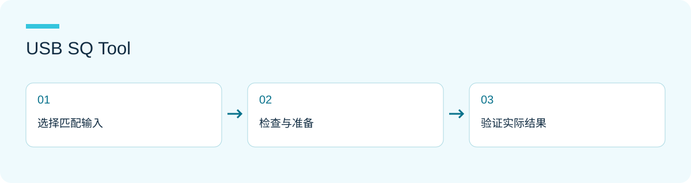
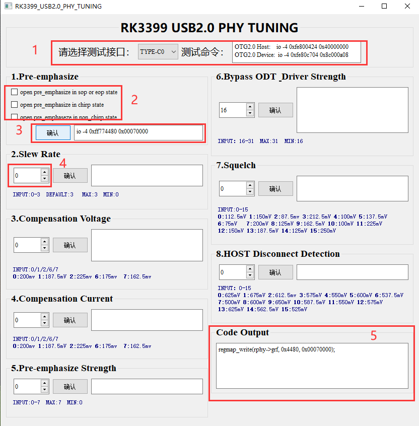



**工具包暂不提供下载。** Windows Defender 将源 USB SQ 1.5 程序报为 `Trojan:Win32/Pomal!rfn` 并隔离，记录显示未执行，仍待原厂核验。不要关闭防护或从旧 Git 提交恢复程序运行。[核验状态](https://github.com/ArmSoM/rockchip-tools/blob/main/SECURITY-REVIEW.md)。文章与 PDF 保留作资料参考，下方哈希仅用于追溯暂停的包，不代表可以下载使用。



USB SQ Tool 生成对应平台的测试命令、寄存器配置和 PHY 驱动参考代码，帮助分析与信号相关的枚举失败、异常断开。它不能把差线材或不合理布线直接变成经过验证的设计。

## 测量优先于调参

先检查线缆、走线阻抗、连接器、供电及端口，再使用适当设备获得眼图报告。记录失败条件和原始 PHY 值，保证每次改动都有可比较基线。

## 按平台页面顺序操作

1. 选择准确且受支持的 SoC 和 USB 端口，USB2.0、USB3.1 支持列表并不相同。
2. 按页面顺序调整，一次修改一个相关参数，不同时改所有值。
3. 页面要求初始寄存器值时，必须读取当前板卡后填写。RK3568 示例没有高 16 位 write-enable，尤其需要保留未调整位。
4. 确认后生成 I/O 命令和 Code Output，执行前对照匹配 BSP 审查。
5. 再次测量，只保留解决目标问题且没有引入退化的修改。

## 参数分别影响什么

预加重、眼高、转换速率、ODT 影响发送端；Squelch 关系到接收阈值，Host Disconnect、B-session-valid 针对不同检测链路。数值越大不代表效果越好，也不能复制另一 SoC 的地址或假设默认电压相同。

## 合入驱动并复测

生成的代码是对应 PHY 驱动的参考，不是自动适用的补丁。修改匹配内核后，验证启动、热插拔、所需速率和实际外设，并保存眼图证据。

本下载包工具为 1.5，内附手册为 V1.4.0；博客已有完整参考使用 V1.8.0，平台覆盖更多，两者必须区分。下载工具或阅读本文不等于通过合规认证。

## 适用范围与验证状态

本文依据本次工具包及原始资料整理。使用前核对具体板卡、SoC、载板、SDK/BSP 与主机架构。本次未执行烧录、生产配置、寄存器写入或硬件测试；提供下载不代表所有 ArmSoM 产品均支持。

## 工具下载、版本与 SHA-256

下载对应压缩包，校验哈希后完整解压。Linux PinDebug 分卷请先按链接中的说明还原；下方该项哈希对应合并后的完整文件。

| 主机 / 版本 | 下载包 |
|---|---|
| Windows / 1.5 | [暂停下载：查看核验状态](https://github.com/ArmSoM/rockchip-tools/blob/main/SECURITY-REVIEW.md) |

**Rockchip_USB_SQ_Tool_V1.5.7z — SHA-256**

```text
9b2ca5e6773bcb88e2bd73c57044ca16c1f2e16d81b1f010569724cb66550b37
```

[GitHub · catalog.json](https://github.com/ArmSoM/rockchip-tools/blob/main/catalog.json) · [SHA256SUMS](https://github.com/ArmSoM/rockchip-tools/blob/main/SHA256SUMS)

## 资料依据与原图

- Rockchip_Introduction_USB_SQ_Tool_CN_V1.4.0.pdf, bundled in tool 1.5; existing article based on V1.8.0 is separate
- [原始 PDF: Rockchip_Introduction_USB_SQ_Tool_CN_V1.4.0.pdf](https://raw.githubusercontent.com/ArmSoM/rockchip-tools/main/manuals/0ec9ef065fdc.pdf)

插图直接提取自标明的原始 PDF。只有中文原图时保留原界面文字，图注按语言整理；这些是历史示例，不是本次 ArmSoM 测试截图。



Rockchip_Introduction_USB_SQ_Tool_CN_V1.4.0.pdf · p. 5

## 继续阅读相关流程

- [Rockchip USB SQ Tool：USB2.0/USB3.1 PHY 信号调优与代码接入](/zh/articles/165-rockchip-usb-sq-tool/)
- [PinDebug：排查 Rockchip IOMUX、GPIO 与电压域配置](/zh/articles/rockchip-tool-pin-debug/)
- [Rockchip 工具下载与使用指南索引](/zh/articles/rockchip-tools-download-guide/)

## 查找准确的 ArmSoM 板卡资料

板卡、载板与接口要求先以产品手册为准。以下链接是平台参考，不表示该归档工具已在这些产品上验证。

[ArmSoM Docs](https://docs.armsom.org/) · [Sige7](https://www.armsom.org/sige7) / [Docs](https://docs.armsom.org/armsom-sige7) · [CM5](https://www.armsom.org/cm5) / [Docs](https://docs.armsom.org/armsom-cm5)


