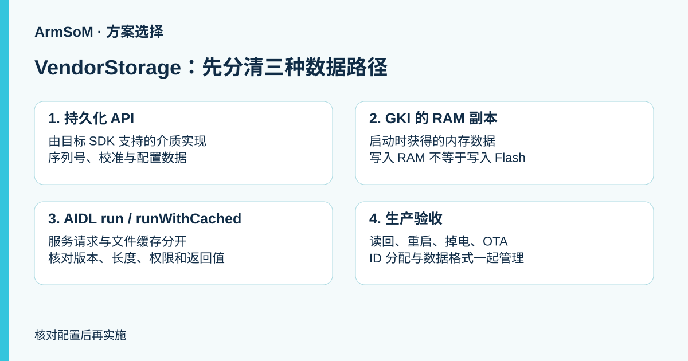

**VendorStorage 适合保存少量设备身份、校准和制造配置，但“调用返回成功”不一定证明数据已经持久化。** 在 Rockchip SDK 中，要先分清真实介质访问、GKI 下的 RAM 副本，以及 Android 服务的文件缓存。

这篇 ArmSoM 工程指南围绕用户提供的 Android 16 AIDL V2 示例整理。最新服务接口尚未在本次工作中取得匹配 SDK 源码编译验证，因此文中相应名称是待对照分支的集成线索；旧 SDK 接口可参考站内 [Vendor Storage V1.3 文档](/zh/articles/100-rockchip-vendor-storage-v13/)。



## 1. 先选择正确的数据路径

| 环境 | 常见路径 | 需要确认 |
| --- | --- | --- |
| U-Boot | `vendor_storage_read()` / `vendor_storage_write()` | 初始化、启动介质与该分支布局 |
| 非 GKI 内核 | `rk_vendor_read()` / `rk_vendor_write()` | 实际注册的存储实现与错误返回 |
| GKI 的 RAM 模块 | `ram_vendor_storage` | 是否只是启动副本，写入是否能落盘 |
| Linux 用户空间 | `/dev/vendor_storage` 与 ioctl | 内核 ABI、长度上限和设备权限 |
| Android AIDL 服务 | `IVendorStorage`、`libvendor_storage` | 服务版本、VINTF、介质支持与 SELinux |
| AIDL 文件缓存 | `runWithCached()` | 文件路径与生命周期，不等同于 VendorStorage NVM |

旧内核的实现可在 [Rockchip develop-6.1 源码](https://github.com/rockchip-linux/kernel/blob/develop-6.1/drivers/soc/rockchip/sdmmc_vendor_storage.c)核对。它不能证明某个 Android 16 AIDL 服务已经存在或支持相同介质。

## 2. 数据结构与 ID：别把它当文件系统

VendorStorage 通常包含头部、条目索引和数据区；版本、完整性信息与冗余副本用于选择有效内容。总区域大小、槽数、偏移和容量会随介质与 SDK 改变，不能把 eMMC 布局直接复制到 UFS、SPI NOR 或 NAND。也不要绕过接口直接覆写“看起来像空闲”的扇区。

原资料将 **156–256** 列为其 SDK 的客户 ID 范围；此前分支文档的定义并不完全相同。量产前必须确认目标头文件和厂商约定，再建立项目自己的分配表。

| 数据 | 设计建议 |
| --- | --- |
| SN、MAC、校准值 | 使用厂商定义及项目登记的 ID，不覆盖出厂数据 |
| 自定义配置 | 定义格式版本、长度、字节序和校验规则 |
| 字符串 | 明确是否包含终止符，按返回长度处理 |
| 二进制数据 | 不用 `strlen()` 推断长度，不作为字符串直接打印 |
| 密钥或 DRM 数据 | 走对应安全方案；普通 VendorStorage 不自动提供保密与访问隔离 |

为新版本预留迁移规则。字段增加时，老固件应能拒绝或安全读取，而不是把新结构按旧大小解释。

## 3. Android 服务集成先检查四件事

先确认源码确实存在、接口版本正确、服务打包完整、设备可访问：

```bash
export SDK_ROOT=/path/to/android-sdk
rg -n 'BOARD_VENDOR_STORAGE_SERVICE|IVendorStorage|runWithCached' \
  "$SDK_ROOT/vendor/rockchip" "$SDK_ROOT/device/rockchip"
rg -n 'vendorstorage-V2-ndk|libvendor_storage|AidlVendorStorageClient' \
  "$SDK_ROOT/vendor/rockchip"
adb shell ls -l /vendor/bin/hw/rockchip.aidl.vendorstorage-service
adb shell service check rockchip.aidl.vendorstorage.IVendorStorage/default
adb shell ls -l /dev/vendor_storage
```

这是搜索与只读查询。未找到服务并不一定是存储损坏：也可能没有打包、没有声明 VINTF、实例名不同，或当前镜像根本不走这条路径。原资料中的常见组件如下。

| 组件 | 原示例名称 | 用途 |
| --- | --- | --- |
| 服务 | `rockchip.aidl.vendorstorage-service` | 承接 Binder 调用 |
| 实例 | `rockchip.aidl.vendorstorage.IVendorStorage/default` | 查找与 VINTF 声明 |
| 底层库 | `libvendor_storage` | 介质访问 |
| NDK 接口 | `rockchip.aidl.vendorstorage-V2-ndk` | 与冻结 AIDL 版本配套 |
| 示例客户端 | `AidlVendorStorageClient` | 开发阶段接口检查 |

原 SDK 示例通过下面的开关集成服务；只有源码中的规则实际消费该变量时才有效：

```makefile
BOARD_VENDOR_STORAGE_SERVICE := true
```

还要核对 init、兼容性矩阵、SEPolicy 与所需库。Lazy HAL 的 `disabled`、`oneshot` 可能是正常按需启动设计，不要为“服务没常驻”直接改成永久运行。不要同时重复打包不同实现的同名实例。

## 4. AIDL 返回值不只有 Binder 状态

原资料给出的两个调用入口：

```aidl
VendorStorageResponse run(in VendorStorageRequest request);
VendorStorageResponse runWithCached(in VendorStorageRequest request, String cachePath);
```

请求包含 `id`、`cmd`、`buf`、`buf_size`。其示例需要先 `CMD_INIT`，再读写；响应也有业务状态语义。应逐层检查：

1. 服务是否已声明并能取得；设置合理等待与故障处理。
2. Binder transaction 是否成功，而不是只判断指针非空。
3. `buf_size` 是否非负且不超过实际 `buf` 长度及调用方容量。
4. `CMD_READ` 是否返回完整预期数据；短读应作为业务情况处理。
5. `CMD_WRITE`、`CMD_INIT` 的成功格式是否与目标版本一致。原示例是一个字节的零值，不应推广到未核对的版本。

不要把 `registerCallback()` 当成同步调用结果的替代渠道。跨版本集成要使用匹配的生成接口、服务和测试客户端，而不是仅复制一个 `.so`。

## 5. 客户 ID 的读写验证流程

以下仅是原示例 CLI 的只读用法：先查看用法输出，**只有确认 156 是已分配的非敏感测试 ID 时**再读该项。若你的客户端语法不同，以本分支帮助为准。

```bash
adb shell AidlVendorStorageClient
adb shell AidlVendorStorageClient r156
```

写入测试请使用隔离测试设备与已登记 ID，并调用该分支正式 API。建议流程是：保存原值 → 写入包含格式版本的短测试数据 → 读回并按字节比较 → 重启读回 → 断电重启读回 → 恢复原值。每步都记录返回码和实际长度；MAC、SN、校准和安全数据不作为试写对象。

| 现象 | 优先排查 |
| --- | --- |
| 当前进程读得到，重启丢失 | 是否访问 RAM 副本或临时缓存 |
| 热重启保留，断电丢失 | 实际持久化路径、写入完成与介质行为 |
| 部分内容被截断 | 客户端缓冲、条目容量、长度解释 |
| shell 可用，业务进程不可用 | 域权限、服务发现和 SELinux 拒绝日志 |
| OTA 后内容变化 | 分区/介质布局、格式迁移、更新是否覆盖制造区 |

## 6. 缓存、权限与 U-Boot 交接

`runWithCached()` 的文件可能用于缓存型配置，不能仅因位于 `/data` 就认定与制造数据有相同生命周期。恢复出厂、用户数据擦除、应用重装和 OTA 必须分别定义。服务应限制可访问的缓存路径，应用也不能任意读写系统文件。

SELinux 应只授予业务域必要的服务与数据权限；不要让所有 shell 或应用获得整个存储区的写权限。U-Boot 与 Android 共享字段时，先核对两边的布局、ID 和初始化逻辑：

```bash
rg -n 'vendor_storage_init|vendor_storage_read|vendor_storage_write' u-boot
rg -n 'rk_vendor_read|rk_vendor_write|ram_vendor_storage' kernel*
```

集成完成后的交付物应包含 ID 分配表、结构版本、支持介质、服务接口版本、权限策略和掉电/OTA 测试记录。截图里未加载的结构图已用本文流程图重绘；缺失的源码或参数不补造。[原资料](https://mp.weixin.qq.com/s/hv_oSAa7SZSpjwOI16nBQw)

## 适用产品与继续阅读

ArmSoM 项目可从 [Sige7](https://www.armsom.org/sige7)、[AIM7](https://www.armsom.org/aim7)、[LM7](https://www.armsom.org/lm7) 的 RK3588 平台，或 [CM5](https://www.armsom.org/cm5)、[Sige5](https://www.armsom.org/sige5) 的 RK3576 平台开始评估。接口与系统支持请分别查阅 [Sige7 文档](https://docs.armsom.org/armsom-sige7)、[CM5 文档](https://docs.armsom.org/armsom-cm5)、[Sige5 文档](https://docs.armsom.org/armsom-sige5)。产品链接用于选型，不代表这些板卡已验证本文全部 SDK 组合。
