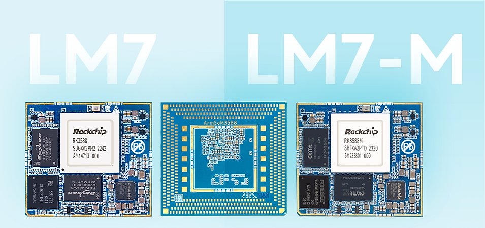

Sige7 和 LM7 都基于 RK3588，但面向不同的产品开发方式。Sige7 是带现成接口的单板计算机，适合先跑通应用；LM7 是 LGA 核心板，适合围绕整机定制底板。两者不是简单的性能高低排序。

## 先选形态，再选配置

| 需求 | 建议起点 | 重点工作 |
|---|---|---|
| 快速连接网络、屏幕与 SSD | Sige7 | 镜像、外设和应用验证 |
| 定制结构与连接器 | LM7 + 匹配开发套件 | 底板、焊接工艺和整机设计 |
| 可插拔模块方案 | AIM7 + 匹配载板 | 连接器、引脚和载板适配 |

Sige7 官方资料列有双 2.5GbE 和 PCIe 3.0 x4 M.2，适合评估网络与存储密集型任务。LM7 文档列有 506-pin LGA、45×50mm 模块形态，强调自定义底板开发。上述接口不能直接当成端到端吞吐保证。

## 1. 本地存储与设备数据中心

Sige7 可连接 SSD 和网络设备，运行文件服务、数据归档或边缘缓存。测试实际文件协议、文件大小、并发客户端和持续写入；网口标称速率不等于文件拷贝速度。需要多硬盘时还要确认控制器、供电与散热，不能把一个 M.2 插槽当作完整 NAS 方案。

## 2. 多摄像头事件分析

采集或接收视频后，按业务频率抽帧，进行预处理和模型推理，只保留需要复核的事件。可用路数由相机、解码器、内存、NPU 和存储共同决定。应先验证单路，再逐步加并发并记录丢帧和温升，不承诺未经测试的固定路数。

## 3. 展厅终端与数字标牌

把视频、网页界面和本地内容管理组合为信息终端。先验证目标屏幕、触控、视频格式和自启动，再增加内容更新和断电恢复。芯片支持 HDMI 输入不代表所选板卡一定提供采集端口；输出和输入要分别核对。

## 4. 工业视觉辅助

在固定光照和相机位置下完成分类、计数或外观辅助检查。模型输出可以显示给操作者，或经协议上传到业务系统。验收包含误报、漏报、全链路延迟和恶劣样本；这是可验证的开发方向，不代表已取得安全或工业检测认证。

## 5. 机器人上层计算

RK3588 可承担视觉、地图显示和任务调度，并与专用运动控制器通信。将电机闭环和安全保护交给适合的控制系统，避免把普通 Linux 调度当成硬实时保证。检查电池供电、通信抖动、热设计与摄像头同步。

## 6. 定制商用终端

当原型已证明应用可行，LM7 可用于围绕外壳、专用接口和生产测试点设计底板。应规划电源时序、PCB 布线、可制造性、焊接返修与量产烧录。官方 LM7 标注模块供电 4V±5%，不能把 Sige7 的板级供电方式直接用于 LM7。

## 从原型进入量产

冻结硬件修订、系统镜像、内核、模型和 runtime；制定恢复入口、序列号、日志和升级策略。在最终机壳、目标环境及真实负载下验收。文章不提供未经测量的成本、功耗或寿命承诺，产品温度范围也应分别查阅相应硬件资料。

## 系列文章与产品入口

- [RK3588 芯片详解：八核 CPU、6 TOPS NPU 与高速扩展如何落地](/zh/articles/rk3588-chip-guide/)
- [AIM7 替代 Jetson Nano/Orin：从硬件评估到 RKNN 模型迁移](/zh/articles/aim7-jetson-nano-orin-alternative/)
- [RK3588 Datasheet V1.4 下载与解读：框图、封装与电气设计](/zh/articles/rk3588-datasheet-v14/)
- [ArmSoM AIM7](https://docs.armsom.org/armsom-aim7) · [Sige7](https://docs.armsom.org/armsom-sige7) · [LM7](https://docs.armsom.org/armsom-lm7)

## 参考资料

- [Rockchip RK3588](https://www.rock-chips.com/a/en/products/RK35_Series/2022/0926/1660.html)
- [ArmSoM AIM7](https://docs.armsom.org/armsom-aim7)
- [ArmSoM Sige7](https://docs.armsom.org/armsom-sige7)
- [ArmSoM LM7](https://docs.armsom.org/armsom-lm7)
- [NVIDIA Jetson modules](https://developer.nvidia.com/embedded/jetson-modules)
- [RKNN-Toolkit2](https://github.com/airockchip/rknn-toolkit2)
