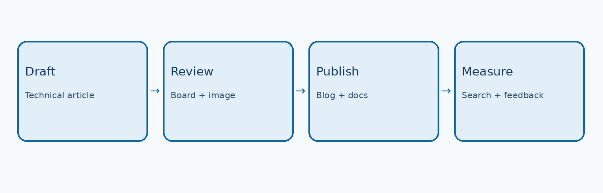

# 发布交接说明 / Publishing notes

本文件供编辑和发布同事使用。正文分别见 [English](README.md) 和 [简体中文](README.zh-CN.md)。中英文共用英文图片，不需要重复复制或翻译图片。

This file is for editors and publishers. The English and Chinese articles share the original English diagrams.

## 标题和路径 / Titles and paths

- 中文标题：RK3576 Linux 设备树开发实战：从 DTS 基础到 GPIO、I2C 配置与 Rockchip i2c-rk3x 驱动调试
- English title: RK3576 Linux Device Tree in Practice: DTS Fundamentals, GPIO and I2C Configuration, and Rockchip i2c-rk3x Driver Debugging
- Repository directory: `docs/rk3576-linux-device-tree-gpio-i2c-rk3x/`
- Suggested blog slug: `/blog/rk3576-linux-device-tree-gpio-i2c-rk3x`
- Target hardware: ArmSoM-CM5 / CM5-IO
- Keywords: RK3576 device tree; Rockchip Linux; RK3576 I2C; DTS; DTBO; ArmSoM CM5

标题已合并原先的 title 与 description，GitHub 正文不再使用重复的副标题或 YAML 元数据。目录使用“小写英文主题 + 芯片 + 关键接口/驱动”，后续文章沿用这个命名方式，不使用易重复的“开发实战”作为唯一目录名。

## 网站摘要 / Website descriptions

中文：以 ArmSoM-CM5/CM5-IO 为例，介绍设备树和 Overlay 的关系、I2C3 M0 引脚复用、I2C 时序与外部传感器配置，并说明 Rockchip i2c-rk3x 故障排查方法。

English: Use ArmSoM-CM5 and CM5-IO to understand Device Tree and overlays, configure I2C3 M0 pinmux, bus timing and an external sensor, and troubleshoot the Rockchip i2c-rk3x driver.

## 原稿发布前核对项 / Source draft review checklist

这些核对项沿用原稿；翻译与格式转换不代表已完成硬件实测。

These checks are retained from the source draft. Translation and formatting do not imply hardware validation.

- [ ] 核对 CM5-IO 引脚与板卡版本。 / Verify CM5-IO pins and board revision.
- [ ] 确认 I2C6 Pin 89/88 的连接器归属。 / Identify the connector associated with I2C6 pins 89/88.
- [ ] 确认 `uEnv.txt` 的真实路径。 / Confirm the active `uEnv.txt` path.
- [ ] 确认 Overlay 是否随目标镜像提供。 / Confirm the overlay is available in the target image.
- [ ] 验证 I2C3 与 `/dev/i2c-3` 的实际映射。 / Verify the mapping between I2C3 and the Linux bus.
- [ ] 对 400kHz 时序示例进行实测。 / Measure and validate the 400 kHz timing example.
- [ ] 不要照抄 GPIO 模拟 I2C 中的占位符。 / Replace the software I2C placeholders.
- [ ] 不要将文中示例标注为实测。 / Do not label examples as measured test results.

## 发布流程 / Publishing workflow

原稿第 4 张图用于发布协作，因此保留在交接说明中；技术正文保留图 1–3。

The fourth source diagram describes editorial work, so it is retained here. The technical articles include figures 1–3.

