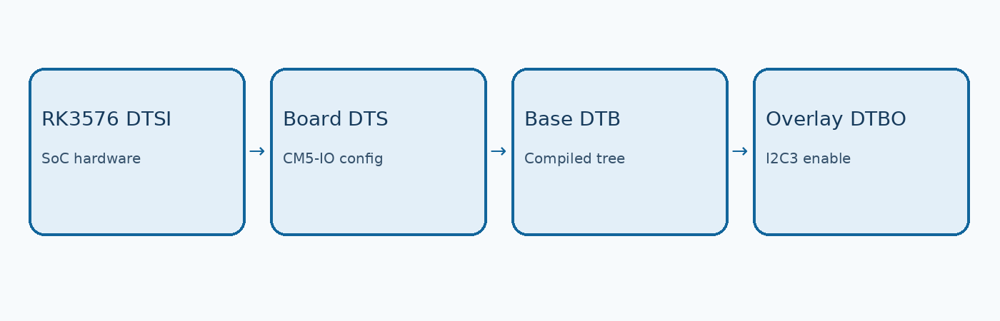
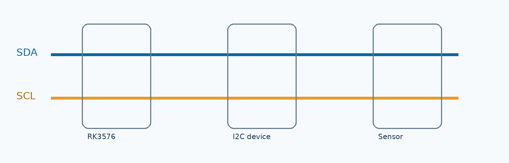
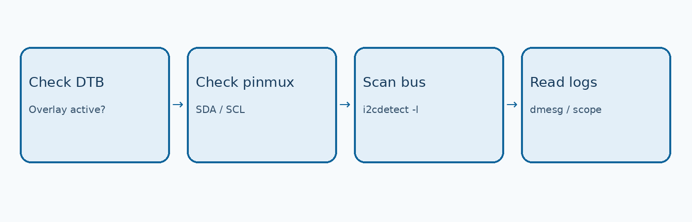

# RK3576 Linux 设备树开发实战：从 DTS 基础到 GPIO、I2C 配置与 Rockchip i2c-rk3x 驱动调试

[English](README.md) | 简体中文

适用平台：ArmSoM-CM5 / CM5-IO（RK3576）

以 ArmSoM-CM5/CM5-IO 为例，讲解 Linux Device Tree、I2C3 M0 Overlay、Pinmux、I2C 时序和 Rockchip `i2c-rk3x` 故障排查。本文区分官方文档示例与未实测步骤。

## 1. RK3576 为什么需要 Device Tree

设备树将硬件描述与 Linux 驱动代码解耦，描述 I2C、SPI、UART、GPIO 等控制器，以及引脚复用、时钟、中断和设备连接。ArmSoM-CM5 基于 RK3576，提供面向嵌入式开发的扩展接口。即使引脚物理存在，仍需确认对应控制器和 Pinmux 已启用。

## 2. DTS、DTSI、DTB 与 DTBO



*图 1：设备树与 Overlay 关系示意（ArmSoM 原创示意图；非启动时序图）*

`DTSI` 定义 SoC 或共用平台硬件；板级 DTS 引用它并覆盖配置；DTC 将源文件编译成 DTB；DTBO 可在支持的启动流程中叠加到基础设备树。不同固件加载方式不同。

```bash
cat /proc/device-tree/model
tr "\0" "\n" < /proc/device-tree/compatible
sudo apt install device-tree-compiler
sudo dtc -I fs -O dts -o rk3576-running.dts /proc/device-tree
```

## 3. CM5-IO I2C3 接口与 GPIO Pinmux

根据 [ArmSoM I2C 官方文档](https://docs.armsom.org/interface-usage/i2c)，CM5-IO 40-pin 连接器的 I2C3_SDA_M0 位于物理 Pin 3，I2C3_SCL_M0 位于物理 Pin 5。I2C7 M1 使用 Pin 19/23，I2C4 M3 使用 Pin 27/29。文档另有 I2C6 Pin 89/88，不能视作 40-pin 排针编号，发布前须核对连接器定义。上述 CM5-IO 定义不可直接套用于 Sige5。



*图 2：I2C SDA/SCL 多设备连接概念图（原创示意，非 CM5-IO 原理图；实际需上拉）*

I2C3_M0 中 M0 是引脚复用选择，并非 Linux 总线编号。使用前检查 SDA/SCL 的复用状态、上拉电阻、I/O 电压及总线占用。

```bash
sudo apt install gpiod i2c-tools
gpiodetect
gpioinfo
i2cdetect -l
ls /sys/kernel/debug/pinctrl/
```

## 4. 使用官方 Overlay 启用 I2C3 M0

ArmSoM 官方 I2C 文档列出 `rk3576-armsom-i2c3-m0-overlay.dtbo`。先确认镜像中存在该文件，并确定 Bootloader 实际读取哪个启动配置。官方文档对 `uEnv.txt` 路径的表述存在差异，不能盲目新建配置文件。

```bash
ls /boot/dtb/overlay/ | grep rk3576
ls -l /boot/uEnv.txt /boot/uEnv/uEnv.txt /boot/extlinux/extlinux.conf 2>/dev/null
```

对于确实使用官方 `dtoverlay` 语法的固件，在生效的配置文件中设置以下示例行（路径需核对）：

```ini
dtoverlay=/dtb/overlay/rk3576-armsom-i2c3-m0-overlay.dtbo
```

保存并 `sync`、重启。随后使用 `i2cdetect -l` 识别实际 Linux 总线，再按需扫描。

```bash
sync
sudo reboot
i2cdetect -l
ls /dev/i2c-*
sudo i2cdetect -y 3
```

> **注意：** `-y 3` 扫描 `/dev/i2c-3`，不是“第一条 I2C 总线”。扫描可能干扰正在使用的设备；地址 `0x68` 仅是官方示例输出，不是通用测试结果。

## 5. I2C 时序：100kHz 与 400kHz

Rockchip `i2c-rk3x` 驱动的设备树可使用 `clock-frequency`、`i2c-scl-rising-time-ns`、`i2c-scl-falling-time-ns` 等属性。下列数值来自官方文档示例，并非 CM5-IO 实测。

```dts
&i2c3 {
    status = "okay";
    clock-frequency = <400000>;
    i2c-scl-rising-time-ns = <265>;
    i2c-scl-falling-time-ns = <11>;
};
```

400kHz 通信需要确认器件支持 Fast-mode，且使用示波器测量 SCL 上升/下降时间。总线电容、上拉电阻和电压不匹配都可能导致通信不稳定。

## 6. 为 I2C3 添加外部传感器

以下是连接 TMP102 兼容温度传感器的教学示例；不代表 ArmSoM 板载该器件。

```dts
&i2c3 {
    status = "okay";
    #address-cells = <1>;
    #size-cells = <0>;

    temperature-sensor@48 {
        compatible = "ti,tmp102";
        reg = <0x48>;
    };
};
```

完成编译与部署后，可使用 `ls /sys/bus/i2c/devices/` 与 `dmesg` 检查驱动绑定。若地址显示 `UU`，通常意味着已被内核驱动占用。

## 7. GPIO 模拟 I2C

当硬件控制器不可用时，可以考虑 `i2c-gpio`。应使用当前内核支持的 binding、真实 GPIO 控制器和引脚编号。软件 I2C 受调度与时序影响，常规设计优先选择硬件 I2C。

```dts
i2c-gpio-example {
    compatible = "i2c-gpio";
    sda-gpios = <&gpioX SDA_PIN 0>; /* placeholder */
    scl-gpios = <&gpioX SCL_PIN 0>; /* placeholder */
    i2c-gpio,delay-us = <5>;
    #address-cells = <1>;
    #size-cells = <0>;
};
```

## 8. i2c-rk3x 故障排查



*图 3：从设备树到波形的调试路径（原创流程示意）*

| 现象 | 排查方向 |
| --- | --- |
| `ENXIO (-6)` | 常见于 NACK：核对地址、供电、复位时序及 ACK 波形。 |
| `timeout, ipd: 0x00, state: 1` | 检查 Pinmux、上拉电压、SDA/SCL 是否被拉低及控制器时钟。 |
| `timeout, ipd: 0x10, state: 1` | 结合内核版本检查中断状态和 `/proc/interrupts`，不能仅凭日志定位 CPU 问题。 |
| `timeout, ipd: 0x80, state: 1` | 检查 SCL 被拉低、外设卡死及总线波形，必要时隔离外设。 |

```bash
dmesg | grep -Ei "i2c|rk3x"
cat /proc/interrupts
sudo cat /sys/kernel/debug/pinctrl/*/pinmux-pins
```

## 9. 设备树编译、部署与恢复

```bash
make ARCH=arm64 CROSS_COMPILE=aarch64-linux-gnu- dtbs -j$(nproc)
```

须使用与运行镜像兼容的内核源码和配置；确认 Bootloader 加载的 DTB/DTBO 路径。修改前备份原文件，保留串口恢复方式，避免一次性修改多个外设。

## 10. 结论

RK3576 设备树开发应遵循“核对原理图 → 检查 DTS/Overlay → 验证 Pinmux → 检查 Linux 总线 → 检测波形与日志”的路径。ArmSoM 官方 Overlay 是合适的起点；深入定制时再修改板级 DTS。

## 参考链接

- [ArmSoM I2C Usage](https://docs.armsom.org/interface-usage/i2c)
- [ArmSoM-CM5](https://docs.armsom.org/armsom-cm5)
- [Linux Device Tree usage model](https://docs.kernel.org/devicetree/usage-model.html)


## 图片说明

本页配图沿用原稿英文示意图，由中英文文档共用。原稿注明这些示意图为原创绘制，可供 ArmSoM 发布；新增实物照片需另行确认授权。

