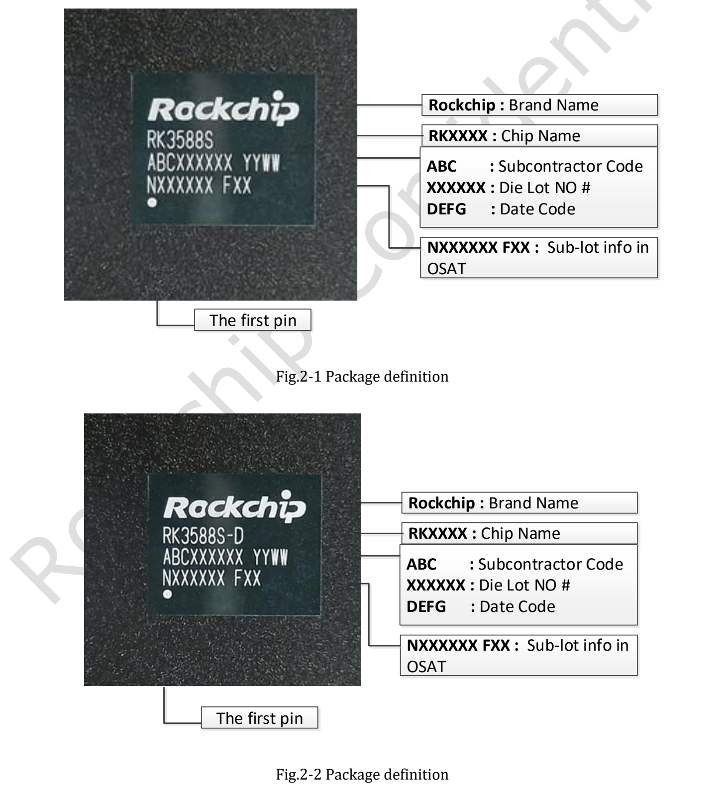
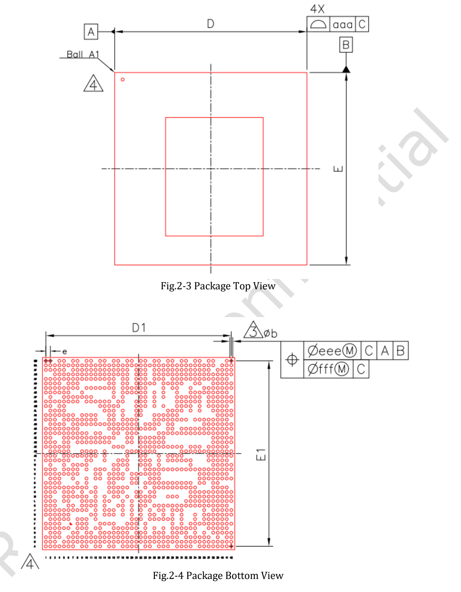
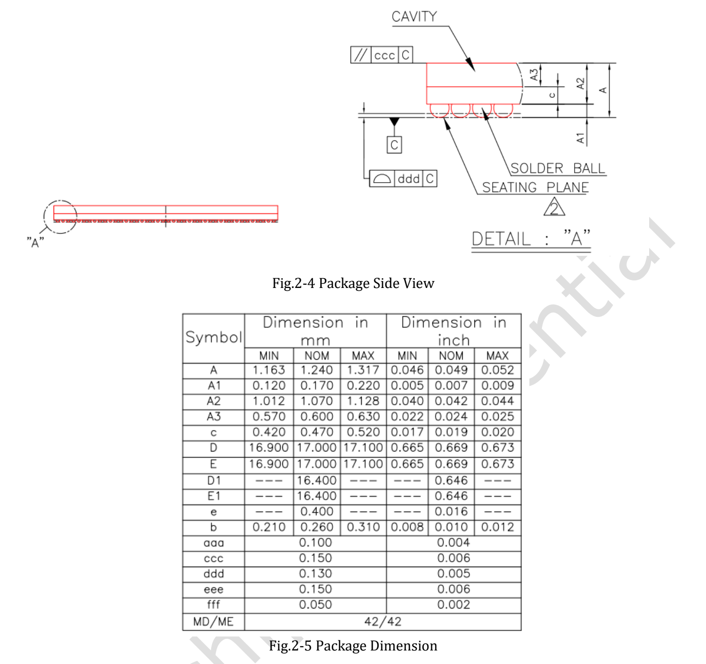

# RK3588S V1.3 — English technical reference

Source: supplied Rockchip RK3588S Datasheet V1.3-20220310.pdf. Technical pages 6–35. This is an English extraction, not a translation. Consult the PDF for merged-cell scope and drawing dimensions. Original ambiguities are retained.

## PDF page 6

### Chapter 1 Introduction
#### 1.1 Overview
RK3588S is a low power, high performance processor for ARM-based PC and Edge
Computing device, personal mobile internet device and other digital multimedia
applications, and integrates quad-core Cortex-A76 and quad-core Cortex-A55 with
separately NEON coprocessor.
Many embedded powerful hardware engines provide optimized performance for high-end
application. RK3588S supports H.265 and VP9 decoder by 8K@60fps, H.264 decoder by
8K@30fps, and AV1 decoder by 4K@60fps, also support H.264 and H.265 encoder by
8K@30fps, high-quality JPEG encoder/decoder, specialized image preprocessor and
postprocessor.
Embedded 3D GPU makes RK3588S completely compatible with OpenGLES 1.1, 2.0, and
3.2, OpenCL up to 2.2 and Vulkan1.2. Special 2D hardware engine with MMU will maximize
display performance and provide very smoothly operation.
RK3588S introduces a new generation totally hardware-based maximum 48-Megapixel ISP
(image signal processor). It implements a lot of algorithm accelerators, such as HDR, 3A,
LSC, 3DNR, 2DNR, sharpening, dehaze, fisheye correction, gamma correction and so on.
The build-in NPU supports INT4/INT8/INT16/FP16 hybrid operation and computing power is
up to 6TOPs. In addition, with its strong compatibility, network models based on a series of
frameworks such as TensorFlow/MXNet/PyTorch/Caffe can be easily converted.
RK3588S has high-performance quad channel external memory interface
(LPDDR4/LPDDR4X/LPDDR5) capable of sustaining demanding memory bandwidths, also
provides a complete set of peripheral interface to support very flexible applications.
#### 1.2 Features
The features listed below which may or may not be present in actual product, may be
subject to the third party licensing requirements. Please contact Rockchip for actual product
feature configurations and licensing requirements.
#### 1.2.1 Microprocessor
- Quad-core ARM Cortex-A76 MPCore processor and quad-core ARM Cortex-A55 MPCore
processor, both are high-performance, low-power and cached application processor
- DSU (DynamIQ Shared Unit) comprises the L3 memory system, control logic, and
external interfaces to support a DynamIQ cluster
- Full implementation of the ARM architecture v8-A instruction set, ARM Neon Advanced
SIMD (single instruction, multiple data) support for accelerating media and signal
processing
- ARMv8 Cryptography Extensions
- Trustzone technology support
- Integrated 64KB L1 instruction cache, 64KB L1 data cache and 512KB L2 cache for
each Cortex-A76
- Integrated 32KB L1 instruction cache, 32KB L1 data cache and 128KB L2 cache for
each Cortex-A55
- Quad-core Cortex-A76 and Quad-core Cortex-A55 share 3MB L3 cache
- Eight separate power domains for CPU core system to support internal power switch
and externally turn on/off based on different application scenario
- PD_CPU_0: 1st Cortex-A55 + Neon + FPU + L1/L2 I/D Cache
- PD_CPU_1: 2nd Cortex-A55 + Neon + FPU + L1/L2 I/D Cache
- PD_CPU_2: 3rd Cortex-A55 + Neon + FPU + L1/L2 I/D Cache
- PD_CPU_3: 4th Cortex-A55 + Neon + FPU + L1/L2 I/D Cache

## PDF page 7

- PD_CPU_4: 1st Cortex-A76 + Neon + FPU + L1/L2 I/D Cache
- PD_CPU_5: 2nd Cortex-A76 + Neon + FPU + L1/L2 I/D Cache
- PD_CPU_6: 3rd Cortex-A76 + Neon + FPU + L1/L2 I/D Cache
- PD_CPU_7: 4th Cortex-A76 + Neon + FPU + L1/L2 I/D Cache
- Three isolated voltage domains to support DVFS, one for A76_0 and A76_1, one for
A76_2 and A76_3, the other for DSU and Cortex-A55.
#### 1.2.2 Memory Organization
- Internal on-chip memory
- BootRom
- Support system boot from the following device:
- SPI interface
- eMMC interface
- SD/MMC interface
- Support system code download by the following interface:
- USB OTG interface
- Share Memory in the voltage domain of VD_LOGIC
- PMU SRAM in VD_PMU for low power application
- External off-chip memory
- Dynamic Memory Interface
- Compatible with JEDEC standards LPDDR4/LPDDR4X/LPDDR5
- Support four channels, each channel 16bits data widths
- Support up to 2 ranks (chip selects) for each channel
- Totally up to 32GB address space
- Low power modes, such as power-down and self-refresh for SDRAM
- eMMC Interface
- Fully compliant with JEDEC eMMC 5.1 and eMMC 5.0 specification
- Backward compliant with eMMC 4.51 and earlier versions specification.
- Support HS400, HS200, DDR50 and legacy operating modes
- Support three data bus width: 1bit, 4bits or 8bits
- SD/MMC Interface
- Compatible with SD3.0, MMC ver4.51
- Data bus width is 4bits
- Flexible Serial Flash Interface(FSPI)
- Support transfer data from/to serial flash device
- Support 1bit, 2bits or 4bits data bus width
- Support 2 chips select
#### 1.2.3 System Component
- MCU
- Three Cortex-M0 MCUs inside RK3588S
- MCU in VD_PMU integrate 16KB Cache and 16KB TCM
- MCU in VD_NPU integrate 16KB Cache and 64KB TCM
- MCU in PD_CENTER integrate 32KB TCM
- Integrated Programmable Interrupt Controller, all IRQ lines connected to GIC
for CPU also connect to MCU in VD_PMU(PMU_M0) and PD_CENTER(DDR_M0)
- Integrated Debug Controller with JTAG interface
- CRU (clock & reset unit)
- Support total 18 PLLs to generate all clocks
- One oscillator with 24MHz clock input
- Support clock gating control for individual components
- Support global soft-reset control for whole chip, also individual soft-reset for each
component
- PMU(power management unit)
- Multiple configurable work modes to save power by different frequency or
automatic clock gating control or power domain on/off control
- Lots of wakeup sources in different mode
- Support 10 separate voltage domains
- Support 45 separate power domains, which can be power up/down by software

## PDF page 8

based on different application scenes
- Timer
- Support 12 secure timers with 64bits counter and interrupt-based operation
- Support 18 non-secure timers with 64bits counter and interrupt-based operation
- Support two operation modes: free-running and user-defined count for each timer
- Support timer work state checkable
- PWM
- Support 16 on-chip PWMs(PWM0~PWM15) with interrupt-based operation
- Programmable pre-scaled operation to bus clock and then further scaled
- Embedded 32-bit timer/counter facility
- Support capture mode
- Support continuous mode or one-shot mode
- Provides reference mode and output various duty-cycle waveform
- Optimized for IR application for PWM3, PWM7, PWM11, PWM15
- Watchdog
- 32-bit watchdog counter
- Counter counts down from a preset value to 0 to indicate the occurrence of a
timeout
- WDT can perform two types of operations when timeout occurs:
- Generate a system reset
- First generate an interrupt and if this is not cleared by the service routine by
the time a second timeout occurs then generate a system reset
- Totally five Watchdog for CPU and MCU
- Interrupt Controller
- Support 12 PPI interrupt source and 480 SPI interrupt sources input from different
components inside RK3588S
- Support 16 software-triggered interrupts
- Input interrupt level is fixed, high-level sensitive for SPI and low-level sensitive for
PPI
- Support different interrupt priority for each interrupt source, and they are always
software-programmable
- DMAC
- Micro-code programming based DMA
- Linked list DMA function is supported to complete scatter-gather transfer
- Support data transfer types including memory-to-memory, memory-to-peripherals,
peripherals-to-memory
- Totally three embedded DMA controllers for peripheral system
- Each DMAC features:
- Support 8 channels
- 32 hardware request from peripherals
- 2 interrupt output
- Support TrustZone technology and programmable secure state for each DMA
channel
- Secure System
- Embedded two cipher engine
- Support Link List Item (LLI) DMA transfer
- Support SHA-1, SHA-256/224, SHA-512/384, MD5, SM3 with hardware padding
- Support HMAC of SHA-1, SHA-256, SHA-512, MD5, SM3 with hardware padding
- Support AES-128, AES-192, AES-256 encrypt & decrypt cipher
- Support AES ECB/CBC/OFB/CFB/CTR/CTS/XTS/CCM/GCM/CBC-MAC/CMAC
mode
- Support SM4 ECB/CBC/OFB/CFB/CTR/CTS/XTS/CCM/GCM/CBC-MAC/CMAC
mode
- Support DES & TDES cipher, with ECB/CBC/OFB/CFB mode
- Support up to 4096 bits PKA mathematical operations for RSA/ECC/SM2
- Support generating random numbers
- Support keyladder to guarantee key secure

## PDF page 9

- Support data scrambling for all DDR types
- Support secure OTP
- Support secure debug
- Support secure DFT test
- Support secure OS
- Except CPU, the other masters in the SoC can also support security and non-
security mode by software-programmable
- Some slave components in SoC can only be addressed by security master and the
other slave components can be addressed by security master or non-security
master by software-programmable
- System SRAM(share memory), part of space is addressed only in security mode
- External DDR space can be divided into 16 parts, each part can be software-
programmable to be enabled by each master
- Mailbox
- Three Mailbox in SoC to service CPU and MCU communication
- Support four mailbox elements per mailbox, each element includes one data word,
one command word register and one flag bit that can represent one interrupt
- Provide 32 lock registers for software to use to indicate whether mailbox is
occupied
- Decompression
- Support for decompressing GZIP files
- Support for decompressing LZ4 files, including the General Structure of LZ4 Frame
format and the Legacy Frame format.
- Support for decompressing data in DEFLATE format
- Support for decompressing data in ZLIB format
- Support Hash32 check in LZ4 decompression process
- Support the limit size function of the decompressed data to prevent the memory
from being maliciously destroyed during the decompression process
#### 1.2.4 Video CODEC
- Video Decoder
- Real-time video decoder of MPEG-1, MPEG-2, MPEG-4, H.263, H.264, H.265, VC-1,
VP9, VP8, MVC, AV1
- MMU Embedded
- Multi-channel decoder in parallel for less resolution
- H.264 AVC/MVC Main10 L6.0 : 8K@30fps (7680x4320)②
- VP9 Profile0/2 L6.1 : 8K@60fps (7680x4320)
- H.265 HEVC/MVC Main10 L6.1 : 8K@60fps (7680x4320)
- AVS2 Profile0/2 L10.2.6 : 8K@60fps (7680x4320)
- AV1 Main Profile 8/10bit L5.3 : 4K@60fps (3840x2160)
- MPEG-2 up to MP : 1080p@60fps (1920x1088)
- MPEG-1 up to MP : 1080p@60fps (1920x1088)
- VC-1 up to AP level 3 : 1080p@60fps (1920x1088)
- VP8 version2 : 1080p@60fps (1920x1088)
- Video Encoder
- Real-time H.265/H.264 video encoding
- Support up to 8K@30fps
- Multi-channel encoder in parallel for less resolution
#### 1.2.5 JPEG CODEC
- JPEG Encoder
- Baseline (DCT sequential)
- Encoder size is from 96x96 to 8192x8192(67Mpixels)
- Up to 90 million pixels per second
- Embedded four encoder units
- JPEG Decoder
- Decoder size is from 48x48 to 65536x65536
- Support YUV400/YUV411/YUV420/YUV422/YUV440/YUV444
- Support up to 1080P@280fps, and 560 million pixels per second

## PDF page 10

- Support MJPEG
- Embedded four encoder units
#### 1.2.6 Neural Process Unit
- Neural network acceleration engine with processing performance up to 6 TOPS
- Include triple NPU core, and support triple core co-work, dual core co-work, and work
independently
- Support integer 4, integer 8, integer 16, float 16, Bfloat 16 and tf32 operation
- Embedded 384KBx3 internal buffer
- Multi-task, multi-scenario in parallel
- Support deep learning frameworks: TensorFlow, Caffe, Tflite, Pytorch, Onnx NN,
Android NN, etc.
- One isolated voltage domain to support DVFS
#### 1.2.7 Graphics Engine
- 3D Graphics Engine
- ARM Mali-G610 MP4
- High performance OpenGLES 1.1, 2.0 and 3.2, OpenCL 2.2, Vulkan1.2 etc.
- Embedded 4 shader cores with shared hierarchical tiler
- Provide MMU and L2 Cache with 4x 256KB size
- The latest Valhall architecture
- ARM Frame Buffer Compression(AFBC) 1.3
- Support Serial Wire debug for embedded MCU
- One isolated voltage domain to support DVFS
- 2D Graphics Engine
- Source format: ARGB/RGB888/RGB565/YUV420/YUV422/BPP
- Destination formats: ARGB/RGB888/RGB565/YUV420/YUV422
- Max resolution: 8192x8192 source, 4096x4096 destination
- Block transfer and Transparency mode
- Color fill with gradient fill, and pattern fill
- Alpha blending modes including global alpha, per pixel alpha (color/alpha channel
separately) and fading
- Arbitrary non-integer scaling ratio, from 1/8 to 8
- 0, 90, 180, 270 degree rotation, x-mirror, y-mirror & rotation operation
- ROP2, ROP3, ROP4
- Support 4k/64k page size MMU
- Image Enhancement Processor
- Image format
- Input data: YUV420/YUV422, semi-planar/planar, UV swap
- Output data: YUV420/YUV422, semi-planar, UV swap, Tile mode
- YUV down sampling conversion from 422 to 420
- Max resolution for dynamic image up to 1920x1080
- De-interlace
#### 1.2.8 Video Input Interface
- MIPI Interface
- Two MIPI DC(DPHY/CPHY) combo PHY
- Support to use DPHY or CPHY
- Each MIPI DPHY V2.0, 4lanes, 4.5Gbps per lane
- Each MIPI CPHY V1.1, 3lanes, 2.5Gsps per lane
- Two MIPI CSI DPHY
- Each MIPI DPHY V1.2, 2lanes, 2.5Gbps per lane
- Support to combine 2 DPHY together to one 4lanes
- Support camera input combination:
- 2 MIPI DCPHY + 2 MIPI CSI DPHY(2 lanes), totally support 4 cameras input
- 2 MIPI DCPHY + 1 MIPI CSI DPHY(4 lanes), totally support 3 cameras input
- DVP interface
- One 8/10/12/16-bit standard DVP interface, up to 150MHz input data
- Support BT.601/BT.656 and BT.1120 VI interface
- Support the polarity of pixel_clk, hsync, vsync configurable

## PDF page 11

#### 1.2.9 Image Signal Processor
- Video Capture(VICAP)
- Support BT601, BT656, BT1120
- Support receiving six interfaces of MIPI CSI/DSI, up to four IDs for each interface
- Support five CSI data formats: RAW8/10/12/14, YUV422
- Support three modes of HDR: virtual channel mode, identification code mode, line
counter mode
- Support RAW data through to ISP0/1
- Maximum input
- 48M：8064x6048@15 dual ISP
- 32M：6528x4898@30 dual ISP
- 16M：4672x3504@30 single ISP
- 3A: include AE/Histogram, AF, AWB statistics output
- FPN: Fixed Pattern Noise removal
- BLC: Black Level Correction
- DPCC: Static/Dynamic defect pixel cluster correction
- PDAF: Phase Detection Auto Focus
- LSC: Lens shading correction
- Bayer-2DNR: Spatial Bayer-raw De-noising
- Bayer-3DNR: Temporal Bayer-raw De-noising
- CAC: Chromatic Aberration Correction
- HDR: 3-Frame Merge into High-Dynamic Range
- DRC: HDR Dynamic Range Compression, Tone mapping
- GIC: Green Imbalance Correction
- Debayer: Advanced Adaptive Demosaic with Chromatic Aberration Correction
- CCM/CSM: Color correction matrix; RGB2YUV etc
- Gamma: Gamma out correction
- Dehaze/Enhance: Automatic Dehaze and Effect enhancement
- 3DLUT: 3D-Lut Color Palette for Customer
- LDCH: Lens-distortion only in the horizontal direction
- YUV-2DNR: Spatial YUV De-noising
- Sharp: Image Sharpening and boundary filtering
- CMSK: privacy mask
- GAIN: image local gain
- Support multi-sensor reuse ISP
- FishEye Correction(FEC)
- Input mode and data format
- Support RASTER: YUV422SP, YUV422I, YUV420SP
- Output mode and data format
- RASTER: YUV422SP, YUV422I, YUV420SP
- FBCE: YUV422SP, YUV420SP
- Support 16x8, 32x16 two density
- Support up to 4 times reduction factor
- Resolution 128x128~4095x4095
- Y Interpolation: Bicubic; C Interpolation: Biliner
#### 1.2.10 Display interface
- HDMI/eDP TX interface
- Support two HDMI/eDP TX combo interface, but HDMI and eDP can not work at the
same time for each interface
- Support x1, x2 and x4 configuration for each interface
- Support all the data rates for HDMI FRL: 3, 6, 8, 10 and 12Gbps
- Support 1.62Gbps, 2.7Gbps and 5.4Gbps for eDP
- Support up to 7680x4320@60Hz for HDMI TX, and 4K@60Hz for eDP
- Support RGB/YUV(up to 10bit) format for HDMI TX
- Support RGB, YCbCr 4:4:4, YCbCr 4:2:2 and 8/10 bit per component video format
for eDP
- Support DSC 1.2a for HDMI TX

## PDF page 12

- Support HDCP2.3 for HDMI TX, and HDCP1.3 for eDP
- DP TX interface
- Support one DP TX 1.4a interface which combo with USB3.1 Gen1
- Support 1/2/4lanes for each interface
- Support 1.62Gbps, 2.7Gbps, 5.4Gbps and 8.1Gbps Serializer
- Support up to 7680x4320@30Hz
- Support RGB/YUV(up to 10bit) format
- Support Single Stream Transport(SST)
- Support DP Alt mode on USB Type-C
- Support HDCP2.3, HDCP 1.3
- MIPI DSI interface
- Support 2 MIPI DPHY 2.0 or CPHY 1.1 interface
- Support 4 data lanes and 4.5Gbps maximum data rate per lane for DPHY
- Support 3 data trios and 2.0Gsps maximum data rate per trio for CPHY
- Support max resolution 4K@60Hz
- Support dual MIPI display: left-right mode
- Support RGB(up to 10bit) format
- Support DSC 1.1/1.2a
- BT.1120 video output interface
- Support up to 1920x1080@60Hz
- Support RGB(up to 8bit) format
- Up to 150MHz data rate
#### 1.2.11 Video Output Processor
- Video ports
- Video Port0, max output resolution: 7680x4320@60Hz
- Video Port1, max output resolution: 4096x4320@60Hz
- Video Port2, max output resolution: 4096x4320@60Hz
- Video Port3, max output resolution: 2048x1080@60Hz
- Cluster 0/1/2/3
- Max input and output resolution 4096x4320
- Support AFBCD
- Support RGB/YUV/YUYV format
- Support scale up/down ratio 4~1/4
- Support rotation
- ESMART 0/1/2/3
- Max input and output resolution 4096x4320
- Support RGB/YUV/YUYV format
- Support scale up/down ratio 8~1/8
- Support 4 region
- Overlay
- Support up to 8 layers overlay: 4 cluster/4 esmart
- Support RGB/YUV domain overlay
- Post process
- HDR
- HDR10/HDR HLG
- HDR2SDR/SDR2HDR
- 3D-LUT/P2I/CSC/BCSH/DITHER/CABC/GAMMA/COLORBAR
- Write back
- Format: ARGB8888/RGB888/RGB565/YUV420
- Max resolution: 1920x1080
#### 1.2.12 Audio Interface
- I2S0/I2S1 with 8 channels
- Up to 8 channels TX and 8 channels RX path
- Audio resolution from 16bits to 32bits
- Sample rate up to 192KHz
- Provides master and slave work mode, software configurable

## PDF page 13

- Support 3 I2S formats (normal, left-justified, right-justified)
- Support 4 PCM formats (early, late1, late2, late3)
- Support TDM normal, 1/2 cycle left shift, 1 cycle left shift, 2 cycle left shift, right
shift mode serial audio data transfer
- I2S, PCM and TDM mode cannot be used at the same time
- I2S2/I2S3 with 2 channels
- Up to 2 channels for TX and 2 channels RX path
- Audio resolution from 16bits to 32bits
- Sample rate up to 192KHz
- Provides master and slave work mode, software configurable
- Support 3 I2S formats (normal, left-justified, right-justified)
- Support 4 PCM formats (early, late1, late2, late3)
- I2S and PCM cannot be used at the same time
- SPDIF0/SPDIF1
- Support two 16-bit audio data store together in one 32-bit wide location
- Support biphase format stereo audio data output
- Support 16 to 31 bit audio data left or right justified in 32-bit wide sample data
buffer
- Support 16, 20, 24 bits audio data transfer in linear PCM mode
- Support non-linear PCM transfer
- PDM0/PDM1
- Up to 8 channels
- Audio resolution from 16bits to 24bits
- Sample rate up to 192KHz
- Support PDM master receive mode
- Digital Audio Codec
- Support 2 channels digital DAC
- Support I2S/PCM interface, master and slave mode
- Support 16 bit sample resolution
- Support three modes of mixing for every digital DAC channel
- Support volume control
- VAD(Voice Activity Detection)
- Support read voice data from I2S/PDM
- Support voice amplitude detection
- Support Multi-Mic array data storing
- Support a level combined interrupt
#### 1.2.13 Connectivity
- SDIO interface
- Compatible with SDIO3.0 protocol
- 4-bit data bus widths
- GMAC 10/100/1000M Ethernet controller
- Support one Ethernet controllers
- Support 10/100/1000-Mbps data transfer rates with the RGMII interfaces
- Support 10/100-Mbps data transfer rates with the RMII interfaces
- Support both full-duplex and half-duplex operation
- USB3.1 Gen1
- Support USB3.1 Gen1,equal to USB3.2 Gen1 and USB3.0,up to 5Gbps datarate
- Embedded 1 USB3.1 OTG interfaces which combo with DP TX (USB3OTG_0)
- Embedded 1 USB3.1 Host interface which combo with Combo PIPE PHY2
(USB3OTG_2)
- Compatible Specification
- Universal Serial Bus 3.0 Specification, Revision 1.0
- Universal Serial Bus Specification, Revision 2.0 (exclude USB3OTG_2)
- eXtensible Host Controller Interface for Universal Serial Bus (xHCI), Revision
1.1
- Support Control/Bulk (including stream)/Interrupt/Isochronous Transfer

## PDF page 14

- Simultaneous IN and OUT transfer for USB3.1 Gen1
- Descriptor caching and data pre-fetching used to improve system performance in
high-latency systems
- LPM protocol in USB 2.0 (exclude USB3OTG_2) and U0, U1, U2, and U3 states for
USB3.1 Gen1
- USB3.1 Gen1 Device Features
- Up to 10 IN endpoints, including control endpoint 0
- Up to 6 OUT endpoints, including control endpoint 0
- Up to 16 endpoint transfer resources, each one for each endpoint
- Flexible endpoint configuration for multiple applications/USB set-configuration
modes
- Hardware handles ERDY and burst
- Stream-based bulk endpoints with controller automatically initiating data
movement
- Isochronous endpoints with isochronous data in data buffers
- Flexible Descriptor with rich set of features to support buffer interrupt
moderation, multiple transfers, isochronous, control, and scattered buffering
support
- USB3.1 Gen1 xHCI Host Features
- Support up to 64 devices
- Support 1 interrupter
- Support 1 USB2.0 port (exclude USB3OTG_2) and 1 Super-Speed port
- Support standard or open-source xHCI and class driver
- USB3.1 Gen1 Dual-Role Device (DRD) Features
- Static Device Operation
- Static Host Operation
- USB3.1/USB2.0 OTG A device and B device basing on ID, USB3OTG_2 only
support USB3.1 Gen1
- Not Support USB3.1/USB2.0 OTG session request protocol (SRP), host
negotiation protocol (HNP) and Role Swap Protocol (RSP)
- Miscellaneous Features
- USB2.0 PHY support Battery Charge detection
- USB3OTG_0 support USB Type-C and DP Alt Mode
- USB3OTG_2 PHY combos with PCIE and SATA
- USB 2.0 Host
- Compatible with USB 2.0 specification
- Support two USB 2.0 Host
- Supports high-speed(480Mbps), full-speed(12Mbps) and low-speed(1.5Mbps) mode
- Support Enhanced Host Controller Interface Specification (EHCI), Revision 1.0
- Support Open Host Controller Interface Specification (OHCI), Revision 1.0a
- Combo PIPE PHY Interface
- Support two Combo PIPE PHYs with PCIe2.1/SATA3.0/USB3.1 controller
- Combo PIPE PHY0 support one of the following interfaces
- SATA
- PCIe2.1
- Combo PIPE PHY2 support one of the following interfaces
- SATA
- PCIe2.1
- USB3.1 Gen1
- PCIe2.1 Interface
- Compatible with PCI Express Base Specification Revision 2.1
- Support 1 lane for each PCIe2.1 interface
- Support Root Complex(RC) only
- Support 5Gbps data rate
- SATA Interface
- Compatible with Serial ATA 3.1 and AHCI revision 1.3.1
- Support eSATA

## PDF page 15

- Support 1 port for each SATA interface
- Support 6Gbps data rate
- SPI interface
- Support 5 SPI Controllers(SPI0-SPI4)
- Support two chip-select output
- Support serial-master and serial-slave mode, software-configurable
- I2C Master controller
- Support 9 I2C Master(I2C0-I2C8)
- Support 7bits and 10bits address mode
- Software programmable clock frequency
- Data on the I2C-bus can be transferred at rates of up to 100k bits/s in the
Standard-mode, up to 400k bits/s in the Fast-mode
- UART interface
- Support 10 UART interfaces(UART0-UART9)
- Embedded two 64-byte FIFO for TX and RX operation respectively
- Support 5bit, 6bit, 7bit, 8bit serial data transmit or receive
- Standard asynchronous communication bits such as start, stop and parity
- Support different input clock for UART operation to get up to 4Mbps baud rate
- Support auto flow control mode for all UART
- CAN Bus
- Support 3 CAN buses
- Support CAN 2.0B protocol
- Support transmit or receive CAN standard frame
- Support transmit or receive CAN extended frame
- Support transmit or receive data frame, remote frame, overload frame, error frame
and frame interval
#### 1.2.14 Others
- Multiple group of GPIO
- All of GPIOs can be used to generate interrupt
- Support level trigger and edge trigger interrupt
- Support configurable polarity of level trigger interrupt
- Support configurable rising edge, falling edge and both edge trigger interrupt
- Support configurable pull direction(a weak pull-up and a weak pull-down)
- Support configurable drive strength
- Temperature Sensor (TS-ADC)
- Support User-Defined Mode and Automatic Mode
- In User-Defined Mode, start_of_conversion can be controlled completely by
software, and also can be generated by hardware.
- In Automatic Mode, the temperature of alarm(high/low temperature) interrupt can
be configurable
- In Automatic Mode, the temperature of system reset can be configurable
- Support to 7 channel TS-ADC, the temperature criteria of each channel can be
configurable
- -40~125°C temperature range and 1°C temperature resolution
- Successive approximation ADC (SARADC)
- 12-bit resolution
- Up to 1MS/s sampling rate
- 6 single-ended input channels
- OTP
- Support 32Kbit space and higher 4k address space is non-secure part.
- Support read and program word mask in secure model
- Support maximum 32 bit OTP program operation
- Support maximum 16 word OTP read operation
- Program and Read state can be read
- Program fail address record
- Package Type
- FCCSP1253L (body: 17mm x 17mm; ball size: 0.26mm; ball pitch: 0.4mm)

## PDF page 16

### 1.3 Block Diagram

## PDF page 17

### Chapter 2 Package Information

#### 2.1 Order Information and 2.2 Top Marking

| Orderable Device | RoHS status | Package | Package Q’ty | Device Feature |
| --- | --- | --- | --- | --- |
| RK3588S | RoHS | FCCSP1253L | 900pcs by tray | Application processor |
| RK3588S-D | RoHS | FCCSP1253L | 900pcs by tray | Application processor with Dolby AudioTM |

## PDF page 18

#### 2.3 Package Dimension

## PDF page 19

## PDF page 20

#### 2.4 Pin Number List
Table 2-1 Pin Number Order Information

|  | Pin Name |  |  | Pin |  |  | Pin Name |  |  | Pin |  |
| --- | --- | --- | --- | --- | --- | --- | --- | --- | --- | --- | --- |
| VSS_1 |  |  | A1 |  |  | AVSS_98 |  |  | AY9 |  |  |
| VSS_2 |  |  | A2 |  |  | DDR_CH0_DQS0N_B |  |  | B1 |  |  |
| DDR_CH1_DQS1P_C |  |  | A3 |  |  | DDR_CH0_DQS0P_B |  |  | B2 |  |  |
| DDR_CH1_DQS1N_C |  |  | A4 |  |  | VSS_4 |  |  | B3 |  |  |
| DDR_CH1_ZQ_C |  |  | A5 |  |  | VSS_5 |  |  | B5 |  |  |
| DDR_CH1_WCK1N_C |  |  | A6 |  |  | DDR_CH1_WCK1P_C |  |  | B6 |  |  |
| DDR_CH1_A3_C |  |  | A7 |  |  | DDR_CH1_A6_C |  |  | B7 |  |  |
| DDR_CH1_DQS0P_C |  |  | A9 |  |  | VSS_6 |  |  | B8 |  |  |
| DDR_CH1_A4_C |  |  | A10 |  |  | DDR_CH1_DQS0N_C |  |  | B9 |  |  |
| DDR_CH1_DQ10_C |  |  | A12 |  |  | VSS_7 |  |  | B10 |  |  |
| DDR_CH1_LP4/4X_CKE1/LP5_CS1_C |  |  | A13 |  |  | VSS_8 |  |  | B11 |  |  |
| DDR_CH1_A5_C |  |  | A15 |  |  | DDR_CH1_DQ9_C |  |  | B12 |  |  |
| DDR_CH1_DQ14_C |  |  | A16 |  |  | DDR_CH1_RESET_C |  |  | B13 |  |  |
| DDR_CH1_LP4/4X_CKE0/LP5_CS0_C |  |  | A18 |  |  | VSS_9 |  |  | B14 |  |  |
| DDR_CH1_LP4/4X_CS1_C |  |  | A19 |  |  | DDR_CH1_LP4/4X_CS0_C |  |  | B15 |  |  |
| DDR_CH1_DQ2_C |  |  | A20 |  |  | DDR_CH1_DQ15_C |  |  | B16 |  |  |
| DDR_CH1_A1_C |  |  | A21 |  |  | VSS_10 |  |  | B17 |  |  |
| DDR_CH1_LP4/4X_CS1_D |  |  | A23 |  |  | DDR_CH1_A0_C |  |  | B18 |  |  |
| DDR_CH1_DQ0_D |  |  | A24 |  |  | VSS_11 |  |  | B19 |  |  |
| DDR_CH1_A0_D |  |  | A26 |  |  | DDR_CH1_DQ0_C |  |  | B20 |  |  |
| DDR_CH1_A1_D |  |  | A27 |  |  | VSS_12 |  |  | B21 |  |  |
| DDR_CH1_DQ3_D |  |  | A28 |  |  | DDR_CH1_A2_C |  |  | B22 |  |  |
| DDR_CH1_A2_D |  |  | A30 |  |  | VSS_13 |  |  | B23 |  |  |
| DDR_CH1_LP4/4X_CKE1/LP5_CS1_D |  |  | A31 |  |  | DDR_CH1_DQ2_D |  |  | B24 |  |  |
| DDR_CH1_DQ15_D |  |  | A32 |  |  | DDR_CH1_RESET_D |  |  | B25 |  |  |
| DDR_CH1_A6_D |  |  | A33 |  |  | VSS_14 |  |  | B26 |  |  |
| DDR_CH1_LP4/4X_CKE0/LP5_CS0_D |  |  | A35 |  |  | VSS_15 |  |  | B27 |  |  |
| DDR_CH1_A3_D |  |  | A36 |  |  | DDR_CH1_DQ5_D |  |  | B28 |  |  |
| DDR_CH1_WCK1P_D |  |  | A37 |  |  | VSS_16 |  |  | B29 |  |  |
| DDR_CH1_A5_D |  |  | A38 |  |  | DDR_CH1_LP4/4X_CS0_D |  |  | B30 |  |  |
| DDR_CH1_WCK0N_D |  |  | A39 |  |  | VSS_17 |  |  | B31 |  |  |
| DDR_CH1_ZQ_D |  |  | A40 |  |  | DDR_CH1_DQ12_D |  |  | B32 |  |  |
| DDR_CH1_DQS0N_D |  |  | A41 |  |  | DDR_CH1_A4_D |  |  | B33 |  |  |
| VSS_3 |  |  | A42 |  |  | VSS_18 |  |  | B34 |  |  |
| DDR_CH0_CKB_A |  |  | AA1 |  |  | VSS_19 |  |  | B35 |  |  |
| DDR_CH0_CK_A |  |  | AA2 |  |  | VSS_20 |  |  | B36 |  |  |
| VSS_296 |  |  | AA3 |  |  | DDR_CH1_WCK1N_D |  |  | B37 |  |  |
| DDR_CH0_DQ1_B |  |  | AA5 |  |  | VSS_21 |  |  | B38 |  |  |
| VSS_297 |  |  | AA6 |  |  | DDR_CH1_WCK0P_D |  |  | B39 |  |  |
| VSS_298 |  |  | AA7 |  |  | VSS_22 |  |  | B40 |  |  |
| VSS_299 |  |  | AA8 |  |  | DDR_CH1_DQS0P_D |  |  | B41 |  |  |
| VSS_300 |  |  | AA9 |  |  | VSS_23 |  |  | B42 |  |  |
| VSS_301 |  |  | AA10 |  |  | HDMI_TX0_SBDP/EDP_TX0_AUXP |  |  | BA1 |  |  |
| VSS_302 |  |  | AA11 |  |  | HDMI_TX0_D3P/EDP_TX0_D3P |  |  | BA2 |  |  |
| VSS_303 |  |  | AA12 |  |  | AVSS_116 |  |  | BA3 |  |  |
| DDR_CH0_PLL_AVSS |  |  | AA14 |  |  | HDMI_TX0_D0N/EDP_TX0_D0N |  |  | BA4 |  |  |
| VSS_304 |  |  | AA19 |  |  | HDMI_TX0_D1P/EDP_TX0_D1P |  |  | BA5 |  |  |
| VSS_305 |  |  | AA22 |  |  | AVSS_117 |  |  | BA6 |  |  |
| VSS_306 |  |  | AA23 |  |  | HDMI_TX0_D2N/EDP_TX0_D2N |  |  | BA7 |  |  |
| PLL_AVSS |  |  | AA26 |  |  | TYPEC0_SBU1/DP0_AUXP |  |  | BA8 |  |  |
| VDD_CPU_LIT_MEM_1 |  |  | AA28 |  |  | AVSS_118 |  |  | BA9 |  |  |
| VDD_CPU_LIT_MEM_2 |  |  | AA29 |  |  | TYPEC0_SSRX1N/DP0_TX0N |  |  | BA10 |  |  |
| VDD_CPU_LIT_MEM_3 |  |  | AA30 |  |  | TYPEC0_SSTX1N/DP0_TX1N |  |  | BA11 |  |  |
| VSS_307 |  |  | AA31 |  |  | AVSS_119 |  |  | BA12 |  |  |
| VSS_308 |  |  | AA37 |  |  | TYPEC0_SSRX2N/DP0_TX2N |  |  | BA13 |  |  |
| VSS_309 |  |  | AA38 |  |  | TYPEC0_SSTX2N/DP0_TX3N |  |  | BA14 |  |  |
| VSS_310 |  |  | AA39 |  |  | AVSS_120 |  |  | BA15 |  |  |
| VSS_311 |  |  | AA40 |  |  | MIPI_DPHY1_TX_D0N/MIPI_CPHY1_TX_TRIO0_A |  |  | BA16 |  |  |
| EMMC_D2/FSPI_D2_M0/GPIO2_D2_u |  |  | AA41 |  |  | MIPI_DPHY1_TX_D1P/MIPI_CPHY1_TX_TRIO1_A |  |  | BA17 |  |  |
| EMMC_D3/FSPI_D3_M0/GPIO2_D3_u |  |  | AA42 |  |  | AVSS_121 |  |  | BA18 |  |  |
| VSS_312 |  |  | AB2 |  |  | MIPI_DPHY1_TX_CLKN/MIPI_CPHY1_TX_TRIO1_B |  |  | BA19 |  |  |
| DDR_CH0_DQ3_A |  |  | AB3 |  |  | MIPI_DPHY1_TX_D2P/MIPI_CPHY1_TX_TRIO2_B |  |  | BA20 |  |  |
| DDR_CH0_DQ1_A |  |  | AB4 |  |  | AVSS_122 |  |  | BA21 |  |  |
| DDR_CH0_DQ4_A |  |  | AB5 |  |  | MIPI_DPHY1_TX_D3N/MIPI_CPHY1_TX_TRIO2_C |  |  | BA22 |  |  |
| VSS_313 |  |  | AB6 |  |  | MIPI_DPHY1_RX_D0P/MIPI_CPHY1_RX_TRIO0_B |  |  | BA23 |  |  |
| VSS_314 |  |  | AB9 |  |  | AVSS_123 |  |  | BA24 |  |  |
| VSS_315 |  |  | AB10 |  |  | MIPI_DPHY1_RX_D1N/MIPI_CPHY1_RX_TRIO0_C |  |  | BA25 |  |  |
| VSS_316 |  |  | AB11 |  |  | MIPI_DPHY1_RX_CLKP/MIPI_CPHY1_RX_TRIO1_C |  |  | BA26 |  |  |
| VSS_317 |  |  | AB12 |  |  | AVSS_124 |  |  | BA27 |  |  |
| DDR_CH0_PLL_DVDD |  |  | AB14 |  |  | MIPI_DPHY1_RX_D2N/MIPI_CPHY1_RX_TRIO2_A |  |  | BA28 |  |  |
| VSS_318 |  |  | AB19 |  |  | MIPI_DPHY1_RX_D3P/NO_USE |  |  | BA29 |  |  |
| VSS_319 |  |  | AB20 |  |  | AVSS_125 |  |  | BA30 |  |  |
| VSS_320 |  |  | AB21 |  |  | MIPI_DPHY0_TX_D0N/MIPI_CPHY0_TX_TRIO0_A |  |  | BA31 |  |  |
| VSS_321 |  |  | AB22 |  |  | MIPI_DPHY0_TX_D1P/MIPI_CPHY0_TX_TRIO1_A |  |  | BA32 |  |  |
| VSS_322 |  |  | AB23 |  |  | AVSS_126 |  |  | BA33 |  |  |
| VSS_323 |  |  | AB24 |  |  | MIPI_DPHY0_TX_CLKN/MIPI_CPHY0_TX_TRIO1_B |  |  | BA34 |  |  |
| PLL_AVDD1V8 |  |  | AB25 |  |  | MIPI_DPHY0_TX_D2P/MIPI_CPHY0_TX_TRIO2_B |  |  | BA35 |  |  |
| VDD_CPU_LIT_1 |  |  | AB31 |  |  | AVSS_127 |  |  | BA36 |  |  |
| VSS_324 |  |  | AB32 |  |  | MIPI_DPHY0_TX_D3N/MIPI_CPHY0_TX_TRIO2_C |  |  | BA37 |  |  |
| VSS_325 |  |  | AB33 |  |  | MIPI_DPHY0_RX_D0P/MIPI_CPHY0_RX_TRIO0_B |  |  | BA38 |  |  |
| VSS_326 |  |  | AB34 |  |  | MIPI_DPHY0_RX_D1P/MIPI_CPHY0_RX_TRIO1_A |  |  | BA40 |  |  |
| EMMCIO_1V8_1 |  |  | AB35 |  |  | MIPI_DPHY0_RX_CLKN/MIPI_CPHY0_RX_TRIO1_B |  |  | BA41 |  |  |

## PDF page 21

|  | Pin Name |  |  | Pin |  |  | Pin Name |  |  | Pin |  |
| --- | --- | --- | --- | --- | --- | --- | --- | --- | --- | --- | --- |
| VSS_327 |  |  | AB36 |  |  | MIPI_DPHY0_RX_D2N/MIPI_CPHY0_RX_TRIO2_A |  |  | BA42 |  |  |
| VSS_328 |  |  | AB37 |  |  | AVSS_128 |  |  | BB1 |  |  |
| VSS_329 |  |  | AB38 |  |  | HDMI_TX0_D3N/EDP_TX0_D3N |  |  | BB2 |  |  |
| VSS_330 |  |  | AB39 |  |  | HDMI_TX0_D0P/EDP_TX0_D0P |  |  | BB4 |  |  |
| VSS_331 |  |  | AB40 |  |  | HDMI_TX0_D1N/EDP_TX0_D1N |  |  | BB5 |  |  |
| EMMC_CLKOUT/GPIO2_A1_d |  |  | AB41 |  |  | HDMI_TX0_D2P/EDP_TX0_D2P |  |  | BB7 |  |  |
| EMMC_D4/I2C1_SCL_M3/UART5_RX_M2/GPIO2_D4_u |  |  | AB42 |  |  | TYPEC0_SBU2/DP0_AUXN |  |  | BB8 |  |  |
| DDR_CH0_LP4/4X_CS1_A |  |  | AC1 |  |  | TYPEC0_SSRX1P/DP0_TX0P |  |  | BB10 |  |  |
| DDR_CH0_A1_A |  |  | AC2 |  |  | TYPEC0_SSTX1P/DP0_TX1P |  |  | BB11 |  |  |
| VSS_332 |  |  | AC3 |  |  | TYPEC0_SSRX2P/DP0_TX2P |  |  | BB13 |  |  |
| VSS_333 |  |  | AC4 |  |  | TYPEC0_SSTX2P/DP0_TX3P |  |  | BB14 |  |  |
| VSS_334 |  |  | AC5 |  |  | MIPI_DPHY1_TX_D0P/MIPI_CPHY1_TX_TRIO0_B |  |  | BB16 |  |  |
| VSS_335 |  |  | AC6 |  |  | MIPI_DPHY1_TX_D1N/MIPI_CPHY1_TX_TRIO0_C |  |  | BB17 |  |  |
| VDD_VDENC_6 |  |  | AC16 |  |  | MIPI_DPHY1_TX_CLKP/MIPI_CPHY1_TX_TRIO1_C |  |  | BB19 |  |  |
| VSS_336 |  |  | AC17 |  |  | MIPI_DPHY1_TX_D2N/MIPI_CPHY1_TX_TRIO2_A |  |  | BB20 |  |  |
| VSS_337 |  |  | AC18 |  |  | MIPI_DPHY1_TX_D3P/NO_USE |  |  | BB22 |  |  |
| VSS_338 |  |  | AC22 |  |  | MIPI_DPHY1_RX_D0N/MIPI_CPHY1_RX_TRIO0_A |  |  | BB23 |  |  |
| VSS_339 |  |  | AC23 |  |  | MIPI_DPHY1_RX_D1P/MIPI_CPHY1_RX_TRIO1_A |  |  | BB25 |  |  |
| VSS_340 |  |  | AC24 |  |  | MIPI_DPHY1_RX_CLKN/MIPI_CPHY1_RX_TRIO1_B |  |  | BB26 |  |  |
| VSS_341 |  |  | AC25 |  |  | MIPI_DPHY1_RX_D2P/MIPI_CPHY1_RX_TRIO2_B |  |  | BB28 |  |  |
| VSS_342 |  |  | AC26 |  |  | MIPI_DPHY1_RX_D3N/MIPI_CPHY1_RX_TRIO2_C |  |  | BB29 |  |  |
| VDD_CPU_LIT_2 |  |  | AC27 |  |  | MIPI_DPHY0_TX_D0P/MIPI_CPHY0_TX_TRIO0_B |  |  | BB31 |  |  |
| VDD_CPU_LIT_3 |  |  | AC28 |  |  | MIPI_DPHY0_TX_D1N/MIPI_CPHY0_TX_TRIO0_C |  |  | BB32 |  |  |
| VDD_CPU_LIT_4 |  |  | AC29 |  |  | MIPI_DPHY0_TX_CLKP/MIPI_CPHY0_TX_TRIO1_C |  |  | BB34 |  |  |
| VDD_CPU_LIT_5 |  |  | AC30 |  |  | MIPI_DPHY0_TX_D2N/MIPI_CPHY0_TX_TRIO2_A |  |  | BB35 |  |  |
| VDD_CPU_LIT_6 |  |  | AC31 |  |  | MIPI_DPHY0_TX_D3P/NO_USE |  |  | BB37 |  |  |
| VCCIO5_1 |  |  | AC33 |  |  | MIPI_DPHY0_RX_D0N/MIPI_CPHY0_RX_TRIO0_A |  |  | BB38 |  |  |
| VCCIO5_2 |  |  | AC34 |  |  | MIPI_DPHY0_RX_CLKP/MIPI_CPHY0_RX_TRIO1_C |  |  | BB41 |  |  |
| EMMCIO_1V8_2 |  |  | AC35 |  |  | AVSS_129 |  |  | BB42 |  |  |
| SPI2_CS1_M2/I2C1_SCL_M1/UART0_RX_M1/GPIO0_B0_z |  |  | AC37 |  |  | DDR_CH0_ZQ_B |  |  | C1 |  |  |
| SDMMC_DET/GPIO0_A4_u |  |  | AC38 |  |  | VSS_24 |  |  | C2 |  |  |
| TSADC_SHUT_ORG/TSADC_SHUT/GPIO0_A1_z |  |  | AC39 |  |  | DDR_CH0_WCK0N_B |  |  | C3 |  |  |
| EMMC_DATA_STROBE/I2C2_SDA_M2/UART5_CTSN_M1/GPIO2 _A2_d |  |  | AC40 |  |  | DDR_CH0_WCK0P_B |  |  | C4 |  |  |
| VSS_343 |  |  | AC41 |  |  | VSS_25 |  |  | C6 |  |  |
| DDR_CH0_LP4/4X_CKE1/LP5_CS1_A |  |  | AD1 |  |  | VSS_26 |  |  | C7 |  |  |
| VSS_344 |  |  | AD2 |  |  | DDR_CH1_WCK0P_C |  |  | C8 |  |  |
| VSS_345 |  |  | AD3 |  |  | VSS_27 |  |  | C9 |  |  |
| VSS_346 |  |  | AD5 |  |  | DDR_CH1_DQ11_C |  |  | C10 |  |  |
| VSS_347 |  |  | AD6 |  |  | VSS_28 |  |  | C11 |  |  |
| VSS_348 |  |  | AD8 |  |  | VSS_29 |  |  | C12 |  |  |
| VSS_349 |  |  | AD9 |  |  | DDR_CH1_DQ12_C |  |  | C13 |  |  |
| VSS_350 |  |  | AD10 |  |  | VSS_30 |  |  | C14 |  |  |
| VSS_351 |  |  | AD11 |  |  | VSS_31 |  |  | C15 |  |  |
| VSS_352 |  |  | AD12 |  |  | DDR_CH1_DQ5_C |  |  | C16 |  |  |
| VSS_353 |  |  | AD13 |  |  | DDR_CH1_DQ4_C |  |  | C17 |  |  |
| VSS_354 |  |  | AD14 |  |  | VSS_32 |  |  | C18 |  |  |
| VDD_VDENC_7 |  |  | AD15 |  |  | VSS_33 |  |  | C19 |  |  |
| VSS_355 |  |  | AD19 |  |  | VSS_34 |  |  | C20 |  |  |
| VSS_356 |  |  | AD20 |  |  | DDR_CH1_CK_C |  |  | C21 |  |  |
| VSS_357 |  |  | AD22 |  |  | VSS_35 |  |  | C22 |  |  |
| VSS_358 |  |  | AD23 |  |  | DDR_CH1_CK_D |  |  | C23 |  |  |
| VSS_359 |  |  | AD24 |  |  | VSS_36 |  |  | C24 |  |  |
| VSS_360 |  |  | AD25 |  |  | DDR_CH1_DQ1_D |  |  | C25 |  |  |
| VDD_CPU_LIT_7 |  |  | AD26 |  |  | VSS_37 |  |  | C26 |  |  |
| VDD_CPU_LIT_8 |  |  | AD27 |  |  | DDR_CH1_DQ6_D |  |  | C27 |  |  |
| CLK32K_IN/CLK32K_OUT0/GPIO0_B2_u |  |  | AD38 |  |  | VSS_38 |  |  | C28 |  |  |
| PMIC_SLEEP2/GPIO0_A3_d |  |  | AD39 |  |  | DDR_CH1_DQ7_D |  |  | C29 |  |  |
| EMMC_RSTN/I2C2_SCL_M2/UART5_RTSN_M1/GPIO2_A3_d |  |  | AD40 |  |  | VSS_39 |  |  | C30 |  |  |
| EMMC_D6/FSPI_CS0N_M0/GPIO2_D6_u |  |  | AD41 |  |  | DDR_CH1_DQ14_D |  |  | C32 |  |  |
| EMMC_D5/I2C1_SDA_M3/UART5_TX_M2/GPIO2_D5_u |  |  | AD42 |  |  | DDR_CH1_DM1_D |  |  | C33 |  |  |
| DDR_CH0_DM0_A |  |  | AE1 |  |  | DDR_CH1_DQ13_D |  |  | C34 |  |  |
| DDR_CH0_DQ6_A |  |  | AE2 |  |  | VSS_40 |  |  | C35 |  |  |
| DDR_CH0_DQ5_A |  |  | AE5 |  |  | DDR_CH1_DQS1N_D |  |  | C36 |  |  |
| VSS_361 |  |  | AE6 |  |  | VSS_41 |  |  | C37 |  |  |
| VSS_362 |  |  | AE7 |  |  | VSS_42 |  |  | C39 |  |  |
| VSS_363 |  |  | AE8 |  |  | AVSS_1 |  |  | C41 |  |  |
| VSS_364 |  |  | AE9 |  |  | PCIE20_2_RXN/SATA30_2_RXN/USB30_SSRXN |  |  | C42 |  |  |
| VSS_365 |  |  | AE10 |  |  | DDR_CH0_A3_B |  |  | D2 |  |  |
| VSS_366 |  |  | AE11 |  |  | VSS_43 |  |  | D3 |  |  |
| VSS_367 |  |  | AE12 |  |  | VSS_44 |  |  | D4 |  |  |
| VSS_368 |  |  | AE13 |  |  | VSS_45 |  |  | D7 |  |  |
| VSS_369 |  |  | AE14 |  |  | DDR_CH1_WCK0N_C |  |  | D8 |  |  |
| VSS_370 |  |  | AE15 |  |  | DDR_CH1_DQ8_C |  |  | D10 |  |  |
| VSS_371 |  |  | AE16 |  |  | VSS_46 |  |  | D11 |  |  |
| VSS_372 |  |  | AE19 |  |  | DDR_CH1_DM1_C |  |  | D13 |  |  |
| VSS_373 |  |  | AE20 |  |  | VSS_47 |  |  | D14 |  |  |
| VSS_374 |  |  | AE22 |  |  | VSS_48 |  |  | D15 |  |  |
| VSS_375 |  |  | AE23 |  |  | DDR_CH1_DQ7_C |  |  | D16 |  |  |
| VSS_376 |  |  | AE24 |  |  | DDR_CH1_DQ6_C |  |  | D17 |  |  |
| VSS_377 |  |  | AE25 |  |  | VSS_49 |  |  | D18 |  |  |
| VSS_378 |  |  | AE26 |  |  | VSS_50 |  |  | D19 |  |  |
| VDD_CPU_LIT_9 |  |  | AE27 |  |  | DDR_CH1_CKB_C |  |  | D21 |  |  |
| VSS_379 |  |  | AE38 |  |  | VSS_51 |  |  | D22 |  |  |
| VSS_380 |  |  | AE39 |  |  | DDR_CH1_CKB_D |  |  | D23 |  |  |
| VSS_381 |  |  | AE40 |  |  | DDR_CH1_DQ4_D |  |  | D25 |  |  |
| EMMC_D7/FSPI_CS1N_M0/GPIO2_D7_u |  |  | AE41 |  |  | VSS_52 |  |  | D26 |  |  |

## PDF page 22

|  | Pin Name |  |  | Pin |  |  | Pin Name |  |  | Pin |  |
| --- | --- | --- | --- | --- | --- | --- | --- | --- | --- | --- | --- |
| EMMC_CMD/FSPI_CLK_M0/GPIO2_A0_u |  |  | AE42 |  |  | DDR_CH1_DM0_D |  |  | D27 |  |  |
| DDR_CH0_A2_A |  |  | AF1 |  |  | DDR_CH1_DQ9_D |  |  | D29 |  |  |
| VSS_382 |  |  | AF2 |  |  | VSS_53 |  |  | D30 |  |  |
| DDR_CH0_DQ7_A |  |  | AF3 |  |  | VSS_54 |  |  | D31 |  |  |
| DDR_CH0_DQ14_A |  |  | AF4 |  |  | VSS_55 |  |  | D32 |  |  |
| DDR_CH0_DQ15_A |  |  | AF5 |  |  | DDR_CH1_DQ8_D |  |  | D34 |  |  |
| VSS_383 |  |  | AF6 |  |  | DDR_CH1_DQS1P_D |  |  | D36 |  |  |
| VSS_384 |  |  | AF7 |  |  | VOP_POST_EMPTY/I2C4_SDA_M3/UART6_RTSN_M1/PW M0_M2/SPI4_CLK_M2/GPIO1_A2_d |  |  | D38 |  |  |
| VSS_385 |  |  | AF8 |  |  | SPI2_CLK_M0/GPIO1_A6_d |  |  | D39 |  |  |
| VSS_386 |  |  | AF9 |  |  | UART7_TX_M2/SPI0_CS1_M2/GPIO1_B5_u |  |  | D40 |  |  |
| VSS_387 |  |  | AF10 |  |  | PCIE20_2_TXN/SATA30_2_TXN/USB30_SSTXN |  |  | D41 |  |  |
| VDD_LOGIC_5 |  |  | AF12 |  |  | PCIE20_2_RXP/SATA30_2_RXP/USB30_SSRXP |  |  | D42 |  |  |
| VDD_LOGIC_6 |  |  | AF13 |  |  | DDR_CH0_A4_B |  |  | E1 |  |  |
| VSS_388 |  |  | AF16 |  |  | VSS_56 |  |  | E2 |  |  |
| VSS_389 |  |  | AF17 |  |  | DDR_CH0_WCK1P_B |  |  | E3 |  |  |
| VSS_390 |  |  | AF19 |  |  | DDR_CH0_WCK1N_B |  |  | E4 |  |  |
| VSS_391 |  |  | AF20 |  |  | VSS_57 |  |  | E5 |  |  |
| VSS_392 |  |  | AF21 |  |  | VSS_58 |  |  | E6 |  |  |
| VSS_393 |  |  | AF26 |  |  | VSS_59 |  |  | E8 |  |  |
| VSS_394 |  |  | AF27 |  |  | VSS_60 |  |  | E9 |  |  |
| VSS_395 |  |  | AF28 |  |  | VSS_61 |  |  | E10 |  |  |
| VSS_396 |  |  | AF29 |  |  | VSS_62 |  |  | E12 |  |  |
| VSS_397 |  |  | AF30 |  |  | DDR_CH1_DQ13_C |  |  | E13 |  |  |
| VSS_398 |  |  | AF31 |  |  | VSS_63 |  |  | E16 |  |  |
| VSS_399 |  |  | AF32 |  |  | DDR_CH1_DM0_C |  |  | E17 |  |  |
| VSS_400 |  |  | AF33 |  |  | VSS_64 |  |  | E18 |  |  |
| VSS_401 |  |  | AF34 |  |  | VSS_65 |  |  | E19 |  |  |
| RESERVED |  |  | AF35 |  |  | DDR_CH1_DQ1_C |  |  | E20 |  |  |
| VCCIO5_1V8 |  |  | AF36 |  |  | VSS_66 |  |  | E21 |  |  |
| VSS_402 |  |  | AF37 |  |  | VSS_67 |  |  | E23 |  |  |
| VSS_403 |  |  | AF38 |  |  | VSS_68 |  |  | E25 |  |  |
| VSS_404 |  |  | AF39 |  |  | VSS_69 |  |  | E27 |  |  |
| VSS_405 |  |  | AF40 |  |  | DDR_CH1_DQ10_D |  |  | E29 |  |  |
| VSS_406 |  |  | AF41 |  |  | VSS_70 |  |  | E30 |  |  |
| DDR_CH0_RESET_A |  |  | AG1 |  |  | VSS_71 |  |  | E31 |  |  |
| DDR_CH0_A5_A |  |  | AG2 |  |  | DDR_CH1_DQ11_D |  |  | E32 |  |  |
| VSS_407 |  |  | AG3 |  |  | VSS_72 |  |  | E33 |  |  |
| VSS_408 |  |  | AG4 |  |  | VSS_73 |  |  | E34 |  |  |
| VSS_409 |  |  | AG5 |  |  | VSS_74 |  |  | E37 |  |  |
| VSS_410 |  |  | AG6 |  |  | VSS_75 |  |  | E38 |  |  |
| VSS_411 |  |  | AG7 |  |  | VSS_76 |  |  | E39 |  |  |
| VSS_412 |  |  | AG8 |  |  | AVSS_2 |  |  | E40 |  |  |
| VSS_413 |  |  | AG15 |  |  | PCIE20_2_TXP/SATA30_2_TXP/USB30_SSTXP |  |  | E41 |  |  |
| VSS_414 |  |  | AG16 |  |  | DDR_CH0_LP4/4X_CKE1/LP5_CS1_B |  |  | F1 |  |  |
| VSS_415 |  |  | AG17 |  |  | VSS_77 |  |  | F2 |  |  |
| VSS_416 |  |  | AG18 |  |  | VSS_78 |  |  | F3 |  |  |
| VSS_417 |  |  | AG19 |  |  | VSS_79 |  |  | F4 |  |  |
| VSS_418 |  |  | AG20 |  |  | VSS_80 |  |  | F8 |  |  |
| VSS_419 |  |  | AG21 |  |  | VSS_81 |  |  | F9 |  |  |
| VSS_420 |  |  | AG22 |  |  | VSS_82 |  |  | F10 |  |  |
| VSS_421 |  |  | AG23 |  |  | VSS_83 |  |  | F13 |  |  |
| VSS_422 |  |  | AG24 |  |  | VSS_84 |  |  | F14 |  |  |
| VSS_423 |  |  | AG25 |  |  | VSS_85 |  |  | F15 |  |  |
| VSS_424 |  |  | AG28 |  |  | VSS_86 |  |  | F16 |  |  |
| VSS_425 |  |  | AG29 |  |  | VSS_87 |  |  | F19 |  |  |
| VSS_426 |  |  | AG31 |  |  | DDR_CH1_DQ3_C |  |  | F20 |  |  |
| VSS_427 |  |  | AG32 |  |  | VSS_88 |  |  | F21 |  |  |
| VSS_428 |  |  | AG33 |  |  | VSS_89 |  |  | F23 |  |  |
| VSS_429 |  |  | AG34 |  |  | VSS_90 |  |  | F29 |  |  |
| VSS_430 |  |  | AG35 |  |  | VSS_91 |  |  | F31 |  |  |
| PMIC_SLEEP4/GPIO0_C2_d |  |  | AG36 |  |  | VSS_92 |  |  | F33 |  |  |
| LITCPU_AVS/SPI3_CLK_M2/GPIO0_D3_u |  |  | AG37 |  |  | VSS_93 |  |  | F34 |  |  |
| I2S1_SDI0_M1/GPU_AVS/UART0_TX_M0/I2C4_SCL_M2/PWM4 _M0/GPIO0_C5_u |  |  | AG38 |  |  | VSS_94 |  |  | F35 |  |  |
| I2S1_SDI3_M1/PDM0_SDI1_M1/I2C6_SCL_M0/UART1_CTSN_ M2/PWM7_IR_M0/SPI3_MISO_M2/GPIO0_D0_d |  |  | AG39 |  |  | VSS_95 |  |  | F36 |  |  |
| VSS_431 |  |  | AG40 |  |  | MIPI_CAMERA2_CLK_M0/SPDIF1_TX_M0/SATA2_ACT_L ED_M1/I2C5_SDA_M3/UART1_RX_M1/PWM13_M2/GPIO 1_B7_u |  |  | F37 |  |  |
| I2S1_SDO1_M1/I2C0_SDA_M2/UART1_RX_M2/SPI3_MOSI_M2 /GPIO0_D2_u |  |  | AG41 |  |  | VSS_96 |  |  | F38 |  |  |
| PMIC_SLEEP6/PDM0_SDI3_M1/GPIO0_D6_d |  |  | AG42 |  |  | VSS_97 |  |  | F39 |  |  |
| VSS_432 |  |  | AH2 |  |  | AVSS_3 |  |  | F40 |  |  |
| VSS_433 |  |  | AH3 |  |  | PCIE20_2_REFCLKP |  |  | F41 |  |  |
| VSS_435 |  |  | AH5 |  |  | PCIE20_2_REFCLKN |  |  | F42 |  |  |
| VSS_436 |  |  | AH7 |  |  | DDR_CH0_DM1_B |  |  | G2 |  |  |
| VSS_437 |  |  | AH8 |  |  | VSS_98 |  |  | G3 |  |  |
| VSS_438 |  |  | AH9 |  |  | DDR_CH0_DQ10_B |  |  | G4 |  |  |
| VSS_439 |  |  | AH10 |  |  | DDR_CH0_DQ8_B |  |  | G5 |  |  |
| VDD_LOGIC_7 |  |  | AH11 |  |  | VSS_99 |  |  | G6 |  |  |
| VDD_LOGIC_8 |  |  | AH12 |  |  | VSS_100 |  |  | G8 |  |  |
| VDD_LOGIC_9 |  |  | AH13 |  |  | VSS_101 |  |  | G9 |  |  |
| VDD_LOGIC_10 |  |  | AH14 |  |  | VSS_102 |  |  | G10 |  |  |
| VDD_LOGIC_11 |  |  | AH15 |  |  | VSS_103 |  |  | G12 |  |  |
| VSS_440 |  |  | AH16 |  |  | VSS_104 |  |  | G20 |  |  |
| VSS_441 |  |  | AH17 |  |  | VSS_105 |  |  | G21 |  |  |
| VDD_GPU_1 |  |  | AH18 |  |  | VSS_106 |  |  | G22 |  |  |

## PDF page 23

|  | Pin Name |  |  | Pin |  |  | Pin Name |  |  | Pin |  |
| --- | --- | --- | --- | --- | --- | --- | --- | --- | --- | --- | --- |
| VDD_GPU_2 |  |  | AH19 |  |  | DDR_CH1_VDDQ_CKE |  |  | G24 |  |  |
| VDD_GPU_3 |  |  | AH20 |  |  | VSS_107 |  |  | G25 |  |  |
| VDD_GPU_4 |  |  | AH21 |  |  | VSS_108 |  |  | G26 |  |  |
| VDD_LOGIC_12 |  |  | AH23 |  |  | VCCIO4_1V8_1 |  |  | G27 |  |  |
| VDD_LOGIC_13 |  |  | AH24 |  |  | VCCIO4_1V8_2 |  |  | G28 |  |  |
| VDD_NPU_MEM_1 |  |  | AH25 |  |  | VSS_109 |  |  | G29 |  |  |
| VDD_NPU_MEM_2 |  |  | AH26 |  |  | VCCIO4 |  |  | G31 |  |  |
| VSS_442 |  |  | AH28 |  |  | PCIE20_SATA30_0_AVDD_1V8 |  |  | G34 |  |  |
| VSS_443 |  |  | AH29 |  |  | AVSS_4 |  |  | G36 |  |  |
| VSS_444 |  |  | AH36 |  |  | SPI2_MISO_M0/GPIO1_A4_d |  |  | G37 |  |  |
| TSADC_TEST_OUT_TS |  |  | AH37 |  |  | MIPI_CAMERA4_CLK_M0/I2C8_SDA_M2/UART1_CTSN_ M1/PWM15_IR_M3/GPIO1_D7_u |  |  | G38 |  |  |
| PMIC_SLEEP5/GPIO0_C3_d |  |  | AH38 |  |  | PDM1_SDI2_M1/SPI0_MISO_M2/GPIO1_B1_d |  |  | G39 |  |  |
| I2S1_MCLK_M1/JTAG_TCK_M2/I2C1_SCL_M0/UART2_TX_M0/P CIE20X1_1_CLKREQN_M0/GPIO0_B5_d |  |  | AH39 |  |  | PCIE20X1_1_CLKREQN_M2/DP0_HPDIN_M2/I2C2_SDA_ M4/UART6_RX_M1/SPI4_MISO_M2/GPIO1_A0_d |  |  | G40 |  |  |
| VSS_434 |  |  | AH4 |  |  | AVSS_5 |  |  | G41 |  |  |
| I2S1_SCLK_TX_M1/JTAG_TMS_M2/I2C1_SDA_M0/UART2_RX_ M0/PCIE20X1_1_WAKEN_M0/GPIO0_B6_d |  |  | AH40 |  |  | DDR_CH0_A6_B |  |  | H1 |  |  |
| I2S1_SDO0_M1/CPU_BIG0_AVS/I2C0_SCL_M2/UART0_CTSN/ UART1_TX_M2/SPI0_CS0_M0/HDMI_TX0_CEC_M1/GPIO0_D1_ u |  |  | AH41 |  |  | DDR_CH0_LP4/4X_CKE0/LP5_CS0_B |  |  | H2 |  |  |
| I2S1_SDI1_M1/NPU_AVS/UART0_RTSN/PWM5_M1/SPI0_CLK_ M0/SATA_CP_POD/GPIO0_C6_u |  |  | AH42 |  |  | VSS_110 |  |  | H3 |  |  |
| DDR_CH0_DQ2_A |  |  | AJ1 |  |  | VSS_111 |  |  | H4 |  |  |
| DDR_CH0_DQ0_A |  |  | AJ2 |  |  | VSS_112 |  |  | H5 |  |  |
| DDR_CH0_DQ12_A |  |  | AJ3 |  |  | VSS_113 |  |  | H6 |  |  |
| VSS_445 |  |  | AJ5 |  |  | VSS_114 |  |  | H11 |  |  |
| DDR_CH0_DQ11_A |  |  | AJ6 |  |  | VSS_115 |  |  | H12 |  |  |
| VSS_446 |  |  | AJ7 |  |  | DDR_CH1_VDDQ_1 |  |  | H14 |  |  |
| VSS_447 |  |  | AJ8 |  |  | DDR_CH1_VDDQ_2 |  |  | H15 |  |  |
| VSS_448 |  |  | AJ9 |  |  | DDR_CH1_VDDQ_3 |  |  | H16 |  |  |
| VSS_449 |  |  | AJ10 |  |  | DDR_CH1_VDDQ_4 |  |  | H18 |  |  |
| VSS_450 |  |  | AJ11 |  |  | DDR_CH1_VDDQ_5 |  |  | H20 |  |  |
| VSS_451 |  |  | AJ12 |  |  | VSS_116 |  |  | H22 |  |  |
| VDD_LOGIC_14 |  |  | AJ15 |  |  | DDR_CH1_VDDQ_CK |  |  | H24 |  |  |
| VSS_452 |  |  | AJ16 |  |  | VSS_117 |  |  | H25 |  |  |
| VDD_GPU_MEM_1 |  |  | AJ18 |  |  | VDD_LOGIC_1 |  |  | H27 |  |  |
| VDD_GPU_5 |  |  | AJ19 |  |  | VSS_118 |  |  | H29 |  |  |
| VDD_GPU_6 |  |  | AJ20 |  |  | VCCIO1_1V8 |  |  | H31 |  |  |
| VDD_GPU_7 |  |  | AJ21 |  |  | PCIE20_SATA30_USB30_2_AVDD_1V8 |  |  | H34 |  |  |
| VDD_NPU_MEM_3 |  |  | AJ25 |  |  | PCIE20_SATA30_0_AVDD_0V85 |  |  | H36 |  |  |
| VSS_453 |  |  | AJ26 |  |  | AVSS_6 |  |  | H37 |  |  |
| VSS_454 |  |  | AJ27 |  |  | PDM1_SDI0_M1/PCIE20X1_1_PERSTN_M2/PWM3_IR_M 3/SPI2_CS0_M0/GPIO1_A7_u |  |  | H38 |  |  |
| VSS_455 |  |  | AJ28 |  |  | PDM1_SDI1_M1/SPI2_CS1_M0/GPIO1_B0_u |  |  | H39 |  |  |
| VSS_456 |  |  | AJ29 |  |  | AVSS_7 |  |  | H40 |  |  |
| VSS_457 |  |  | AJ30 |  |  | PCIE20_0_TXP/SATA30_0_TXP |  |  | H41 |  |  |
| VDD_LOGIC_15 |  |  | AJ31 |  |  | PCIE20_0_TXN/SATA30_0_TXN |  |  | H42 |  |  |
| VDD_LOGIC_16 |  |  | AJ32 |  |  | DDR_CH0_LP4/4X_CS0_B |  |  | J1 |  |  |
| VCCIO6_1V8 |  |  | AJ34 |  |  | VSS_119 |  |  | J2 |  |  |
| VSS_458 |  |  | AJ35 |  |  | DDR_CH0_DQ9_B |  |  | J3 |  |  |
| PMU_0V75_1 |  |  | AJ36 |  |  | DDR_CH0_DQ11_B |  |  | J4 |  |  |
| PMU_0V75_2 |  |  | AJ37 |  |  | DDR_CH0_DQ14_B |  |  | J5 |  |  |
| VSS_459 |  |  | AJ38 |  |  | VSS_120 |  |  | J6 |  |  |
| VSS_460 |  |  | AJ39 |  |  | VSS_121 |  |  | J7 |  |  |
| VSS_461 |  |  | AJ40 |  |  | VSS_122 |  |  | J8 |  |  |
| VSS_462 |  |  | AJ41 |  |  | VSS_123 |  |  | J9 |  |  |
| DDR_CH0_LP4/4X_CKE0/LP5_CS0_A |  |  | AK1 |  |  | VSS_124 |  |  | J10 |  |  |
| VSS_463 |  |  | AK2 |  |  | VSS_125 |  |  | J12 |  |  |
| DDR_CH0_DQ13_A |  |  | AK3 |  |  | VSS_126 |  |  | J14 |  |  |
| DDR_CH0_DM1_A |  |  | AK4 |  |  | VSS_127 |  |  | J15 |  |  |
| DDR_CH0_DQ8_A |  |  | AK5 |  |  | VSS_128 |  |  | J16 |  |  |
| VSS_464 |  |  | AK6 |  |  | DDR_CH1_VDD_1 |  |  | J18 |  |  |
| VSS_465 |  |  | AK7 |  |  | DDR_CH1_VDD_MIF_1 |  |  | J20 |  |  |
| NC |  |  | AK9 |  |  | VSS_129 |  |  | J22 |  |  |
| VCCIO2 |  |  | AK10 |  |  | VSS_130 |  |  | J24 |  |  |
| VCCIO2_1V8 |  |  | AK11 |  |  | VSS_131 |  |  | J26 |  |  |
| HDMI/eDP_TX0_VDD_IO_1V8 |  |  | AK12 |  |  | VDD_LOGIC_2 |  |  | J27 |  |  |
| VDD_LOGIC_17 |  |  | AK15 |  |  | VSS_132 |  |  | J29 |  |  |
| VSS_466 |  |  | AK16 |  |  | VSS_133 |  |  | J30 |  |  |
| VDD_GPU_MEM_2 |  |  | AK18 |  |  | VSS_134 |  |  | J31 |  |  |
| VDD_GPU_8 |  |  | AK21 |  |  | PCIE20_SATA30_USB30_2_AVDD_0V85 |  |  | J36 |  |  |
| VSS_467 |  |  | AK22 |  |  | AVSS_8 |  |  | J38 |  |  |
| VDD_NPU_MEM_4 |  |  | AK25 |  |  | AVSS_9 |  |  | J39 |  |  |
| VSS_468 |  |  | AK26 |  |  | AVSS_10 |  |  | J40 |  |  |
| VDD_NPU_1 |  |  | AK27 |  |  | PCIE20_0_RXN/SATA30_0_RXN |  |  | J41 |  |  |
| VDD_NPU_2 |  |  | AK28 |  |  | PCIE20_0_RXP/SATA30_0_RXP |  |  | J42 |  |  |
| VDD_NPU_3 |  |  | AK29 |  |  | DDR_CH0_DQS1P_B |  |  | K1 |  |  |
| VSS_469 |  |  | AK30 |  |  | DDR_CH0_DQS1N_B |  |  | K2 |  |  |
| I2S1_LRCK_TX_M1/PWM0_M0/I2C2_SCL_M0/CAN0_TX_M0/SP I0_CS1_M0/PCIE20X1_1_PERSTN_M0/GPIO0_B7_d |  |  | AK39 |  |  | VSS_135 |  |  | K3 |  |  |
| VSS_470 |  |  | AK40 |  |  | VSS_136 |  |  | K6 |  |  |
| MIPI_CSI0_D1P |  |  | AK41 |  |  | VSS_137 |  |  | K7 |  |  |
| MIPI_CSI0_D1N |  |  | AK42 |  |  | DDR_CH0_VDDQ_CK_1 |  |  | K9 |  |  |
| DDR_CH0_A3_A |  |  | AL2 |  |  | VSS_138 |  |  | K10 |  |  |
| VSS_471 |  |  | AL3 |  |  | VSS_139 |  |  | K11 |  |  |
| VSS_472 |  |  | AL4 |  |  | VSS_140 |  |  | K12 |  |  |
| VSS_473 |  |  | AL5 |  |  | VSS_141 |  |  | K14 |  |  |

## PDF page 24

|  | Pin Name |  |  | Pin |  |  | Pin Name |  |  | Pin |  |
| --- | --- | --- | --- | --- | --- | --- | --- | --- | --- | --- | --- |
| HDMI/eDP_TX0_VDD_CMN_1V8 |  |  | AL14 |  |  | VSS_142 |  |  | K17 |  |  |
| AVSS_24 |  |  | AL15 |  |  | DDR_CH1_VDD_2 |  |  | K18 |  |  |
| VSS_474 |  |  | AL16 |  |  | DDR_CH1_VDD_MIF_2 |  |  | K20 |  |  |
| VDD_GPU_MEM_3 |  |  | AL18 |  |  | VSS_143 |  |  | K22 |  |  |
| VDD_GPU_9 |  |  | AL21 |  |  | VSS_144 |  |  | K23 |  |  |
| VSS_475 |  |  | AL22 |  |  | VSS_145 |  |  | K25 |  |  |
| VDD_NPU_4 |  |  | AL28 |  |  | VSS_146 |  |  | K26 |  |  |
| VDD_NPU_5 |  |  | AL29 |  |  | VDD_CPU_BIG0_MEM_1 |  |  | K27 |  |  |
| VDD_NPU_6 |  |  | AL30 |  |  | VDD_CPU_BIG0_MEM_2 |  |  | K28 |  |  |
| VDD_LOGIC_18 |  |  | AL31 |  |  | VDD_CPU_BIG0_MEM_3 |  |  | K29 |  |  |
| VCCIO6_1 |  |  | AL33 |  |  | VDD_CPU_BIG0_MEM_4 |  |  | K30 |  |  |
| VSS_476 |  |  | AL35 |  |  | VSS_147 |  |  | K31 |  |  |
| I2S1_LRCK_RX_M1/PDM0_CLK1_M1/PWM2_M0/UART0_RX_M0 /I2C4_SDA_M2/DP0_HPDIN_M1/GPIO0_C4_d |  |  | AL38 |  |  | VSS_148 |  |  | K32 |  |  |
| I2S1_SDO2_M1/PDM0_SDI2_M1/PWM3_IR_M0/I2C1_SCL_M2/ CAN2_RX_M1/HDMI_TX0_SDA_M1/SPI3_CS0_M2/SATA_CPDE T/GPIO0_D4_u |  |  | AL39 |  |  | VSS_149 |  |  | K33 |  |  |
| I2S1_SDI2_M1/PDM0_SDI0_M1/I2C6_SDA_M0/UART1_RTSN_ M2/PWM6_M0/SPI0_MISO_M0/GPIO0_C7_d |  |  | AL40 |  |  | AVSS_11 |  |  | K34 |  |  |
| MIPI_CSI0_D0N |  |  | AL41 |  |  | AVSS_12 |  |  | K35 |  |  |
| MIPI_CSI0_D0P |  |  | AL42 |  |  | AVSS_13 |  |  | K36 |  |  |
| DDR_CH0_ZQ_A |  |  | AM1 |  |  | AVSS_14 |  |  | K37 |  |  |
| DDR_CH0_A6_A |  |  | AM2 |  |  | AVSS_15 |  |  | K38 |  |  |
| VSS_477 |  |  | AM4 |  |  | AVSS_16 |  |  | K39 |  |  |
| VSS_478 |  |  | AM5 |  |  | AVSS_17 |  |  | K40 |  |  |
| HDMI/eDP_TX0_VDD_0V75_1 |  |  | AM13 |  |  | PCIE20_0_REFCLKN |  |  | K41 |  |  |
| AVSS_25 |  |  | AM14 |  |  | DDR_CH0_A5_B |  |  | L1 |  |  |
| AVSS_26 |  |  | AM15 |  |  | VSS_150 |  |  | L2 |  |  |
| VSS_479 |  |  | AM16 |  |  | VSS_151 |  |  | L3 |  |  |
| VSS_480 |  |  | AM17 |  |  | VSS_152 |  |  | L5 |  |  |
| VDD_GPU_10 |  |  | AM21 |  |  | VSS_153 |  |  | L6 |  |  |
| VDD_GPU_11 |  |  | AM22 |  |  | DDR_CH0_VDDQ_CK_2 |  |  | L9 |  |  |
| VSS_481 |  |  | AM23 |  |  | VSS_154 |  |  | L10 |  |  |
| VSS_482 |  |  | AM25 |  |  | VSS_155 |  |  | L11 |  |  |
| VSS_483 |  |  | AM27 |  |  | VSS_156 |  |  | L12 |  |  |
| VDD_NPU_7 |  |  | AM30 |  |  | VSS_157 |  |  | L14 |  |  |
| VSS_484 |  |  | AM31 |  |  | DDR_CH1_PLL_AVDD1V8 |  |  | L15 |  |  |
| VSS_485 |  |  | AM32 |  |  | DDR_CH1_VDD_3 |  |  | L18 |  |  |
| VCCIO6_2 |  |  | AM33 |  |  | DDR_CH1_VDD_MIF_3 |  |  | L20 |  |  |
| MIPI_CSI0_AVCC1V8 |  |  | AM35 |  |  | VSS_158 |  |  | L22 |  |  |
| MIPI_CSI0_AVCC0V75 |  |  | AM37 |  |  | VSS_159 |  |  | L23 |  |  |
| PMIC_SLEEP3/GPIO0_C1_d |  |  | AM38 |  |  | VSS_160 |  |  | L24 |  |  |
| I2S1_SDO3_M1/CPU_BIG1_AVS/I2C1_SDA_M2/CAN2_TX_M1/ HDMI_TX0_SCL_M1/SPI3_CS1_M2/SATA_MP_SWITCH/GPIO0_ D5_u |  |  | AM39 |  |  | VSS_161 |  |  | L32 |  |  |
| I2S1_SCLK_RX_M1/PDM0_CLK0_M1/PWM1_M0/I2C2_SDA_M0 /CAN0_RX_M0/SPI0_MOSI_M0/GPIO0_C0_d |  |  | AM40 |  |  | VSS_162 |  |  | L33 |  |  |
| VSS_486 |  |  | AM41 |  |  | AVSS_18 |  |  | L34 |  |  |
| DDR_CH0_DQS0P_A |  |  | AN1 |  |  | AVSS_19 |  |  | L35 |  |  |
| DDR_CH0_DQS0N_A |  |  | AN2 |  |  | VSS_163 |  |  | L36 |  |  |
| VSS_487 |  |  | AN3 |  |  | MIPI_CAMERA3_CLK_M0/I2C8_SCL_M2/UART1_RTSN_M 1/PWM14_M2/GPIO1_D6_u |  |  | L37 |  |  |
| DDR_CH0_DQ10_A |  |  | AN4 |  |  | MIPI_CAMERA1_CLK_M0/SPDIF0_TX_M0/I2C5_SCL_M3/ UART1_TX_M1/GPIO1_B6_u |  |  | L38 |  |  |
| DDR_CH0_DQ9_A |  |  | AN5 |  |  | I2C4_SCL_M3/UART6_CTSN_M1/PWM1_M2/SPI4_CS0_ M2/GPIO1_A3_d |  |  | L39 |  |  |
| VSS_488 |  |  | AN6 |  |  | PCIE20X1_1_WAKEN_M2/I2C2_SCL_M4/UART6_TX_M1/ SPI4_MOSI_M2/GPIO1_A1_d |  |  | L40 |  |  |
| VSS_489 |  |  | AN7 |  |  | AVSS_20 |  |  | L41 |  |  |
| OTP_VDDOTP_0V75 |  |  | AN8 |  |  | PCIE20_0_REFCLKP |  |  | L42 |  |  |
| HDMI/eDP_TX0_AVDD_0V75 |  |  | AN10 |  |  | DDR_CH0_LP4/4X_CS1_B |  |  | M1 |  |  |
| AVSS_27 |  |  | AN11 |  |  | VSS_164 |  |  | M2 |  |  |
| HDMI/eDP_TX0_VDD_0V75_2 |  |  | AN12 |  |  | VSS_165 |  |  | M5 |  |  |
| AVSS_28 |  |  | AN13 |  |  | DDR_CH0_VDDQ_CKE_1 |  |  | M6 |  |  |
| AVSS_29 |  |  | AN14 |  |  | DDR_CH0_VDDQ_CKE_2 |  |  | M7 |  |  |
| AVSS_30 |  |  | AN15 |  |  | VSS_166 |  |  | M8 |  |  |
| VSS_490 |  |  | AN17 |  |  | VSS_167 |  |  | M9 |  |  |
| AVSS_31 |  |  | AN18 |  |  | VSS_168 |  |  | M10 |  |  |
| VDD_GPU_12 |  |  | AN21 |  |  | VSS_169 |  |  | M12 |  |  |
| VDD_GPU_13 |  |  | AN22 |  |  | VSS_170 |  |  | M14 |  |  |
| VSS_491 |  |  | AN23 |  |  | DDR_CH1_PLL_DVDD |  |  | M16 |  |  |
| VSS_492 |  |  | AN25 |  |  | VSS_171 |  |  | M17 |  |  |
| VDD_NPU_8 |  |  | AN30 |  |  | VSS_172 |  |  | M19 |  |  |
| VSS_493 |  |  | AN31 |  |  | VSS_173 |  |  | M21 |  |  |
| VSS_494 |  |  | AN32 |  |  | VSS_174 |  |  | M22 |  |  |
| VSS_495 |  |  | AN33 |  |  | VSS_175 |  |  | M23 |  |  |
| VSS_496 |  |  | AN34 |  |  | VDD_CPU_BIG0_1 |  |  | M24 |  |  |
| VSS_497 |  |  | AN35 |  |  | VDD_CPU_BIG0_2 |  |  | M25 |  |  |
| VSS_498 |  |  | AN37 |  |  | VDD_CPU_BIG0_3 |  |  | M28 |  |  |
| VSS_499 |  |  | AN38 |  |  | VDD_CPU_BIG0_4 |  |  | M29 |  |  |
| VSS_500 |  |  | AN39 |  |  | VDD_CPU_BIG0_5 |  |  | M30 |  |  |
| VSS_501 |  |  | AN40 |  |  | AVSS_21 |  |  | M33 |  |  |
| MIPI_CSI0_CLK0N |  |  | AN41 |  |  | AVSS_22 |  |  | M34 |  |  |
| MIPI_CSI0_CLK0P |  |  | AN42 |  |  | VSS_176 |  |  | M35 |  |  |
| VSS_502 |  |  | AP2 |  |  | VSS_177 |  |  | M36 |  |  |
| VSS_503 |  |  | AP5 |  |  | PDM1_CLK1_M1/SATA0_ACT_LED_M1/UART4_TX_M2/S PI0_CLK_M2/GPIO1_B3_d |  |  | M37 |  |  |

## PDF page 25

|  | Pin Name |  |  | Pin |  |  | Pin Name |  |  | Pin |  |
| --- | --- | --- | --- | --- | --- | --- | --- | --- | --- | --- | --- |
| VSS_504 |  |  | AP6 |  |  | PDM1_SDI3_M1/UART4_RX_M2/SPI0_MOSI_M2/GPIO1_ B2_d |  |  | M38 |  |  |
| AVSS_32 |  |  | AP7 |  |  | PDM1_CLK0_M1/UART7_RX_M2/SPI0_CS0_M2/GPIO1_B 4_u |  |  | M39 |  |  |
| AVSS_33 |  |  | AP8 |  |  | HDMI_TX0_HPD_M0/SPI2_MOSI_M0/GPIO1_A5_d |  |  | M40 |  |  |
| AVSS_34 |  |  | AP9 |  |  | I2S0_LRCK_RX/PDM0_CLK0_M0/I2C4_SDA_M4/PWM15_ IR_M2/GPIO1_C6_d |  |  | M41 |  |  |
| AVSS_35 |  |  | AP10 |  |  | I2S0_SCLK_TX/I2C6_SCL_M1/UART3_CTSN/PWM7_IR_ M2/SPI4_CS0_M0/GPIO1_C3_d |  |  | M42 |  |  |
| AVSS_36 |  |  | AP11 |  |  | DDR_CH0_DQ2_B |  |  | N1 |  |  |
| AVSS_37 |  |  | AP16 |  |  | DDR_CH0_DQ13_B |  |  | N2 |  |  |
| TYPEC0_DP0_VDDA_0V85_1 |  |  | AP18 |  |  | VSS_178 |  |  | N3 |  |  |
| AVSS_38 |  |  | AP22 |  |  | DDR_CH0_DQ12_B |  |  | N5 |  |  |
| SARADC_AVDD_1V8 |  |  | AP23 |  |  | DDR_CH0_DQ15_B |  |  | N6 |  |  |
| VSS_505 |  |  | AP25 |  |  | VSS_179 |  |  | N7 |  |  |
| VSS_506 |  |  | AP27 |  |  | VSS_180 |  |  | N9 |  |  |
| VDD_NPU_9 |  |  | AP30 |  |  | VSS_181 |  |  | N11 |  |  |
| AVSS_39 |  |  | AP31 |  |  | VSS_182 |  |  | N12 |  |  |
| AVSS_40 |  |  | AP32 |  |  | DDR_CH1_PLL_AVSS |  |  | N15 |  |  |
| VSS_507 |  |  | AP33 |  |  | VSS_183 |  |  | N16 |  |  |
| VSS_508 |  |  | AP34 |  |  | VSS_184 |  |  | N17 |  |  |
| VSS_509 |  |  | AP35 |  |  | VSS_185 |  |  | N18 |  |  |
| VSS_510 |  |  | AP37 |  |  | VSS_186 |  |  | N21 |  |  |
| VSS_511 |  |  | AP38 |  |  | VSS_187 |  |  | N22 |  |  |
| VSS_512 |  |  | AP39 |  |  | VDD_CPU_BIG0_6 |  |  | N24 |  |  |
| VSS_513 |  |  | AP40 |  |  | VDD_CPU_BIG0_7 |  |  | N25 |  |  |
| MIPI_CSI0_D3N |  |  | AP41 |  |  | AVSS_23 |  |  | N33 |  |  |
| MIPI_CSI0_D3P |  |  | AP42 |  |  | VSS_188 |  |  | N34 |  |  |
| SDMMC_CLK/PDM1_CLK0_M0/TEST_CLKOUT_M0/MCU_JTAG_T MS_M0/CAN0_RX_M1/UART5_TX_M0/GPIO4_D5_d |  |  | AR1 |  |  | OSC_1V8_1 |  |  | N35 |  |  |
| SDMMC_D1/PDM1_SDI2_M0/JTAG_TMS_M1/I2C3_SDA_M4/UA RT2_RX_M1/PWM9_M1/GPIO4_D1_u |  |  | AR2 |  |  | OSC_1V8_2 |  |  | N36 |  |  |
| VSS_514 |  |  | AR3 |  |  | PMUIO1_1V8_1 |  |  | N37 |  |  |
| VSS_515 |  |  | AR4 |  |  | VSS_189 |  |  | N38 |  |  |
| DDR_CH0_WCK0N_A |  |  | AR5 |  |  | VSS_190 |  |  | N39 |  |  |
| DDR_CH0_WCK0P_A |  |  | AR6 |  |  | VSS_191 |  |  | N40 |  |  |
| AVSS_41 |  |  | AR9 |  |  | I2C3_SCL_M0/UART3_TX_M0/SPI4_MOSI_M0/GPIO1_C 1_z |  |  | N41 |  |  |
| AVSS_42 |  |  | AR16 |  |  | I2S0_SDI0/GPIO1_D4_d |  |  | N42 |  |  |
| AVSS_43 |  |  | AR18 |  |  | DDR_CH0_RESET_B |  |  | P1 |  |  |
| TYPEC0_DP0_VDDA_0V85_2 |  |  | AR19 |  |  | VSS_192 |  |  | P2 |  |  |
| AVSS_44 |  |  | AR20 |  |  | DDR_CH0_DQ5_B |  |  | P3 |  |  |
| AVSS_45 |  |  | AR21 |  |  | DDR_CH0_DQ4_B |  |  | P4 |  |  |
| AVSS_46 |  |  | AR22 |  |  | DDR_CH0_DQ7_B |  |  | P5 |  |  |
| TYPEC0_DP0_VDDH_1V8 |  |  | AR23 |  |  | VSS_193 |  |  | P6 |  |  |
| AVSS_47 |  |  | AR25 |  |  | VSS_194 |  |  | P7 |  |  |
| MIPI_D/C_PHY1_VDD |  |  | AR27 |  |  | VSS_195 |  |  | P8 |  |  |
| MIPI_D/C_PHY1_VDD_1V8_1 |  |  | AR30 |  |  | VSS_196 |  |  | P9 |  |  |
| MIPI_D/C_PHY0_VDD |  |  | AR33 |  |  | DDR_CH0_VDDQ_1 |  |  | P10 |  |  |
| MIPI_D/C_PHY1_VDD_1V2_1 |  |  | AR34 |  |  | VSS_197 |  |  | P12 |  |  |
| MIPI_D/C_PHY0_VDD_1V2_2 |  |  | AR35 |  |  | VDD_VDENC_1 |  |  | P15 |  |  |
| GMAC1_PPSTRIG/I2C3_SDA_M1/UART7_TX_M1/SPI1_MISO_M 1/GPIO3_C0_d |  |  | AR36 |  |  | VSS_198 |  |  | P16 |  |  |
| GMAC1_TXD3/SDIO_D1_M1/I2S3_SCLK/AUDDSM_LN/FSPI_D2 _M2/I2C6_SCL_M4/PWM11_IR_M0/SPI4_MOSI_M1/GPIO3_A1 _u |  |  | AR37 |  |  | VSS_199 |  |  | P17 |  |  |
| GMAC1_TXD2/SDIO_D0_M1/I2S3_MCLK/FSPI_D0_M2/I2C6_S DA_M4/PWM10_M0/SPI4_MISO_M1/GPIO3_A0_u |  |  | AR38 |  |  | VSS_200 |  |  | P18 |  |  |
| GMAC1_RXD1/I2S2_SCLK_RX_M1/MIPI_CAMERA3_CLK_M1/P WM9_M0/GPIO3_B0_u |  |  | AR39 |  |  | VSS_201 |  |  | P19 |  |  |
| VSS_516 |  |  | AR40 |  |  | VDD_CPU_BIG0_8 |  |  | P23 |  |  |
| VSS_517 |  |  | AR41 |  |  | VSS_202 |  |  | P25 |  |  |
| SDMMC_D3/PDM1_SDI0_M0/JTAG_TMS_M0/I2C8_SDA_M0/UA RT5_RTSN_M0/PWM10_M1/GPIO4_D3_u |  |  | AT1 |  |  | VSS_203 |  |  | P26 |  |  |
| VSS_518 |  |  | AT2 |  |  | VSS_204 |  |  | P27 |  |  |
| DDR_CH0_WCK1N_A |  |  | AT3 |  |  | VSS_205 |  |  | P28 |  |  |
| DDR_CH0_WCK1P_A |  |  | AT4 |  |  | VSS_206 |  |  | P29 |  |  |
| VSS_519 |  |  | AT5 |  |  | VSS_207 |  |  | P30 |  |  |
| VSS_520 |  |  | AT6 |  |  | VSS_208 |  |  | P31 |  |  |
| AVSS_48 |  |  | AT7 |  |  | VSS_209 |  |  | P32 |  |  |
| AVSS_49 |  |  | AT8 |  |  | VSS_210 |  |  | P33 |  |  |
| USB20_AVDD_3V3 |  |  | AT10 |  |  | VSS_211 |  |  | P34 |  |  |
| USB20_DVDD_0V75_1 |  |  | AT11 |  |  | PDM0_SDI0_M0/SPI1_CS1_M2/GPIO1_D5_d |  |  | P38 |  |  |
| USB20_DVDD_0V75_2 |  |  | AT12 |  |  | I2S0_LRCK_TX/I2C2_SCL_M3/UART4_RTSN/GPIO1_C5_ d |  |  | P39 |  |  |
| USB20_AVDD_1V8_1 |  |  | AT13 |  |  | I2S0_SDO3/I2S0_SDI2/PDM0_SDI2_M0/I2C1_SCL_M4/ UART4_TX_M0/PWM0_M1/SPI1_CLK_M2/GPIO1_D2_d |  |  | P40 |  |  |
| USB20_AVDD_1V8_2 |  |  | AT14 |  |  | I2S0_SDO0/I2C4_SCL_M4/UART4_CTSN/GPIO1_C7_d |  |  | P41 |  |  |
| CIF_HREF/BT1120_D8/I2S1_SDO1_M0/PCIE20X1_1_BUTTON_ RSTN/I2C7_SCL_M3/UART8_RTSN_M0/PWM14_M1/SPI0_CS0_ M1/CAN1_RX_M1/GPIO4_B2_u |  |  | AT15 |  |  | DDR_CH0_A2_B |  |  | R1 |  |  |
| AVSS_50 |  |  | AT16 |  |  | DDR_CH0_A1_B |  |  | R2 |  |  |
| TYPEC0_DP0_VDD_0V85 |  |  | AT18 |  |  | VSS_212 |  |  | R3 |  |  |
| AVSS_51 |  |  | AT19 |  |  | VSS_213 |  |  | R4 |  |  |
| AVSS_52 |  |  | AT20 |  |  | VSS_214 |  |  | R8 |  |  |
| AVSS_53 |  |  | AT21 |  |  | DDR_CH0_VDDQ_2 |  |  | R10 |  |  |
| AVSS_54 |  |  | AT22 |  |  | VDD_VDENC_2 |  |  | R15 |  |  |
| AVSS_55 |  |  | AT23 |  |  | VSS_215 |  |  | R16 |  |  |

## PDF page 26

|  | Pin Name |  |  | Pin |  |  | Pin Name |  |  | Pin |  |
| --- | --- | --- | --- | --- | --- | --- | --- | --- | --- | --- | --- |
| MIPI_D/C_PHY1_VREG |  |  | AT27 |  |  | VSS_216 |  |  | R20 |  |  |
| AVSS_56 |  |  | AT29 |  |  | VSS_217 |  |  | R21 |  |  |
| MIPI_D/C_PHY0_VDD_1V8_2 |  |  | AT30 |  |  | VDD_CPU_BIG0_9 |  |  | R23 |  |  |
| MIPI_D/C_PHY0_VREG |  |  | AT33 |  |  | VDD_CPU_BIG0_10 |  |  | R24 |  |  |
| VSS_521 |  |  | AT36 |  |  | VSS_218 |  |  | R25 |  |  |
| GMAC1_RXD0/MIPI_CAMERA2_CLK_M1/PWM8_M0/GPIO3_A7_ u |  |  | AT37 |  |  | VDD_CPU_BIG1_1 |  |  | R26 |  |  |
| GMAC1_RXD2/SDIO_D2_M1/I2S3_LRCK/AUDDSM_LP/FSPI_D2 _M2/UART8_TX_M1/SPI4_CLK_M1/GPIO3_A2_u |  |  | AT38 |  |  | VDD_CPU_BIG1_2 |  |  | R27 |  |  |
| GMAC1_TXCLK/SDIO_CMD_M1/I2S3_SDI/AUDDSM_RP/UART8 _RTSN_M1/SPI4_CS1_M1/GPIO3_A4_d |  |  | AT39 |  |  | VDD_CPU_BIG1_3 |  |  | R28 |  |  |
| GMAC1_RXD3/SDIO_D3_M1/I2S3_SDO/AUDDSM_RN/FSPI_D3 _M2/UART8_RX_M1/SPI4_CS0_M1/GPIO3_A3_u |  |  | AT40 |  |  | VDD_CPU_BIG1_4 |  |  | R29 |  |  |
| MIPI_CSI0_D2P |  |  | AT41 |  |  | VDD_CPU_BIG1_5 |  |  | R30 |  |  |
| MIPI_CSI0_D2N |  |  | AT42 |  |  | VDD_CPU_BIG1_6 |  |  | R31 |  |  |
| SDMMC_CMD/PDM1_CLK1_M0/MCU_JTAG_TCK_M0/CAN0_TX_ M1/UART5_RX_M0/PWM7_IR_M1/GPIO4_D4_u |  |  | AU1 |  |  | VDD_CPU_BIG1_7 |  |  | R32 |  |  |
| VSS_522 |  |  | AU2 |  |  | VDD_CPU_BIG1_8 |  |  | R33 |  |  |
| VSS_523 |  |  | AU3 |  |  | VSS_219 |  |  | R35 |  |  |
| VSS_524 |  |  | AU4 |  |  | PMUIO1_1V8_2 |  |  | R36 |  |  |
| USB20_HOST1_REXT |  |  | AU6 |  |  | I2C3_SDA_M0/UART3_RX_M0/SPI4_MISO_M0/GPIO1_C 0_z |  |  | R38 |  |  |
| TYPEC0_USB20_OTG0_REXT |  |  | AU7 |  |  | I2S0_SDI1/PDM0_SDI3_M0/I2C1_SDA_M4/UART4_RX_ M0/PWM1_M1/SPI1_CS0_M2/GPIO1_D3_d |  |  | R39 |  |  |
| AVSS_57 |  |  | AU8 |  |  | VSS_220 |  |  | T2 |  |  |
| CIF_D5/BT1120_D5/I2S1_SDI0_M0/I2C3_SDA_M2/UART3_TX _M2/SPI2_MOSI_M1/GPIO4_A5_d |  |  | AU15 |  |  | VSS_221 |  |  | T3 |  |  |
| AVSS_58 |  |  | AU16 |  |  | VSS_222 |  |  | T4 |  |  |
| AVSS_59 |  |  | AU18 |  |  | DDR_CH0_VDDQ_3 |  |  | T10 |  |  |
| AVSS_60 |  |  | AU19 |  |  | DDR_CH0_VDD_1 |  |  | T12 |  |  |
| AVSS_61 |  |  | AU21 |  |  | DDR_CH0_VDD_2 |  |  | T13 |  |  |
| MIPI_CAMERA0_CLK_M0/SPDIF1_TX_M1/I2S1_SDO0_M0/SAT A2_ACT_LED_M0/I2C6_SCL_M3/UART8_RX_M0/SPI0_CS1_M1 /GPIO4_B1_u |  |  | AU22 |  |  | VDD_VDENC_3 |  |  | T15 |  |  |
| BT1120_D11/UART9_RX_M1/PWM12_M1/SPI3_MISO_M1/GPIO 4_B5_d |  |  | AU23 |  |  | VSS_224 |  |  | T16 |  |  |
| AVSS_62 |  |  | AU24 |  |  | VSS_225 |  |  | T17 |  |  |
| AVSS_63 |  |  | AU25 |  |  | VSS_226 |  |  | T18 |  |  |
| AVSS_64 |  |  | AU27 |  |  | VSS_227 |  |  | T20 |  |  |
| AVSS_65 |  |  | AU28 |  |  | VSS_228 |  |  | T21 |  |  |
| AVSS_66 |  |  | AU29 |  |  | VSS_229 |  |  | T24 |  |  |
| CIF_D11/PCIE20X1_2_CLKREQN_M0/HDMI_TX0_SCL_M2/I2C5 _SCL_M0/SPI3_MOSI_M3/GPIO3_C7_u |  |  | AU30 |  |  | VSS_230 |  |  | T25 |  |  |
| AVSS_67 |  |  | AU31 |  |  | VDD_CPU_BIG1_9 |  |  | T26 |  |  |
| CIF_D8/FSPI_CS0N_M2/CAN2_RX_M0/UART5_TX_M1/SPI3_CS 0_M3/GPIO3_C4_u |  |  | AU34 |  |  | VSS_231 |  |  | T35 |  |  |
| VSS_525 |  |  | AU35 |  |  | VSS_232 |  |  | T36 |  |  |
| VSS_526 |  |  | AU38 |  |  | VSS_233 |  |  | T37 |  |  |
| VSS_527 |  |  | AU39 |  |  | VSS_234 |  |  | T38 |  |  |
| VSS_528 |  |  | AU40 |  |  | VSS_235 |  |  | T39 |  |  |
| MIPI_CSI0_CLK1P |  |  | AU41 |  |  | VSS_236 |  |  | T40 |  |  |
| MIPI_CSI0_CLK1N |  |  | AU42 |  |  | XIN_24M |  |  | T41 |  |  |
| SDMMC_D2/PDM1_SDI1_M0/JTAG_TCK_M0/I2C8_SCL_M0/UA RT5_CTSN_M0/GPIO4_D2_u |  |  | AV1 |  |  | XOUT_24M |  |  | T42 |  |  |
| SDMMC_D0/PDM1_SDI3_M0/JTAG_TCK_M1/I2C3_SCL_M4/UA RT2_TX_M1/PWM8_M1/GPIO4_D0_u |  |  | AV2 |  |  | VSS_223 |  |  | T7 |  |  |
| DDR_CH0_DQS1N_A |  |  | AV3 |  |  | DDR_CH0_A0_A |  |  | U1 |  |  |
| DDR_CH0_DQS1P_A |  |  | AV4 |  |  | DDR_CH0_A0_B |  |  | U2 |  |  |
| VSS_529 |  |  | AV5 |  |  | DDR_CH0_DQ0_B |  |  | U3 |  |  |
| USB20_HOST0_DM |  |  | AV6 |  |  | DDR_CH0_DQ6_B |  |  | U4 |  |  |
| USB20_HOST1_DP |  |  | AV7 |  |  | DDR_CH0_DQ3_B |  |  | U5 |  |  |
| AVSS_68 |  |  | AV8 |  |  | VSS_237 |  |  | U6 |  |  |
| AVSS_69 |  |  | AV9 |  |  | VSS_238 |  |  | U7 |  |  |
| TYPEC0_USB20_VBUSDET |  |  | AV10 |  |  | VSS_239 |  |  | U8 |  |  |
| SARADC_IN2 |  |  | AV11 |  |  | DDR_CH0_VDD_3 |  |  | U12 |  |  |
| AVSS_70 |  |  | AV12 |  |  | DDR_CH0_VDD_4 |  |  | U13 |  |  |
| SARADC_IN3 |  |  | AV13 |  |  | VDD_VDENC_4 |  |  | U15 |  |  |
| AVSS_71 |  |  | AV14 |  |  | VSS_240 |  |  | U16 |  |  |
| AVSS_72 |  |  | AV15 |  |  | VSS_241 |  |  | U17 |  |  |
| AVSS_73 |  |  | AV16 |  |  | VSS_242 |  |  | U18 |  |  |
| CIF_D6/BT1120_D6/I2S1_SDI1_M0/I2C5_SCL_M2/UART3_RX _M2/SPI2_CLK_M1/GPIO4_A6_d |  |  | AV18 |  |  | VSS_243 |  |  | U20 |  |  |
| CIF_D0/BT1120_D0/I2S1_MCLK_M0/PCIE20X1_1_CLKREQN_M 1/UART9_RTSN_M1/SPI0_MISO_M1/GPIO4_A0_d |  |  | AV19 |  |  | VSS_244 |  |  | U21 |  |  |
| AVSS_74 |  |  | AV21 |  |  | VSS_245 |  |  | U22 |  |  |
| BT1120_D13/PCIE20X1_2_CLKREQN_M1/HDMI_TX0_SCL_M0/I 2C5_SDA_M1/SPI3_CLK_M1/GPIO4_B7_u |  |  | AV22 |  |  | VSS_246 |  |  | U23 |  |  |
| CIF_VSYNC/BT1120_D9/I2S1_SDO2_M0/PCIE20X1_2_BUTTON _RSTN/I2C7_SDA_M3/UART8_CTSN_M0/PWM15_IR_M1/CAN1 _TX_M1/GPIO4_B3_u |  |  | AV23 |  |  | VSS_247 |  |  | U24 |  |  |
| AVSS_75 |  |  | AV25 |  |  | VSS_248 |  |  | U25 |  |  |
| CIF_D2/BT1120_D2/I2S1_LRCK_TX_M0/PCIE20X1_1_PERSTN _M1/SPI0_CLK_M1/GPIO4_A2_d |  |  | AV26 |  |  | VDD_CPU_BIG1_10 |  |  | U26 |  |  |
| CIF_CLKOUT/BT1120_D10/I2S1_SDO3_M0/DP0_HPDIN_M0/SP DIF0_TX_M1/UART9_TX_M1/PWM11_IR_M1/GPIO4_B4_u |  |  | AV27 |  |  | I2S0_SCLK_RX/PDM0_CLK1_M0/I2C2_SDA_M3/PWM11_ IR_M2/SPI4_CS1_M0/GPIO1_C4_d |  |  | U35 |  |  |
| AVSS_76 |  |  | AV29 |  |  | I2S0_MCLK/I2C6_SDA_M1/UART3_RTSN/PWM3_IR_M2/ SPI4_CLK_M0/GPIO1_C2_d |  |  | U36 |  |  |
| CIF_D10/SPI3_MISO_M3/GPIO3_C6_u |  |  | AV30 |  |  | I2S0_SDO1/I2C7_SCL_M0/UART6_TX_M2/SPI1_MISO_ M2/GPIO1_D0_d |  |  | U37 |  |  |

## PDF page 27

|  | Pin Name |  |  | Pin |  |  | Pin Name |  |  | Pin |  |
| --- | --- | --- | --- | --- | --- | --- | --- | --- | --- | --- | --- |
| HDMI_TX0_HPD_M1/MCU_JTAG_TCK_M1/UART9_RX_M2/SPI0 _CS0_M3/GPIO3_D4_d |  |  | AV31 |  |  | I2S0_SDO2/I2S0_SDI3/PDM0_SDI1_M0/I2C7_SDA_M0/ UART6_RX_M2/SPI1_MOSI_M2/GPIO1_D1_d |  |  | U38 |  |  |
| AVSS_77 |  |  | AV32 |  |  | VSS_249 |  |  | U39 |  |  |
| AVSS_78 |  |  | AV33 |  |  | VSS_250 |  |  | U40 |  |  |
| CIF_D9/FSPI_CS1N_M2/CAN2_TX_M0/UART5_RX_M1/SPI3_CS 1_M3/GPIO3_C5_u |  |  | AV34 |  |  | VSS_251 |  |  | U41 |  |  |
| GMAC1_TXD1/I2S2_MCLK_M1/UART2_CTSN/GPIO3_B4_u |  |  | AV35 |  |  | DDR_CH0_CKB_B |  |  | V1 |  |  |
| VSS_530 |  |  | AV36 |  |  | DDR_CH0_CK_B |  |  | V2 |  |  |
| ETH1_REFCLKO_25M/MIPI_CAMERA1_CLK_M1/I2C4_SCL_M0/ GPIO3_A6_d |  |  | AV37 |  |  | VSS_252 |  |  | V3 |  |  |
| GMAC1_RXCLK/SDIO_CLK_M1/MIPI_CAMERA0_CLK_M1/FSPI_ CLK_M2/I2C4_SDA_M0/UART8_CTSN_M1/GPIO3_A5_d |  |  | AV38 |  |  | DDR_CH0_DM0_B |  |  | V5 |  |  |
| GMAC1_RXDV_CRS/I2S2_LRCK_RX_M1/MIPI_CAMERA4_CLK_ M1/UART2_TX_M2/PWM2_M1/GPIO3_B1_d |  |  | AV39 |  |  | VSS_253 |  |  | V6 |  |  |
| GMAC1_MDC/MIPI_TE0/I2C8_SCL_M4/UART7_RTSN_M1/PWM 14_M0/SPI1_CS0_M1/GPIO3_C2_d |  |  | AV40 |  |  | VSS_254 |  |  | V7 |  |  |
| VSS_531 |  |  | AV41 |  |  | VSS_255 |  |  | V8 |  |  |
| VSS_532 |  |  | AW3 |  |  | DDR_CH0_VDDQ_4 |  |  | V10 |  |  |
| VSS_533 |  |  | AW4 |  |  | DDR_CH0_VDD_MIF_1 |  |  | V12 |  |  |
| USB20_HOST0_REXT |  |  | AW5 |  |  | DDR_CH0_VDD_MIF_2 |  |  | V13 |  |  |
| USB20_HOST0_DP |  |  | AW6 |  |  | DDR_CH0_VDD_MIF_3 |  |  | V14 |  |  |
| USB20_HOST1_DM |  |  | AW7 |  |  | VSS_256 |  |  | V16 |  |  |
| AVSS_79 |  |  | AW8 |  |  | VSS_257 |  |  | V17 |  |  |
| AVSS_80 |  |  | AW9 |  |  | VSS_258 |  |  | V19 |  |  |
| TYPEC0_USB20_OTG_ID |  |  | AW10 |  |  | VSS_259 |  |  | V23 |  |  |
| TYPEC0_DP0_REXT |  |  | AW11 |  |  | VSS_260 |  |  | V24 |  |  |
| AVSS_81 |  |  | AW12 |  |  | VSS_261 |  |  | V25 |  |  |
| SARADC_IN5 |  |  | AW13 |  |  | VDD_CPU_BIG1_MEM_1 |  |  | V26 |  |  |
| AVSS_82 |  |  | AW14 |  |  | VDD_CPU_BIG1_MEM_2 |  |  | V27 |  |  |
| SARADC_IN0_BOOT |  |  | AW15 |  |  | VDD_CPU_BIG1_MEM_3 |  |  | V28 |  |  |
| AVSS_83 |  |  | AW16 |  |  | VDD_CPU_BIG1_MEM_4 |  |  | V29 |  |  |
| AVSS_84 |  |  | AW17 |  |  | VSS_262 |  |  | V30 |  |  |
| CIF_D1/BT1120_D1/I2S1_SCLK_TX_M0/PCIE20X1_1_WAKEN_ M1/UART9_CTSN_M1/SPI0_MOSI_M1/GPIO4_A1_d |  |  | AW18 |  |  | VSS_263 |  |  | V31 |  |  |
| CIF_D4/BT1120_D4/I2S1_LRCK_RX_M0/I2C3_SCL_M2/UART0 _RX_M2/SPI2_MISO_M1/GPIO4_A4_d |  |  | AW19 |  |  | VSS_264 |  |  | V32 |  |  |
| AVSS_85 |  |  | AW21 |  |  | VSS_265 |  |  | V33 |  |  |
| BT1120_D12/SATA0_ACT_LED_M0/I2C5_SCL_M1/PWM13_M1/ SPI3_MOSI_M1/GPIO4_B6_d |  |  | AW22 |  |  | VSS_266 |  |  | V34 |  |  |
| BT1120_D14/PCIE20X1_2_WAKEN_M1/HDMI_TX0_SDA_M0/I2 C8_SCL_M3/SPI3_CS0_M1/GPIO4_C0_u |  |  | AW23 |  |  | PMUIO2_1 |  |  | V35 |  |  |
| AVSS_86 |  |  | AW25 |  |  | PMUIO2_2 |  |  | V36 |  |  |
| CIF_D7/BT1120_D7/I2S1_SDI2_M0/I2C5_SDA_M2/SPI2_CS0_ M1/GPIO4_A7_d |  |  | AW26 |  |  | PMUIO2_1V8_1 |  |  | V37 |  |  |
| CIF_CLKIN/BT1120_CLKOUT/I2S1_SDI3_M0/I2C6_SDA_M3/U ART8_TX_M0/SPI2_CS1_M1/GPIO4_B0_d |  |  | AW27 |  |  | VSS_267 |  |  | V38 |  |  |
| AVSS_87 |  |  | AW28 |  |  | VSS_268 |  |  | V39 |  |  |
| AVSS_88 |  |  | AW29 |  |  | VSS_269 |  |  | V40 |  |  |
| MCU_JTAG_TMS_M1/UART9_TX_M2/PWM11_IR_M3/SPI0_CS1 _M3/GPIO3_D5_d |  |  | AW30 |  |  | TVSS |  |  | V41 |  |  |
| CIF_D12/PCIE20X1_2_WAKEN_M0/HDMI_TX0_SDA_M2/I2C5_ SDA_M0/UART4_RX_M1/PWM8_M2/SPI3_CLK_M3/GPIO3_D0_ u |  |  | AW31 |  |  | NPOR |  |  | V42 |  |  |
| AVSS_89 |  |  | AW32 |  |  | VSS_270 |  |  | W2 |  |  |
| AVSS_90 |  |  | AW33 |  |  | VSS_271 |  |  | W5 |  |  |
| GMAC1_TXER/I2S2_SDI_M1/UART2_RX_M2/PWM3_IR_M1/GPI O3_B2_d |  |  | AW34 |  |  | VSS_272 |  |  | W7 |  |  |
| GMAC1_TXD0/I2S2_SDO_M1/UART2_RTSN/GPIO3_B3_u |  |  | AW35 |  |  | VSS_273 |  |  | W8 |  |  |
| AVSS_91 |  |  | AW36 |  |  | VSS_274 |  |  | W9 |  |  |
| GMAC1_MCLKINOUT/I2S2_LRCK_TX_M1/CAN1_TX_M0/UART3 _RX_M1/PWM13_M0/GPIO3_B6_d |  |  | AW37 |  |  | DDR_CH0_VDDQ_5 |  |  | W10 |  |  |
| GMAC1_PPSCLK/UART7_RX_M1/SPI1_CLK_M1/GPIO3_C1_d |  |  | AW38 |  |  | VDD_VDENC_5 |  |  | W16 |  |  |
| GMAC1_MDIO/MIPI_TE1/I2C8_SDA_M4/UART7_CTSN_M1/PW M15_IR_M0/SPI1_CS1_M1/GPIO3_C3_d |  |  | AW39 |  |  | VDD_VDENC_MEM_1 |  |  | W17 |  |  |
| AVSS_92 |  |  | AW40 |  |  | VSS_275 |  |  | W18 |  |  |
| MIPI_DPHY0_RX_D3P/NO_USE |  |  | AW41 |  |  | VSS_276 |  |  | W19 |  |  |
| MIPI_DPHY0_RX_D3N/MIPI_CPHY0_RX_TRIO2_C |  |  | AW42 |  |  | VSS_277 |  |  | W22 |  |  |
| HDMI_TX0_SBDN/EDP_TX0_AUXN |  |  | AY1 |  |  | VSS_278 |  |  | W23 |  |  |
| AVSS_93 |  |  | AY2 |  |  | VSS_279 |  |  | W24 |  |  |
| HDMI/eDP_TX0_REXT |  |  | AY3 |  |  | VSS_280 |  |  | W26 |  |  |
| AVSS_94 |  |  | AY4 |  |  | VDD_LOGIC_3 |  |  | W33 |  |  |
| AVSS_95 |  |  | AY5 |  |  | REFCLK_OUT/GPIO0_A0_d |  |  | W38 |  |  |
| AVSS_96 |  |  | AY7 |  |  | SPI2_MOSI_M2/I2C0_SDA_M0/GPIO0_A6_z |  |  | W39 |  |  |
| AVSS_97 |  |  | AY8 |  |  | SPI2_CS0_M2/I2C1_SDA_M1/PWM5_M0/UART0_TX_M1/ GPIO0_B1_z |  |  | W40 |  |  |
| TYPEC0_USB20_OTG_DM |  |  | AY10 |  |  | PMIC_SLEEP1/GPIO0_A2_d |  |  | W41 |  |  |
| TYPEC0_USB20_OTG_DP |  |  | AY11 |  |  | PMIC_INT_L/GPIO0_A7_u |  |  | W42 |  |  |
| AVSS_99 |  |  | AY12 |  |  | DDR_CH0_A4_A |  |  | Y1 |  |  |
| SARADC_IN1 |  |  | AY13 |  |  | DDR_CH0_LP4/4X_CS0_A |  |  | Y2 |  |  |
| AVSS_100 |  |  | AY14 |  |  | VSS_281 |  |  | Y3 |  |  |
| SARADC_IN4 |  |  | AY15 |  |  | VSS_282 |  |  | Y4 |  |  |
| AVSS_101 |  |  | AY16 |  |  | VSS_283 |  |  | Y5 |  |  |
| AVSS_102 |  |  | AY17 |  |  | VSS_284 |  |  | Y6 |  |  |
| AVSS_103 |  |  | AY18 |  |  | DDR_CH0_VDDQ_6 |  |  | Y10 |  |  |
| CIF_D3/BT1120_D3/I2S1_SCLK_RX_M0/UART0_TX_M2/GPIO4 _A3_d |  |  | AY19 |  |  | VSS_285 |  |  | Y11 |  |  |
| AVSS_104 |  |  | AY21 |  |  | DDR_CH0_PLL_AVDD1V8 |  |  | Y14 |  |  |
| AVSS_105 |  |  | AY22 |  |  | VDD_VDENC_MEM_2 |  |  | Y17 |  |  |
| AVSS_106 |  |  | AY23 |  |  | VSS_286 |  |  | Y18 |  |  |

## PDF page 28

|  | Pin Name |  |  | Pin |  |  | Pin Name |  |  | Pin |  |
| --- | --- | --- | --- | --- | --- | --- | --- | --- | --- | --- | --- |
| AVSS_107 |  |  | AY25 |  |  | VSS_287 |  |  | Y19 |  |  |
| BT1120_D15/SPDIF1_TX_M2/PCIE20X1_2_PERSTN_M1/HDMI_ TX0_CEC_M0/I2C8_SDA_M3/PWM6_M1/SPI3_CS1_M1/GPIO4_ C1_d |  |  | AY26 |  |  | VSS_288 |  |  | Y22 |  |  |
| CIF_D13/PCIE20X1_2_PERSTN_M0/UART4_TX_M1/PWM9_M2/ SPI0_MISO_M3/GPIO3_D1_d |  |  | AY27 |  |  | VSS_289 |  |  | Y23 |  |  |
| AVSS_108 |  |  | AY28 |  |  | VSS_290 |  |  | Y24 |  |  |
| AVSS_109 |  |  | AY29 |  |  | PLL_DVDD0V75 |  |  | Y26 |  |  |
| CIF_D14/I2C7_SCL_M2/UART9_RTSN_M2/SPI0_MOSI_M3/GPI O3_D2_d |  |  | AY30 |  |  | VSS_291 |  |  | Y28 |  |  |
| CIF_D15/I2C7_SDA_M2/UART9_CTSN_M2/PWM10_M2/SPI0_C LK_M3/GPIO3_D3_d |  |  | AY31 |  |  | VSS_292 |  |  | Y29 |  |  |
| AVSS_110 |  |  | AY32 |  |  | VSS_293 |  |  | Y30 |  |  |
| AVSS_111 |  |  | AY33 |  |  | VSS_294 |  |  | Y31 |  |  |
| GMAC1_PTP_REF_CLK/I2C3_SCL_M1/SPI1_MOSI_M1/GPIO3_B 7_d |  |  | AY34 |  |  | VSS_295 |  |  | Y32 |  |  |
| GMAC1_TXEN/I2S2_SCLK_TX_M1/CAN1_RX_M0/UART3_TX_M 1/PWM12_M0/GPIO3_B5_u |  |  | AY35 |  |  | VDD_LOGIC_4 |  |  | Y33 |  |  |
| AVSS_112 |  |  | AY36 |  |  | PMUIO2_1V8_2 |  |  | Y37 |  |  |
| AVSS_113 |  |  | AY37 |  |  | SPI2_MISO_M2/I2C0_SCL_M0/GPIO0_B3_z |  |  | Y38 |  |  |
| AVSS_114 |  |  | AY39 |  |  | SPI2_CLK_M2/SDMMC_PWREN/PMU_DEBUG/GPIO0_A5_ d |  |  | Y39 |  |  |
| MIPI_DPHY0_RX_D1N/MIPI_CPHY0_RX_TRIO0_C |  |  | AY40 |  |  | EMMC_D1/FSPI_D1_M0/GPIO2_D1_u |  |  | Y40 |  |  |
| AVSS_115 |  |  | AY41 |  |  | EMMC_D0/FSPI_D0_M0/GPIO2_D0_u |  |  | Y41 |  |  |
| MIPI_DPHY0_RX_D2P/MIPI_CPHY0_RX_TRIO2_B |  |  | AY42 |  |  |  |  |  |  |  |  |

## PDF page 29

### Chapter 3 Electrical Specification
#### 3.1 Absolute Ratings
The below table provides the absolute ratings.
Absolute maximum or minimum ratings specify the values beyond which the device may be
damaged permanently. Long-term exposure to absolute maximum ratings conditions may
affect device reliability.
Table 3-1 Absolute ratings

|  | Parameters |  |  | Related Power Group |  |  | Min |  |  | Max |  |  | Unit |  |
| --- | --- | --- | --- | --- | --- | --- | --- | --- | --- | --- | --- | --- | --- | --- |
| Supply voltage for CPU |  |  | VDD_CPU_BIG0 VDD_CPU_BIG1 VDD_CPU_LIT |  |  | -0.3 |  |  | 1.1 |  |  | V |  |  |
| Supply voltage for CPU memory |  |  | VDD_CPU_BIG0_MEM VDD_CPU_BIG1_MEM VDD_CPU_LIT_MEM |  |  | -0.3 |  |  | 1.1 |  |  | V |  |  |
| Supply voltage for GPU |  |  | VDD_GPU |  |  | -0.3 |  |  | 1.1 |  |  | V |  |  |
| Supply voltage for GPU memory |  |  | VDD_GPU_MEM |  |  | -0.3 |  |  | 1.1 |  |  | V |  |  |
| Supply voltage for NPU |  |  | VDD_NPU |  |  | -0.3 |  |  | 1.1 |  |  | V |  |  |
| Supply voltage for NPU memory |  |  | VDD_NPU_MEM |  |  | -0.3 |  |  | 1.1 |  |  | V |  |  |
| Supply voltage for VCODEC |  |  | VDD_VDENC |  |  | -0.3 |  |  | 0.95 |  |  | V |  |  |
| Supply voltage for VCODEC memory |  |  | VDD_VDENC_MEM |  |  | -0.3 |  |  | 0.95 |  |  | V |  |  |
| Supply voltage for core logic |  |  | VDD_LOGIC |  |  | -0.3 |  |  | 0.95 |  |  | V |  |  |
| 0.75V supply voltage |  |  | PMU_0V75 PLL_DVDD0V75 USB20_DVDD_0V75 HDMI/eDP_TX0_VDD_0V75 HDMI/eDP_TX0_AVDD_0V75 MIPI_CSI0_AVCC0V75 OTP_VDDOTP_0V75 |  |  | -0.3 |  |  | 0.95 |  |  | V |  |  |
| 0.85V supply voltage |  |  | DDR_CH0_VDD DDR_CH0_VDD_MIF DDR_CH0_PLL_DVDD DDR_CH1_VDD DDR_CH1_VDD_MIF DDR_CH1_PLL_DVDD TYPEC0_DP0_VDD_0V85 TYPEC0_DP0_VDDA_0V85 MIPI_D/C_PHY0_VDD MIPI_D/C_PHY1_VDD PCIE20_SATA30_0_AVDD_0V85 PCIE20_SATA30_USB30_2_AVDD_0V85 |  |  | -0.3 |  |  | 1.00 |  |  | V |  |  |
| 1.2V supply voltage |  |  | MIPI_D/C_PHY_VDD_1V2 |  |  | -0.3 |  |  | 1.35 |  |  | V |  |  |
| 1.8V supply voltage |  |  | DDR_CH0_PLL_AVDD1V8 DDR_CH1_PLL_AVDD1V8 PLL_AVDD1V8 USB20_AVDD_1V8 TYPEC0_DP0_VDDH_1V8 HDMI/eDP_TX0_VDD_CMN_1V8 HDMI/eDP_TX0_VDD_IO_1V8 MIPI_CSI0_AVCC1V8 MIPI_D/C_PHY_VDD_1V8 PCIE20_SATA30_0_AVDD_1V8 PCIE20_SATA30_USB30_2_AVDD_1V8 SARADC_AVDD_1V8 OSC_1V8 |  |  | -0.5 |  |  | 1.98 |  |  | V |  |  |
| 3.3V supply voltage |  |  | USB20_AVDD_3V3 |  |  | -0.5 |  |  | 3.63 |  |  | V |  |  |
| 1.8V only GPIO supply voltage |  |  | PMUIO1_1V8 EMMCIO_1V8 VCCIO1_1V8 |  |  | -0.5 |  |  | 1.98 |  |  | V |  |  |
| 1.8V/3.3V GPIO supply voltage |  |  | PMUIO2_1V8 VCCIO2_1V8 VCCIO4_1V8 VCCIO5_1V8 VCCIO6_1V8 |  |  | -0.5 |  |  | 3.63 |  |  | V |  |  |
| Supply voltage for DDR IO (LPDDR4/4X 0.6V; LPDDR5 0.5V) |  |  | DDR_CH0_VDDQ DDR_CH0_VDDQ_CK DDR_CH1_VDDQ |  |  | -0.3 |  |  | 0.7 |  |  | V |  |  |

## PDF page 30

#### 3.2 Recommended Operating Condition
Following table describes the recommended operating condition.
Table 3-2 Recommended operating condition

|  | Parameters |  |  | Related Power Group |  |  | Min |  |  | Max |  |  | Unit |  |
| --- | --- | --- | --- | --- | --- | --- | --- | --- | --- | --- | --- | --- | --- | --- |
|  |  |  | DDR_CH1_VDDQ_CK |  |  |  |  |  |  |  |  |  |  |  |
| Supply voltage for DDR IO (LPDDR4/4X 1.1V; LPDDR5 1.05V) |  |  | DDR_CH0_VDDQ_CKE DDR_CH1_VDDQ_CKE |  |  | -0.3 |  |  | 1.25 |  |  | V |  |  |
| Storage Temperature |  |  | Tstg |  |  | -40 |  |  | 125 |  |  | ℃ |  |  |
| Max Conjunction Temperature |  |  | Tj |  |  | NA |  |  | 125 |  |  | ℃ |  |  |

|  | Parameters |  |  | Symbol |  |  | Min |  |  | Typ |  |  | Max |  |  | Unit |  |
| --- | --- | --- | --- | --- | --- | --- | --- | --- | --- | --- | --- | --- | --- | --- | --- | --- | --- |
| Voltage for CPU BigCore 0 |  |  | VDD_CPU_BIG0 |  |  | 0.55 |  |  | 0.75 |  |  | 1.05 |  |  | V |  |  |
| Voltage for CPU BigCore 0 Memory |  |  | VDD_CPU_BIG0_MEM |  |  | 0.675 |  |  | 0.75 |  |  | 1.05 |  |  | V |  |  |
| Voltage for CPU BigCore 1 |  |  | VDD_CPU_BIG1 |  |  | 0.55 |  |  | 0.75 |  |  | 1.05 |  |  | V |  |  |
| Voltage for CPU BigCore 1 Memory |  |  | VDD_CPU_BIG1_MEM |  |  | 0.675 |  |  | 0.75 |  |  | 1.05 |  |  | V |  |  |
| Voltage for CPU LitCore and DSU |  |  | VDD_CPU_LIT |  |  | 0.55 |  |  | 0.75 |  |  | 0.95 |  |  | V |  |  |
| Voltage for CPU LitCore and DSU Memory |  |  | VDD_CPU_LIT_MEM |  |  | 0.675 |  |  | 0.75 |  |  | 0.95 |  |  | V |  |  |
| Voltage for GPU |  |  | VDD_GPU |  |  | 0.55 |  |  | 0.75 |  |  | 0.95 |  |  | V |  |  |
| Voltage for GPU Memory |  |  | VDD_GPU_MEM |  |  | 0.675 |  |  | 0.75 |  |  | 0.95 |  |  | V |  |  |
| Voltage for NPU |  |  | VDD_NPU |  |  | 0.55 |  |  | 0.75 |  |  | 0.95 |  |  | V |  |  |
| Voltage for NPU Memory |  |  | VDD_NPU_MEM |  |  | 0.675 |  |  | 0.75 |  |  | 0.95 |  |  | V |  |  |
| Voltage for VCODEC |  |  | VDD_VDENC |  |  | 0.675 |  |  | 0.75 |  |  | 0.825 |  |  | V |  |  |
| Voltage for VCODEC Memory |  |  | VDD_VDENC_MEM |  |  | 0.675 |  |  | 0.75 |  |  | 0.825 |  |  | V |  |  |
| Voltage for Logic |  |  | VDD_LOGIC |  |  | 0.675 |  |  | 0.75 |  |  | 0.825 |  |  | V |  |  |
| Voltage for PMU |  |  | PMU_0V75 |  |  | 0.675 |  |  | 0.75 |  |  | 0.825 |  |  | V |  |  |
| Digital GPIO Power (1.8V only) |  |  | PMUIO1_1V8, VCCIO1_1V8 |  |  | 1.65 |  |  | 1.8 |  |  | 1.95 |  |  | V |  |  |
| Digital GPIO Power (3.3V/1.8V) |  |  | PMUIO2_1V8, VCCIO2_1V8, VCCIO4_1V8, VCCIO5_1V8, VCCIO6_1V8 |  |  | 2.7 1.65 |  |  | 3.3 1.8 |  |  | 3.6 1.95 |  |  | V |  |  |
| eMMC IO Power (1.8V) |  |  | EMMCIO_1V8 |  |  | 1.65 |  |  | 1.8 |  |  | 1.95 |  |  | V |  |  |
| DDR CH0 Logic power(0.85V) |  |  | DDR_CH0_VDD, DDR_CH0_VDD_MIF, DDR_CH1_VDD, DDR_CH1_VDD_MIF |  |  | 0.675 |  |  | 0.85 |  |  | 0.935 |  |  | V |  |  |
| DDR CH0_PLL power(0.85V) |  |  | DDR_CH0_PLL_DVDD, DDR_CH1_PLL_DVDD |  |  | 0.675 |  |  | 0.75 |  |  | 0.8925 |  |  | V |  |  |
| DDR CH0_PLL power(1.8V) |  |  | DDR_CH0_PLL_AVDD1V8, DDR_CH1_PLL_AVDD1V8 |  |  | 1.62 |  |  | 1.8 |  |  | 1.98 |  |  | V |  |  |
| LPDDR4 IO VDDQ power |  |  | DDR_CH0_VDDQ, DDR_CH0_VDDQ_CK, DDR_CH1_VDDQ, DDR_CH1_VDDQ_CK |  |  | 0.57 |  |  | 0.6 |  |  | 0.63 |  |  | V |  |  |
| LPDDR4 Retention IO VDDQ Power |  |  | DDR_CH0_VDDQ_CKE, DDR_CH1_VDDQ_CKE |  |  | 1.045 |  |  | 1.1 |  |  | 1.155 |  |  | V |  |  |
| LPDDR5 IO VDDQ power |  |  | DDR_CH0_VDDQ, DDR_CH0_VDDQ_CK, DDR_CH1_VDDQ, DDR_CH1_VDDQ_CK |  |  | 0.475 |  |  | 0.5 |  |  | 0.525 |  |  | V |  |  |
| LPDDR5 Retention IO VDDQ Power |  |  | DDR_CH0_VDDQ_CKE, DDR_CH1_VDDQ_CKE |  |  | 1.0 |  |  | 1.05 |  |  | 1.1 |  |  | V |  |  |
| PLL Analog Power(0.75V) |  |  | PLL_DVDD0V75 |  |  | 0.675 |  |  | 0.75 |  |  | 0.8925 |  |  | V |  |  |
| PLL Analog Power(1.8V) |  |  | PLL_AVDD1V8 |  |  | 1.62 |  |  | 1.8 |  |  | 1.98 |  |  | V |  |  |
| USB 2.0 Analog Power (0.75V) |  |  | USB20_DVDD_0V75 |  |  | 0.6975 |  |  | 0.75 |  |  | 0.825 |  |  | V |  |  |
| USB 2.0 Analog Power (1.8V) |  |  | USB20_AVDD_1V8 |  |  | 1.674 |  |  | 1.8 |  |  | 1.98 |  |  | V |  |  |
| USB 2.0 Analog Power (3.3V) |  |  | USB20_AVDD_3V3 |  |  | 3.069 |  |  | 3.3 |  |  | 3.63 |  |  | V |  |  |
| USB &amp; DP Analog Power (0.85V) |  |  | TYPEC0_DP0_VDD_0V85, TYPEC0_DP0_VDDA_0V85 |  |  | 0.8075 |  |  | 0.85 |  |  | 0.8925 |  |  | V |  |  |
| USB &amp; DP Analog Power (1.8V) |  |  | TYPEC0_DP0_VDDH_1V8 |  |  | 1.71 |  |  | 1.8 |  |  | 1.89 |  |  | V |  |  |

## PDF page 31

#### 3.3 DC Characteristics
Table 3-3 DC Characteristics

|  | Parameters |  |  | Symbol |  |  | Min |  |  | Typ |  |  | Max |  |  | Unit |  |
| --- | --- | --- | --- | --- | --- | --- | --- | --- | --- | --- | --- | --- | --- | --- | --- | --- | --- |
| Combo PIPE PHY Analog Power(0.9V) |  |  | PCIE20_SATA30_0_AVDD_0V85, PCIE20_SATA30_USB30_2_AVDD_0V85 |  |  | 0.8 |  |  | 0.85 |  |  | 0.935 |  |  | V |  |  |
| Combo PIPE PHY Analog Power(1.8V) |  |  | PCIE20_SATA30_0_AVDD_1V8, PCIE20_SATA30_USB30_2_AVDD_1V8 |  |  | 1.62 |  |  | 1.8 |  |  | 1.98 |  |  | V |  |  |
| MIPI CSI DPHY Analog Power(0.75V) |  |  | MIPI_CSI0_AVCC0V75 |  |  | 0.675 |  |  | 0.75 |  |  | 0.825 |  |  | V |  |  |
| MIPI CSI DPHY Analog Power(1.8V) |  |  | MIPI_CSI0_AVCC1V8 |  |  | 1.62 |  |  | 1.8 |  |  | 1.98 |  |  | V |  |  |
| MIPI DCPHY Analog Power (0.85V) |  |  | MIPI_D/C_PHY_VDD, MIPI_D/C_PHY1_VDD |  |  | 0.7125 |  |  | 0.85 |  |  | 0.8925 |  |  | V |  |  |
| MIPI DCPHY Analog Power (1.2V) |  |  | MIPI_D/C_PHY_VDD_1V2 |  |  | 1.14 |  |  | 1.2 |  |  | 1.26 |  |  | V |  |  |
| MIPI DCPHY Analog Power (1.8V) |  |  | MIPI_D/C_PHY_VDD_1V8 |  |  | 1.71 |  |  | 1.8 |  |  | 1.89 |  |  | V |  |  |
| HDMI/eDP TX Digital Power (0.75V) |  |  | HDMI/eDP_TX0_VDD_0V75 |  |  | 0.675 |  |  | 0.75 |  |  | 0.825 |  |  | V |  |  |
| HDMI/eDP TX Analog Power (0.75V) |  |  | HDMI/eDP_TX0_AVDD_0V75 |  |  | 0.675 |  |  | 0.75 |  |  | 0.825 |  |  | V |  |  |
| HDMI/eDP TX Analog Power (1.8V) |  |  | HDMI/eDP_TX0_VDD_CMN_1V8 |  |  | 1.62 |  |  | 1.8 |  |  | 1.98 |  |  | V |  |  |
| HDMI/eDP TX Analog Power (1.8V) |  |  | HDMI/eDP_TX0_VDD_IO_1V8 |  |  | 1.62 |  |  | 1.8 |  |  | 1.98 |  |  | V |  |  |
| SARADC Analog Power(1.8V) |  |  | SARADC_AVDD_1V8 |  |  | 1.62 |  |  | 1.8 |  |  | 1.98 |  |  | V |  |  |
| OTP Analog Power(0.75V) |  |  | OTP_VDDOTP_0V75 |  |  | 0.675 |  |  | 0.75 |  |  | 0.825 |  |  | V |  |  |
| OSC Analog Power(1.8V) |  |  | OSC_1V8 |  |  | 1.65 |  |  | 1.8 |  |  | 1.95 |  |  | V |  |  |
| OSC input clock frequency |  |  |  |  |  | NA |  |  | 24 |  |  | NA |  |  | MHz |  |  |
| Max CPU frequency |  |  |  |  |  | NA |  |  | NA |  |  | TBD |  |  | GHz |  |  |
| Max GPU frequency |  |  |  |  |  | NA |  |  | NA |  |  | TBD |  |  | MHz |  |  |
| Max NPU frequency |  |  |  |  |  | NA |  |  | NA |  |  | TBD |  |  | MHz |  |  |
| Ambient Operating Temperature |  |  | TA |  |  | 0 |  |  | NA |  |  | 80 |  |  | ℃ |  |  |

|  | Parameters |  |  |  | Symbol |  |  | Min |  |  | Typ |  |  | Max |  |  | Unit |  |
| --- | --- | --- | --- | --- | --- | --- | --- | --- | --- | --- | --- | --- | --- | --- | --- | --- | --- | --- |
| Digital 3.3V/1.8V GPIO @3.3V |  | Input Low Voltage |  | VIL |  |  | VSS |  |  | NA |  |  | 0.3*VDDO |  |  | V |  |  |
|  |  | Input High Voltage |  | VIH |  |  | 0.7*VDDO |  |  | NA |  |  | VDDO |  |  | V |  |  |
|  |  | Output Low Voltage |  | VOL |  |  | VSS |  |  | NA |  |  | 0.25*DVDD |  |  | V |  |  |
|  |  | Output High Voltage |  | VOH |  |  | 0.75*DVDD |  |  | NA |  |  | DVDD |  |  | V |  |  |
|  |  | Pullup Resistor |  | RRPU |  |  | 10 |  |  | NA |  |  | 100 |  |  | Kohm |  |  |
|  |  | Pulldown Resistor |  | RRPD |  |  | 10 |  |  | NA |  |  | 100 |  |  | Kohm |  |  |
| Digital 3.3V/1.8V GPIO @1.8V |  | Input Low Voltage |  | VIL |  |  | VSS |  |  | NA |  |  | 0.3*VDDO |  |  | V |  |  |
|  |  | Input High Voltage |  | VIH |  |  | 0.7*VDDO |  |  | NA |  |  | VDDO |  |  | V |  |  |
|  |  | Output Low Voltage |  | VOL |  |  | VSS |  |  | NA |  |  | 0.25*DVDD |  |  | V |  |  |
|  |  | Output High Voltage |  | VOH |  |  | 0.75*DVDD |  |  | NA |  |  | DVDD |  |  | V |  |  |
|  |  | Pullup Resistor |  | RRPU |  |  | 10 |  |  | NA |  |  | 50 |  |  | Kohm |  |  |
|  |  | Pulldown Resistor |  | RRPD |  |  | 10 |  |  | NA |  |  | 50 |  |  | Kohm |  |  |
| Digital 1.8V only GPIO @1.8V |  | Input Low Voltage |  | VIL |  |  | VSS |  |  | NA |  |  | 0.3*VDDO |  |  | V |  |  |
|  |  | Input High Voltage |  | VIH |  |  | 0.7*VDDO |  |  | NA |  |  | VDDO |  |  | V |  |  |
|  |  | Output Low Voltage |  | VOL |  |  | VSS |  |  | NA |  |  | 0.25*DVDD |  |  | V |  |  |
|  |  | Output High Voltage |  | VOH |  |  | 0.75*DVDD |  |  | NA |  |  | DVDD |  |  | V |  |  |
|  |  | Pullup Resistor |  | RRPU |  |  | 10 |  |  | NA |  |  | 50 |  |  | Kohm |  |  |
|  |  | Pulldown Resistor |  | RRPD |  |  | 10 |  |  | NA |  |  | 50 |  |  | Kohm |  |  |
| eMMC IO @1.8V |  | Input Low Voltage |  | VIL |  |  | VSS |  |  | NA |  |  | 0.35*DVDD |  |  | V |  |  |
|  |  | Input High Voltage |  | VIH |  |  | 0.65*DVDD |  |  | NA |  |  | DVDD |  |  | V |  |  |
|  |  | Output Low Voltage |  | VOL |  |  | VSS |  |  | NA |  |  | 0.45 |  |  | V |  |  |
|  |  | Output High Voltage |  | VOH |  |  | DVDD-0.45 |  |  | NA |  |  | DVDD |  |  | V |  |  |
|  |  | Pullup Resistor |  | RRPU |  |  | 10 |  |  | NA |  |  | 50 |  |  | Kohm |  |  |
|  |  | Pulldown Resistor |  | RRPD |  |  | 10 |  |  | NA |  |  | 50 |  |  | Kohm |  |  |

## PDF page 32

Note: VDDO and DVDD are both IO power Supply
#### 3.4 Electrical Characteristics for General IO
Table 3-4 Electrical Characteristics for Digital General IO
Note: VDDO and DVDD are both IO power Supply
#### 3.5 Electrical Characteristics for PLL
Table 3-5 Electrical Characteristics for INT PLL
Table 3-6 Electrical Characteristics for FRAC PLL

|  | Parameters |  |  |  | Symbol |  |  | Min |  |  | Typ | Max |  | Unit |  |
| --- | --- | --- | --- | --- | --- | --- | --- | --- | --- | --- | --- | --- | --- | --- | --- |
| DDR IO |  | Input Low Voltage |  | VIL |  |  | NA |  |  | NA |  | Vref-0.14 | V |  |  |
|  |  | Input High Voltage |  | VIH |  |  | Vref+0.14 |  |  | NA |  | NA | V |  |  |
|  |  | Output Log Voltage |  | VOL |  |  | NA |  |  | NA |  | 0.2 | V |  |  |
|  |  | Output High Voltage |  | VOH |  |  | 0.25 |  |  | NA |  | NA | V |  |  |
|  |  | Input Low Current |  | IIL |  |  | -100/-500 |  |  | NA |  | 100/500 | Room/Hot uA |  |  |
|  |  | Input High Current |  | IIH |  |  | -100/-500 |  |  | NA |  | 100/500 | Room/Hot uA |  |  |

|  | Parameters |  |  |  | Symbol |  |  | Test condition |  |  | Min |  |  | Typ |  |  | Max |  |  | Unit |  |
| --- | --- | --- | --- | --- | --- | --- | --- | --- | --- | --- | --- | --- | --- | --- | --- | --- | --- | --- | --- | --- | --- |
| Digital 3.3V/1.8V GPIO @3.3V |  | Input leakage current |  | IPAD |  |  | DVDD=Max, VPAD=0V or DVDD |  |  | -10 |  |  | NA |  |  | 10 |  |  | uA |  |  |
|  |  | Input Hysteresis for Schmitt Trigger Operation |  | VH |  |  |  |  |  | 0.08* VDDO |  |  | NA |  |  | NA |  |  | V |  |  |
|  |  | Input pullup resistor current |  | IRPU |  |  | VPAD = 0V |  |  | -20 |  |  | NA |  |  | -180 |  |  | uA |  |  |
|  |  | Input pulldown resistor current |  | IRPD |  |  | VPAD = VDDO |  |  | 20 |  |  | NA |  |  | 180 |  |  | uA |  |  |
| Digital 3.3V/1.8V GPIO @1.8V |  | Input leakage current |  | IPAD |  |  | DVDD=Max, VPAD=0V or DVDD |  |  | -10 |  |  | NA |  |  | 10 |  |  | uA |  |  |
|  |  | Input Hysteresis for Schmitt Trigger Operation |  | VH |  |  |  |  |  | 0.1* VDDO |  |  | NA |  |  | NA |  |  | V |  |  |
|  |  | Input pullup resistor current |  | IRPU |  |  | VPAD = 0V |  |  | -20 |  |  | NA |  |  | -180 |  |  | uA |  |  |
|  |  | Input pulldown resistor current |  | IRPD |  |  | VPAD = VDDO |  |  | 20 |  |  | NA |  |  | 180 |  |  | uA |  |  |
| Digital 1.8V only GPIO @1.8V |  | Input leakage current |  | IPAD |  |  | DVDD=Max, VPAD=0V or DVDD |  |  | -10 |  |  | NA |  |  | 10 |  |  | uA |  |  |
|  |  | Input Hysteresis for Schmitt Trigger Operation |  | VH |  |  |  |  |  | 0.1* VDDO |  |  | NA |  |  | NA |  |  | V |  |  |
|  |  | Input pullup resistor current |  | IRPU |  |  | VPAD = 0V |  |  | -20 |  |  | NA |  |  | -170 |  |  | uA |  |  |
|  |  | Input pulldown resistor current |  | IRPD |  |  | VPAD = VDDO |  |  | 20 |  |  | NA |  |  | 170 |  |  | uA |  |  |
| eMMC IO @1.8V |  | Input leakage current |  | IPAD |  |  | DVDD=Max, VPAD=0V or DVDD |  |  | -10 |  |  | NA |  |  | 10 |  |  | uA |  |  |
|  |  | Input Hysteresis for Schmitt Trigger Operation |  | VH |  |  |  |  |  | 0.1* DVDD |  |  | NA |  |  | NA |  |  | V |  |  |
|  |  | Input pullup resistor current |  | IRPU |  |  | VPAD = 0V |  |  | -20 |  |  | NA |  |  | -170 |  |  | uA |  |  |
|  |  | Input pulldown resistor current |  | IRPD |  |  | VPAD = VDDO |  |  | 20 |  |  | NA |  |  | 170 |  |  | uA |  |  |

|  | Parameters |  |  | Symbol |  |  | Test condition |  |  | Min | Typ |  |  | Max |  | Unit |  |
| --- | --- | --- | --- | --- | --- | --- | --- | --- | --- | --- | --- | --- | --- | --- | --- | --- | --- |
| Input clock frequency |  |  | FFIN |  |  |  |  |  | 4.5 |  | - |  | 300 |  |  | MHz |  |
| Reference frequency(FFIN/p) |  |  | FFREE |  |  |  |  |  | 4.5 |  | 7 |  | 12 |  |  | MHz |  |
| Frequency of PLL’s output |  |  | FFOUT |  |  |  |  |  | 35.2 |  | - |  | 4500 |  |  | MHz |  |
| Frequency of VCO’s output |  |  | FFVCO |  |  |  |  |  | 2250 |  | - |  | 4500 |  |  | MHz |  |
| Lock time |  |  | TLT |  |  | Measured at all FFIN and FFOUT range. RESETB=High |  |  | - |  | - |  | 150 |  |  | Cycles |  |

|  | Parameters |  |  | Symbol |  |  | Test condition |  |  | Min | Typ |  |  | Max |  | Unit |  |
| --- | --- | --- | --- | --- | --- | --- | --- | --- | --- | --- | --- | --- | --- | --- | --- | --- | --- |
| Input clock frequency |  |  | FFIN |  |  |  |  |  | 6 |  | - |  | 300 |  |  | MHz |  |
| Reference frequency(FFIN/p) |  |  | FFREE |  |  |  |  |  | 6 |  | 20 |  | 30 |  |  | MHz |  |
| Frequency of PLL’s output |  |  | FFOUT |  |  |  |  |  | 35.2 |  | - |  | 4500 |  |  | MHz |  |

## PDF page 33

Table 3-7 Electrical Characteristics for DDR PLL
Notes:
① p is the input divider value
#### 3.6 Electrical Characteristics for PCIe2/SATA Interface
Table 3-8 Electrical Characteristics for PCIe2/SATA Interface
#### 3.7 Electrical Characteristics for MIPI CDPHY interface
Table 3-9 Electrical Characteristics for MIPI CDPHY interface

|  | Parameters |  |  | Symbol |  |  | Test condition |  |  | Min |  |  | Typ |  | M | ax |  |  | Unit |  |
| --- | --- | --- | --- | --- | --- | --- | --- | --- | --- | --- | --- | --- | --- | --- | --- | --- | --- | --- | --- | --- |
| Frequency of VCO’s output |  |  | FFVCO |  |  |  |  |  | 2250 |  |  | - |  |  | 4500 |  |  | MHz |  |  |
| Lock time |  |  | TLT |  |  | Measured at all FFIN and FFOUT range. RESETB=High |  |  | - |  |  | - |  |  | 500 |  |  | Cycles |  |  |

|  | Parameters |  |  | Symbol |  |  | Test condition |  |  | Min |  |  | Typ |  | M | ax |  |  | Unit |  |
| --- | --- | --- | --- | --- | --- | --- | --- | --- | --- | --- | --- | --- | --- | --- | --- | --- | --- | --- | --- | --- |
| Input clock frequency |  |  | FFIN |  |  |  |  |  | 6 |  |  | - |  |  | 300 |  |  | MHz |  |  |
| Reference frequency(FFIN/p) |  |  | FFREE |  |  |  |  |  | 6 |  |  | 20 |  |  | 30 |  |  | MHz |  |  |
| Frequency of PLL’s output |  |  | FFOUT |  |  |  |  |  | 51.6 |  |  | - |  |  | 6600 |  |  | MHz |  |  |
| Frequency of VCO’s output |  |  | FFVCO |  |  |  |  |  | 3300 |  |  | - |  |  | 6600 |  |  | MHz |  |  |
| Lock time |  |  | TLT |  |  | Measured at all FFIN and FFOUT range. RESETB=High |  |  | - |  |  | - |  |  | 500 |  |  | Cycles |  |  |

|  | Parameters |  |  | Symbol |  |  | Min |  |  | Typ | Max |  |  | Unit |  |
| --- | --- | --- | --- | --- | --- | --- | --- | --- | --- | --- | --- | --- | --- | --- | --- |
| Transmitter |  |  |  |  |  |  |  |  |  |  |  |  |  |  |  |
| Differential Peak-Peak TX Output Voltage Swing |  |  | VTX_DIFF_PP |  |  | 800 |  |  | 1000 |  | 1200 |  | mV |  |  |
| Differential Peak-Peak Low Power TX Output Voltage Swing |  |  | VTX_DIFF_PP_LOW |  |  | 400 |  |  | NA |  | 1200 |  | mV |  |  |
| The output impedance |  |  | RTX_DIFF_DC |  |  | 80 |  |  | 100 |  | 120 |  | ohm |  |  |
| Single Ended Output Resistance Matching |  |  | RTX_DC_OFFSET |  |  | NA |  |  | NA |  | 5 |  | % |  |  |
| Transmitter output common mode voltage |  |  | VTX_DC_CM |  |  | 400 |  |  | NA |  | 800 |  | mV |  |  |
| Maximum mismatch between TXP and TXM for both time and amp |  |  | VTX_CM_AC_PP_ACTIVE |  |  | NA |  |  | NA |  | 50 |  | mV |  |  |
| The amount of voltage change allowed during Receiver Detection |  |  | VTX_RCV_DETECT |  |  | NA |  |  | NA |  | 600 |  | mV |  |  |
| TX de-emphasis |  |  | VTX_DE_RATIO |  |  | 3.0 |  |  | 3.5 |  | 4.0 |  | dB |  |  |
| AC Coupling Capacitor(USB3.1/PCIe) |  |  | CAC_COUPLING |  |  | 75 |  |  | NA |  | 200 |  | nF |  |  |
| AC Coupling Capacitor(SATA) |  |  |  |  |  | 6 |  |  | NA |  | 12 |  | nF |  |  |
| Output rising time for 20% to 80% |  |  | Tr |  |  | 25 |  |  | NA |  | NA |  | ps |  |  |
| Output falling time for 20% to 80% |  |  | Tf |  |  | 25 |  |  | NA |  | NA |  | ps |  |  |
| Transmitter short circuit limit |  |  | ITX_SHORT |  |  | NA |  |  | NA |  | 20 |  | mA |  |  |
| Output differential skew |  |  | TSKEW_DIFF |  |  | -15 |  |  | NA |  | 15 |  | ps |  |  |
| Receiver |  |  |  |  |  |  |  |  |  |  |  |  |  |  |  |
| Input Voltage Swing |  |  | VRXDPP_C |  |  | 250 |  |  | NA |  | 1200 |  | mVpp |  |  |
| The input differential impedance |  |  | RRXD_C |  |  | 80 |  |  | 100 |  | 120 |  | Ohm |  |  |
| Single Ended input Resistance Matching |  |  | RRXD_C_MS |  |  | NA |  |  | NA |  | 5 |  | % |  |  |

|  | Parameters |  |  | Symbol |  |  | Description |  |  | Test condition |  |  | Min |  |  | Typ | Max |  |  | Unit |  |
| --- | --- | --- | --- | --- | --- | --- | --- | --- | --- | --- | --- | --- | --- | --- | --- | --- | --- | --- | --- | --- | --- |
| LP-RX |  |  | VIH |  |  | Logic1 input voltage |  |  | All conditions |  |  | 880 |  |  | NA |  | NA |  | mV |  |  |
|  |  |  | VIL |  |  | Logic0 input voltage, not in ULPS state |  |  | All conditions |  |  | NA |  |  | NA |  | 550 |  | mV |  |  |
| Skew Calibration |  |  | Tskewcal (initial) |  |  | Duration for which the transmitter drives the skew- calibration pattern in the initial skew calibration mode |  |  | &gt;1.5Gbps |  |  | NA |  |  | NA |  | 100 |  | us |  |  |
|  |  |  |  |  |  |  |  |  |  |  |  | 2^15 |  |  | NA |  | NA |  | UI |  |  |
|  |  |  | Tskewcal (periodic) |  |  | Duration for which the transmitter drives the skew- calibration pattern in the periodic skew calibration mode |  |  | &gt;1.5Gbps (optional) |  |  | NA |  |  | NA |  | 10 |  | us |  |  |
|  |  |  |  |  |  |  |  |  |  |  |  | 2^13 |  |  | NA |  | NA |  | UI |  |  |

## PDF page 34

#### 3.8 Electrical Characteristics for MIPI CSI DPHY interface
Table 3-10 Electrical Characteristics for MIPI CSI DPHY interface
#### 3.9 Electrical Characteristics for SARADC
Table 3-10 Electrical Characteristics for SARADC
#### 3.10 Electrical Characteristics for TSADC
Table 3-11 Electrical Characteristics for TSADC

| Parameters |  | Symbol |  |  | Min |  |  | Typ |  |  | Max |  |  | Units |
| --- | --- | --- | --- | --- | --- | --- | --- | --- | --- | --- | --- | --- | --- | --- |
| Common-mode interference beyond 450 MHz | ΔVCMRX(HF) |  |  | NA |  |  | NA |  |  | 100 |  |  | mV |  |
|  |  |  |  | NA |  |  | NA |  |  | 50 |  |  | mV |  |
| Common-mode interference 50MHz- 450MHz | ΔVCMRX(LF) |  |  | -50 |  |  | NA |  |  | 50 |  |  | mV |  |
|  |  |  |  | -25 |  |  | NA |  |  | 25 |  |  | mV |  |
| Common-mode termination | CCM |  |  | NA |  |  | NA |  |  | 60 |  |  | pF |  |
| Input pulse rejection | eSPIKE |  |  | NA |  |  | NA |  |  | 300 |  |  | V.ps |  |
| Minimum pulse width response | TMIN-RX |  |  | 20 |  |  | NA |  |  | NA |  |  | ns |  |
| Peak interference amplitude | VINT |  |  | NA |  |  | NA |  |  | 200 |  |  | mV |  |
| Interference frequency | fINT |  |  | 450 |  |  | NA |  |  | NA |  |  | MHz |  |

| Parameters | Symbol | Test condition | Min | Typ |  |  | Max |  |  | Unit |
| --- | --- | --- | --- | --- | --- | --- | --- | --- | --- | --- |
| Resolution |  |  | NA | 12 |  | NA |  |  | Bit |  |
| Anglog Input Range | AIN |  | AVSS18 | NA |  | AVDD18 |  |  | V |  |
| Differential Non-Linearity | DNL INL EOT EOB | PD = Low Fs = 1MS/s FCLK = 20MHz FSOC = 1MHz FAIN = 10kHz ramp wave | NA | ±1.0 |  | ±3.0 |  |  | LSB |  |
| Integral Non-Linearity |  |  | NA | ±2.0 |  | ±6.0 |  |  | LSB |  |
| Top Offset Voltage Error |  |  | NA | ±10 |  | ±20 |  |  | LSB |  |
| Bottom Offset Voltage Error |  |  | NA | ±10 |  | ±20 |  |  | LSB |  |

| Parameters | Symbol | Test condition | Min | Typ |  |  | Max |  |  | Unit |
| --- | --- | --- | --- | --- | --- | --- | --- | --- | --- | --- |
| Accuracy from -40℃ to 125℃ | TJACC | Temp: -40 ~ 125℃ Supply: 1.62V ~ 1.98V | NA | ±3 |  | ±5 |  |  | ℃ |  |
| Sensing Temperature Range | TRANGE |  | -40 | 25 |  | 125 |  |  | ℃ |  |
| Resolution | TLSB |  | NA | 1 |  | NA |  |  | ℃ |  |

## PDF page 35

### Chapter 4 Thermal Management
#### 4.1 Overview
For reliability and operability concerns, the absolute maximum junction temperature has to
be below 125℃.
#### 4.2 Package Thermal Characteristics
Table 4-1 provides the thermal resistance characteristics for the package used on the SoC.
The resulting simulation data for reference only, please prevail in kind test.
Table 4-1 Thermal Resistance Characteristics
Note: The testing PCB is 10Layer，200*130mm, Ambient temperature is 25℃.

| Parameter | Symbol | Typical | Unit |
| --- | --- | --- | --- |
| Junction-to-ambient thermal resistance | 𝜽 𝑱𝑨 | 8.2 | (℃/𝑾) |
| Junction-to-board thermal resistance | 𝜽 𝑱𝑩 | 3.7 | (℃/𝑾) |
| Junction-to-case thermal resistance | 𝜽 𝑱𝑪 | 0.01 | (℃/𝑾) |
