# ArmSoM Rockchip AMP: Complete Developer Guide

This guide supports AMP adaptation on ArmSoM platforms using the corresponding Rockchip SoCs, including Sige7 / AIM7 (RK3588) and Sige5 / CM5 / AIM5 (RK3576). Use the matching AMP SDK, U-Boot, kernel, device tree and RT-Thread / RK HAL projects. Adapt the configuration to the board schematic, actual DDR layout and peripheral ownership. All 11 source chapters, configuration examples, original benchmark data and illustrations are retained. Benchmark figures are from Rockchip, not measurements made on ArmSoM.

Editorial note: the latest Chinese file is the technical baseline; English is checked against the official document of the same version. Tables and code indentation have been reconstructed. The RK3588 32/64-bit support tables differ between the preface and section 1.2.1; both original values remain. Confirm MCU address translation and the GPIO0 / GPIO1_IRQn relationship against the actual BSP/TRM. Hardware constants have not been guessed. See EDITORIAL-NOTES.md for corrections.

[中文](README.zh-CN.md) | [English](README.md) | [Русский](README.ru.md)

[Sige7](https://docs.armsom.org/armsom-sige7) · [Sige5](https://docs.armsom.org/armsom-sige5) · [CM5](https://docs.armsom.org/armsom-cm5) · [AIM7](https://docs.armsom.org/armsom-aim7) · [AIM5](https://docs.armsom.org/armsom-aim5)

### Rockchip AMP Developer Guide

ID: RK-KF-YF-160

Release Version: V1.2.0

Preface

Overview

This document primarily guides engineers in project development based on Rockchip AMP(Asymmetric Multiprocessing) systems.

Supported Platform

| Chip Model | Processor Core | Linux | RTOS | Bare-metal |
| --- | --- | --- | --- | --- |
| RK3588 | 4 x ARM Cortex-A76 | Kernel 5.10 | N/A | N/A |
| RK3588 | 4 x ARM Cortex-A55 | Kernel 5.10 | RTT 3.1-32<br>RTT 4.1-64 | HAL-32<br>HAL-64 |
| RK3588 | 1 x ARM Cortex-M0 | N/A | RTT 3.1<br>RTT 4.1 | HAL |
| RK3576 | 4 x ARM Cortex-A72 | Kernel 6.1 | N/A | N/A |
| RK3576 | 4 x ARM Cortex-A53 | Kernel 6.1 | RTT 4.1-32 | HAL-32 |
| RK3576 | 1 x ARM Cortex-M0 | N/A | RTT 4.1 | HAL |
| RK3568 | 4 x ARM Cortex-A55 | Kernel 4.19<br>Kernel 5.10 | RTT 3.1-32 | HAL-32 |
| RK3568 | 1 x RISC-V | N/A | RTT 3.1 | HAL |
| RK3562 | 4 x ARM Cortex-A53 | Kernel 5.10 | RTT 4.1-32 | HAL-32 |
| RK3562 | 1 x ARM Cortex-M0 | N/A | RTT 4.1 | HAL |
| RK3358 | 4 x ARM Cortex-A35 | N/A | RTT 3.1-32 | HAL-32 |
| RK3308 | 4 x ARM Cortex-A35 | Kernel 5.10 | RTT 3.1-32<br>RTT 4.1-32 | HAL-32 |

## 1. Chapter-1 Heterogeneous Multi-core Systems

### 1.1 Overview

#### 1.1.1 Introduction to Heterogeneous Multi-core Systems

Heterogeneous multi-core systems are computing systems that independently operate different platforms on different processor cores within the same SoC. They support both SMP (Symmetric Multi-Processing) for symmetric multi-processing systems and AMP (Asymmetric Multi-Processing) for asymmetric multi-processing systems.

In heterogeneous multi-core systems, the two systems of traditional platforms are merged into one. In traditional platforms, Linux systems and real-time systems are typically two completely separate systems, requiring two complete processors and two sets of peripheral circuits. However, in heterogeneous multi-core systems, by properly allocating processor cores, peripherals, and other resources, the same SoC chip can independently run both Linux and real-time systems. This satisfies the requirements for rich system software functionality and hardware peripherals while meeting the system's real-time requirements.

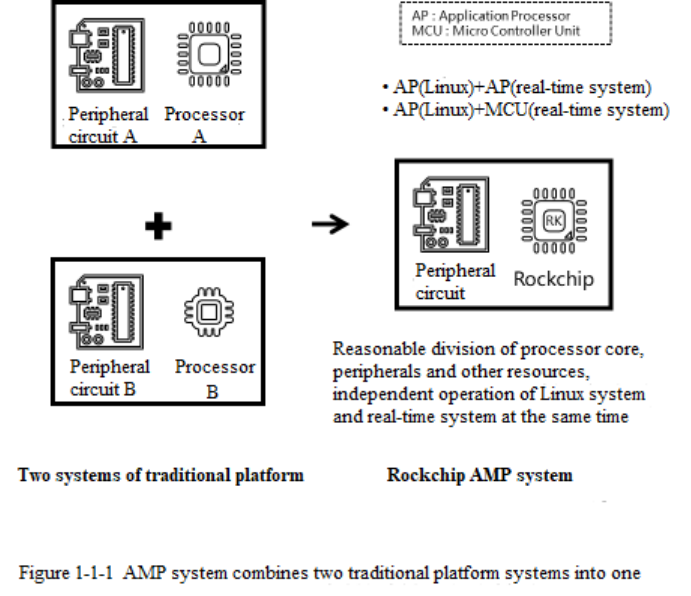

Heterogeneous multi-core systems also support the simultaneous independent operation of multiple real- time systems on the same SoC chip.

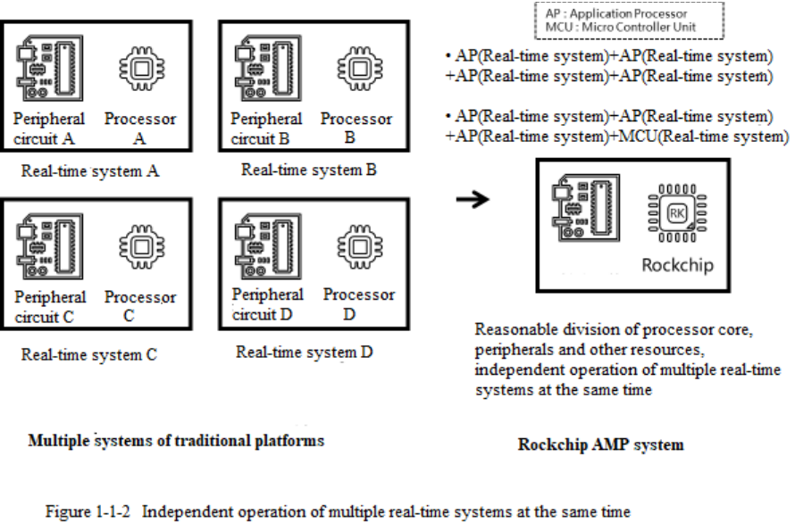

Furthermore, heterogeneous multi-core systems support the operation of the same SoC chip in both SMP + AMP modes.

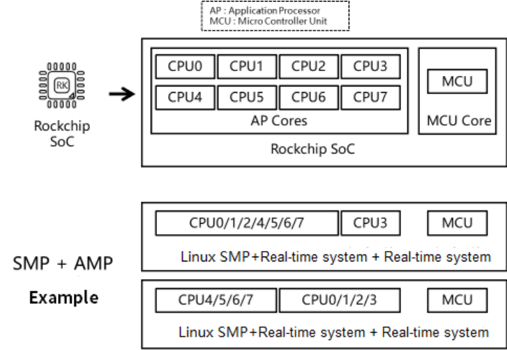

When applied to product design, heterogeneous multi-core systems offer significant advantages in cost- effectiveness and product size. They are now widely used in products across various industries such as power, industrial control, consumer electronics, and automotive electronics.

#### 1.1.2 Rockchip Heterogeneous Multi-core System

The Rockchip Heterogeneous Multi-core System is a general-purpose multi-core heterogeneous system solution provided by Rockchip. It builds upon the existing SMP symmetric multiprocessing system by adding support for AMP asymmetric multiprocessing systems. This document primarily introduces the AMP solution, which mainly includes the AMP booting solution and the AMP communication solution. The detailed implementation principles are referenced in the relevant sections of this document.

In terms of the operating platform, Linux offers a standard Linux Kernel, RTOS provides the open-source RT-Thread, and Bare-metal offers a bare-metal development library based on the RK HAL hardware abstraction layer. At the same time, the Rockchip Heterogeneous Multi-core System supports customers in adapting to more operating platforms on their own, such as adapting a specified RTOS based on the RK HAL hardware abstraction layer.

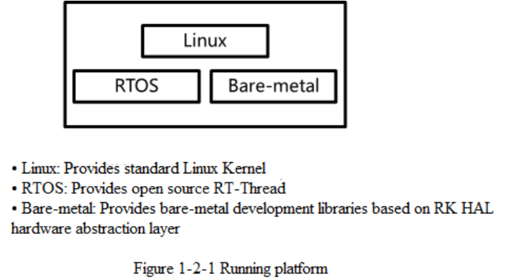

In terms of the processor core, Rockchip Heterogeneous Multi-core System supports each homogenous ARM Cortex-A processor core in the SoC to run independently. It also supports heterogeneous ARM Cortex-M or RISC-V processor cores in the SoC to run independently. By reasonable allocation of processor core resources, Rockchip Multi-core Heterogeneous System assigns specific tasks to the most suitable processor core for processing, thereby enabling the SoC to exhibit superior performance and energy efficiency.

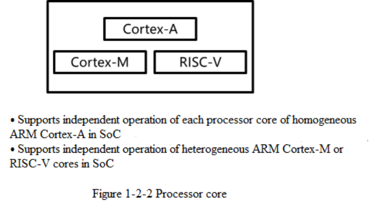

Currently, the Rockchip Multi-core Heterogeneous System mainly adopts an unsupervised AMP scheme. It does not use virtualization management, thereby achieving faster interrupt response when running real-time systems to meet the stringent hard real-time requirements in industry applications such as power and industrial control.

In the future, Rockchip Multi-core Heterogeneous System will also offer virtualization management as an optional feature. Based on the RPMsg and RemoteProc frameworks, it will support the standard OpenAMP. For industrial control industry applications, it will support the Type-1 Hypervisor Jailhouse. In the SoCs that Rockchip will launch subsequently, further support for hardware resource isolation will be added to enhance the flexibility and reliability of the Rockchip Multi-core Heterogeneous System.

### 1.2 Platform Support

#### 1.2.1 RK3588

##### 1.2.1.1 Processor Cores

| Processor Type | Processor Cores |
| --- | --- |
| AP | 4 x ARM Cortex-A76 + 4 x ARM Cortex-A55 |
| MCU | 1 x ARM Cortex-M0 |

##### 1.2.1.2 Running Platform Support

| Processor Cores | ARM Cortex-A76 | ARM Cortex-A55 | ARM Cortex-M0 |
| --- | --- | --- | --- |
| Linux Support | Kernel 5.10 | Kernel 5.10 | N/A |
| RTOS Support | N/A | RT-Thread 3.1-32<br>RT-Thread 4.1-32 | RT-Thread 3.1<br>RT-Thread 4.1 |
| Bare-metal Support | N/A | HAL-32 | HAL |

#### 1.2.2 RK3576

##### 1.2.2.1 Processor Cores

```text
Processor Cores
```

| Processor Type | Processor Cores |
| --- | --- |
| AP | 4 x ARM Cortex-A72 + 4 x ARM Cortex-A53 |
| MCU | 1 x ARM Cortex-M0 |

```text
1 x ARM Cortex-M0
```

##### 1.2.2.2 Running Platform Support

| Processor Core | ARM Cortex-A72 | ARM Cortex-A53 | ARM Cortex-M0 |
| --- | --- | --- | --- |
| Linux Support | Kernel 6.1 | Kernel 6.1 | N/A |
| RTOS Support | N/A | RTT 4.1-32 | RTT 4.1 |
| Bare-metal Support | N/A | HAL-32 | HAL |

#### 1.2.3 RK3568

##### 1.2.3.1 Processor Cores

| Processor Type | Core Configuration |
| --- | --- |
| AP | 4 x ARM Cortex-A55 |
| MCU | 1 x RISC-V |

##### 1.2.3.2 Operating Platform Support

```text
Processor Cores
```

| Processor Cores | ARM Cortex-A55 | RISC-V |
| --- | --- | --- |
| Linux Support | Kernel 4.19<br>Kernel 5.10 | N/A |
| RTOS Support | RTT 3.1-32 | RTT 3.1 |
| Bare-metal Support | HAL-32 | HAL |

#### 1.2.4 RK3562

##### 1.2.4.1 Processor Cores

```text
Processor Type
```

| Processor Type | Processor Cores |
| --- | --- |
| AP | 4 x ARM Cortex-A53 |
| MCU | 1 x ARM Cortex-M0 |

```text
MCU
```

##### 1.2.4.2 Supported Operating Platforms

| Processor Cores | ARM Cortex-A53 | ARM Cortex-M0 |
| --- | --- | --- |
| Linux Support | Kernel 5.10 | N/A |
| RTOS Support | RTT 4.1-32 | RTT 4.1 |
| Bare-metal Support | HAL-32 | HAL |

#### 1.2.5 RK3358

##### 1.2.5.1 Processor Core

| Processor Type | Processor Cores |
| --- | --- |
| AP | 4 x ARM Cortex-A35 |

##### 1.2.5.2 Operating Platform Support

| Processor Cores | ARM Cortex-A35 |
| --- | --- |
| Linux Support | N/A |
| RTOS Support | RTT 3.1-32 |
| Bare-metal Support | HAL-32 |

#### 1.2.6 RK3308

##### 1.2.6.1 Processor Cores

| Processor Type | Processor Cores |
| --- | --- |
| AP | 4 x ARM Cortex-A35 |

##### 1.2.6.2 Supported Operating Platforms

| Processor Core | ARM Cortex-A35 |
| --- | --- |
| Linux Support | Kernel 5.10 |
| RTOS Support | RTT 3.1-32<br>RTT 4.1-32 |
| Bare-metal Support | HAL-32 |

### 1.3 Product Case Introduction

#### 1.3.1 AP + AP Case: Power Relay Protection Device

In power relay protection devices, there are requirements for both the system's real-time capabilities, such as real-time collection and data analysis of various electrical quantities, and real-time response to protection control signals. There is also a demand for the system's richness, necessitating the use of complex software functions and hardware peripherals, such as display devices, USB devices, Ethernet devices, etc. By using Rockchip's multi-core heterogeneous system, the traditional platform's two systems are merged into one, and a single board can independently run the Linux system and real-time system simultaneously, achieving all the aforementioned functions.

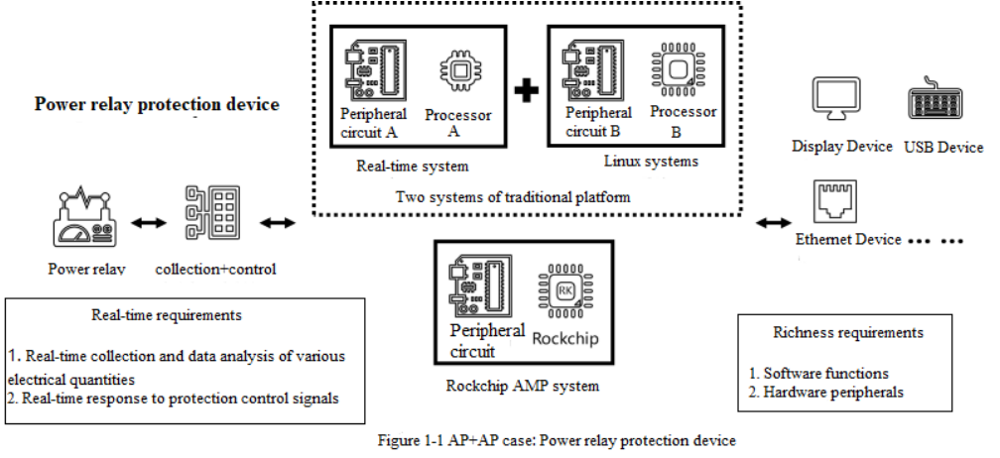

Furthermore, thanks to the high-performance characteristics of the AP, when used for real-time system processing tasks, a more efficient operation and stronger computational power experience can also be obtained.

#### 1.3.2 AP + MCU Case: Robot Vacuum Cleaner

For robot vacuum cleaners, it is necessary to operate a Linux system and utilize complex peripherals such as WiFi, Camera, and Audio to achieve functionalities like network connectivity, map storage, and algorithm processing. Additionally, a real-time system is required to operate with simple peripherals such as PWM, SPI, UART, ADC, and GPIO to implement environmental perception, motion control, and condition monitoring. By employing Rockchip multi-core heterogeneous system, the traditional platform's two systems are merged into one, eliminating the need for an external MCU and achieving all the aforementioned functions.

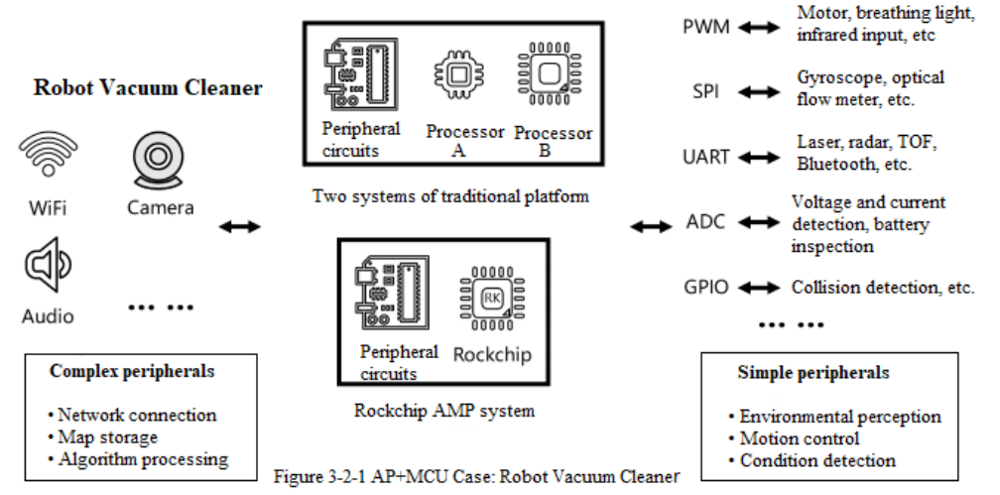

Furthermore, using the internal MCU of the SoC as a real-time processor or co-processor also allows the Linux system to achieve a more complete performance release.

## 2. Chapter-2 AMP SDK

### 2.1 Directory Structure

The source code structure of the AMP SDK provided by Rockchip's multi-core heterogeneous system is as follows. The parts marked with * in the comments are the main directories of the AMP SDK.

```text
.
├── app        # Linux system user interface example
├── buildroot  # Buildroot system compilation directory
├── debian     # Debian system compilation directory
├── device     # * AMP SDK compilation scripts and configuration files
├── docs       # * AMP SDK documentation
├── external   # Supplementary applications for Buildroot system
├── hal        # * Bare-metal system compilation directory
├── kernel-*   # * Compilation directories for different versions of the Linux Kernel
├── prebuilts  # * Pre-installed compilation toolchains
├── rkbin      # * Binary files used by the AMP SDK
├── rtos       # * RTOS system compilation directory
├── tools      # Tool set used by the AMP SDK
├── u-boot     # * U-Boot compilation directory
├── uefi       # UEFI compilation directory
└── yocto      # Yocto system compilation directory
```

### 2.2 Device Directory

The device directory contains the compilation scripts and default configurations for the AMP SDK. Taking RK3562 as an example, the main files include:

```text
device/rockchip
├── common
│   ├── build.sh                       # Common compilation script for AMP SDK
│   └── scripts
│       └── mk-amp.sh                  # Common compilation script for RTOS / Bare-metal
└── rk3562
    ├── amp.its                        # Firmware packaging configuration file for RTOS + Bare-metal
    ├── amp_linux.its                  # Firmware packaging configuration file for Linux +
RTOS / Bare-metal
    ├── amp_mcu.its                    # Firmware packaging configuration file for Linux +
RTOS / Bare-metal MCU
    └── rockchip_rk3562_xxx_defconfig  # Board-level compilation configuration file
```

Related Sections:

Chapter 3 Compilation Configuration

### 2.3 Kernel Directory

The kernel directory contains the source code of the Linux system. The AMP SDK provides a standard Linux Kernel.

The support status for each SOC platform is as follows:

| SOC | Kernel 4.19 | Kernel 5.10 | Kernel 6.1 |
| --- | --- | --- | --- |
| RK3588 |  | ✔ |  |
| RK3576 |  |  | ✔ |
| RK3568 | ✔ | ✔ |  |
| RK3562 |  | ✔ |  |
| RK3308 |  | ✔ |  |

Taking the RK3562 as an example, the main files include:

```text
kernel
├── arch/arm64/boot/dts/rockchip
│   ├── rk3562-amp.dtsi                # AMP dtsi file
│   └── rk3562-xxx-amp.dts             # AMP dts board-level configuration file
├── drivers
│   ├── mailbox                        # Mailbox inter-core communication solution
│   ├── rpmsg                          # RPMsg inter-core communication solution
│   ├── soc/rockchip
│   │   └── rockchip_amp.c             # Resource partitioning, lifecycle management of the
slave core, etc.
└── include
```

For the Linux + RTOS / Bare-metal operation mode, the core running the Linux system must act as the master core, responsible for resource partitioning and management of the slave core (Remote Core) of the entire multi-core heterogeneous system.

Related sections:

Chapter 3 Compilation Configuration

Chapter 4 Resource Partitioning

Chapter 5 Boot Solution

Chapter 6 Communication Solution

### 2.4 HAL Directory

The hal directory contains the source code for Bare-metal systems. The AMP SDK provides a bare-metal development library based on the RK HAL hardware abstraction layer.

RK HAL is a hardware abstraction layer based on the ARM CMSIS (Cortex Microcontroller Software Interface Standard) for microcontroller software interface standards. Users can directly use RK HAL for Bare-metal system development, or adapt RK HAL for specified RTOS.

The support status for each SOC platform is as follows:

| SOC | AP HAL-32 | MCU HAL |
| --- | --- | --- |
| RK3588 | ✔ | ✔ |
| RK3576 | ✔ | ✔ |
| RK3568 | ✔ | ✔ |
| RK3562 | ✔ | ✔ |
| RK3358 | ✔ | N/A |
| RK3308 | ✔ | N/A |

Taking RK3562 as an example, the main files include:

```text
├── doc
│   └── Rockchip_User_Guide_HAL_CN.md    # RK HAL Development Documentation
├── lib
│   ├── bsp                              # Board Support Package
│   ├── CMSIS                            # ARM Microcontroller Software Interface Standard Library
│   ├── Core                             # MCU Related Files
│   ├── Core_A                           # AP 32-bit Related Files
│   ├── Core_A_64                        # AP 64-bit Related Files
│   ├── Device/RK3562
│   │   ├── Include
│   │   │   ├── rk3562.h                 # RK3562 Register Definition
│   │   │   ├── soc.h                    # RK3562 SOC Related Definition
│   │   │   └── system_rk3562.h
│   │   └── Source/Templates
│   │       ├── GCC                      # Using GCC Cross-Compilation Toolchain
│   │       │   ├── gcc_arm.ld           # Linker Script Example
│   │       │   ├── start_m0.S           # MCU Startup File
│   │       │   └── startup_rk3562.c     # AP Startup File
│   │       ├── mmu_rk3562.c             # AP MMU Map Configuration File
│   │       ├── system_rk3562.c
│   │       └── system_rk3562_mcu.c
│   ├── DSP                              # DSP Related Files
│   └── RISCV                            # RISC-V Related Files
│   └── hal
│       ├── inc                          # Module Driver Header Files
│       └── src                          # Module Driver Files
├── middleware                           # Bare-metal System Middleware
│   ├── benchmark                        # Performance Testing
│   ├── rpmsg-lite                       # RPMsg Inter-Processor Communication Solution
│   └── simple_console                   # Console
├── project                              # Bare-metal System Project Examples
│   ├── common
│   │   └── GCC
│   │       ├── Cortex-A.mk              # AP Common Compilation File
│   │       ├── Cortex-M.mk              # MCU Common Compilation File
│   │       └── riscv.mk                 # RISC-V Common Compilation File
│   ├── rk3562
│   │   ├── GCC
│   │   │   ├── build.sh                 # AP Compilation Script
│   │   │   ├── gcc_arm.ld.S             # AP Linker Script
│   │   │   └── Makefile                 # AP Compilation File
│   │   ├── Image
│   │   │   ├── amp.img                  # Packaged Bare-metal System Firmware
│   │   │   ├── amp.its                  # RTOS + Bare-metal Firmware Packaging Configuration File
│   │   │   ├── amp_linux.its            # Linux + RTOS / Bare-metal Firmware Packaging Configuration File
│   │   │   ├── halx.bin
│   │   │   ├── halx.elf
│   │   │   └── parameter.txt            # Partition Table Configuration File
│   │   ├── mkimage.sh                   # AP Firmware Packaging Script
│   │   └── src
│   │       ├── hal_conf.h               # RK HAL Configuration File
│   │       ├── main.c                   # Bare-metal System Example
│   │       └── test_demo.c              # Bare-metal System Module and Function Example
│   └── rk3562-mcu
│       ├── GCC
│       │   ├── gcc_bus_m0.ld            # MCU Linker Script
│       │   └── Makefile                 # MCU Compilation File
│       ├── Image
│       │   ├── amp.img                  # Packaged Bare-metal System Firmware
│       │   ├── amp_mcu.its              # Linux + RTOS / Bare-metal MCU Firmware Packaging Configuration File
│       │   ├── mcu.bin
│       │   ├── mcu.elf
│       │   └── parameter.txt            # Partition Table Configuration File
│       ├── mkimage.sh                   # MCU Firmware Packaging Script
│       └── src
│           ├── hal_conf.h               # RK HAL Configuration File
│           ├── main.c                   # Bare-metal System Example
│           └── test_demo.c              # Bare-metal System Module and Function Example
├── test                                 # Bare-metal System Module Test Files
└── tools                                # Bare-metal System Tool Set
```

Related Sections:

Chapter 3 Compilation Configuration

Chapter 4 Resource Allocation

Chapter 5 Boot Solutions

Chapter 6 Communication Solutions

### 2.5 RTOS Directory

The rtos directory contains the source code for the RTOS system. The AMP SDK provides the open-source RT-Thread.

RT-Thread is a mature and stable open-source RTOS independently developed in China, with the largest installed base in the country. The RT-Thread platform is a technical platform that integrates a real-time operating system kernel, middleware components, and an open-source developer community. You can visit the RT-Thread Documentation Center to view the online technical documentation.

The RT-Thread provided in the Rockchip multi-core heterogeneous system is adapted based on RK HAL. The RK HAL files are located in bsp/rockchip/common/hal/lib . The RTOS Device Driver files are in bsp/rockchip/common/drivers .

The support status for each SOC platform is as follows:

| SOC | AP RTT 3.1-32 | AP RTT 4.1-32 | AP RTT 4.1-64 | MCU RTT 3.1 | MCU RTT 4.1 |
| --- | --- | --- | --- | --- | --- |
| RK3588 | ✔ |  | ✔ | ✔ | ✔ |
| RK3576 |  |  | ✔ |  | ✔ |
| RK3568 | ✔ |  |  | ✔ |  |
| RK3562 |  | ✔ |  |  | ✔ |
| RK3358 | ✔ |  |  | N/A | N/A |
| RK3308 | ✔ | ✔ |  | N/A | N/A |

Taking RK3562 as an example, the main files of RT-Thread V4.1 include:

```text
├── applications                         # Common application files
├── bsp/rockchip                         # Board Support Package
│   ├── common                           # Common modules and feature-related files
│   │   ├── drivers                      # RTOS Device Driver files
│   │   ├── fwmgr                        # Firmware management related files
│   │   ├── hal                          # RK HAL files
│   │   └── test                         # Module and feature test files
│   ├── rk3562-32                        # RK3562 AP 32-bit
│   │   ├── applications                 # Application files
│   │   ├── board                        # Board configuration files
│   │   ├── driver                       # Driver files
│   │   ├── Image
│   │   │   ├── amp.img                  # Packaged RTOS / Bare-metal firmware
│   │   │   ├── amp.its                  # RTOS + Bare-metal firmware packaging configuration file
│   │   │   ├── amp_linux.its            # Linux + RTOS / Bare-metal firmware packaging configuration file
│   │   │   ├── rttx.bin
│   │   │   ├── rttx.elf
│   │   │   ├── parameter.txt            # Partition table configuration file
│   │   │   └── smp.its                  # RTOS SMP firmware packaging configuration file
│   │   ├── test                         # Test files
│   │   ├── build.sh                     # AP compilation script
│   │   ├── gcc_arm.ld.S                 # AP linking script
│   │   ├── hal_conf.h                   # RK HAL configuration file
│   │   ├── Kconfig
│   │   ├── mkimage.sh                   # AP firmware packaging script
│   │   ├── rtconfig.h
│   │   ├── rtconfig.py
│   │   ├── SConscript
│   │   └── SConstruct
│   ├── rk3562-mcu                       # RK3562 MCU
│   │   ├── applications                 # Application files
│   │   ├── board                        # Board configuration files
│   │   ├── driver                       # Driver files
│   │   ├── Image
│   │   │   ├── amp.img                  # Packaged RTOS system firmware
│   │   │   ├── amp_mcu.its              # Linux + RTOS / Bare-metal MCU firmware packaging configuration file
│   │   │   ├── mcu.bin
│   │   │   └── mcu.elf
│   │   ├── gcc_arm.ld.S                 # MCU linking script
│   │   ├── hal_conf.h                   # RK HAL configuration file
│   │   ├── Kconfig
│   │   ├── mkimage.sh                   # MCU firmware packaging script
│   │   ├── rtconfig.h
│   │   ├── rtconfig.py
│   │   ├── SConscript
│   │   └── SConstruct
│   └── tools                            # Toolset
├── components
├── examples
├── include
├── libcpu
├── src
├── third_party
└── tools
```

Related Sections:

Chapter 3 Compilation Configuration

Chapter 4 Resource Allocation

Chapter 5 Boot Scheme

Chapter 6 Communication Scheme

### 2.6 U-Boot Directory

The u-boot directory contains the U-Boot source code. The AMP SDK requires the addition of rk-amp.config to enable the following configurations:

```text
CONFIG_AMP=y
CONFIG_ROCKCHIP_AMP=y
```

Taking the RK3562 as an example, the main files related to the AMP SDK include:

```text
arch/arm/mach-rockchip/rk3562/rk3562.c   # SOC initialization file
drivers/cpu/rockchip_amp.c               # AMP startup solution
include/configs/rk3562_common.h          # Common chip configuration file
```

Related sections:

Chapter 3 Compilation Configuration

Chapter 5 Startup Scheme

### 2.7 rkbin Directory

The rkbin directory contains binary files used by the AMP SDK and should be used in conjunction with the directory.

Taking the RK3562 as an example, the main files related to the AMP SDK include:

```text
bin/rk35/rk3562_bl31_xxx.elf             # Common bl31 file
bin/rk35/rk3562_bl31_cpu3_xxx.elf        # bl31 file for pre-level running on CPU3
RKTRUST/RK3562TRUST.ini                  # Common configuration file
RKTRUST/RK3562TRUST_CPU3.ini             # Configuration file for pre-level running on CPU3
```

Related Sections:

Chapter 3 Compilation Configuration

Chapter 5 Boot Solutions

## 3. Chapter-3 Compilation Configuration

### 3.1 Configuration File

Before compiling the AMP SDK, please first select and modify the relevant configuration files.

#### 3.1.1 Common Compilation Configuration File

AMP SDK Compilation Configuration: Primarily informs the compilation script about the project locations for RTOS and Bare-metal, as well as the specific configurations for the accompanying projects. The default configuration for AMP SDK is located at <AMP_SDK>/device/rockchip/.chip/rockchip_xxx_defconfig , with the following configurations:

```text
RK_AMP=y                                          # Support for AMP RTOS / Bare-metal
RK_AMP_ARCH="arm"                                 # 32-bit is used for RTOS / Bare-metal
                                                  # Use "arm64" for 64-bit
RK_AMP_HAL_TARGET="rk3562"                        # The project directory name corresponding to AP Bare-metal
RK_AMP_RTT_TARGET="rk3562-32"                     # The project directory name corresponding to AP RTOS
RK_AMP_MCU_HAL_TARGET="rk3562-mcu"                # The project directory name corresponding to MCU Bare-metal
RK_AMP_MCU_RTT_TARGET="rk3562-mcu"                # The project directory name corresponding to MCU RTOS
RK_AMP_CFG is not set                             # Auxiliary configuration file
RK_AMP_FIT_ITS="amp_linux.its"                    # Configuration file for AMP firmware packaging
RK_UBOOT_CFG_FRAGMENTS="rk-amp"                   # Add configuration file for AMP U-Boot config
RK_UBOOT_TRUST_INI is not set                     # Configuration file required when using a special rkbin
RK_PARAMETER="parameter.txt"                      # Partition table configuration file
```

It is recommended to use the make menuconfig method for configuring the AMP SDK, as this method can automatically organize the dependency relationships between compilation macros, preventing the generation of invalid compilation configurations.

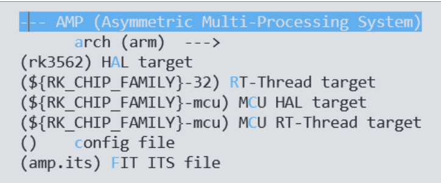

#### 3.1.2 AMP Firmware Packaging Configuration File

AMP firmware packaging utilizes the standard FIT format, which is natively supported and highly recommended by U-Boot. By modifying the ITS configuration file, a variety of configurations can be supported for each AMP processor core running an RTOS or Bare-metal. Taking RK3562 as an example, RK3562 has three default AMP configuration schemes:

amp_linux.its : A hybrid deployment scheme of Linux + RTOS / Bare-metal.

amp.its : A hybrid deployment scheme of RTOS + Bare-metal.

amp_mcu.its : A hybrid deployment scheme of Linux + MCU RTOS / Bare-metal.

##### 3.1.2.1 amp_linux.its

Linux + RTOS / Bare-metal Hybrid Deployment Scheme. The following example shows the RK3562 CPU3 running RTOS independently, with the remaining processor cores running Linux SMP.

```text
/dts-v1/;
/ {
    description = "FIT source file for Rockchip AMP";
    #address-cells = <1>;
    images {
        // amp3 node configures CPU3, other processor cores are similar.
        amp3 {
            description  = "RTOS core3";          // Firmware description information
            data         = /incbin/("rtt3.bin"); // Specifies the firmware location to be
packaged (with path)
            type         = "firmware";           // AP is set to firmware
            compression  = "none";               // Keep the default none
            arch         = "arm";                // Specifies the processor architecture
            cpu          = <0x3>;                // Specifies the processor's hardware ID
            thumb        = <0>;                  // Specifies the processor's instruction set
            hyp          = <0>;                  // Specifies whether the processor runs the Hypervisor
            load         = <0x01800000>;         // Specifies the firmware load and run address
            compile {                            // Configuration at compile time, automatically cleared after compilation
                size     = <0x00800000>;         // Running memory size
                sys      = "rtt";                // RTOS (rtt) or Bare-metal (hal)
                core     = "ap";                 // Processor core type: ap or mcu
                rtt_config   = "board/rk3562_evb1_lp4x/amp_defconfig";
            };
            udelay       = <10000>;              // Delay to start the next processor core
            hash {
                algo = "sha256";                 // Specifies the algorithm for firmware integrity check
            };
        };
    };
    share {                                           // Shared memory configuration at
compile time, automatically cleared after compilation
        shm_base         = <0x07800000>;          // Shared memory start address
        shm_size         = <0x00400000>;          // Shared memory size
        rpmsg_base       = <0x07c00000>;          // RPMsg shared memory start address
        rpmsg_size       = <0x00500000>;          // RPMsg shared memory size
    };
    configurations {
        default = "conf";
        conf {
            description = "Rockchip AMP images";
            rollback-index = <0x0>;
            loadables = "amp3";                   // Specifies the firmware to be loaded, as well as the loading and startup order
            signature {
                algo = "sha256,rsa2048";
                padding = "pss";
                key-name-hint = "dev";
                sign-images = "loadables";
            };
            /* - run linux on cpu0 * - it is brought up by amp(that run on U-Boot) * - it is boot entry depends on U-Boot */
            linux {                               // Supports Linux hybrid deployment
                description  = "linux-os";
                arch         = "arm64";
                cpu          = <0x000>;
                thumb        = <0>;
                hyp          = <0>;
                udelay       = <0>;
                // If the AMP firmware load location conflicts with the Linux Kernel load location, it needs to be adjusted
                load         = <0x2000000>;        // Linux Kernel load location
                load_c       = <0x4880000>;        // Compressed Linux Kernel load location
            };
        };
    };
};
```

##### 3.1.2.2 amp.its

RTOS + Bare-metal Hybrid Deployment Scheme. The following example shows RK3562 CPU1 running RTOS independently, with the remaining processor cores running three independent Bare-metal instances.

```text
/dts-v1/;
/ {
    description = "FIT source file for Rockchip AMPAK";
    #address-cells = <1>;
    images {
        amp0 {
            description  = "Bare-metal-core0";
            data         = /incbin/("rtt0.bin");
            type         = "firmware";
            compression  = "none";
            arch         = "arm";
            cpu          = <0x0>;
            thumb        = <0>;
            hyp          = <0>;
            load         = <0x02000000>;
            udelay       = <10000>;
            compile {
                size    = <0x00800000>;
                sys     = "hal";
            };
            hash {
                algo = "sha256";
            };
        };
        amp1 {
            description  = "RTOS-core1";
            data         = /incbin/("rtt1.bin");
            type         = "firmware";
            compression  = "none";
            arch         = "arm";
            cpu          = <0x1>;
            thumb        = <0>;
            hyp          = <0>;
            load         = <0x00800000>;
            udelay       = <10000>;
            compile {
                size    = <0x00800000>;
                sys     = "rtos";
            };
            hash {
                algo = "sha256";
            };
        };
        amp2 {
            description  = "Bare-metal-core2";
            data         = /incbin/("rtt2.bin");
            type         = "firmware";
            compression  = "none";
            arch         = "arm";
            cpu          = <0x2>;
            thumb        = <0>;
            hyp          = <0>;
            load         = <0x01000000>;
            udelay       = <10000>;
            compile {
                size    = <0x00800000>;
                sys     = "hal";
            };
            hash {
                algo = "sha256";
            };
        };
        amp3 {
            description  = "Bare-metal-core3";
            data         = /incbin/("rtt3.bin");
            type         = "firmware";
            compression  = "none";
            arch         = "arm";
            cpu          = <0x3>;
            thumb        = <0>;
            hyp          = <0>;
            load         = <0x01800000>;
            udelay       = <10000>;
            compile {
                size    = <0x00800000>;
                sys     = "hal";
            };
            hash {
                algo = "sha256";
            };
        };
    }
    share {
        shm_base         = <0x07800000>;
        shm_size         = <0x00400000>;
    };
    configurations {
        default = "conf";
        conf {
            description = "Rockchip AMPAK images";
            rollback-index = <0x0>;
            loadables = "amp0", "amp1", "amp2", "amp3";
            signature {
                algo = "sha256,rsa2048";
                padding = "pss";
                key-name-hint = "dev";
                sign-images = "loadables";
            };
        };
    };
};
```

##### 3.1.2.3 amp_mcu.its

Linux + MCU RTOS / Bare-metal Hybrid Deployment Scheme. The following example shows RK3562 AP running Linux SMP, and MCU independently running Bare-metal AMP.

```text
/dts-v1/;
/ {
    description = "Rockchip AMP FIT Image";
    #address-cells = <1>;
    images {
        mcu {
            description  = "mcu";
            data         = /incbin/("./rtt.bin");
            type         = "standalone";          // MCU is set to standalone
            compression  = "none";
            arch         = "arm";
            load         = <0x08200000>;
            udelay       = <1000000>;
            compile {
                size     = <0x00800000>;
                sys      = "hal";
                core     = "mcu";                 // Processor core type: ap or mcu
            };
            hash {
                algo = "sha256";
            };
        };
    };
    share {
        shm_base         = <0x07800000>;
        shm_size         = <0x00400000>;
        rpmsg_base       = <0x07c00000>;
        rpmsg_size       = <0x00500000>;
    };
    configurations {
        default = "conf";
        conf {
            description = "Rockchip AMP images";
            rollback-index = <0x0>;
            loadables = "mcu";
            signature {
                algo = "sha256,rsa2048";
                padding = "pss";
                key-name-hint = "dev";
                sign-images = "loadables";
            };
        };
    };
};
```

Note: When using Rockchip's multi-core heterogeneous system, it is necessary to plan the runtime memory and shared memory reasonably to avoid conflicts.

Related Sections:

Chapter 4 Resource Allocation

#### 3.1.3 Auxiliary Configuration File

Some SoC platforms require the additional use of the <AMP_SDK>/device/rockchip/.chip/$RK_AMP_CFG auxiliary configuration file. Parameters in the auxiliary configuration file are directly exported to the environment variables to assist in compilation.

For example, in RK3308, to use the shared LOG function, the following configuration needs to be added:

```text
## Chapter-3 RTT config
## Chapter-3 Share Memory config
RTT_SHLOG0_SIZE=0x00001000
RTT_SHLOG1_SIZE=0x00001000
RTT_SHLOG2_SIZE=0x00001000
RTT_SHLOG3_SIZE=0x00001000
## Chapter-3 HAL config
## Chapter-3 Share Memory config same as RTT
SHLOG0_SIZE=$RTT_SHLOG0_SIZE
SHLOG1_SIZE=$RTT_SHLOG1_SIZE
SHLOG2_SIZE=$RTT_SHLOG2_SIZE
SHLOG3_SIZE=$RTT_SHLOG3_SIZE
```

#### 3.1.4 Partition Table Configuration File

During the development process, it is necessary to adjust the partition table configuration according to the actual capacity of the storage medium used and the size of the AMP firmware.

Manually modify the partition table configuration file parameter.txt. The partition table configuration file is located at: <AMP_SDK>/device/rockchip/.chip/$RK_PARAMETER . The format for adding a partition is size@start(part_name) , with the unit being sector (512 Bytes). For example, to add a 2M amp partition:

```text
CMDLINE:
mtdparts=:0x00002000@0x00004000(uboot),0x00002000@0x00006000(misc),0x00020000@0x00008000(boot),0x00001000@0x00028000(amp),0x00040000@0x00029000(recovery),0x00010000@0x00069000(backup),0x01c00000@0x00079000(rootfs),0x00040000@0x01c79000(oem),-@0x01cb9000(userdata:grow)
```

Use the script to insert the new amp partition:

```text
./build.sh list-parts
==========================================
          Partition table
==========================================
1:        uboot at 0x00004000 size=0x00002000(4M)
2:         misc at 0x00006000 size=0x00002000(4M)
3:         boot at 0x00008000 size=0x00020000(64M)
4:     recovery at 0x00028000 size=0x00040000(128M)
5:       backup at 0x00068000 size=0x00010000(32M)
6:       rootfs at 0x00078000 size=0x01c00000(14G)
7:          oem at 0x01c78000 size=0x00040000(128M)
8:     userdata at 0x01cb8000 size=-(grow)
./build.sh insert-part:4:amp:2M
./build.sh list-parts
==========================================
          Partition table
==========================================
1:        uboot at 0x00004000 size=0x00002000(4M)
2:         misc at 0x00006000 size=0x00002000(4M)
3:         boot at 0x00008000 size=0x00020000(64M)
4:          amp at 0x00028000 size=0x00001000(2M)
5:     recovery at 0x00029000 size=0x00040000(128M)
6:       backup at 0x00069000 size=0x00010000(32M)
7:       rootfs at 0x00079000 size=0x01c00000(14G)
8:          oem at 0x01c79000 size=0x00040000(128M)
9:     userdata at 0x01cb9000 size=-(grow)
```

### 3.2 Compilation Commands

#### 3.2.1 Common Compilation Command

The common compilation command for AMP SDK is as follows, supporting one-click compilation and packaging functions:

```text
./build.sh chip         # Select the SoC platform
./build.sh lunch        # Select the default configuration file
./build.sh              # One-click compilation and packaging
./build.sh uboot        # Compile U-Boot separately
./build.sh kernel       # Compile the Linux Kernel separately
./build.sh amp          # Compile RTOS / Bare-metal separately
./build.sh cleanall     # Clean all
./build.sh help         # Get help
```

./build.sh amp will read the AMP firmware packaging configuration file and automatically complete the compilation and packaging of amp.img .

#### 3.2.2 Individual Compilation Commands

Individual compilation commands for various components can be obtained from the build_info.txt in the base firmware that comes with the AMP SDK.

##### 3.2.2.1 Linux Kernel Compilation Commands

When compiling the Linux Kernel as a standalone component, taking the RK3562 AP as an example, the reference commands are as follows:

```text
cd <AMP_SDK>/kernel
export ARCH=arm64                              # Specify the architecture of the processor
export CROSS_COMPILE="path to compiler"        # Specify the cross-compilation toolchain
## Chapter-3 For example:
export CROSS_COMPILE=../prebuilts/gcc/linux-x86/aarch64/gcc-arm-10.3-2021.07-x86_64-aarch64-none-linux-gnu/bin/aarch64-none-linux-gnu-
make rockchip_linux_defconfig                  # Specify the compilation configuration
make rk3562-evb1-lp4x-v10-linux-amp.img -j8    # Compile the specified dts board-level configuration
```

##### 3.2.2.2 RT-Thread Compilation Command

When compiling RT-Thread as a standalone component, taking the RK3562 AP as an example, the reference command is as follows:

```text
cd <AMP_SDK>/rtos/bsp/rockchip/rk3562-32/
./build.sh <cpu_id 0~3 or all>
./mkimage.sh
scons -j8
scons -c
```

##### 3.2.2.3 RK HAL Compilation Command

When compiling the RK HAL as a standalone component, taking the RK3562 AP as an example, the reference command is as follows:

```text
cd <AMP_SDK>/hal/project/rk3562/GCC
./build.sh <cpu_id 0~3 or all>
cd ..
./mkimage.sh
make -j8
make clean
```

##### 3.2.2.4 U-Boot Compilation Command

When compiling U-Boot as a standalone component, taking RK3562 as an example, the reference command is as follows:

```text
cd <AMP_SDK>/u-boot/
make rk3562_defconfig rk-amp.config
./make.sh
```

If a special rkbin is required, for instance, an rkbin that runs on CPU3 in the previous stage, the reference command is as follows:

```text
cd <AMP_SDK>/u-boot/
make rk3562_defconfig rk-amp.config
./make.sh ../rkbin/RKTRUST/RK3562TRUST_CPU3.ini
```

Related Sections:

Chapter 5 Boot Solutions

## 4. Chapter-4 Resource Allocation

### 4.1 System Architecture

#### 4.1.1 AP + AP System Architecture

In Rockchip multi-core heterogeneous system, the AP + AP system architecture is divided into two types: Linux + RTOS / Bare-metal and RTOS + Bare-metal. In the Linux + RTOS / Bare-metal system architecture, the processor core running Linux acts as the Master Core. The processor core running RTOS / Bare-metal acts as the Remote Core. In the RTOS + Bare-metal system architecture, the first processor core to boot acts as the Master Core. Other processor cores act as Remote Core. The master core is responsible for the division and management of shared resources in the entire multi-core heterogeneous system and runs the master station service program.

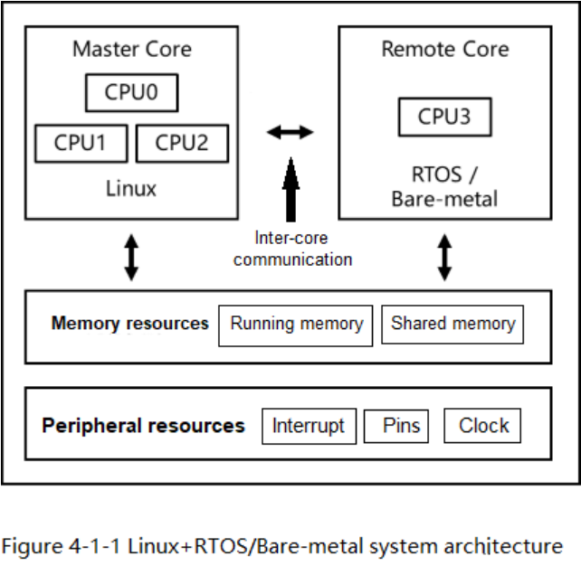

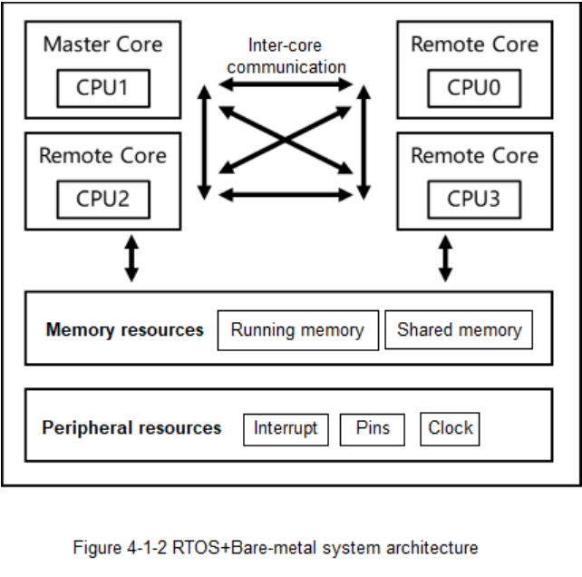

#### 4.1.2 AP + MCU System Architecture

In the Rockchip multi-core heterogeneous system, the AP + MCU system architecture is Linux + MCU RTOS / Bare-metal. The AP processor core running Linux serves as the master core. The MCU processor core running RTOS / Bare-metal serves as the remote core. The master core is responsible for the allocation and management of shared resources in the entire multi-core heterogeneous system and runs the master station service program.

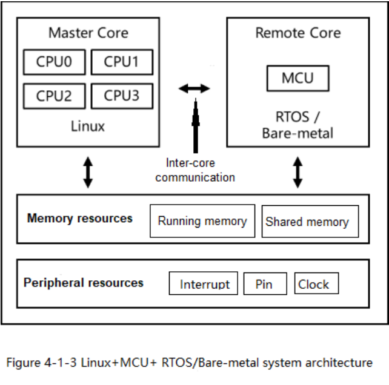

### 4.2 Resource Configuration of the Linux Kernel

#### 4.2.1 Linux Kernel Configuration Files

##### 4.2.1.1 DTS Related Files

The resource configuration of the Linux Kernel is in the DTS files. The DTS files for Rockchip multi-core heterogeneous system are named rkxxxx-evbxxxxx-amp.dts and include rkxxxx-amp.dtsi , for example:

```text
arch/arm64/boot/dts/rockchip/rk3562-amp.dtsi
arch/arm64/boot/dts/rockchip/rk3562-evb1-lp4x-v10-linux-amp.dts
```

rk3562-amp.dtsi is used by the Linux Kernel to centrally manage the shared resources of the multi-core heterogeneous system.

```text
/ {
        rockchip_amp: rockchip-amp {
                compatible = "rockchip,amp";
                /* Clock resources used by AMP */
                clocks = <&cru FCLK_BUS_CM0_CORE>, <&cru CLK_BUS_CM0_RTC>,
                        <&cru PCLK_MAILBOX>, <&cru PCLK_INTC>,
                        <&cru SCLK_UART7>, <&cru PCLK_UART7>,
                        <&cru PCLK_TIMER>, <&cru CLK_TIMER4>, <&cru CLK_TIMER5>;
                /* Pin resources used by AMP */
                pinctrl-names = "default";
                pinctrl-0 = <&uart7m1_xfer>;
                /* Interrupt resources used by AMP */
                amp-cpu-aff-maskbits = /bits/ 64 <0x0 0x1 0x1 0x2 0x2 0x4 0x3 0x8>;
                amp-irqs = /bits/ 64 <GIC_AMP_IRQ_CFG_ROUTE(147, 0xd0, CPU_GET_AFFINITY(3, 0))>;
                status = "okay";
        };
};
```

##### 4.2.1.2 AMP Driver Related Files

AMP Driver related files: <AMP_SDK>/kernel/drivers/soc/rockchip/rockchip_amp.c

```text
// ...
// Centralized management of AMP's interrupt resources, called by the GIC driver
static void amp_gic_get_irqs_config(struct device_node *np, struct amp_gic_ctrl_s *amp_ctrl)
{
    // ....
}
static int rockchip_amp_probe(struct platform_device *pdev)
{
    // ...
    // Centralized management of AMP's clock resources
    rkamp_dev->num_clks = devm_clk_bulk_get_all(&pdev->dev, &rkamp_dev->clks);
    // Centralized management of AMP's power supply resources
    rkamp_dev->num_pds =
        of_count_phandle_with_args(pdev->dev.of_node, "power-domains",
                                   "#power-domain-cells");
    // Centralized management of AMP's core resources, lifecycle management of the core, such as open, close, restart, etc.
    cpus_node = of_get_child_by_name(pdev->dev.of_node, "amp-cpus");
    // ...
}
// Pin resources, processed by the pinctrl driver before calling rockchip_amp_probe.
static const struct of_device_id rockchip_amp_match[] = {
    { .compatible = "rockchip,amp" }, // Corresponds to the property in the DTS file
    // ...
};
```

#### 4.2.2 Linux Cores Configuration

The Core node running HAL/RTOS needs to be shielded, so the relevant node needs to be deleted in DTS. The Core of each platform has been defined in 'rkxxxx.dtsi'. So just include the configured DTSI in the DTS of AMP and delete the cores you need to use, for example, using Core3 of RK3588 for A55 as HAL/RTOS:

```text
/ {
    model = "Rockchip RK3588 EVB1 LP4 V10 Board";
    compatible = "rockchip,rk3588-evb1-lp4-v10", "rockchip,rk3588";
    cpus {
        cpu-map {
            cluster0 {
                /delete-node/ core3;
            };
        };
    };
    reserved-memory {
        #address-cells = <2>;
        #size-cells = <2>;
        ranges;
        amp_reserved: amp@800000 {
            reg = <0x0 0x00800000 0x0 0x01800000>;
            no-map;
        };
    };
};
&arm_pmu {
    interrupt-affinity = <&cpu_l0>, <&cpu_l1>, <&cpu_l2>,
                 <&cpu_b0>, <&cpu_b1>, <&cpu_b2>, <&cpu_b3>;
};
/delete-node/ &cpu_l3;
```

Use Core3 of RK3588 for A76 as HAL/RTOS:

```text
/ {
    model = "Rockchip RK3588 EVB1 LP4 V10 Board";
    compatible = "rockchip,rk3588-evb1-lp4-v10", "rockchip,rk3588";
    cpus {
        cpu-map {
            cluster2 {
                /delete-node/ core1;
            };
        };
    };
    reserved-memory {
        #address-cells = <2>;
        #size-cells = <2>;
        ranges;
        amp_reserved: amp@800000 {
            reg = <0x0 0x00800000 0x0 0x01800000>;
            no-map;
        };
    };
};
&arm_pmu {
    interrupt-affinity = <&cpu_l0>, <&cpu_l1>, <&cpu_l2>, <&cpu_l3>,
                 <&cpu_b0>, <&cpu_b1>, <&cpu_b2>;
};
/delete-node/ &cpu_b3;
```

#### 4.2.3 Linux Kernel Memory Resources

##### 4.2.3.1 Running Memory Configuration

DRAM is the system's private running memory. The Linux Kernel defaults to using all DDR resources as DRAM. Therefore, in a multi-core heterogeneous system, it is necessary to reserve the space of other systems' DRAM on the Linux Kernel DTS.

Taking RK3562 as an example:

```text
/ {
    reserved-memory {
        /* rk3588-amp.dtsi */
        /* MCU address */
        mcu_reserved: mcu@8200000 {
            reg = <0x0 0x8200000 0x0 0x100000>;
            no-map;
        };
        /* rk3588-evb1-lp4-v10-linux-amp.dts */
        /* AP address */
        amp_reserved: amp@800000 {
            reg = <0x0 0x01800000 0x0 0x00800000>;
            no-map;
        };
    };
};
```

##### 4.2.3.2 Share Memory Configuration

Share Memory serves as a space for information exchange between multiple systems. The Linux Kernel, by default, utilizes all DDR resources as DRAM. Therefore, in a multi-core heterogeneous system, it is necessary to reserve the Share Memory on the Linux Kernel DTS.

The reservation configuration operation is consistent with the Linux Kernel DRAM Configuration, as long as the names are different.

Taking RK3562 as an example:

```text
/ {
    reserved-memory {
        /* rk3588-amp.dtsi */
        rpmsg_reserved: rpmsg@7c00000 {
            reg = <0x0 0x07c00000 0x0 0x400000>;
            no-map;
        };
    };
};
```

#### 4.2.4 Peripheral Resources of the Linux Kernel

The Linux Kernel, by default, defines all SoC resources in the Device Tree Source (DTS). Therefore, when AMP needs to use peripheral resources outside of the Linux Kernel, it is necessary to disable the corresponding modules in the DTS to allocate resources for other systems used by AMP.

The following example shows how to transfer the I2C1 resource from the Linux Kernel to the Real-Time Operating System (RTOS) for use on the RK3562 EVB1:

First, locate the definition of I2C1 in rk3562.dtsi .

```text
i2c1: i2c@ffa00000 {                                                 /* Module Name */
        compatible = "rockchip,rk3562-i2c", "rockchip,rk3399-i2c";
        reg = <0x0 0xffa00000 0x0 0x1000>;
        clocks = <&cru CLK_I2C1>, <&cru PCLK_I2C1>;                  /* Clock References */
        clock-names = "i2c", "pclk";
        interrupts = <GIC_SPI 13 IRQ_TYPE_LEVEL_HIGH>;               /* Interrupt Reference */
        pinctrl-names = "default";
        pinctrl-0 = <&i2c1m0_xfer>;                                  /* Pin Reference */
        #address-cells = <1>;
        #size-cells = <0>;
        status = "disabled";
};
```

From the DTS, the resource configuration for I2C1 indicates that I2C1 requires:

Interrupt resources

Pin resources

Clock resources

First, disable the I2C1 resources in the DTS:

```text
&i2c1 {
       status = "disabled";
};
```

##### 4.2.4.1 Interrupt Configuration

Add the interrupt resource of I2C1 to the amp-irqs node of rockchip-amp :

```text
/ {
        rockchip_amp: rockchip-amp {
                compatible = "rockchip,amp";
                // ......
                /* Interrupt resources used by AMP */
-               amp-irqs = /bits/ 64 <GIC_AMP_IRQ_CFG_ROUTE(147, 0xd0, CPU_GET_AFFINITY(3, 0))>;
+               amp-irqs = /bits/ 64 <GIC_AMP_IRQ_CFG_ROUTE(147, 0xd0, CPU_GET_AFFINITY(3, 0))
+                                     GIC_AMP_IRQ_CFG_ROUTE(45, 0xd0, CPU_GET_AFFINITY(3, 0))>;
                                      // Add I2C1: 45 = I2C1 interrupt 13 + fixed offset 32
                // ......
        };
};
```

Note: The module interrupt number and the amp-irqs referenced interrupt number have a fixed offset of 32.

##### 4.2.4.2 Pin Configuration

Add the I2C1 pin resources to the rockchip-amp node:

```text
/ {
        rockchip_amp: rockchip-amp {
                compatible = "rockchip,amp";
                // ......
                /* Pin resources used by AMP */
                pinctrl-names = "default";
-               pinctrl-0 = <&uart7m1_xfer>;
+               pinctrl-0 = <&uart7m1_xfer>, <&i2c1m0_xfer>;
                // ......
        };
};
```

Note: The module may use multiple sets of pin resources; select the group that is actually used for addition.

##### 4.2.4.3 Clock Configuration

Add the I2C1 clock resources to the rockchip-amp node:

```text
/ {
        rockchip_amp: rockchip-amp {
                compatible = "rockchip,amp";
                // ......
                /* Clock resources used by AMP */
                clocks = <&cru FCLK_BUS_CM0_CORE>, <&cru CLK_BUS_CM0_RTC>,
                        <&cru PCLK_MAILBOX>, <&cru PCLK_INTC>,
                        <&cru SCLK_UART7>, <&cru PCLK_UART7>,
-                       <&cru PCLK_TIMER>, <&cru CLK_TIMER4>, <&cru CLK_TIMER5>;
+                       <&cru PCLK_TIMER>, <&cru CLK_TIMER4>, <&cru CLK_TIMER5>,
+                       <&cru CLK_I2C1>, <&cru PCLK_I2C1>;
                // ......
        };
};
```

### 4.3 RTOS Resource Configuration

#### 4.3.1 RT-Thread Configuration File

Typically, in SoC-level projects, several board-level configurations are preset. During project use, the CONFIG_RT_BOARD_NAME configuration is modified via the scons --menuconfig command to meet the need of adapting the same project to multiple boards.

Therefore, the content of RT-Thread configuration includes:

```text
<AMP_SDK>/internal/rk3588/rtos/bsp/rockchip/rk3562-32/
├── applications
├── board
│   ├── common                  # Common configuration
│   ├── Kconfig
│   ├── rk3562_evb1_lp4x        # Board-level configuration
│   └── SConscript
├── build.sh                    # Build script, containing some build configurations
└── ...
```

Common configuration part: The basic configuration of the chip, which is a mandatory code for the project and serves all board-level projects.

Board-level configuration part: Board-level configuration, which configures related functions for a specific board, such as GPIO, UART, I2C, etc.

Build command: The build command can achieve system parameter passing during compilation, providing flexible compilation instructions. When there is a build.sh script, parameters can be directly defined in it. Alternatively, specific build parameters can be export ed and then compiled using the scons command.

##### 4.3.1.1 Board-Level Related Files

RT-Thread project resource configuration, including general configurations and board-level configurations.

General configuration files include:

```text
## Chapter-4 General Configuration
<AMP_SDK>/rtos/bsp/rockchip/rk3562-32/board/common/board_base.c
<AMP_SDK>/rtos/bsp/rockchip/rk3562-32/board/common/iomux_base.c
```

General configurations define the initialization sequence for hardware startup and the default hardware resources while providing a large number of RT_WEAK definitions, which makes it convenient for users to replace them in the board-level configuration.

```text
RT_WEAK const struct clk_init clk_inits[];            // Weak definition of structure, can
be redefined in board-level configuration
RT_WEAK  void rt_hw_iomux_config(void);               // Weak definition of function, can be
redefined in board-level configuration
// ...                                                // Weak definition resources vary with different SoCs, not listed one by one
void rt_hw_board_init(void)
{
    // ... Initialization sequence, do not modify
}
```

Board-level configuration files include:

```text
## Chapter-4 Board-Level Configuration
<AMP_SDK>/rtos/bsp/rockchip/rk3562-32/board/rk3562_evb1_lp4x/board.c
<AMP_SDK>/rtos/bsp/rockchip/rk3562-32/board/rk3562_evb1_lp4x/iomux.c
```

In the board-level configuration, the RT_WEAK resources should be redefined.

```text
// <AMP_SDK>/rtos/bsp/rockchip/rk3562-32/board/rk3562_evb1_lp4x/iomux.c
void rt_hw_iomux_config(void)
{
    // ...
}
```

##### 4.3.1.2 Compilation Related Files

RT-Thread uses SCONS for compilation, and the files involved in the compilation are:

```text
cd <AMP_SDK>/rtos/bsp/rockchip/rk3562-32/
rk3562-32/rtconfig.h               # Configuration file used for compilation
rtconfig.py                        # Compilation script, determining the location of the
compilation chain, and the input parameters of the compilation command, etc.
SConscript                         # SCONS link file
SConstruct                         # SCONS link file
build.sh                           # RT-Thread AP Core quick compilation script, MCU Core does not have this script
```

The AP Core uses the ./build.sh script to complete the compilation, while the MCU Core uses the make command to complete the compilation.

#### 4.3.2 RT-Thread Memory Resources

The memory allocation of RT-Thread is assigned by the compiled linker script files.

```text
<AMP_SDK>/rtos/bsp/rockchip/rk3562-32/gcc_arm.ld.S
<AMP_SDK>/rtos/bsp/rockchip/rk3562-mcu/gcc_link.ld.S
```

##### 4.3.2.1 AP Runtime Memory Configuration

```text
/* cat <AMP_SDK>/rtos/bsp/rockchip/rk3562-32/gcc_arm.ld.S */
MEMORY
{
    SRAM  (rxw) : ORIGIN = 0xfe480000, LENGTH = 64K            /* SYSTEM SRAM */
    DRAM  (rxw) : ORIGIN = FIRMWARE_BASE, LENGTH = DRAM_SIZE   /* DRAM */
    SHMEM (rxw) : ORIGIN = SHMEM_BASE, LENGTH = SHMEM_SIZE     /* shared memory for all cpu */
    LINUX_RPMSG (rxw) : ORIGIN = LINUX_RPMSG_BASE, LENGTH = LINUX_RPMSG_SIZE
}
## Chapter-4 cat <AMP_SDK>/rtos/bsp/rockchip/rk3562-32/rtconfig.py
## Chapter-4 variable conversion, connecting the build.sh script and gcc_arm.ld.S file
CFLAGS += ' -DFIRMWARE_BASE={a} -DDRAM_SIZE={b} -DSHMEM_BASE={c} -DSHMEM_SIZE={d} -DLINUX_RPMSG_BASE={e} -DLINUX_RPMSG_SIZE={f}'.format(a=PRMEM_BASE, b=PRMEM_SIZE, c=SHMEM_BASE, d=SHMEM_SIZE, e=LINUX_RPMSG_BASE, f=LINUX_RPMSG_SIZE)
## Chapter-4 cat <AMP_SDK>/rtos/bsp/rockchip/rk3562-32/build.sh
export RTT_PRMEM_BASE=$(eval echo \$CPU$1_MEM_BASE)            /* DRAM start location */
export RTT_PRMEM_SIZE=$(eval echo \$CPU$1_MEM_SIZE)            /* DRAM capacity size */
export RTT_SHMEM_BASE=0x07800000                               /* shared memory start location */
export RTT_SHMEM_SIZE=0x00400000                               /* shared memory capacity size */
export LINUX_RPMSG_BASE=0x07c00000                             /* rpmsg start location */
export LINUX_RPMSG_SIZE=0x00500000                             /* rpmsg capacity size */
```

The memory configuration of the RT-Thread AP Core is located in gcc_arm.ld.S . For the convenience of compilation configuration, some parameters are transformed through rtconfig.py to build.sh for easy compilation modification.

The address information configured in the AP Core corresponds to the actual physical address information of the DDR.

DRAM can be configured through the parameters in build.sh :

```text
CPU3_MEM_BASE=0x01800000
CPU3_MEM_SIZE=0x00800000
export RTT_PRMEM_BASE=$(eval echo \$CPU$1_MEM_BASE)             /* DRAM start location */
export RTT_PRMEM_SIZE=$(eval echo \$CPU$1_MEM_SIZE)             /* DRAM capacity size */
```

The different variable names are transformed through rtconfig.py .

##### 4.3.2.2 AP Shared Memory Configuration

Taking the shared memory LINUX_RPMSG as an example, the following content needs to be defined in gcc_arm.ld.S :

```text
MEMORY {
    LINUX_RPMSG (rxw) : ORIGIN = LINUX_RPMSG_BASE, LENGTH = LINUX_RPMSG_SIZE
}
.linux_share_rpmsg (NOLOAD):
{
    PROVIDE(__linux_share_rpmsg_start__ = .);
    . += LINUX_RPMSG_SIZE;
    PROVIDE(__linux_share_rpmsg_end__ = .);
} > LINUX_RPMSG
```

The physical address pointer of LINUX_RPMSG can be directly obtained in the code:

```text
/* [AMP_SDK]/rtos/bsp/rockchip/rk3562-32/board/common/rpmsg_base.h */
/* RPMSG shared memory information */
extern uint32_t __share_rpmsg_start__[];
extern uint32_t __share_rpmsg_end__[];
#define RPMSG_MEM_BASE      ((uint32_t)&__share_rpmsg_start__)
#define RPMSG_MEM_END       ((uint32_t)&__share_rpmsg_end__)
```

##### 4.3.2.3 MCU Runtime Memory Configuration

```text
/* cat <AMP_SDK>/rtos/bsp/rockchip/rk3562-mcu/gcc_link.ld.S */
MEMORY
{
    DDR   (rxw) : ORIGIN = 0x00000000, LENGTH = 512K               /* DRAM */
}
/* cat <AMP_SDK>/rtos/bsp/rockchip/rk3562-mcu/Image/amp.its */
/ {
    images {
        mcu {
            //...
            load         = <0x08200000>;
            //...
        };
    };
};
```

The memory configuration of the RT-Thread MCU Core is jointly completed by gcc_link.ld.S and amp.its .

The difference between the MCU Core and the AP Core is that the startup location of the MCU Core is the 0 address of the MCU Core itself. Therefore, there is a fixed offset between the address seen by the MCU Core and the actual physical address.

```text
/* cat <AMP_SDK>/rtos/bsp/rockchip/rk3562-mcu/gcc_link.ld.S */
MEMORY
{
    DDR   (rxw) : ORIGIN = 0x00000000, LENGTH = 512K               /* DRAM */
}
/* cat <AMP_SDK>/rtos/bsp/rockchip/rk3562-mcu/Image/amp.its */
/ {
    images {
        mcu {
            //...
            load         = <0x08200000>;
            //...
        };
    };
};
```

The above example shows the setting of RT-Thread MCU DRAM at the physical address 0x08200000 , with a capacity of 512K.

##### 4.3.2.4 MCU Shared Memory Configuration

As an example of adding shared memory LINUX_RPMSG to the RK3562 RT-Thread MCU, the following content needs to be defined in gcc_arm.ld.S :

```text
/* cat <AMP_SDK>/rtos/bsp/rockchip/rk3562-mcu/gcc_link.ld.S */
MEMORY {
    // ...
    LINUX_RPMSG (rxw) : ORIGIN = 0x00100000, LENGTH = 0x00500000
}
//...
.linux_share_rpmsg (NOLOAD):
{
    PROVIDE(__linux_share_rpmsg_start__ = .);
    . += LINUX_RPMSG_SIZE;
    PROVIDE(__linux_share_rpmsg_end__ = .);
} > LINUX_RPMSG
/* cat <AMP_SDK>/rtos/bsp/rockchip/rk3562-mcu/Image/amp.its */
/ {
    images {
        mcu {
            //...
            load         = <0x08200000>;
            //...
        };
    };
};
0x08300000 = 0x08200000 + 0x00100000
```

In this example, the physical address of LINUX_RPMSG is 0x08300000 = 0x08200000 + 0x00100000. The MCU-visible relative address is 0x00100000. Its size is 0x00500000 bytes (5 MiB).

In the code, the information of LINUX_RPMSG can also be obtained. It should be noted that in the MCU, all address information is offset by its own loading address.

```text
/* RPMSG share memory information */
extern uint32_t __share_rpmsg_start__[];
extern uint32_t __share_rpmsg_end__[];
#define RPMSG_MEM_BASE      ((uint32_t)&__share_rpmsg_start__)      /* 0x00100000 */
#define RPMSG_MEM_END       ((uint32_t)&__share_rpmsg_end__)        /* 0x00500000 */
```

#### 4.3.3 Peripheral Resources of RT-Thread

For example, by adding the I2C1 resource to RK3562, this section introduces how to add a peripheral module in RT-Thread.

##### 4.3.3.1 AP Interrupt Configuration

If you are using the MCU core, please skip this section. The MCU uses a separate NVIC controller and does not require this configuration.

Declare the need to respond to I2C1 interrupts in irqsConfig .

```text
// <AMP_SDK>/rtos/bsp/rockchip/rk3562-32/board/common/board_base.c
// The system runs on CPU3, so CPU3 needs to respond to I2C1 interrupts.
#define CUR_CPU       3
static struct GIC_AMP_IRQ_INIT_CFG irqsConfig[] =
{
    // ...
    GIC_AMP_IRQ_CFG_ROUTE(I2C1_IRQn, 0xd0, CPU_GET_AFFINITY(CUR_CPU, 0)),
    // ...
}
```

##### 4.3.3.2 MCU Interrupt Configuration

Interrupts directly connected to the MCU go through the NVIC interface, and all other interrupts need to go through the INTMUX interface.

```text
<AMP_SDK>/hal/project/rk3562/src/test_demo.c
// NVIC interface example
/************************************************/
/*                                              */
/*                SOFTIRQ_TEST                  */
/*                                              */
/************************************************/
#ifdef SOFTIRQ_TEST
static void soft_isr(void)
{
    printf("softirq_test: enter isr\n");
}
static void softirq_test(void)
{
    printf("softirq_test start\n");
    HAL_NVIC_SetIRQHandler(RSVD0_MCU_IRQn, soft_isr);
    HAL_NVIC_EnableIRQ(RSVD0_MCU_IRQn);
    HAL_DelayMs(4000);
    HAL_NVIC_SetPendingIRQ(RSVD0_MCU_IRQn);
}
#endif
// INTMUX interface example
/************************************************/
/*                                              */
/*                  GPIO_TEST                   */
/*                                              */
/************************************************/
#ifdef GPIO_TEST
    //......
static void gpio_test(void)
{
    //......
    /* Test GPIO interrupt */
    HAL_GPIO_SetPinDirection(GPIO1, GPIO_PIN_B7, GPIO_IN);
    HAL_INTMUX_SetIRQHandler(GPIO1_IRQn, gpio1_isr, NULL);
    HAL_IRQ_HANDLER_SetGpioIRQHandler(GPIO_BANK1, GPIO_PIN_B7, b7_call_back, NULL);
    HAL_INTMUX_EnableIRQ(GPIO1_IRQn);
    HAL_GPIO_SetIntType(GPIO1, GPIO_PIN_B7, GPIO_INT_TYPE_EDGE_BOTH);
    HAL_GPIO_EnableIRQ(GPIO1, GPIO_PIN_B7);
    printf("test_gpio interrupt ready\n");
}
#endif
```

##### 4.3.3.3 Pin Configuration

Initialize the I2C1 pin configuration in rt_hw_iomux_config .

```text
// <AMP_SDK>/rtos/bsp/rockchip/rk3562-32/board/rk3562_evb1_lp4x/iomux.c
void i2c1_m0_iomux_config(void)
{
    HAL_PINCTRL_SetIOMUX(GPIO_BANK0,
                         GPIO_PIN_B3 | GPIO_PIN_B4,
                         PIN_CONFIG_MUX_FUNC1);
}
void rt_hw_iomux_config(void)
{
    // ...
    i2c1_m0_iomux_config();
    // ...
}
```

##### 4.3.3.4 Clock Configuration

The RT-Thread comes with a built-in CRU module, eliminating the additional clock switch configuration.

From this point, you can utilize the I2C interface of RT-Thread to operate on I2C1.

### 4.4 Bare-metal Resource Allocation

#### 4.4.1 RK HAL Configuration File

##### 4.4.1.1 Board-Level Related Files

All RK HAL resources are directly defined in main.c , and users can configure the allocation method on their own.

##### 4.4.1.2 Compilation Related Files

Files involved in the RK HAL build are listed below:

```text
cd <AMP_SDK>/hal/project/rk3562/GCC
Makefile                           # Configuration file used for compilation
build.sh                           # Quick compilation script for RT-Thread AP Core, MCU Core does not have this script
```

AP Core utilizes the ./build.sh script to complete the compilation, while MCU Core completes the compilation using the make command.

#### 4.4.2 RK_HAL Memory Resources

Memory allocation for HAL is assigned by the compiled linker script.

```text
<AMP_SDK>/hal/project/rk3562/GCC/gcc_arm.ld.S
<AMP_SDK>/hal/project/rk3562-mcu/GCC/gcc_bus_m0.ld
```

##### 4.4.2.1 AP Runtime Memory Configuration

```text
/* cat <AMP_SDK>/hal/project/rk3562/GCC/gcc_arm.ld.S */
MEMORY
{
    SRAM  (rxw) : ORIGIN = SRAM_BASE, LENGTH = SRAM_SIZE            /* SYSTEM SRAM */
    DRAM  (rxw) : ORIGIN = FIRMWARE_BASE, LENGTH = DRAM_SIZE   /* DRAM */
    SHMEM (rxw) : ORIGIN = SHMEM_BASE, LENGTH = SHMEM_SIZE     /* shared memory for all cpu */
    LINUX_RPMSG (rxw) : ORIGIN = LINUX_RPMSG_BASE, LENGTH = LINUX_RPMSG_SIZE
}
## Chapter-4 cat <AMP_SDK>/hal/lib/CMSIS/Device/RK3562/Source/Templates/mmu_rk3562.c
## Chapter-4 Memory mapping, connect build.sh script and gcc_arm.ld.S file
## Chapter-4 if defined(NC_MEM_BASE) && defined(NC_MEM_SIZE)
    MMU_TTSection(MMUTable, FIRMWARE_BASE, (DRAM_SIZE - NC_MEM_SIZE) >> 20, Sect_Normal);
    MMU_TTSection(MMUTable, NC_MEM_BASE, NC_MEM_SIZE >> 20, Sect_Normal_NC);
#else
    MMU_TTSection(MMUTable, FIRMWARE_BASE, DRAM_SIZE >> 20, Sect_Normal);
#endif
    MMU_TTSection(MMUTable, SHMEM_BASE, SHMEM_SIZE >> 20, Sect_Normal_SH);
//    MMU_TTSection(MMUTable, SHMEM_BASE, SHMEM_SIZE >> 20, Sect_Normal_NC_SH);
#ifdef LINUX_RPMSG_BASE
    MMU_TTSection(MMUTable, LINUX_RPMSG_BASE, LINUX_RPMSG_SIZE >> 20, Sect_Normal_NC_SH);
#endif
## Chapter-4 cat <AMP_SDK>/hal/project/rk3562/GCC/build.sh
export FIRMWARE_CPU_BASE=$(eval echo \$CPU$1_MEM_BASE)            /* DRAM start position */
export DRAM_SIZE=$(eval echo \$CPU$1_MEM_SIZE)                    /* DRAM capacity size */
export SHMEM_BASE=0x07800000                                      /* shared memory start position */
export SHMEM_SIZE=0x00400000                                   /* shared memory capacity size */
export LINUX_RPMSG_BASE=0x07c00000                             /* rpmsg start position */
export LINUX_RPMSG_SIZE=0x00500000                             /* rpmsg capacity size */
```

The memory configuration of the HAL AP Core is located in gcc_arm.ld.S . For the convenience of compilation configuration, some parameters are transformed into build.sh through mmu_rk3562.c, facilitating compilation modifications.

The address information configured in the AP Core corresponds to the actual physical address information of the DDR.

DRAM can be configured through the parameters in build.sh :

```text
CPU3_MEM_BASE=0x01800000
CPU3_MEM_SIZE=0x00800000
export FIRMWARE_CPU_BASE=$(eval echo \$CPU$1_MEM_BASE)             /* DRAM start position */
export DRAM_SIZE=$(eval echo \$CPU$1_MEM_SIZE)                     /* DRAM capacity size */
```

The above variables correspond to the DRAM area in gcc_arm.ld.S :

```text
DRAM  (rxw) : ORIGIN = FIRMWARE_BASE, LENGTH = DRAM_SIZE    /* DRAM */
```

The different variable names are transformed in mmu_rk3562.c.

##### 4.4.2.2 AP Shared Memory Configuration

Taking the shared memory LINUX_RPMSG as an example, the following content needs to be defined in gcc_arm.ld.S :

```text
MEMORY {
    LINUX_RPMSG (rxw) : ORIGIN = LINUX_RPMSG_BASE, LENGTH = LINUX_RPMSG_SIZE
}
.linux_share_rpmsg (NOLOAD):
{
    PROVIDE(__linux_share_rpmsg_start__ = .);
    . += LINUX_RPMSG_SIZE;
    PROVIDE(__linux_share_rpmsg_end__ = .);
} > LINUX_RPMSG
```

You can directly obtain the physical address pointer of LINUX_RPMSG in the code:

```text
/* <AMP_SDK>/hal/project/rk3562/src/test_demo.c */
extern uint32_t __linux_share_rpmsg_start__[];
extern uint32_t __linux_share_rpmsg_end__[];
#define RPMSG_LINUX_MEM_BASE ((uint32_t)&__linux_share_rpmsg_start__)
#define RPMSG_LINUX_MEM_END  ((uint32_t)&__linux_share_rpmsg_end__)
#define RPMSG_LINUX_MEM_SIZE (2UL * RL_VRING_OVERHEAD)
```

##### 4.4.2.3 MCU Runtime Memory Configuration

```text
/* cat <AMP_SDK>/hal/project/rk3562-mcu/GCC/gcc_bus_m0.ld */
MEMORY
{
    DDR   (rxw) : ORIGIN = 0x00000000, LENGTH = 512K               /* DRAM */
}
/* cat <AMP_SDK>/hal/project/rk3562-mcu/Image/amp.its */
/ {
    images {
        mcu {
            //...
            load         = <0x08200000>;
            //...
        };
    };
};
```

The memory configuration of the HAL MCU core is defined jointly by gcc_bus_m0.ld and amp.its.

The difference between the MCU Core and the AP Core is that the startup location of the MCU Core is the 0 address of the MCU Core itself. Therefore, there is a fixed offset between the addresses seen by the MCU Core and the actual physical addresses.

##### 4.4.2.4 MCU Shared Memory Configuration

Taking the addition of shared memory LINUX_RPMSG to the RK3562 HAL MCU as an example, the following content needs to be defined in gcc_bus_m0.ld:

```text
/* cat <AMP_SDK>/hal/project/rk3562-mcu/GCC/gcc_bus_m0.ld */
MEMORY {
    // ...
    LINUX_RPMSG (rxw) : ORIGIN = 0x00100000, LENGTH = 0x00500000
}
//...
.linux_share_rpmsg (NOLOAD):
{
    PROVIDE(__linux_share_rpmsg_start__ = .);
    . += LINUX_RPMSG_SIZE;
    PROVIDE(__linux_share_rpmsg_end__ = .);
} > LINUX_RPMSG
/* cat <AMP_SDK>/hal/project/rk3562-mcu/Image/amp.its */
/ {
    images {
        mcu {
            //...
            load         = <0x08200000>;
            //...
        };
    };
};
0x08300000 = 0x08200000 + 0x00100000
```

In this example, the physical address of LINUX_RPMSG is 0x08300000 = 0x08200000 + 0x00100000. The MCU-visible relative address is 0x00100000. Its size is 0x00500000 bytes (5 MiB).

In the code, the information of LINUX_RPMSG can also be obtained. It should be noted that in the MCU, all address information is offset by the self-loading address.

#### 4.4.3 RK HAL Peripheral Resources

##### 4.4.3.1 AP Interrupt Configuration

All RK HAL resources are directly defined in main.c . This example shows how to add a peripheral module in RK HAL by adding I2C1 resource to RK3562.

```text
/* ------------------ I2C1 Interrupt Configuration --------------------*/
/* RK HAL bare CORE*/
static struct GIC_AMP_IRQ_INIT_CFG irqsConfig[] = {
    GIC_AMP_IRQ_CFG_ROUTE(I2C1_IRQn, 0xd0, CPU_GET_AFFINITY(3, 0)),
    GIC_AMP_IRQ_CFG_ROUTE(0, 0, CPU_GET_AFFINITY(1, 0)), /* sentinel */
};
static struct GIC_IRQ_AMP_CTRL irqConfig = {
    .cpuAff = CPU_GET_AFFINITY(1, 0),
    .defPrio = 0xd0,
    .defRouteAff = CPU_GET_AFFINITY(1, 0),
    .irqsCfg = &irqsConfig[0],
};
/* ------------------ I2C1 Pin Resources --------------------*/
static void HAL_IOMUX_I2C1M0_Config(void)
{
    HAL_PINCTRL_SetIOMUX(GPIO_BANK0,
                         GPIO_PIN_B3 | GPIO_PIN_B4,
                         PIN_CONFIG_MUX_FUNC1);
}
void main(void)
{
    uint32_t freq;
    struct I2C_HANDLE instance;
    /* HAL BASE Init */
    HAL_Init();
    /* BSP Init */
    BSP_Init();
    /* Interrupt Init */
    HAL_GIC_Init(&irqConfig);
    HAL_IOMUX_I2C1M0_Config();
    freq = HAL_CRU_ClkGetFreq(g_i2c1dev.clkID);
    HAL_I2C_Init(&instance, g_i2c1dev.pReg, freq, I2C_100K);
    // i2c operations ...
    while (1);
}
```

##### 4.4.3.2 MCU Interrupt Configuration

All RK HAL resources are directly defined in main.c . Taking the addition of the I2C1 resource in the RK3562 MCU as an example, this section shows how to add a peripheral module in RK HAL.

```text
/* ------------------ I2C1 Pin Resources --------------------*/
static void HAL_IOMUX_I2C1M0_Config(void)
{
    HAL_PINCTRL_SetIOMUX(GPIO_BANK0,
                         GPIO_PIN_B3 | GPIO_PIN_B4,
                         PIN_CONFIG_MUX_FUNC1);
}
void main(void)
{
    uint32_t freq;
    struct I2C_HANDLE instance;
    /* HAL BASE Init, MCU Core uses NVIC controller, HAL_Init completes NVIC initialization */
    HAL_Init();
    /* BSP Init */
    BSP_Init();
    HAL_IOMUX_I2C1M0_Config();
    freq = HAL_CRU_ClkGetFreq(g_i2c1dev.clkID);
    HAL_I2C_Init(&instance, g_i2c1dev.pReg, freq, I2C_100K);
    // i2c operations ...
    while (1);
}
```

##### 4.4.3.3 Pin Configuration

The I2C1 pin configuration is the same on the MCU and AP, and the required pin function is configured using the HAL_PINCTRL_SetIOMUX function.

```text
/* ------------------ I2C1 Pin Resources --------------------*/
static void HAL_IOMUX_I2C1M0_Config(void)
{
    HAL_PINCTRL_SetIOMUX(GPIO_BANK0,
                         GPIO_PIN_B3 | GPIO_PIN_B4,
                         PIN_CONFIG_MUX_FUNC1);
}
void main(void)
{
    //......
    HAL_IOMUX_I2C1M0_Config();
    //......
}
```

##### 4.4.3.4 Clock Configuration

The I2C1 clock configuration is the same on the MCU and AP, using the HAL_CRU_ClkGetFreq and HAL_I2C_Init functions to obtain the clock frequency and initialize the I2C device.

```text
void main(void)
{
   uint32_t freq;
   struct I2C_HANDLE instance;
   //......
   HAL_CRU_ClkGetFreq(g_i2c1dev.clkID);
   HAL_I2C_Init(&instance, g_i2c1dev.pReg, freq, I2C_100K);
   //......
}
```

### 4.5 Cache Coherence

#### 4.5.1 Three Ways to Maintain Cache Coherence

There are three ways to maintain cache coherence:

1. Disabling the cache is the simplest method, but it may significantly reduce CPU performance.

2. Software-managed coherence is the traditional solution to data sharing issues, where software clears or refreshes dirty data in the cache and invalidates old data to maintain cache coherence. But frequent calls to software interfaces will consume system resources.

3. Hardware-managed coherence provides a simplified software solution. Through hardware, any cache data marked as “shared” will always be automatically updated. All processors within the shared domain and peripherals that have joined the hardware consistency bus of the CPU cache (such as ACP) will see exactly the same data.

#### 4.5.2 Between AP Cores and MCU Cores

There is no hardware-managed coherence between the AP core and the MCU core. Only methods 1 and 2 can be used.

#### 4.5.3 Between AP Cores

For AP cores, ARM Cortex-A series processors widely support hardware-maintained cache coherence. You can check it in the manual. All three methods are usable.

For hardware-managed coherence, within the same cluster, cache coherence among multiple cores is maintained by the DSU (DynamIQ System Unit) for the DynamIQ architecture, and by the SCU (Snoop Control Unit) for the big.LITTLE architecture. Cache coherence between different clusters is maintained by the CCI (Cache Coherent Interconnect). They follow the MOESI/MESI protocols.

When using hardware to maintain cache coherence, the software only needs to configure the shareable and cacheable attributes in the MMU page table corresponding to the shared memory address, without any other configuration.

Summarizing the impact of shareable and cacheable attributes on cache coherence:

|  | non-shareable | inner-shareable | outer-shareable |
| --- | --- | --- | --- |
| non-<br>cacheable | Data will not be<br>cached | Data will not be cached | Data will not be cached |
| write-back<br>cacheable | Hardware does not<br>maintain cache<br>coherence | Hardware maintains cache<br>coherence within the same<br>cluster among cores | Hardware maintains cache<br>coherence between<br>different clusters |
| write-through<br>cacheable | Same as above | Same as above | Same as above |

## 5. Chapter-5 Booting Solution

### 5.1 Rockchip SoC Processor Architecture

In the Rockchip multi-core heterogeneous system, the Rockchip SoC processor architecture can be abstracted as shown in the figure below.

AP Cores (Application Processor), typically ARM Cortex-A processor cores.

MCU Core (Micro Controller Unit), typically ARM Cortex-M or RISC-V processor cores.

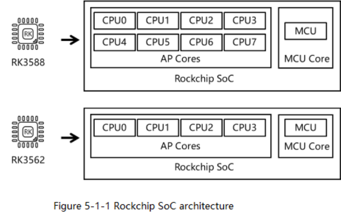

### 5.2 Dual AP Boot Solution

Taking the RK3562 as an example, the RK3562 is a quad-core ARM Cortex-A53 processor, which we abstract into CPU0, CPU1, CPU2, and CPU3. When running Rockchip's multi-core heterogeneous system, it supports various combinations of operation modes.

#### 5.2.1 Linux + RTOS or Bare-metal

##### 5.2.1.1 Example Firmware: Kernel + RT-Thread / HAL

When using the Kernel + RT-Thread / HAL boot solution, the default RTOS runs on CPU3. During startup, the Bootloader operates on CPU0, loading first into U-Boot. In U-Boot, it reads and starts the AMP firmware running on CPU3. U-Boot continues to run on CPU0, loading and starting the Linux Kernel, which in turn starts up CPU1 and CPU2. The process flowchart is as follows:

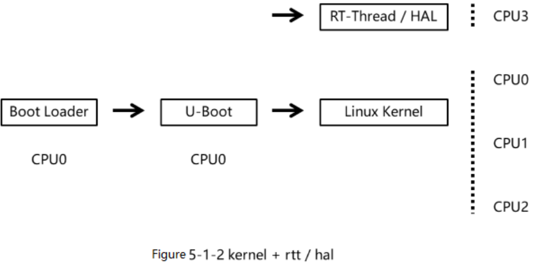

The amp_linux.its packaging file for Kernel + RT-Thread / HAL, is configured as follows:

```text
/dts-v1/;
/ {
    description = "FIT source file for Rockchip AMP";
    #address-cells = <1>;
    images {
        amp3 {
            description  = "bare-metal-core3";
            data         = /incbin/("cpu3.bin");
            type         = "firmware";
            compression  = "none";
            arch         = "arm";         // arm or arm64, it is arm by default
            cpu          = <0x3>;         // CPU ID
            thumb        = <0>;
            hyp          = <0>;
            load         = <0x01800000>;  // DRAM start address
            // Compilation configuration, automatically cleared by the compilation script after compilation
            compile {
                size         = <0x00800000>; // DRAM size
                srambase     = <0xfe480000>; // SRAM start address
                sramsize     = <0x00010000>; // SRAM size
                sys          = "rtt"; // CPU running system: HAL or RT-Thread
                // RT-Thread compilation configuration file
                rtt_config   = "board/rk3562_evb1_lp4x/defconfig";
            };
            udelay       = <10000>; // CPU startup delay, the delay time when multiple CPUs start in sequence
            hash {
                algo = "sha256";
            };
        };
        // An images can contain multiple sub-nodes, SDK will traverse all nodes under images and compile and package automatically according to node information
    };
    // Shared memory information, compilation configuration, automatically cleared by the compilation script after compilation
    share {
        shm_base         = <0x07800000>; // Multi-core CPU shared SDRAM memory start address
        shm_size         = <0x00400000>; // Multi-core CPU shared SDRAM memory allocation size
        rpmsg_base       = <0x07C00000>; // RPMSG shared memory start address
        rpmsg_size       = <0x00500000>; // RPMSG shared memory allocation size
        // Main system core ID, when multiple AMPs contain multiple systems, this parameter sets the CPU ID of the main system
        // In pure RTOS AMP, it defaults to "0x01"
        // When an AMP system includes linux, the linux cpu0 is configured as the main core by default
        primary = <0x0>;
    };
    configurations {
        default = "conf";
        conf {
            description = "Rockchip AMP images";
            rollback-index = <0x0>;
            loadables = "amp3"; // Loadable image, only "amp3" in this example
            signature {
                algo = "sha256,rsa2048";
                padding = "pss";
                key-name-hint = "dev";
                sign-images = "loadables";
            };
            /* - run linux on cpu0 * - it is brought up by amp (that run on U-Boot) * - it is boot entry depends on U-Boot */
            linux {
                description  = "linux-os";
                arch         = "arm64";
                cpu          = <0x000>;
                thumb        = <0>;
                hyp          = <0>;
                udelay       = <0>;
                // If the AMP system conflicts with the Kernel loading position, adjust the Kernel loading position
                load         = <0x2000000>; // Kernel loading position
                load_c       = <0x4880000>; // Compressed Kernel loading position
            };
        };
    };
};
```

##### 5.2.1.2 Example Firmware: Kernel + 3 HAL

When using the Kernel + 3 * HAL boot solution, the default Linux runs on CPU0. During startup, the Bootloader runs on CPU0 and first loads into U-Boot. In U-Boot, it reads the amp.img firmware and loads the Bare-metal firmware in the order of loadables = "amp1", "amp2", "amp3"; , and starts the corresponding CPU1, CPU2, and CPU3 cores. U-Boot continues to run on CPU0 and continues to load the Linux Kernel. The process flowchart is as follows:

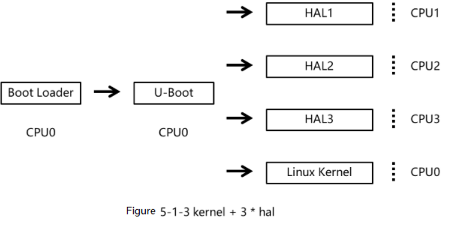

The configuration of packaging file amp_linux.its of the Kernel + 3 * HAL / RT-Thread is as follows:

```text
description = "FIT source file for Rockchip AMP";
#address-cells = <1>;
images {
    amp1 {
    // ......
    }
    amp2 {
    // ......
    }
    amp3 {
        description  = "bare-metal-core3";
        data         = /incbin/("cpu3.bin");
        type         = "firmware";
        compression  = "none";
        arch         = "arm";         // arm or arm64, default arm
        cpu          = <0x3>;         // CPU ID
        thumb        = <0>;
        hyp          = <0>;
        load         = <0x01800000>;  // DRAM start address
        // Compile configuration, automatically cleared by the compile script after compilation
        compile {
            size         = <0x00800000>; // DRAM size
            srambase     = <0xfe480000>; // SRAM start address
            sramsize     = <0x00010000>; // SRAM size
            sys          = "hal"; // CPU running system: HAL or RT-Thread
            // RT-Thread compilation configuration file
            rtt_config   = "board/rk3562_evb1_lp4x/defconfig";
        };
        udelay       = <10000>; // CPU startup delay, delay time when multiple CPUs start in sequence
        hash {
            algo = "sha256";
        };
    };
    // An images can contain multiple sub-nodes, and the SDK will traverse all nodes under images, automatically compiling and packaging based on node information
};
## Chapter-5 Shared memory information, compile configuration, automatically cleared by the
compile script after compilation
share {
    shm_base         = <0x07800000>; // Multi-core CPU shared SDRAM memory start address
    shm_size         = <0x00400000>; // Multi-core CPU shared SDRAM memory allocation size
    rpmsg_base       = <0x07C00000>; // RPMSG shared memory start address
    rpmsg_size       = <0x00500000>; // RPMSG shared memory allocation size
    // Master system core ID, when multiple AMPs contain multiple systems, this parameter sets the CPU ID of the main system
    // In pure RTOS AMP, it is default to "0x01"
    // When the AMP system contains Linux, the Linux cpu0 is configured as the main core by default
    primary = <0x0>;
};
configurations {
    default = "conf";
    conf {
        description = "Rockchip AMP images";
        rollback-index = <0x0>;
        // Image load list: When there are multiple amp images,
        // For example: loadables = "amp0", "amp1", "amp2", "amp3"...
        // When CPU0 is the boot core, the actual loading order is: amp1-->amp2-->amp3->...-
>amp0
        // And so on, the boot core is occupied during the boot phase and will be the last to start
        // Load the image, in this example, there are "amp1", "amp2", "amp3"
        loadables = "amp1", "amp2", "amp3";
        signature {
            algo = "sha256,rsa2048";
            padding = "pss";
            key-name-hint = "dev";
            sign-images = "loadables";
        };
        /* - run linux on cpu0 * - it is brought up by amp(that run on U-Boot) * - it is boot entry depends on U-Boot */
        linux {
            description  = "linux-os";
            arch         = "arm64";
            cpu          = <0x000>;
            thumb        = <0>;
            hyp          = <0>;
            udelay       = <0>;
            // If the AMP system conflicts with the Kernel loading position, adjust the Kernel loading position
            load         = <0x2000000>; // Kernel loading position
            load_c       = <0x4880000>; // Compressed Kernel loading position
        };
    };
};
```

#### 5.2.2 RTOS + Bare-metal

##### 5.2.2.1 Example Firmware: HAL + HAL

When using the HAL + HAL boot solution, the primary bootloader operates on CPU0, first loads into U-Boot, reads the amp.img firmware, loads the bare-metal firmwares cpu1.bin, cpu2.bin, cpu3.bin, and starts the corresponding cores CPU1, CPU2, and CPU3 cores. U-Boot continues to run on CPU0, loading the remaining bare-metal cpu0.bin firmware. The process flowchart is as follows:

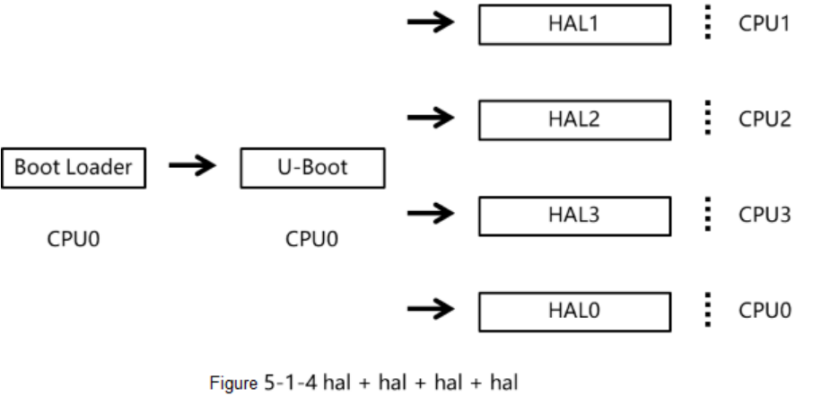

The packaging file amp_linux.its for HAL + HAL is configured as follows:

```text
description = "FIT source file for Rockchip AMP";
        #address-cells = <1>;
        images {
                amp0 {
                // ......
                }
                amp1 {
                        description  = "Bare-metal core3";
                        data         = /incbin/("cpu1.bin");
                        type         = "firmware";
                        compression  = "none";
                        arch         = "arm";         // arm or arm64, default arm
                        cpu          = <0x1>;         // CPU ID
                        thumb        = <0>;
                        hyp          = <0>;
                        load         = <0x00800000>;  // DRAM start address
                        // Compilation configuration, automatically cleared by the compilation script after Compilation
                        compile {
                                size         = <0x00800000>; // DRAM size
                                srambase     = <0xfe480000>; // SRAM start address
                                sramsize     = <0x00010000>; // SRAM size
                                sys          = "hal"; // CPU running system: HAL or RT-Thread
                                // RT-Thread compilation configuration file
                                rtt_config   = "board/rk3562_evb1_lp4x/defconfig";
                        };
                        udelay       = <10000>; // CPU startup delay, delay time when multiple CPUs start in sequence
                        hash {
                                algo = "sha256";
                        };
                }
                amp2 {
                // ......
                }
                amp3 {
                // ......
                };
                // Multiple sub-nodes can be included under one images, SDK will traverse all nodes under images, and automatically compile and package according to the node information
        };
        // Shared memory information, compilation configuration, automatically cleared by the compilation script after compilation
        share {
                shm_base         = <0x07800000>; // Multi-core CPU shared SDRAM memory start address
                shm_size         = <0x00400000>; // Multi-core CPU shared SDRAM memory allocation size
                rpmsg_base       = <0x07C00000>; // RPMSG shared memory start address
                rpmsg_size       = <0x00500000>; // RPMSG shared memory allocation size
                // Master system core ID, when multiple AMPs contain multiple systems, this parameter sets the CPU ID of the primary system
                // In pure RTOS AMP, it is defaulted to "0x01"
                // When the AMP system contains Linux, the Linux cpu0 is configured as the primary core by default
                primary = <0x0>;
        };
        configurations {
                default = "conf";
                conf {
                        description = "Rockchip AMP images";
                        rollback-index = <0x0>;
                        // Image load list: when there are multiple amp images,
                        // For example: loadables = "amp0", "amp1", "amp2", "amp3"...
                        // When CPU0 is the boot core, the actual loading order is: amp1--
>amp2-->amp3-->...-->amp0
                        // And so on, the boot core is occupied during the boot phase and will be the last to start in the AMP
                        // Load image, in this example there are "amp1", "amp2", "amp3"
                        loadables = "amp0", "amp1", "amp2", "amp3";
                        signature {
                                algo = "sha256,rsa2048";
                                padding = "pss";
                                key-name-hint = "dev";
                                sign-images = "loadables";
                        };
                };
        };
```

##### 5.2.2.2 Example Firmware: RT-Thread + HAL

When using the RTOS + Bare-metal boot solution, the preliminary bootloader runs on CPU0, first loads into U-Boot, reads the amp.img firmware, loads the cpu1.bin (RTOS firmware) and cpu2.bin, cpu3.bin 2 Bare-metal firmwares, and starts the corresponding CPU1, CPU2, CPU3 cores. U-Boot continues to run on CPU0, continuing to load and start the Bare-metal firmware, that is, cpu0.bin. The flowchart is as follows:

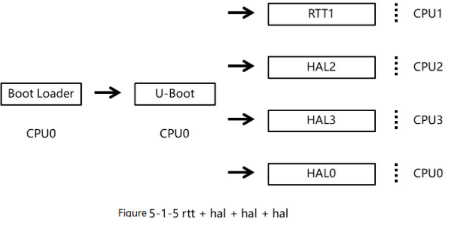

The packaging file for RT-Thread + HAL, amp_linux.its, is configured as follows:

```text
description = "FIT source file for Rockchip AMP";
        #address-cells = <1>;
        images {
                amp0 {
                // ......
                }
                amp1 {
                        description  = "Bare-metal core3";
                        data         = /incbin/("cpu1.bin");
                        type         = "firmware";
                        compression  = "none";
                        arch         = "arm";         // arm or arm64, default arm
                        cpu          = <0x1>;         // CPU ID
                        thumb        = <0>;
                        hyp          = <0>;
                        load         = <0x00800000>;  // DRAM start address
                        // Compilation configuration, automatically cleared by the compilation script after compilation
                        compile {
                                size         = <0x00800000>; // DRAM size
                                srambase     = <0xfe480000>; // SRAM start address
                                sramsize     = <0x00010000>; // SRAM size
                                sys          = "rtt"; // CPU running system: HAL or RT-Thread
                                // RT-Thread compilation configuration file
                                rtt_config   = "board/rk3562_evb1_lp4x/defconfig";
                        };
                        udelay       = <10000>; // CPU startup delay, delay time when multiple CPUs start in sequence
                        hash {
                                algo = "sha256";
                        };
                }
                amp2 {
                // ......
                }
                amp3 {
                // ......
                };
                // Under one images, multiple sub-nodes can be included, and the SDK will traverse all nodes under images, automatically compiling and packaging based on node information
        };
        // Shared memory information, compilation configuration, automatically cleared by the compilation script after compilation
        share {
                shm_base         = <0x07800000>; // Multi-core CPU shared SDRAM memory start address
                shm_size         = <0x00400000>; // Multi-core CPU shared SDRAM memory allocation size
                rpmsg_base       = <0x07C00000>; // RPMSG shared memory start address
                rpmsg_size       = <0x00500000>; // RPMSG shared memory allocation size
                // Master system core ID, when multiple AMPs contain multiple systems, this parameter sets the CPU ID of the main system
                // In pure RTOS AMP, it is defaulted to "0x01"
                // When the AMP system contains Linux, the Linux cpu0 is configured as the main core by default
                primary = <0x0>;
        };
        configurations {
                default = "conf";
                conf {
                        description = "Rockchip AMP images";
                        rollback-index = <0x0>;
                        // Image load list: when there are multiple amp images,
                        // For example: loadables = "amp0", "amp1", "amp2", "amp3"...
                        // When CPU0 is the boot core, the actual load order is: amp1-->amp2-
->amp3-->...-->amp0
                        // And so on, the boot core is occupied during the boot phase and will be the last to start in the AMP
                        // Load image, this example has "amp1", "amp2", "amp3"
                        loadables = "amp0", "amp1", "amp2", "amp3";
                        signature {
                                algo = "sha256,rsa2048";
                                padding = "pss";
                                key-name-hint = "dev";
                                sign-images = "loadables";
                        };
                };
        };
```

### 5.3 AP + MCU Boot Solution

#### 5.3.1 Linux + MCU RTOS or Bare-metal

##### 5.3.1.1 Example Firmware: Kernel + MCU RT-Thread or HAL

Using a Linux + 1 MCU boot solution, at startup, the Bootloader runs on CPU0, first loading into U-Boot. In U-Boot, it reads and starts the MCU running AMP firmware. U-Boot continues to run on CPU0, continues to load and start the Linux Kernel, and the Linux Kernel then starts up CPU1, CPU2, and CPU3. The process flowchart is as follows:

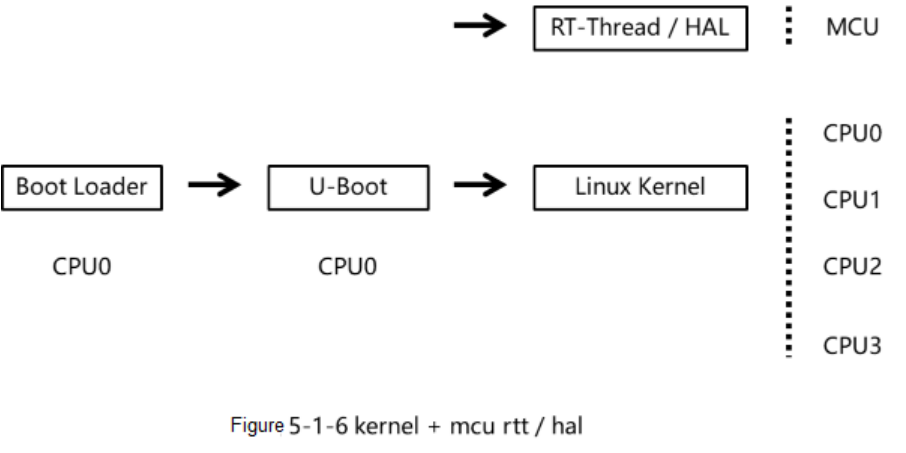

The packaging file for Kernel + MCU RT-Thread / HAL, amp_linux.its, is configured as follows:

```text
/dts-v1/;
/ {
        description = "Rockchip AMP FIT Image";
        #address-cells = <1>;
        images {
                mcu {
                        description  = "mcu"; // The firmware compiled from the hal, rtt
system is unified as mcu.bin
                        data         = /incbin/("./mcu.bin");
                        type         = "standalone"; // must be "standalone"
                        compression  = "none";
                        arch         = "arm"; // "arm64" or "arm", the same as U-Boot state
                        load         = <0x08200000>; // MCU program RAM start address
                        udelay       = <1000000>; // Boot delay time
                        hash {
                                algo = "sha256";
                        };
                };
        };
        configurations {
                default = "conf";
                conf {
                        description = "Rockchip AMP images";
                        rollback-index = <0x0>;
                        // Load image, only "mcu" in this example
                        loadables = "mcu";
                        signature {
                                algo = "sha256,rsa2048";
                                padding = "pss";
                                key-name-hint = "dev";
                                sign-images = "loadables";
                        };
                };
        };
};
```

### 5.4 Boot Solutions for Different Memory

The SDK supports boot solutions for various storage media, such as eMMC, Flash, SD cards, etc. This allows developers to better use the advantages of different storage devices and choose the most suitable storage solution according to specific project requirements.

#### 5.4.1 Booting from eMMC / Flash

Rockchip solutions typically utilize eMMC / Flash as the primary boot device to initiate system startup. The firmware of the system's bootloader and operating system kernel is stored in the eMMC/Flash chip. The main process is as follows:

1. Power-on Boot:

When the chip is powered on, it executes the internal boot ROM code of the device.

The boot ROM is responsible for loading the bootloader into memory.

2. Bootloader:

The bootloader is a special segment of code located in the boot partition of the eMMC / Flash storage device.

The bootloader is usually U-Boot or a custom bootloader provided by Rockchip.

The bootloader is responsible for initializing the system hardware, loading the kernel and file system, and transferring control to the kernel.

3. Kernel Loading:

The bootloader loads the Linux kernel image from the boot partition of the eMMC / Flash into memory.

The bootloader can also load the Device Tree Blob (DTB) and other necessary files.

4. Kernel Boot:

The loaded kernel image is decompressed into memory and begins execution.

The kernel initializes hardware, sets up interrupts, starts the scheduler, etc.

The kernel configures and identifies hardware devices based on information from the Device Tree Blob (DTB).

The kernel mounts the root file system during boot. 5. File System Mounting:

The kernel mounts the root file system from the eMMC / Flash according to the indications in the Device Tree Blob (DTB).

The root file system can be of types such as ext4, FAT, etc.

After the file system is mounted, the system can access files and directories within the file system.

6. User Space Initialization:

Initialization scripts or system services are responsible for starting user space processes and services.

User space processes and services can start applications, network services, etc., as needed.

For details and configurations, please refer to the Storage section in the document titled "Rockchip_Developer_Guide_UBoot_Nextdev_CN.pdf".

### 5.5 Quick Start Guide

#### 5.5.1 SD Card Boot

The SD card boot is facilitated by RK's tools to enable direct booting from an SD card, greatly easing the process for users to update the boot firmware without the need to re-flash the firmware to the device's internal storage. The detailed implementation steps are: burning the firmware to the SD card and using the SD card as the primary storage. When the controller boots from the SD card, both the firmware and temporary files are stored on the SD card, allowing normal operation regardless of the presence of local primary storage.

For the detailed boot process and related details, please refer to the descriptions of the SD card boot section in the documents "Rockchip_Developer_Guide_UBoot_Nextdev_CN.pdf" and "Rockchip_Developer_Guide_SD_Boot_CN.pdf".

### 5.6 Fast Boot Solution

The SDK supports system fast boot solution. By using a high-performance MCU built into the SoC, it assists the AP side in performing some simple thread operations during the boot phase, thereby enabling the rapid execution of operational tasks.

#### 5.6.1 SPL Boot Solution

The SPL solution refers to the approach of releasing and loading the MCU firmware at the SPL stage in advance, thereby reducing the time from power-up to the MCU firmware loading.

Taking the RK3562 as an example, the time from power-up to the first control business completion of the MCU can be as fast as 200mS.

The detailed configuration for the SPL boot solution is as follows:

The startup at the SPL stage requires modifying the RKTRUST/RK3562TRUST.ini under the rkbin repository to enable the MCU. The default firmware runs at 0x08200000.

```text
MCU=bin/rk35/rk3562_mcu_v1.00.bin,0x08200000,okay
```

Under the uboot repository, compile with the following command:

```text
./make.sh rk3562 --spl-new
```

The MCU firmware is packaged into the uboot.img, which is responsible for loading and releasing by the SPL.

#### 5.6.2 Dual Storage Boot Solution

The dual storage solution refers to a configuration that pairs NOR with eMMC, where the MCU firmware is stored in a small Flash memory, and the AP firmware is placed in the eMMC firmware. Due to the significantly shorter initialization time of Flash upon power-up compared to eMMC, the MCU firmware can be loaded more quickly.

For detailed configurations of the dual storage solution, please refer to the document Rockchip Developer Guide Dual Storage CN.pdf.

## 6. Chapter-6 Communication Strategy

### 6.1 Inter-Processor Interrupt Triggering

Rockchip AMP communication strategy is implemented by using interrupts combined with shared memory. After the sender updates the data in the shared memory, it triggers an interrupt to notify the receiver to process it. Currently, three methods of inter-processor interrupt triggering are provided: Mailbox interrupt triggering, software interrupt triggering, and SGI triggering. Additionally, Rockchip multi-core heterogeneous systems also provide Hardware Spinlock for reliable atomic operations.

#### 6.1.1 Mailbox Interrupt Trigger

Utilizing the RK Mailbox module for inter-core communication, it is possible to transmit a 32-bit Command register data and a 32-bit Data register data while triggering a Mailbox interrupt.

```text
#ifdef PRIMARY_CPU
// Master interrupt handling, the function will be callback here
static void mbox_master_isr(int vector, void *param)
{
    HAL_MBOX_IrqHandler(vector, pMBox);
    HAL_GIC_EndOfInterrupt(vector);
}
//  Interrupt Callback in the Mailbox
static void mbox_master_cb(struct MBOX_CMD_DAT *msg, void *args)
{
    uint32_t cpu_id;
    struct MBOX_CMD_DAT rx_msg = *msg;
    cpu_id = HAL_CPU_TOPOLOGY_GetCurrentCpuId();
    // Process the received 32-bit Command data and a 32-bit Data
    printf("mbox master: receive cpu-%ld cmd=0x%lx data=0x%lx\n", cpu_id, rx_msg.CMD, rx_msg.DATA);
}
#else
// Remote interrupt handling, the function will be callback here
static void mbox_remote_isr(int vector, void *param)
{
    HAL_MBOX_IrqHandler(vector, pMBox);
    HAL_GIC_EndOfInterrupt(vector);
}
static void mbox_remote_cb(struct MBOX_CMD_DAT *msg, void *args)
{
    uint32_t cpu_id;
    struct MBOX_CMD_DAT rx_msg = *msg;
    cpu_id = HAL_CPU_TOPOLOGY_GetCurrentCpuId();
    // Process the received 32-bit Command data and a 32-bit Data
    printf("mbox remote: receive cpu-%ld cmd=0x%lx data=0x%lx\n", cpu_id, rx_msg.CMD, rx_msg.DATA);
}
#endif
#ifdef PRIMARY_CPU
// Master side channel registration
static struct MBOX_CLIENT mbox_client2_m = { "mbox-cl2m", MBOX0_CH2_B2A_IRQn,
mbox_master_cb, (void *)MBOX_CH_2 };
static void mbox_master_test(void)
{
    struct MBOX_CLIENT *mbox_cl2m;
    struct MBOX_CMD_DAT tx_msg;
    uint32_t cpu_id;
    int ret = 0;
    cpu_id = HAL_CPU_TOPOLOGY_GetCurrentCpuId();
    mbox_cl2m = &mbox_client2_m;
    tx_msg.CMD = cpu_id & 0xFU;
    tx_msg.DATA = 0x12345678;
    /* Master core uses MBOX_A2B and remote core uses MBOX_B2A */
    HAL_MBOX_Init(pMBox, MBOX_A2B);
    ret = HAL_MBOX_RegisterClient(pMBox, MBOX_CH_2, mbox_cl2m);
    if (ret) {
        printf("mbox_cl2m register failed, ret=%d\n", ret);
    }
    HAL_IRQ_HANDLER_SetIRQHandler(MBOX0_CH2_B2A_IRQn, mbox_master_isr, NULL);
    HAL_GIC_Enable(MBOX0_CH2_B2A_IRQn);
    HAL_DelayMs(4000);
    printf("mbox master: send cmd=0x%lx data=0x%lx\n", tx_msg.CMD, tx_msg.DATA);
    // Send data, 32-bit Command data and a 32-bit Data
    HAL_MBOX_SendMsg(pMBox, MBOX_CH_2, &tx_msg);
}
#endif
#ifdef CPU2
// Remote side channel registration
static struct MBOX_CLIENT mbox_client2_r = { "mbox-cl2r", MBOX0_CH2_A2B_IRQn,
mbox_remote_cb, (void *)MBOX_CH_2 };
static void mbox_remote_test(void)
{
    struct MBOX_CLIENT *mbox_cl2r;
    struct MBOX_CMD_DAT tx_msg;
    uint32_t cpu_id;
    int ret = 0;
    cpu_id = HAL_CPU_TOPOLOGY_GetCurrentCpuId();
    mbox_cl2r = &mbox_client2_r;
    tx_msg.CMD = cpu_id & 0xFU;
    tx_msg.DATA = 0x98765432;
    /* Master core uses MBOX_A2B and remote core uses MBOX_B2A */
    HAL_MBOX_Init(pMBox, MBOX_B2A);
    ret = HAL_MBOX_RegisterClient(pMBox, MBOX_CH_2, mbox_cl2r);
    if (ret) {
        printf("mbox_cl2r register failed, ret=%d\n", ret);
    }
    HAL_IRQ_HANDLER_SetIRQHandler(MBOX0_CH2_A2B_IRQn, mbox_remote_isr, NULL);
    HAL_GIC_Enable(MBOX0_CH2_A2B_IRQn);
    HAL_DelayMs(2000);
    printf("mbox remote: send cmd=0x%lx data=0x%lx\n", tx_msg.CMD, tx_msg.DATA);
    // Send data, 32-bit Command data and a 32-bit Data
    HAL_MBOX_SendMsg(pMBox, MBOX_CH_2, &tx_msg);
}
#endif
```

#### 6.1.2 Software Interrupt Triggering

Using GIC SPI interrupt, which is the reserved irq in shared peripheral interrupts, by actively sending a pending trigger.

```text
static void soft_isr(int vector, void *param)
{
    printf("soft_isr, vector = %d\n", vector);
    HAL_GIC_EndOfInterrupt(vector);
}
static void softirq_test(void)
{
    HAL_IRQ_HANDLER_SetIRQHandler(RSVD0_IRQn, soft_isr, NULL);
    HAL_GIC_Enable(RSVD0_IRQn);
    // Trigger the software interrupt
    HAL_GIC_SetPending(RSVD0_IRQn);
}
```

#### 6.1.3 SGI Triggering

Using GIC SGI, that is, software interrupt triggering. Since Linux SMP occupies 8 non-secure SGI interrupt numbers, and the other 8 secure SGI interrupt numbers require special application. Therefore, the method of SGI triggering is commonly used for synchronization between multiple slave cores.

```text
#define IPI_CPU0               0x01
#define IPI_CPU1               0x02
#define IPI_CPU2               0x04
#define IPI_CPU3               0x08
#define IPI_TO_TARGETLIST      0
#define IPI_TO_ALL_EXCEPT_SELF 1
static void ipi_sgi_isr(int vector, void *param)
{
    uint32_t cpu_id;
    cpu_id = HAL_CPU_TOPOLOGY_GetCurrentCpuId();
    if (cpu_id == 2) {
        HAL_DelayMs(1000);
    } else if (cpu_id == 3) {
        HAL_DelayMs(2000);
    }
    printf("ipi sgi: cpu_id=%ld vector = %d\n", cpu_id, vector);
    HAL_GIC_EndOfInterrupt(vector);
}
static void ipi_sgi_test(void)
{
    uint32_t cpu_id;
    cpu_id = HAL_CPU_TOPOLOGY_GetCurrentCpuId();
    HAL_IRQ_HANDLER_SetIRQHandler(IPI_SGI7, ipi_sgi_isr, NULL);
    HAL_GIC_Enable(IPI_SGI7);
    if (cpu_id == 1) {
        printf("ipi sgi: cpu_id=%ld test start\n", cpu_id);
        HAL_DelayMs(2000);
        // Trigger CPU0 SGI7 interrupt
        HAL_GIC_SendSGI(IPI_SGI7, 0, IPI_TO_ALL_EXCEPT_SELF);
        HAL_DelayMs(4000);
        HAL_GIC_SendSGI(IPI_SGI7, IPI_CPU3, IPI_TO_TARGETLIST);
        HAL_DelayMs(4000);
        HAL_GIC_SendSGI(IPI_SGI7, IPI_CPU3 | IPI_CPU2, IPI_TO_TARGETLIST);
        HAL_DelayMs(4000);
        HAL_GIC_SendSGI(IPI_SGI7, IPI_CPU3 | IPI_CPU2 | IPI_CPU0, IPI_TO_TARGETLIST);
    }
}
```

### 6.2 Low-Level Interface Solution

Rockchip multi-core heterogeneous system provides open inter-core interrupts + Shared Memory underlying driver interface to customers. For customers who are already using multi-core heterogeneous systems, they can directly replace the corresponding underlying driver interface to complete platform porting work.

RK AMP currently supports inter-core interrupt triggering methods such as Mailbox and software interrupts, with Linux only supporting uncache for shared memory, and the rest default to supporting cacheable.

For the Mailbox interrupt method under Linux, refer to the code at the following path: drivers/rpmsg/rockchip_rpmsg_mbox.c

For the software interrupt method under Linux, refer to the code at the following path: drivers/rpmsg/rockchip_rpmsg_softirq.c

For RPMsg-Lite under Bare-metal, refer to the code at the following path: hal/middleware/rpmsg-lite/lib/rpmsg_lite/porting/platform/RKXX/rpmsg_platform.c

For RPMsg-Lite under RTOS, refer to the code at the following path: rtos/rockchip/common/drivers/rpmsg-lite/lib/rpmsg_lite/porting/platform/RKXX/rpmsg_platform.c

### 6.3 RPMsg Protocol Solution

#### 6.3.1 Standard Framework

Rockchip provides a standard framework solution for the RPMsg protocol in multi-core heterogeneous systems, with Linux Kernel adapting to RPMsg, RTOS and Bare-metal adapting to RPMsg-Lite. It defines the standard binary interface used for communication between cores in an AMP system.

RPMsg is a messaging mechanism implemented on VirtIO, which is a general architecture for implementing virtualized IO, similar to virtual network cards, virtual disks, etc., all of which use this technology. In VirtIO, it is based on VirtIO-Ring, which implements data transmission/reception through shared memory, with vring being unidirectional; one vring is only used to send data to the Remote Core, and another vring is used to receive data from the Remote Core.

Therefore, from an overall framework perspective, RPMsg is composed of inter-core interrupts between the Master Core and Remote Core, as well as three segments of Shared Memory: vring0, vring1, and vdev buffer.

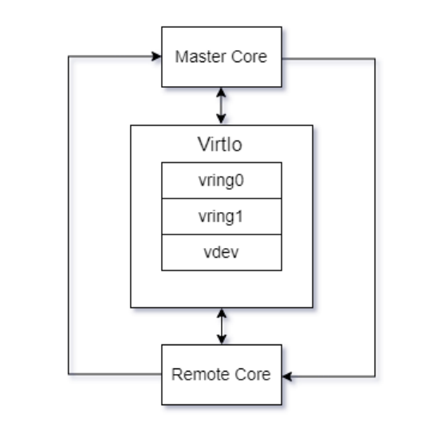

#### 6.3.2 Communication Process

In RPMsg, the master and remote cores communicate through interrupts and shared memory, with the master core responsible for memory management. There are two buffers, USED and AVAIL, for each communication direction, which can be divided into segments according to the RPMsg message format, and these memory blocks can be linked to form a ring.

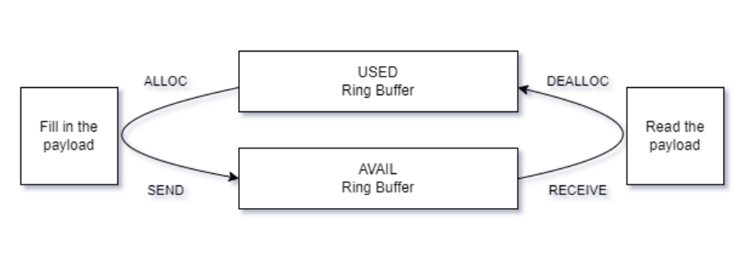

Thus, when the master core and the remote core communicate:

1. The Master Core, when sending, obtains a buffer from vring0(USED), and then fills the message according to the RPMsg protocol.

2. The processed memory buffer is linked to vring1(AVAIL).

3. An interrupt is triggered to notify the Remote Core that there is data to be processed.

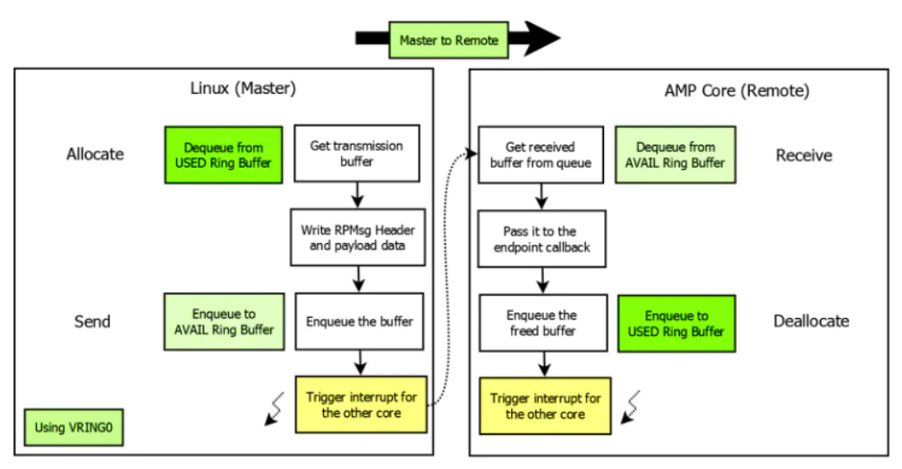

Similarly, when the remote core needs to communicate with the master core:

1. The remote core obtains a buffer from vring1(AVAIL) according to the queue, and then fills the message according to the RPMsg protocol.

2. The processed memory buffer is linked to vring0(USED).

3. An interrupt is triggered to notify the Master Core that there is data to be processed.

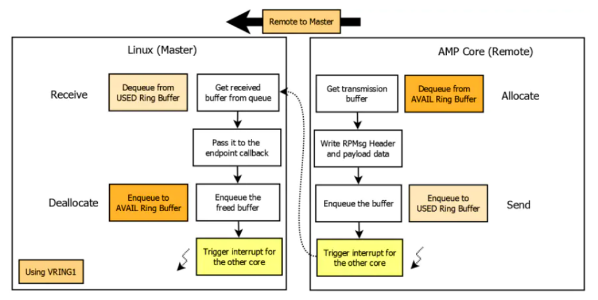

After completing the message transfer, the used buffer is released and waits for the next data to be sent. When the remote core sends, the process is the opposite of the master core's sending process. Shared data during communication is placed in the vdev buffer.

The maximum data length that RPMsg can send at a time depends on the payload length, which is 512 Bytes by default in the SDK. Since RPMsg also has a 16-Byte data header, the maximum data volume that can be transferred at one time is 496 Bytes. For more details, refer to drivers/rpmsg/virtio_rpmsg_bus.c.

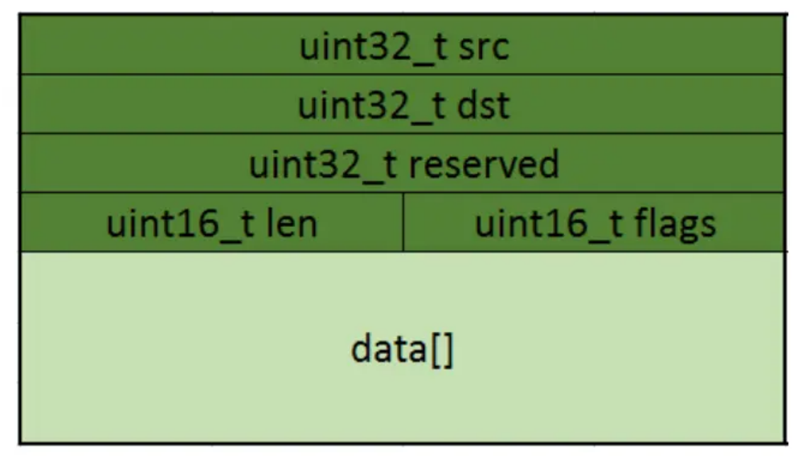

#### 6.3.3 RPMsg Adaptation

##### 6.3.3.1 Linux Kernel RPMsg Adaptation

The main code structure of Linux Kernel RPMsg is as follows:

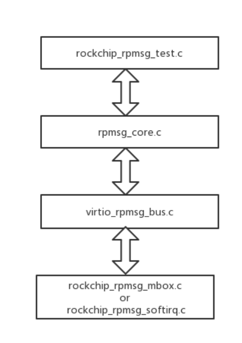

kernel/drivers/rpmsg/rockchip_rpmsg_mbox.c is a driver registered on the Platform Bus, also registering a device to the VirtIO Bus. It implements the physical layer based on the mailbox inter-core interrupt and Shared Memory underlying driver interface.

kernel/drivers/rpmsg/rockchip_rpmsg_softirq.c is also a driver registered on the Platform Bus, registering a device to the VirtIO Bus as well. It implements the physical layer based on the softirq inter-core interrupt and Shared Memory underlying driver interface.

kernel/drivers/rpmsg/virtio_rpmsg_bus.c is a driver registered on the VirtIO Bus, registering a device to the RPMsg Bus. VirtIO and Virtqueue are the MAC layer (MAC Layer) chosen for the general RPMsg protocol.

kernel/drivers/rpmsg/rpmsg_core.c creates the RPMsg Bus and provides the transport layer (Transport Layer) interface.

kernel/drivers/rpmsg/rockchip_rpmsg_test.c provides a simple example of inter-core communication channel creation and data transmission and reception.

RPMsg TTY Support

The Linux kernel also supports mounting RPMsg as a TTY device. The principle and software structure are consistent with the aforementioned Linux. The RPMsg on the Linux side generally acts as the Master. When connecting with Remote, a endpoint needs to be created. A channel allows for the creation of multiple endpoints, and different endpoints are created through the server name (service name) sent by the server name (service name). In other words, when the local server name (local service name) on Linux (Master) matches the server name sent by the remote Remote, two terminals that can communicate with each other are created at both ends of the channel (channel).

As shown in kernel/drivers/rpmsg/rockchip_rpmsg_test.c:

```text
static struct rpmsg_device_id rockchip_rpmsg_test_id_table[] = {
    { .name = "rpmsg-ap3-ch0" },
    { .name = "rpmsg-mcu0-test" },
    { .name = "rpmsg-perf-bw-test" },
    { .name = "rpmsg-perf-pingpong-bw-test" },
    { .name = "rpmsg-latency-test" },
    { /* sentinel */ },
};
```

In kernel/drivers/rpmsg/rockchip_rpmsg_test.c, the above server names (service names) are declared, and after the Remote end is linked, a link can be created by sending the corresponding server name. When the name matches, the probe function is called.

The principle of RPMsg TTY is also the same. After enabling the configuration, the Remote end sends a matching server name, and the Linux RPMsg calls the probe function after receiving the matching name, and at the same time, registers RPMsg as a TTY device. After the registration is successful, the /dev/ttyRPMSG node can be found.

The TTY creation example is as follows:

After the Remote end creates the terminal, it sends the "rpmsg-tty" server name using rpmsg_ns_announce:

```text
ept = rpmsg_lite_create_ept(instance, RPMSG_HAL_REMOTE_TEST3_EPT, remote_ept_cb, info);
rpmsg_ns_announce(instance, ept, "rpmsg-tty", RL_NS_CREATE);
```

kernel/drivers/tty/rpmsg_tty.c

```text
static struct rpmsg_device_id rpmsg_driver_tty_id_table[] = {
    { .name = "rpmsg-tty" },
    { },
};
```

##### 6.3.3.2 RPMsg-Lite Adaptation

RPMsg-Lite is a third-party open-source solution with a structure similar to Linux RPMsg.

The main code structure of RPMsg-Lite is as follows:

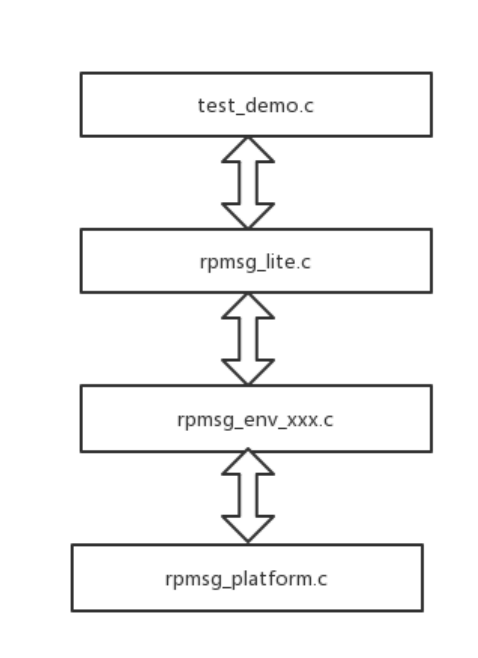

The implementation of RPMsg-Lite can be divided into three components, two of which are optional. The core component is located in rpmsg_lite.c. The two optional components are used to implement the receive blocking API (in rpmsg_queue.c) and the Name Service endpoint, which is used to create and declare endpoint nodes (in rpmsg_ns.c).

The actual memory access is implemented in virtqueue.c, which mainly defines the data structures used to manage the use of shared memory, such as vring or virtqueue.

The porting part consists of two layers: environment and platform. The environment will be implemented separately for each environment, such as the bare-metal environment in rpmsg_env_bm.c, and the RT-Thread environment in rpmsg_env_rt_thread.c. Of course, developers can also refer to this part of the code to implement support for a specified RTOS. The platform is implemented in rpmsg_platform.c, mainly for interrupt configuration and triggering, as introduced above, different interrupts (MailBox or soft interrupts) can be used at this stage. If there are cache or shared memory address offsets, specific operations also need to be carried out in the platform. RPMsg-Lite can refer to:

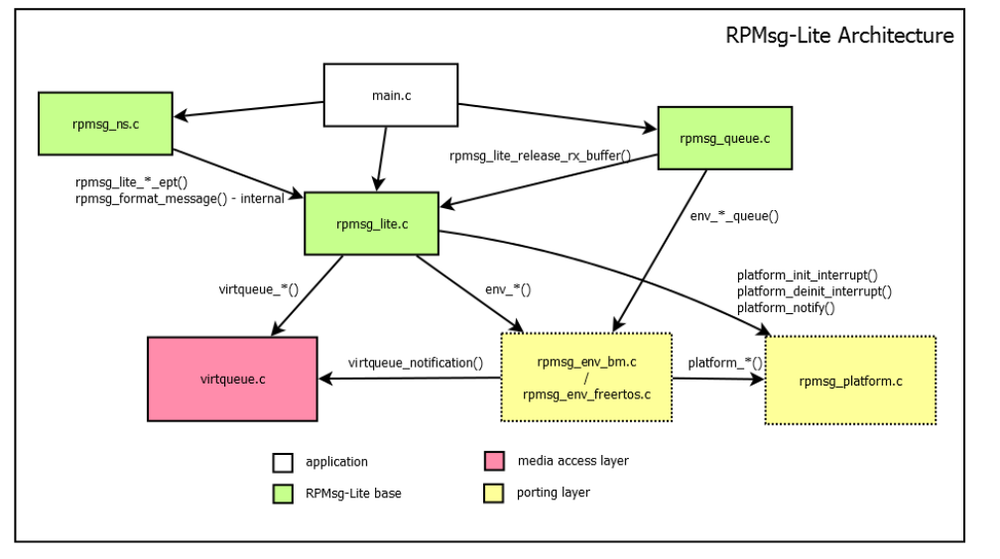

##### 6.3.3.3 MCU RPMsg-Lite Adaptation

MCUs also utilize RPMsg-Lite, and it is important to note that due to the memory mapping on MCUs, if you wish to change the address of the shared memory, you will need to reconfigure uboot and rpmsg_platform.c. Currently, the shared memory for RPMsg is all under unCache, so there is no need to refresh the Cache to ensure memory data consistency. For platforms with MCUs, it is only necessary to pay attention to the mapping of the shared memory address, which is typically initialized in Uboot.

The starting address of the MCU's RAM is passed by ITS configuration and has an offset from the actual physical address. Therefore, the shared memory address seen by the MCU and the actual physical address also have an offset. It is recommended to place the shared memory address after the MCU for ease of subsequent operations.

Taking RK3562 as an example, the register description can refer to the TRM documentation. The current SDK shared address configuration is at 0x07C00000, with a size of 0x500000. The MCU RAM starting address is passed by ITS to Uboot and configured as 0x7b00000. Therefore, in the file u-boot/arch/arm/mach- rockchip/rk3562/rk3562.c:

```text
int fit_standalone_release(char *id, uintptr_t entry_point)
{
    /* bus m0 configuration: */
    /* open hclk_dcache / hclk_icache / clk_bus m0 rtc / fclk_bus_m0_core */
    writel(0x03180000, TOP_CRU_BASE + TOP_CRU_GATE_CON23);
    /* open bus m0 sclk / bus m0 hclk / bus m0 dclk */
    writel(0x00070000, TOP_CRU_BASE + TOP_CRU_CM0_GATEMASK);
    /* * mcu_cache_peripheral_addr * The uncache area ranges from 0x7c00000 to 0xffb400000 * and contains rpmsg shared memory */
    /* Here, 0x07c00000 to 0xffb40000 are all set to uncache to ensure shared memory is in uncache */
    writel(0x07c00000, SYS_GRF_BASE + SYS_GRF_SOC_CON5);
    writel(0xffb40000, SYS_GRF_BASE + SYS_GRF_SOC_CON6);
    /* Configure the starting address of MCU RAM */
    sip_smc_mcu_config(ROCKCHIP_SIP_CONFIG_BUSMCU_0_ID,
               ROCKCHIP_SIP_CONFIG_MCU_CODE_START_ADDR,
               0xffff0000 | (entry_point >> 16));
    /* release dcache / icache / bus m0 jtag / bus m0 */
    writel(0x03280000, TOP_CRU_BASE + TOP_CRU_SOFTRST_CON23);
    /* release pmu m0 jtag / pmu m0 */
    /* writel(0x00050000, PMU1_CRU_BASE + PMU1_CRU_SOFTRST_CON02); */
    return 0;
}
```

In the amp.its of MCU:

```text
/* * Copyright (C) 2023 Rockchip Electronics Co., Ltd * * SPDX-License-Identifier: GPL-2.0 */
/dts-v1/;
/ {
    description = "Rockchip AMP FIT Image";
    #address-cells = <1>;
    images {
        mcu {
            description  = "mcu";
            data         = /incbin/("./mcu.bin");
            type         = "standalone";    // must be "standalone"
            compression  = "none";
            arch         = "arm";        // "arm64" or "arm", the same as U-Boot state
            load         = <0x07b00000>; //MCU RAM starting address
            udelay       = <1000000>;
            hash {
                algo = "sha256";
            };
        };
    };
    configurations {
        default = "conf";
        conf {
            description = "Rockchip AMP images";
            rollback-index = <0x0>;
            loadables = "mcu";
            signature {
                algo = "sha256,rsa2048";
                padding = "pss";
                key-name-hint = "dev";
                sign-images = "loadables";
            };
        };
    };
};
```

In the gcc_bus_m0.ld configuration, it can be seen that the shared memory address is an offset address:

```text
/* SPDX-License-Identifier: BSD-3-Clause */
/* * Copyright (c) 2023 Rockchip Electronics Co., Ltd. */
MEMORY
{
    # RAM starting address, actual physical address 0x07b00000
    RAM(rxw) : ORIGIN = 0x00000000, LENGTH = 0x100000
    # RPMsg shared memory address, actual physical address 0x07c00000
    LINUX_RPMSG (rxw) : ORIGIN = 0x00100000, LENGTH = 0x00500000
}
```

At the same time, Master is responsible for memory management, with the MCU acting as the Remote end. The buffer address obtained from the vring is the actual physical address, so an offset processing is required when sending/receiving. please refer to rpmsg_platform.c.

```text
#ifdef HAL_MCU_CORE
/* MCU offset address */
#ifdef HAL_CACHE_DECODED_ADDR_BASE
#define RL_PHY_MCU_OFFSET HAL_CACHE_DECODED_ADDR_BASE
#else
#define RL_PHY_MCU_OFFSET (0U)
#endif
#endif
/** * platform_patova * * Dummy implementation * */
void *platform_patova(uint32_t addr)
{
#ifdef HAL_MCU_CORE
    addr -= RL_PHY_MCU_OFFSET;
#endif
    return ((void *)(char *)addr);
}
```

### 6.4 RPMsg Compilation Configuration

#### 6.4.1 Kernel + RT-Thread

Kernel Configuration:

```text
## Chapter-6 Enable MailBox support
CONFIG_MAILBOX=y
CONFIG_ROCKCHIP_MBOX=y
## Chapter-6 MailBox interrupt triggering
CONFIG_RPMSG_ROCKCHIP_MBOX=y
CONFIG_RPMSG_VIRTIO=y
```

Enable TTY support:

```text
CONFIG_RPMSG_TTY=y
```

RT-Thread Configuration: Run scons --menuconfig

```text
## Chapter-6 Enable RPMsg-Lite support
CONFIG_RT_USING_RPMSG_LITE=y
## Chapter-6 Enable Linux+RTT RPMsg
CONFIG_RT_USING_LINUX_RPMSG=y
```

#### 6.4.2 Kernel + HAL

Kernel Configuration:

```text
## Chapter-6 Enable MailBox support
CONFIG_MAILBOX=y
CONFIG_ROCKCHIP_MBOX=y
## Chapter-6 MailBox interrupt trigger
CONFIG_RPMSG_ROCKCHIP_MBOX=y
CONFIG_RPMSG_VIRTIO=y
```

HAL Configuration: HAL defaults to enabling RPMSG support, for details on how to activate the test demo using HAL, refer to the RPMsg Test Example section.

```text
// Enable in test_demo.c
#define RPMSG_LINUX_TEST
```

#### 6.4.3 RT-Thread + HAL

RT-Thread Configuration: Execute scons --menuconfig

```text
## Chapter-6 Enable RPMsg-Lite support
CONFIG_RT_USING_RPMSG_LITE=y
```

### 6.5 RPMsg Testing Example

#### 6.5.1 Kernel + RT-Thread

The Kernel RPMSG inter-processor communication framework, with the underlying adaptation using the VirtIO approach. The main code paths are as follows:

```text
kernel/drivers/rpmsg/rpmsg_core.c
kernel/drivers/rpmsg/virtio_rpmsg_bus.c
kernel/drivers/rpmsg/rockchip_rpmsg_softirq.c
kernel/include/linux/rpmsg/rockchip_rpmsg.h
```

##### 6.5.1.1 Shared Memory

Taking the SDK provided demo as an example, allocate 5M of shared memory for RPMSG, where 4M is for VRING BUFFER and 1M is for VDEV BUFFER.

Since the current rpmsg code of the kernel is configured to share memory as uncacheable by default, both ends are set to uncacheable by default.

Kernel Path: SDK/kernel/arch/arm64/boot/dts/rockchip/rkxxxx-amp.dtsi

```text
reserved-memory {
    #address-cells = <2>;
    #size-cells = <2>;
    ranges;
    /* remote amp core address */
    amp_reserved: amp@2e00000 {
        reg = <0x0 0x2e00000 0x0 0x1200000>;
        no-map;
    };
    rpmsg_reserved: rpmsg@7c00000 {
        reg = <0x0 0x07c00000 0x0 0x400000>;
        no-map;
    };
    rpmsg_dma_reserved: rpmsg-dma@8000000 {
        compatible = "shared-dma-pool";
        reg = <0x0 0x08000000 0x0 0x100000>;
        no-map;
    };
};
```

RTT Path: SDK/rtos/bsp/rockchip/rk3308-32/board/common/board_base.c

```text
1.MMU is mapped as unCache
    {LINUX_SHMEM_BASE, LINUX_SHMEM_BASE + LINUX_SHMEM_SIZE - 1, LINUX_SHMEM_BASE,
UNCACHED_MEM},
```

If there is a requirement for the data transmission speed of rpmsg, the shared memory can be configured as cacheable. For example, under the condition that all CPUs of rk3576 are fixed at 1416 MHz and the DDR frequency is 2112 MHz, when the shared memory is configured as uncacheable, the measured bandwidth from the kernel side sending to the rtt side receiving is 77 MB/s. When the shared memory is configured as cacheable, the measured bandwidth is 1880 MB/s.

Prefer consistent cache attributes at both ends. If Linux uses cacheable memory and RTT uses uncacheable memory, Linux must clean its written data before RTT consumes it. Before Linux reads RTT-written data, Linux must invalidate stale cache lines. Coordinate these operations with buffer ownership and the actual SDK implementation.

If shared memory is to be configured as cacheable, the rpmsg driver framework code needs to be modified.

Kernel Path: SDK/kernel/drivers/rpmsg/virtio_rpmsg_bus.c

Replace the dma_alloc_coherent with the ioremap_cache. Among them, addr is the address of rpmsg_dma_reserved.

```text
--- a/drivers/rpmsg/virtio_rpmsg_bus.c
+++ b/drivers/rpmsg/virtio_rpmsg_bus.c
@@ -913,9 +913,7 @@ static int rpmsg_probe(struct virtio_device *vdev)
        total_buf_space = vrp->num_bufs * vrp->buf_size;
        /* allocate coherent memory for the buffers */
-       bufs_va = dma_alloc_coherent(vdev->dev.parent,
-                                    total_buf_space, &vrp->bufs_dma,
-                                    GFP_KERNEL);
+       bufs_va = ioremap_cache(addr, total_buf_space);
```

RTT Path: SDK/rtos/bsp/rockchip/rkxxxx/board/common/board_base.c

```text
struct mem_desc platform_mem_desc[] =
{
#if (defined(LINUX_RPMSG_VRING_BASE) && defined(LINUX_RPMSG_BUFF_BASE))
    {LINUX_RPMSG_VRING_BASE, LINUX_RPMSG_VRING_BASE + LINUX_RPMSG_VRING_SIZE,
LINUX_RPMSG_VRING_BASE, NORMAL_NOCACHE_MEM},
    {LINUX_RPMSG_BUFF_BASE, LINUX_RPMSG_BUFF_BASE + LINUX_RPMSG_BUFF_SIZE,
LINUX_RPMSG_BUFF_BASE, NORMAL_MEM},
#endif
}
```

The rpmsg shared memory is divided into the vring area and the buff_pool area. The buff_pool area stores the actual data packets, and the vring area stores the addresses of the data packets for management. Data access mainly occurs in the buff_pool area. Here, only the buff_pool area is configured as cacheable. In the code, LINUX_RPMSG_VRING_BASE corresponds to the address rpmsg_reserved of the device tree node, that is, the vring area, and LINUX_RPMSG_BUFF_BASE corresponds to the address rpmsg_dma_reserved, that is, the buff_pool area.

##### 6.5.1.2 Testing Demo

###### 6.5.1.2.1 Kernel Demo

Modify the configuration file in the Kernel project at kernel/arch/arm64/configs/xxxx_defconfig .

```text
CONFIG_RPMSG_ROCKCHIP_TEST
```

Or configure through the menuconfig interface:

```text
## Chapter-6 Open the configuration interface
make ARCH=arm64 rkxxxx_linux_defconfig
make ARCH=arm64 menuconfig
    # Enable the following macro switch
    CONFIG_RPMSG_ROCKCHIP_TEST
## Chapter-6 Save the configuration
make ARCH=arm64 savedefconfig
cp defconfig arch/arm64/configs/rkxxxx_linux_defconfig
```

Kernel Demo Path: kernel/drivers/rpmsg/rockchip_rpmsg_test.c

```text
1. Main process of the demo
static struct rpmsg_driver rockchip_rpmsg_test = {
    .drv.name   = KBUILD_MODNAME,
    .drv.owner  = THIS_MODULE,
    .id_table   = rockchip_rpmsg_test_id_table,
    .probe      = rockchip_rpmsg_test_probe,
    .callback   = rockchip_rpmsg_test_cb,
    .remove     = rockchip_rpmsg_test_remove,
};
2. rockchip_rpmsg_test_id_table
/* Wait for remote core announce a new ept name from the master core, and if it matches the name in the following list, enter the probe function */
static struct rpmsg_device_id rockchip_rpmsg_test_id_table[] = {
    { .name = "rpmsg-ap3-ch0" },
    { .name = "rpmsg-mcu0-test" },
    { /* sentinel */ },
};
3. rockchip_rpmsg_test_probe
static int rockchip_rpmsg_test_probe(struct rpmsg_device *rp)
{
    int ret, size;
    uint32_t master_ept_id, remote_ept_id;
    struct instance_data *idata;
    master_ept_id = rp->src;
    remote_ept_id = rp->dst;
    dev_info(&rp->dev, "new channel: 0x%x -> 0x%x!\n", master_ept_id,
             remote_ept_id);
    /* probe send a message to the remote to let it know the master ept id */
    ret = rpmsg_send(rp->ept, LINUX_TEST_MSG_1, strlen(LINUX_TEST_MSG_1));
    if (ret) {
        dev_err(&rp->dev, "rpmsg_send failed: %d\n", ret);
        return ret;
    }
    /* Run the test */
    ret = rpmsg_sendto(rp->ept, LINUX_TEST_MSG_2, strlen(LINUX_TEST_MSG_2),
                       remote_ept_id);
    if (ret) {
        dev_err(&rp->dev, "rpmsg_send failed: %d\n", ret);
        return ret;
    }
    return 0;
}
4. rockchip_rpmsg_test_cb
static int rockchip_rpmsg_test_cb(struct rpmsg_device *rp, void *payload,
                                  int payload_len, void *priv, u32 src)
{
    int ret, size;
    uint32_t remote_ept_id;
    struct instance_data *idata = dev_get_drvdata(&rp->dev);
    /* After the master sends a message to the remote, the remote will also send a message back */
    remote_ept_id = src;
    dev_info(&rp->dev, "rx msg %s rx_count %d(remote_ept_id: 0x%x)\n",
            (char *)payload, ++idata->rx_count, remote_ept_id);
    /* Test to stop after receiving and sending 10000 messages */
    if (idata->rx_count >= MSG_LIMIT) {
        dev_info(&rp->dev, "Rockchip rpmsg test exit!\n");
        return 0;
    }
    /* After receiving data, send another message to the remote */
    ret = rpmsg_sendto(rp->ept, LINUX_TEST_MSG_2, strlen(LINUX_TEST_MSG_2),
                       remote_ept_id);
    if (ret)
        dev_err(&rp->dev, "rpmsg_send failed: %d\n", ret);
        return ret;
    }
```

Detailed interface function description is as follows:

| Function | Description |
| --- | --- |
| rpmsg_send() | Send a message to the remote processor |
| rpmsg_sendto() | Send a message to the remote processor with a specified remote ept id |

src identifies the local endpoint; dst identifies the remote endpoint. For Master, src is the master endpoint and dst is the remote endpoint; for Remote the roles reverse.

###### 6.5.1.2.2 RTT Demo

Configuration Menu Configuration: scons --menuconfig

```text
CONFIG_RT_USING_RPMSG_LITE=y
CONFIG_RT_USING_LINUX_RPMSG=y
CONFIG_RT_USING_COMMON_TEST_LINUX_RPMSG_LITE=y
```

RTT Demo Path: rtos/bsp/rockchip/common/tests/rpmsg_test.c

```text
static void rpmsg_linux_test(void)
{
    int j;
    uint32_t master_id, remote_id;
    struct rpmsg_info_t *info;
    struct rpmsg_block_t *block;
    rpmsg_queue_handle remote_queue;
    char *rx_msg = (char *)rt_malloc(RL_BUFFER_PAYLOAD_SIZE);
    uint32_t master_ept_id;
    uint32_t ept_flags;
    void *ns_cb_data;
    rpmsg_share_mem_check();
    master_id = MASTER_ID;
    remote_id = HAL_CPU_TOPOLOGY_GetCurrentCpuId();
    rt_kprintf("rpmsg remote: remote core cpu_id-%ld\n", remote_id);
    rt_kprintf("rpmsg remote: shmem_base-0x%lx shmem_end-%lx\n",
    RPMSG_LINUX_MEM_BASE, RPMSG_LINUX_MEM_END);
    info = malloc(sizeof(struct rpmsg_info_t));
    if (info == NULL) {
        rt_kprintf("info malloc error!\n");
        while (1) {
            ;
        }
    }
    info->private = malloc(sizeof(struct rpmsg_block_t));
    if (info->private == NULL) {
        rt_kprintf("info malloc error!\n");
        while (1) {
            ;
        }
    }
    /* Initialize rpmsg endpoint */
    info->instance = rpmsg_lite_remote_init((void *)RPMSG_LINUX_MEM_BASE,
    RL_PLATFORM_SET_LINK_ID(master_id, remote_id), RL_NO_FLAGS);
    rpmsg_lite_wait_for_link_up(info->instance);
    rt_kprintf("rpmsg remote: link up! link_id-0x%lx\n",
               info->instance->link_id);
    rpmsg_ns_bind(info->instance, rpmsg_ns_cb, &ns_cb_data);
    remote_queue  = rpmsg_queue_create(info->instance);
    info->ept = rpmsg_lite_create_ept(info->instance,
    RPMSG_RTT_REMOTE_TEST3_EPT_ID, rpmsg_queue_rx_cb, remote_queue);
    /* The remote core announce a new ept name corresponding to the master end */
    ept_flags = RL_NS_CREATE;
    rpmsg_ns_announce(info->instance, info->ept,
    RPMSG_RTT_REMOTE_TEST_EPT3_NAME, ept_flags);
    /****************** rpmsg test run **************/
    for (j = 0; j < 100; j++)
    {
        rpmsg_queue_recv(info->instance, remote_queue,
                         (uint32_t *)&master_ept_id, rx_msg,
                         RL_BUFFER_PAYLOAD_SIZE, RL_NULL, RL_BLOCK);
    //    rpmsg_queue_recv_nocopy(remote_rpmsg, remote_queue, (uint32_t *)&src,
                                  (char **)&rx_msg, RL_NULL, RL_BLOCK);
        rt_kprintf("rpmsg remote: master_ept_id-0x%lx rx_msg: %s\n",
                   master_ept_id, rx_msg);
        rpmsg_lite_send(info->instance, info->ept, master_ept_id,
        RPMSG_RTT_TEST_MSG, strlen(RPMSG_RTT_TEST_MSG), RL_BLOCK);
    }
}
```

Detailed Interface Function Description:

| Function | Description |
| --- | --- |
| rpmsg_lite_remote_init() | Initialize the RPMsg-lite remote end. |
| rpmsg_queue_create() | Create a queue in RPMsg-lite. |
| rpmsg_lite_create_ept() | Create an endpoint. |
| rpmsg_queue_recv() | Data received is automatically copied to the buffer area. |
| rpmsg_ns_bind() | Bind to the name service ept (ept id 0x35 is specifically for the name service<br>to pass the names of new channels). |
| rpmsg_ns_announce() | Announce the remote new ept name. |
| rpmsg_lite_send() | Send a message. |

###### 6.5.1.2.3 Successful Test Log

The Linux master core RPMSG is successfully mounted and the following printouts can be observed:

```text
[    1.105178] rockchip-rpmsg 7c00000.rpmsg: Rockchip RPMSG platform probe.
[    1.105228] rockchip-rpmsg 7c00000.rpmsg: assigned reserved memory node rpmsg_dma@8000000
[    1.105239] rockchip-rpmsg 7c00000.rpmsg: rpdev vdev0: vring0 0x7c00000, vring1 0x7c08000
[    1.105720] virtio_rpmsg_bus virtio0: RPMSG host is online
```

After the remote core initiates the name service announcement, the Linux master core can observe the following printouts:

```text
[    1.105808] virtio_rpmsg_bus virtio0: creating channel rpmsg-ap3-ch0 addr 0xc3
[    1.105980] rockchip_rpmsg_test virtio0.rpmsg-ap3-ch0.-1.195: RPMSG master: new channel:
0x400 -> 0xc3!
```

Here, rpmsg-ap3-ch0 is the ept name, 0x400 is the Master ept id, and 0xc3 is the Remote ept id.

The RT-Thread test results show the following boot log information:

```text
[(3)0.101.712] rpmsg remote: remote core cpu_id-3
[(3)0.101.890] rpmsg remote: shmem_base-0x7c00000 shmem_end-8100000
[(3)0.506.840] rpmsg remote: link up! link_id-0x3
```

The RPMSG FLAG definitions are as follows:

```text
/* RPMSG flag bit definition * bit 0: Set 1 to indicate remote processor is ready * bit 1: Set 1 to use reserved memory region as shared DMA pool * bit 2: Set 1 to use cached share memory as vring buffer */
#define RPMSG_REMOTE_IS_READY            BIT(0)
#define RPMSG_SHARED_DMA_POOL            BIT(1)
#define RPMSG_CACHED_VRING                BIT(2)
```

#### 6.5.2 RT-Thread + HAL

The RPMsg-lite inter-core communication in RTOS is based on inter-core interrupts and shared memory. A standardized framework is used to achieve communication between multiple cores. By default, CPU 1 is configured as the Master, and other CPUs are configured as Remotes.

##### 6.5.2.1 Shared Memory

The starting address and size of RT-Thread shared memory

Detailed allocation of the shared memory area

Path: rtos/bsp/rockchip/rkxxxx-32/gcc_arm.ld.S

```text
.share_lock (NOLOAD):
    {
        . = ALIGN(64);
        PROVIDE(__spinlock_mem_start__ = .);
        . += __SPINLOCK_MEM_SIZE;
        PROVIDE(__spinlock_mem_end__ = .);
        . = ALIGN(64);
    } > SHMEM
   .share_rpmsg (NOLOAD):
    {
        . = ALIGN(0x1000);
        PROVIDE(__share_rpmsg_start__ = .);
        . += __SHARE_RPMSG_SIZE;
        PROVIDE(__share_rpmsg_end__ = .);
        . = ALIGN(0x1000);
    } > SHMEM
    .share_data :
    {
        . = ALIGN(64);
        PROVIDE(__share_data_start__ = .);
        KEEP(*(.share_data))
        PROVIDE(__share_data_end__ = .);
        . = ALIGN(64);
    } > SHMEM AT > DRAM
```

The starting address and size of HAL shared memory:

Detailed allocation of the shared memory area

Path: hal/project/rkxxxx/GCC/gcc_arm.ld.S

```text
.share_lock (NOLOAD) :
     {
         . = ALIGN(64);
         PROVIDE(__spinlock_mem_start__ = .);
         . += __SPINLOCK_MEM_SIZE;
         PROVIDE(__spinlock_mem_end__ = .);
         . = ALIGN(64);
     } > SHMEM
     .share_rpmsg (NOLOAD):
     {
         . = ALIGN(0x1000);
         PROVIDE(__share_rpmsg_start__ = .);
         . += SHRPMSG_SIZE; // Assuming SHRPMSG_SIZE is a typo and should be
__SHARE_RPMSG_SIZE
         PROVIDE(__share_rpmsg_end__ = .);
         . = ALIGN(0x1000);
     } > SHMEM
     .share_ramfs (NOLOAD):
     {
         . = ALIGN(0x1000);
         PROVIDE(__share_ramfs_start__ = .);
         . += SHRAMFS_SIZE;
         PROVIDE(__share_ramfs_end__ = .);
         . = ALIGN(0x1000);
     } > SHMEM
     .share_log (NOLOAD):
     {
         . = ALIGN(64);
         PROVIDE(__share_log0_start__ = .);
         . += SHLOG0_SIZE;
         PROVIDE(__share_log0_end__ = .);
         . = ALIGN(64);
         PROVIDE(__share_log1_start__ = .);
         . += SHLOG1_SIZE;
         PROVIDE(__share_log1_end__ = .);
         . = ALIGN(64);
         PROVIDE(__share_log2_start__ = .);
         . += SHLOG2_SIZE;
         PROVIDE(__share_log2_end__ = .);
         . = ALIGN(64);
         PROVIDE(__share_log3_start__ = .);
         . += SHLOG3_SIZE;
         PROVIDE(__share_log4_end__ = .); // Assuming there was a typo and the correct
symbol should be __share_log4_end__
         . = ALIGN(64);
     } > SHMEM
```

##### 6.5.2.2 Testing Demo

###### 6.5.2.2.1 RTT Demo

Path: SDK/rtos/bsp/rockchip/rkxxxx-32

Menu Configuration: scons --menuconfig

```text
CONFIG_RT_USING_RPMSG_LITE=y
CONFIG_RT_USING_COMMON_TEST_RPMSG_LITE=y
```

RTT Demo Path: rtos/bsp/rockchip/common/tests/rpmsg_test.c

The core code of RPMsg-lite is located in the directory: rtos/bsp/rockchip/common/drivers/rpmsg-lite. The detailed interface function descriptions are as follows:

| Function | Description |
| --- | --- |
| rpmsg_lite_master_init() | Initialize the RPMsg-lite master end |
| rpmsg_lite_remote_init() | Initialize the RPMsg-lite remote end |
| rpmsg_lite_wait_for_link_up() | The RPMsg-lite remote end waits for the initialization link to be<br>successful |
| rpmsg_queue_create() | Create a queue for RPMsg-lite |
| rpmsg_lite_create_ept() | Create an endpoint |
| rpmsg_queue_recv() | Copy the received data to the local buffer |
| rpmsg_queue_recv_nocopy() | Directly pass the pointer of the received data |
| rpmsg_lite_send() | Send a message |

```text
Send a message
```

###### 6.5.2.2.2 HAL Demo

File: SDK/hal/project/rkxxxx/src/main.c

```text
#define TEST_DEMO
#define TEST_USE_RPMSG_INIT
```

File: SDK/hal/project/rkxxxx/src/test_demo.c

```text
#define RPMSG_TEST
```

HAL Demo Path: hal/project/rkxxxx/src/test_demo.c

The core code of RPMsg-lite is located in the directory: hal/middleware/rpmsg-lite/. Below are the detailed interface function descriptions:

| Function | Description |
| --- | --- |
| rpmsg_lite_master_init() | Initialize the RPMsg-lite master side |
| rpmsg_lite_remote_init() | Initialize the RPMsg-lite remote side |
| rpmsg_lite_wait_for_link_up() | RPMsg-lite remote end wait for the initialization link to be successful |
| rpmsg_lite_create_ept() | Create an endpoint |
| rpmsg_lite_send() | Send a message |

###### 6.5.2.2.3 Test Results

Enter the serial port command in the serial terminal to view the log information.

```text
## Chapter-6 RPMSG Test Command
msh >rpmsg_master_test
## Chapter-6 Test Results
[(1)21.952.622] rpmsg probe remote cpu(0) ept(0x80008000) success!
[(1)22.031.235] rpmsg probe remote cpu(2) ept(0x80008002) success!
[(1)22.086.368] rpmsg probe remote cpu(3) ept(0x80008003) success!
[(1)22.086.410] rpmsg_master_send: master[1]-->remote[0], remote ept addr = 0x80008000
[(0)22.152.780]rpmsg_remote_recv: remote[0]<--master[1], master ept addr = 0x80000000
[(0)22.152.959]rpmsg_remote_send: remote[0]-->master[1], master ept addr = 0x80000000
[(1)22.153.616] rpmsg_master_recv: master[1]<--remote[0], remote ept addr = 0x80008000
[(1)22.154.272] rpmsg_master_send: master[1]-->remote[2], remote ept addr = 0x80008002
[(2)22.231.397]rpmsg_remote_recv: remote[2]<--master[1], master ept addr = 0x80000002
[(2)22.231.580]rpmsg_remote_send: remote[2]-->master[1], master ept addr = 0x80000002
[(1)22.232.237] rpmsg_master_recv: master[1]<--remote[2], remote ept addr = 0x80008002
[(1)22.232.893] rpmsg_master_send: master[1]-->remote[3], remote ept addr = 0x80008003
[(3)22.286.525]rpmsg_remote_recv: remote[3]<--master[1], master ept addr = 0x80000003
[(3)22.286.706]rpmsg_remote_send: remote[3]-->master[1], master ept addr = 0x80000003
[(1)22.287.363] rpmsg_master_recv: master[1]<--remote[3], remote ept addr = 0x80008003
[(1)22.288.017] rpmsg test OK!
```

## 7. Chapter-7 Interrupts

### 7.1 Cortex-A GIC

The Cortex-A GIC (Generic Interrupt Controller) is a module designed to handle interrupt requests. Its function is to manage and distribute various types of interrupts and send them to the processor core to execute the corresponding interrupt service routines.

GIC can be divided into GICv2 and GICv3 versions, and the support situation of commonly used chip platforms is as follows:

```text
SoC
```

| SoC | GICv2 | GICv3 |
| --- | --- | --- |
| RK3588 |  | ✔ |
| Rk3576 | ✔ |  |
| RK3568 |  | ✔ |
| RK3562 | ✔ |  |
| RK3358 | ✔ |  |
| RK3308 | ✔ |  |

```text
RK3308
```

There are three types of interrupts contained in the GIC:

1. SGI: Interrupt numbers 0-15, software-generated interrupts, private to each CPU.

2. PPI: Interrupt numbers 16-31, private peripheral interrupts, private to each CPU.

3. SPI: Interrupt numbers starting from 32, common peripheral interrupts, shared by all CPUs.

The combination of the three interrupts achieves a variety of rich applications. At the same time, in various configuration files, different interrupt groups are also given different grouping offsets.

The steps for using interrupts include the following aspects:

1. GIC Interrupt Configuration: Configure the interrupt priority corresponding to the specified interrupt number, and which CPU will run the interrupt service routine..

2. GIC Interrupt Service Routine Registration: Register the interrupt service routine corresponding to the specified interrupt number.

3. GIC Interrupt Enable: Enable the interrupt, so the system can receive and respond to it.

4. Configure the peripheral module interrupt to enable the module to generate interrupts.

Taking the configuration of GPIO interrupts in RK3562 Bare-metal and RTOS as an example, a brief introduction of how to configure is provided.

#### 7.1.1 GIC Interrupt Configuration

Locate the definition of the irqsConfig structure in both Bare-metal and RTOS environments:

RTOS: <AMP_SDK>/rtos/bsp/rockchip/rk3562/board/common/board_base.c

Bare-metal: <AMP_SDK>/hal/project/rk3562/src/main.c or <AMP_SDK>/hal/project/rk3308/src/main.c , depending on the macro used for compilation, different configurations are applied

The code structure is as follows:

```text
#define DEFAULT_IRQ_CPU 1 /* Points to the core of main system, modify according to actual situation */
struct GIC_AMP_IRQ_INIT_CFG irqsConfig[] = {
    GIC_AMP_IRQ_CFG_ROUTE(GPIO0_IRQn, 0xd0, CPU_GET_AFFINITY(0, 0)), /* Add a path for CPU0 to respond to CPU0 interrupts */
    GIC_AMP_IRQ_CFG_ROUTE(0, 0, CPU_GET_AFFINITY(DEFAULT_IRQ_CPU, 0)),   /* sentinel */
};
struct GIC_IRQ_AMP_CTRL irqConfig = {
    .cpuAff = CPU_GET_AFFINITY(DEFAULT_IRQ_CPU, 0),
    .defPrio = 0xd0,
    .defRouteAff = CPU_GET_AFFINITY(DEFAULT_IRQ_CPU, 0),
    .irqsCfg = &irqsConfig[0],
};
int main()
{
    HAL_GIC_Init(&irqConfig);
    // ......
}
```

In the multi-system Bare-metal and RTOS configuration, all systems share this table.

User-modifiable locations:

DEFAULT_IRQ_CPU: The CPU that responds to all interrupts by default. Interrupts not configured in irqsConfig are all responded to by DEFAULT_IRQ_CPU.

GIC_AMP_IRQ_CFG_ROUTE(irqNum, Priority, CPU_GET_AFFINITY(cpuID, cpuCluster)) Parameter Description:

```text
Description
```

| Parameter | Description |
| --- | --- |
| irqNum | Interrupt number |
| Priority | Priority (use the default value, no need to modify) |
| cpuID | The number of the CPU that responds to the interrupt |
| cpuCluster | CPU cluster, commonly seen in big.LITTLE systems. For RK3562, it is always 0 |

#### 7.1.2 GIC Interrupt Service Routine

##### 7.1.2.1 Bare-metal GIC Interrupt Service Routine

Below is a simple introduction of how to use GPIO interrupts, taking the GPIO0 C4 pin as an example for setting an interrupt on the rising edge.

```text
// Main entry point for GPIO0 interrupt service routine
static void gpio_isr(int vector, void *param)
{
    // ......
    HAL_GPIO_IRQHandler(GPIO0, GPIO_BANK0);
    // ......
}
// Interrupt callback function for GPIO0 C4 pin
static HAL_Status c4_call_back(eGPIO_bankId bank, uint32_t pin, void *args)
{
    // ......
    return HAL_OK;
}
// Example of using GPIO interrupts
static void gpio_test(void)
{
    // ......
    /* Step 1: GIC Configuration */
    /* Set the GIC (GPIO0) interrupt service routine, enable the interrupt, and allow the system to receive module interrupts */
    HAL_IRQ_HANDLER_SetIRQHandler(GPIO0_IRQn, gpio_isr, NULL);
    HAL_GIC_Enable(GPIO0_IRQn);
    /* Step 2: Module Configuration */
    /* Set GPIO0 C4 as an input pin */
    HAL_GPIO_SetPinDirection(GPIO0, GPIO_PIN_C4, GPIO_IN);
    /* Set the interrupt type and callback function for GPIO0 C4, and enable the IO interrupt for GPIO0 C4 */
    HAL_IRQ_HANDLER_SetGpioIRQHandler(GPIO_BANK0, GPIO_PIN_C4, c4_call_back, NULL);
    HAL_GPIO_SetIntType(GPIO0, GPIO_PIN_C4, GPIO_INT_TYPE_EDGE_RISING);
    /* Enable the GPIO interrupt to allow the module to generate an interrupt */
    HAL_GPIO_EnableIRQ(GPIO0, GPIO_PIN_C4);
}
```

In the example, the interrupt configuration is divided into two parts:

GIC Configuration: Set the interrupt response function gpio_isr and enable the system to receive interrupts. This part is common to all interrupts and has a unified configuration interface.

Module Configuration: Configure the module interrupt to generate an interrupt signal to the GIC module. This part mainly follows the module's own rules and is quite different, requiring detailed reference to the module's documentation for code writing.

Since the GPIO interrupts are shared by 32 pins using a single GPIO interrupt signal, the example includes the HAL_GPIO_IRQHandler function in the interrupt service to dispatch the callback function for the specific pin.

##### 7.1.2.2 RTOS GIC Interrupt Service Routine

In RTOS, the Bare-metal interface can be used, exemplified by the registration of a Bare-metal GIC interrupt service routine. Alternatively, the official interface encapsulated by the RTOS can be used. Similarly, the example of setting an interrupt trigger on the rising edge using C4 pin of GPIO0 is set in RTOS as follows:

```text
// Example of using GPIO pin interrupts
void irq_callback(void *args)
{
    // .......
}
static void gpio_test(void)
{
    struct rt_device_pin_mode   pin_mode;
    rt_device_t pin_dev = rt_device_find("pin");
    rt_device_open(pin_dev, RT_DEVICE_FLAG_RDWR);
    pin_mode.pin = BANK_PIN(0, GPIO_PIN_C4); /* GPIO0_C4 */
    pin_mode.mode = PIN_MODE_INPUT;
    rt_device_control(pin_dev, 0, &pin_mode);
    rt_pin_attach_irq(pin_mode.pin, PIN_IRQ_MODE_RISING, irq_callback, RT_NULL);
    rt_pin_irq_enable(pin_mode.pin, PIN_IRQ_ENABLE);
}
```

Modules may vary significantly, so for more details, please refer to the official RT-Thread documentation.

### 7.2 Cortex-M NVIC

The Cortex-M NVIC (Nested Vectored Interrupt Controller) is a critical component within the processor for managing interrupts. It is responsible for managing and allocating interrupt requests from external and internal sources, and dispatching them to the appropriate processor core for processing.

Supported platforms include: RK3588, RK3576, RK3562, with the master core being the Cortex-M0 series.

The Cortex-M0 series can support up to 32 interrupts. This implies that additional interrupts require secondary polling. To address this, the INTMUX mechanism is introduced to accommodate more interrupts, facilitating software development.

The steps for using NVIC interrupts include the following aspects:

1. NVIC Interrupt Initialization: Initialize the interrupt vector table and the NVIC controller.

2. NVIC Interrupt Service Routine Registration: Register the interrupt service routine corresponding to the specified interrupt number.

3. NVIC Interrupt Enable: Enable the interrupt so that the system can receive and respond to it.

4. Configure the peripheral module interrupt to allow the module to generate interrupts.

As an example of configuring a GPIO interrupt in the RK3562 Bare-metal MCU and RTOS MCU, a brief introduction is provided on how to configure it.

#### 7.2.1 NVIC Interrupt Initialization

In Bare-metal and RTOS environments, NVIC interrupt initialization has been included in HAL_Init(); . Directly invoking HAL_Init or separately extracting NVIC operations can both achieve initialization.

```text
/* <AMP_SDK>/hal/lib/hal/src/hal_base.c */
HAL_Status HAL_Init(void)
{
#ifdef __CORTEX_M
#ifdef HAL_NVIC_MODULE_ENABLED
    /* Set Interrupt Group Priority */
    HAL_NVIC_Init();
    /* Set Interrupt Group Priority */
    HAL_NVIC_SetPriorityGrouping(NVIC_PRIORITYGROUP_DEFAULT);
#endif
#endif
    // .......
    return HAL_OK;
}
```

#### 7.2.2 NVIC Interrupt Service Routine

##### 7.2.2.1 Bare-metal GIC Interrupt Service Routine

Here is a brief introduction of how to use the GPIO interrupt with an example of setting the C4 pin of GPIO0 to trigger on the rising edge.

```text
// Main entry point for the GPIO0 interrupt service routine
static void gpio_isr(int vector, void *param)
{
    // ......
    HAL_GPIO_IRQHandler(GPIO0, GPIO_BANK0);
    // ......
}
// Interrupt callback function for the GPIO0 C4 pin
static HAL_Status c4_call_back(eGPIO_bankId bank, uint32_t pin, void *args)
{
    // ......
    return HAL_OK;
}
// Example of using GPIO pin interrupts
static void gpio_test(void)
{
    // ......
    /* Step 1: GIC Configuration */
    /* Set the NVIC (GPIO0) interrupt service routine and enable the interrupt to allow the system to receive module interrupts */
    HAL_INTMUX_SetIRQHandler(GPIO1_IRQn, gpio_isr, NULL);
    HAL_INTMUX_EnableIRQ(GPIO1_IRQn);
    /* Step 2: Module Configuration */
    /* Set GPIO0 C4 as an input pin */
    HAL_GPIO_SetPinDirection(GPIO0, GPIO_PIN_C4, GPIO_IN);
    /* Set the interrupt type and callback function for GPIO0 C4, and enable the IO interrupt for GPIO0 C4 */
    HAL_IRQ_HANDLER_SetGpioIRQHandler(GPIO_BANK0, GPIO_PIN_C4, c4_call_back, NULL);
    HAL_GPIO_SetIntType(GPIO0, GPIO_PIN_C4, GPIO_INT_TYPE_EDGE_RISING);
    /* Enable the GPIO interrupt to allow the module to generate an interrupt */
    HAL_GPIO_EnableIRQ(GPIO0, GPIO_PIN_C4);
}
```

In the example, the interrupt configuration is divided into two parts:

NVIC Configuration: Configure the interrupt response function gpio_isr and enable the system interrupt reception. This part is common to all interrupts and uses a unified configuration interface. In this function, the original NVIC interface is encapsulated with HAL_INTMUX*** due to the use of the INTMUX mechanism, and it is used in the same way as the original NVIC function.

Module Configuration: Configure the module interrupt to allow the module to generate an interrupt signal to the NVIC module. This part mainly follows the module's own rules, which are quite different and require detailed reference to the module documentation for code writing.

Since the GPIO interrupt is shared by 32 pins with a single GPIO interrupt signal, the HAL_GPIO_IRQHandler function is added in the interrupt service to dispatch the callback function for the specific pin.

##### 7.2.2.2 RTOS NVIC Interrupt Service Routine

Refer to RTOS GIC Interrupt Service Routine

### 7.3 RISC-V Interrupt Controller

The RISC-V IPIC (Integrated Programmable Interrupt Controller) is a critical component within the processor used for managing interrupts. It is responsible for managing and allocating interrupt requests from external and internal sources, and dispatching them to the appropriate processor core for processing.

Supported platforms include: RK3568, with the master core being the RISC-V series.

The maximum number of interrupts that the RISC-V series can handle is 32. This means that additional interrupts require secondary polling. To accommodate this, the INTMUX mechanism is introduced to allow for more interrupts, facilitating software development.

The steps for using IPIC interrupts include the following aspects:

1. IPIC Interrupt Initialization: Initialize the interrupt vector table and the IPIC controller.

2. IPIC Interrupt Service Routine Registration: Register the interrupt service Routine corresponding to a specified interrupt number.

3. IPIC Interrupt Enable: Enable the interrupt so that the system can receive and respond to it.

4. Configure the peripheral module interrupt to allow the module to generate interrupts.

As an example of configuring a GPIO interrupt in RK3568 Bare-metal RISC-V and RTOS RISC-V, a brief introduction of how to configure it is provided.

#### 7.3.1 IPIC Interrupt Initialization

In both Bare-metal and RTOS environments, the initialization of IPIC interrupts has been included within HAL_INTMUX_Init() . Directly invoking HAL_INTMUX_Init() or separately extracting IPIC operations can both achieve initialization.

```text
/* <AMP_SDK>/hal/lib/hal/src/hal_intmux.c */
HAL_Status HAL_INTMUX_Init(void)
{
    // .......
#ifdef HAL_RISCVIC_MODULE_ENABLED
    HAL_RISCVIC_Init();
#endif
    // .......
    return HAL_OK;
}
```

#### 7.3.2 IPIC Interrupt Service Routine

##### 7.3.2.1 Bare-metal GIC Interrupt Service Routine

Below is a simple introduction of how to use the GPIO interrupt, taking the GPIO4 C5 pin as an example for setting an interrupt trigger on the rising edge.

```text
// The main entry for the GPIO0 interrupt service routine
static void gpio_isr(int vector, void *param)
{
    // ......
    HAL_GPIO_IRQHandler(GPIO4, GPIO_BANK4);
    // ......
}
// The interrupt callback function for the GPIO0 C4 pin
static HAL_Status c5_call_back(eGPIO_bankId bank, uint32_t pin, void *args)
{
    // ......
    return HAL_OK;
}
// Example of using GPIO interrupts
static void gpio_test(void)
{
    // ......
    /* Step 1: GIC Configuration */
    /* Set the interrupt service routine for IPIC (GPIO4), enable the interrupt, and allow the system to receive module interrupts */
    HAL_INTMUX_SetIRQHandler(GPIO4_IRQn, gpio_isr, NULL);
    HAL_INTMUX_EnableIRQ(GPIO4_IRQn);
    /* Step 2: Module Configuration */
    /* Set GPIO4 C5 as an input */
    HAL_GPIO_SetPinDirection(GPIO4, GPIO_PIN_C5, GPIO_IN);
    /* Set the interrupt type and callback function for GPIO4 C5, and enable the IO interrupt for GPIO4 C5 */
    HAL_IRQ_HANDLER_SetGpioIRQHandler(GPIO_BANK4, GPIO_PIN_C5, c5_call_back, NULL);
    HAL_GPIO_SetIntType(GPIO4, GPIO_PIN_C5, GPIO_INT_TYPE_EDGE_RISING);
    /* Enable the GPIO interrupt, allowing the module to generate an interrupt */
    HAL_GPIO_EnableIRQ(GPIO4, GPIO_PIN_C5);
}
```

In the example, the interrupt configuration is divided into two parts:

IPIC Configuration: Configure the interrupt response function gpio_isr and enable the system to receive interrupts. This part is common to all interrupts and uses a unified configuration interface. In this function, the original IPIC interface has been encapsulated with HAL_INTMUX_Init , and it is used in the same way as the original IPIC function.

Module Configuration: Configure the module interrupt to generate an interrupt signal for the IPIC module. This part mainly follows the module's own rules, which are quite different, and requires detailed reference to the module description for coding.

Since the GPIO interrupt is shared by 32 pins with a single GPIO interrupt signal, the HAL_GPIO_IRQHandler function has been added to the interrupt service to dispatch the callback function for the specific pin.

##### 7.3.2.2 RTOS IPIC Interrupt Service Routine

Refer to RTOS GIC Interrupt Service Routine

## 8. Chapter-8 Modules

### 8.1 eMMC

#### 8.1.1 HAL

Depending on the hardware controller, the eMMC driver is divided into SDIO and SDHCI, with source code located in hal/lib/src/ and hal/middleware/sdhci/ . HAL provides fundamental read and write interfaces. Taking RK3568 as an example:

```text
#include "mmc_api.h"
#define TestSector   8
#define maxTestSector (TestSector * 4)
static int pWriteBuf[maxTestSector * 128];
static int pReadBuf[maxTestSector * 128];
static int userCapSize;
static int SdhciInit(void)
{
    int ioctlParam[5] = {0, 0, 0, 0, 0};
    int ret;
    sdmmc_init((void *)0xFE310000);
    ret = sdmmc_ioctrl(SDM_IOCTRL_REGISTER_CARD, ioctlParam);
    if (ret) {
        printf("eMMC init error!\n");
        return -1;
    }
    ret = sdmmc_ioctrl(SDM_IOCTR_GET_CAPABILITY, ioctlParam);
    if (ret) {
        printf("eMMC get capability error!\n");
        return -1;
    }
    userCapSize = ioctlParam[1];
}
static int SdhciTest(void)
{
    int i, j, loop = 0;
    int testEndLBA;
    int testLBA = 0;
    int testSecCount = 1;
    int printFlag;
    testEndLBA = userCapSize / 32;
    for (i = 0; i < (maxTestSector * 128); i++)
        pWriteBuf[i] = i;
    for (loop = 0; loop < 2; loop++) {
        HAL_DBG("---------Test loop = %d---------\n", loop);
        HAL_DBG("---------Test ftl write [Start]---------\n", "");
        testSecCount = 1;
        HAL_DBG("testEndLBA = %x\n", testEndLBA);
        HAL_DBG("testLBA = %x\n", testLBA);
        for (testLBA = 0x10000 + loop; (testLBA + testSecCount) < testEndLBA;) {
            sdmmc_write(testLBA, testSecCount, pWriteBuf);
            sdmmc_read(testLBA, testSecCount, pReadBuf);
            printFlag = testLBA & 0x1FF;
            if (printFlag < testSecCount)
                HAL_DBG("testLBA = %x\n", testLBA);
            for (j = 0; j < testSecCount * 128; j++) {
                if (pWriteBuf[j] != pReadBuf[j]) {
                    printf("write not match:row=%x, num=%x, write=%x, read=%x\n", testLBA, j, pWriteBuf[j], pReadBuf[j]);
                    while (1);
                }
            }
            testLBA += testSecCount;
            testSecCount++;
            if (testSecCount > maxTestSector)
                testSecCount = 1;
        }
        HAL_DBG("---------Test ftl check [Start]---------%s\n", "");
        testSecCount = 1;
        for (testLBA = 0x10000 + loop; (testLBA + testSecCount) < testEndLBA;) {
            sdmmc_read(testLBA, testSecCount, pReadBuf);
            printFlag = testLBA & 0x7FF;
            if (printFlag < testSecCount)
                HAL_DBG("testLBA = %x\n", testLBA);
            for (j = 0; j < testSecCount * 128; j++) {
                if (pWriteBuf[j] != pReadBuf[j]) {
                    printf("check not match:row=%x, num=%x, write=%x, read=%x\n", testLBA, j, pWriteBuf[j], pReadBuf[j]);
                    while (1);
                }
            }
            testLBA += testSecCount;
            testSecCount++;
            if (testSecCount > maxTestSector)
                testSecCount = 1;
        }
    }
    HAL_DBG("---------Test end---[End]------\n", "");
    return 0;
}
```

#### 8.1.2 RT-Thread

RT-Thread provides file system support for the SDIO driver, with the SDHCI offering basic block read and write interfaces.

SDIO Configuration: Menuconfig configuration entry:

```text
RT-Thread Components  -->
    Device Drivers  -->
    [*] Using SD/MMC device drivers
RT_USING_SDIO=y
RT_USING_SDIO0=y
RT_USING_DMA=y
RT_USING_DMA_PL330=y
RT_USING_DMA0=y
```

SDHCI Configuration:

```text
RT_USING_SDHCI=y
```

RT-Thread elm-fat File System Support: Menuconfig configuration entry:

```text
RT-Thread Components -->
    Device virtual file system  -->
    [*] Using device virtual file system
    [*]   Using mount table for file system /* Implement the corresponding registration partition table to enable automatic mounting of partitions on power-up */
    [*]   Enable elm-chan fatfs /* FAT file system */
      elm-chan's FatFs, Generic FAT Filesystem Module  -->
      (4096) Maximum sector size to be handled. /* Must be changed to 4096 for products with SPI Nor */
RT_USING_DFS=y
RT_SDCARD_MOUNT_POINT="/"
DFS_FILESYSTEMS_MAX=4
DFS_FILESYSTEM_TYPES_MAX=4
RT_USING_DFS_MNTTABLE=y
RT_USING_DFS_ELMFAT=y
RT_DFS_ELM_MAX_SECTOR_SIZE=4096
```

RT-Thread will mount the file system in storage according to the mount_table. If automatic mounting of the file system with partitioning is enabled, you can add the corresponding partition registration information in mnt.c, for example,add the "root" partition to the "/" directory:

```text
const struct dfs_mount_tbl mount_table[] =
{
    {"root", "/", "elm", 0, 0},
    {0}
};
```

If you wish to design your own file system mounting process, you can also achieve file system mounting with the following code:

```text
dfs_mount("root", "/", "elm", 0, 0)
```

If there is no corresponding file system in the eMMC, you can format the file system and mount it:

```text
mkfs -t elm sd0      # Format sd0 as an elm-FAT file system
mount sd0 / elm      # Mount sd0 as elm-FAT in the / directory
```

After the file system is successfully mounted, you can operate the file system through the serial port commands to verify the functionality of the file system:

```text
## Chapter-8 Create a file in the root directory
echo "This is a test!" /test.txt
## Chapter-8 Check the directory
ls
Directory /:
test.txt
## Chapter-8 Check the file content
cat test.txt
This is a test!
```

#### 8.1.3 Kernel

For detailed Usage of Kernel eMMC, you can refer to the document titled "Rockchip_Developer_Guide_SDMMC_SDIO_eMMC_EN.pdf".

### 8.2 UART

#### 8.2.1 UART Configuration in HAL

The UART configuration in the HAL mainly consists of the following steps:

1. Configure IOMUX

2. Configure UART interrupt in the interrupt table

3. Call the initialization interface

Taking RK3562 as an example:

```text
static void HAL_IOMUX_Uart7M1Config(void)
{
    HAL_PINCTRL_SetIOMUX(GPIO_BANK1,
                         GPIO_PIN_B3,
                         PIN_CONFIG_MUX_FUNC3);
    HAL_PINCTRL_SetIOMUX(GPIO_BANK1,
                         GPIO_PIN_B4,
                         PIN_CONFIG_MUX_FUNC3);
}
static struct GIC_AMP_IRQ_INIT_CFG irqsConfig[] = {
/* TODO: Config the irqs here. * GIC version: GICv2 */
    GIC_AMP_IRQ_CFG_ROUTE(UART7_IRQn, 0xd0, CPU_GET_AFFINITY(1, 0)),
    GIC_AMP_IRQ_CFG_ROUTE(0, 0, CPU_GET_AFFINITY(1, 0)),   /* sentinel */
};
void main(void)
{
    struct HAL_UART_CONFIG hal_uart_config = {
        .baudRate = UART_BR_1500000,
        .dataBit = UART_DATA_8B,
        .stopBit = UART_ONE_STOPBIT,
        .parity = UART_PARITY_DISABLE,
    };
    HAL_IOMUX_Uart7M1Config();
    HAL_UART_Init(&g_uart7Dev, &hal_uart_config);
}
```

#### 8.2.2 UART Configuration in RT-Thread

The UART configuration in RT-Thread is mainly divided into the following steps:

1. enable UART support by scons --menuconfig

2. Configure the corresponding IOMUX

3. Configure g_uart_board information, including baud rate, etc.

4. Configure UART interrupt in the interrupt table

Some UARTs in RT-Thread have already been fully configured as described above and can be directly enabled by scons --menuconfig . Take RK3562 for example, :

Menuconfig Configuration Entry:

```text
RT-Thread rockchip RK3562 drivers  -->
    Enable UART  -->
    [*] Enable UART
    [*]   Enable UART0
## Chapter-8 UART0
RT_CONSOLE_DEVICE_NAME="uart0"
RT_USING_UART=y
RT_USING_UART0=y
## Chapter-8 UART7
RT_CONSOLE_DEVICE_NAME="uart7"
RT_USING_UART=y
RT_USING_UART7=y
/* Configure the corresponding IOMUX */
#ifdef RT_USING_UART0
RT_WEAK void uart0_m0_iomux_config(void)
{
    HAL_PINCTRL_SetIOMUX(GPIO_BANK0,
                         GPIO_PIN_D0 |
                         GPIO_PIN_D1,
                         PIN_CONFIG_MUX_FUNC1);
}
#endif
#ifdef RT_USING_UART7
RT_WEAK void uart7_m1_iomux_config(void)
{
    HAL_PINCTRL_SetIOMUX(GPIO_BANK1,
                         GPIO_PIN_B3 |
                         GPIO_PIN_B4,
                         PIN_CONFIG_MUX_FUNC3);
}
#endif
/* Call IOMUX */
void rt_hw_iomux_config(void)
{
    rt_hw_iodomain_config();
#ifdef RT_USING_UART0
    uart0_m0_iomux_config();
#endif
#ifdef RT_USING_UART7
    uart7_m1_iomux_config();
#endif
#ifdef RT_USING_GMAC
#ifdef RT_USING_GMAC0
    gmac0_m0_iomux_config();
#endif
#endif
/* Configure `g_uart_board` information */
#if defined(RT_USING_UART0)
RT_WEAK const struct uart_board g_uart0_board =
{
    .baud_rate = UART_BR_1500000,
    .dev_flag = ROCKCHIP_UART_SUPPORT_FLAG_DEFAULT,
    .bufer_size = RT_SERIAL_RB_BUFSZ,
    .name = "uart0",
};
#endif /* RT_USING_UART0 */
/* Configure UART interrupt in the interrupt table */
static struct GIC_AMP_IRQ_INIT_CFG irqsConfig[] =
{
    /* Config the irqs here. */
    // todo...
    GIC_AMP_IRQ_CFG_ROUTE(UART0_IRQn, 0xd0, CPU_GET_AFFINITY(3, 0)),
    GIC_AMP_IRQ_CFG_ROUTE(0, 0, CPU_GET_AFFINITY(1, 0)),   /* sentinel */
};
```

#### 8.2.3 Kernel

The Kernel DTS file kernel/arch/arm64/boot/dts/rockchip/rkxxxx.dtsi corresponding to Soc platform contains all UART configurations, which can be enabled as needed. For detailed information on Kernel UART, please refer to the document "Rockchip_Developer_Guide_UART_CN.pdf".

In the AMP system, to prevent peripheral resource conflicts, it is necessary to isolate and disable the resources used by other systems in the Kernel DTS, including UART. Therefore, in the rkxxxx-amp.dtsi file, UARTs used by other systems need to be isolated, and the UART interrupt should be configured for the CPU it is used by.

```text
/* In the DTS, route the UART7 interrupt (69) to CPU3, and declare the clock for UART7. If other DTSs use the clock, an error will be reported, to achieve resource isolation */
/ {
    rockchip_amp: rockchip-amp {
        compatible = "rockchip,amp";
        clocks = <&cru FCLK_BUS_CM0_CORE>, <&cru CLK_BUS_CM0_RTC>,
            <&cru PCLK_MAILBOX>, <&cru PCLK_INTC>,
            <&cru SCLK_UART7>, <&cru PCLK_UART7>,
            <&cru PCLK_TIMER>, <&cru CLK_TIMER4>, <&cru CLK_TIMER5>;
        pinctrl-names = "default";
        pinctrl-0 = <&uart7m1_xfer>;
        amp-cpu-aff-maskbits = /bits/ 64 <0x0 0x1 0x1 0x2 0x2 0x4 0x3 0x8>;
        amp-irqs = /bits/ 64 <GIC_AMP_IRQ_CFG_ROUTE(147, 0xd0, CPU_GET_AFFINITY(3, 0))
                            GIC_AMP_IRQ_CFG_ROUTE(69, 0xd0, CPU_GET_AFFINITY(3, 0))>;
        status = "okay";
    };
    /* Disable UART7 in the DTS */
    &uart7 {
        status = "disabled";
    }
}
```

### 8.3 SPI FLASH

For detailed usage of SPI FLASH, please refer to the document "Rockchip_Developer_Guide_RT-Thread_SPIFLASH_EN.pdf"

On the Rockchip platform, the available SPI Flash controllers include FSPI, SFC, and SPI.

FSPI (Flexible Serial Peripheral Interface) is a flexible serial transmission controller with the following main features:

Supports SPI Nor, SPI Nand, Psram and SRAM with SPI protocol

Supports Standard SPI (single line), Dual SPI, Quad SPI, with some versions supporting Octal SPI

Supports SDR (single-edge transmission), some versions support DTR (dual-edge transmission)

XIP technology

DMA transfer (built-in DMA)

SFC (Serial Flash Controller) is a serial transmission controller with the following main features:

Supports SPI Nor, SPI Nand, SPI protocol Psram, and SRAM

Supports Standard SPI (single line), Dual SPI, Quad SPI

Supports SDR (single-edge transmission)

DMA transfer (built-in DMA)

SPI (Serial Peripheral Interface) is a general serial transmission controller with the following main features:

Supports SPI Nor, SPI Nand, SPI protocol Psram

Supports Standard SPI (single line)

Supports SDR (single-edge transmission)

DMA transfer (external DMA)

#### 8.3.1 Hardware Abstraction Layer (HAL)

The RK HAL provides a HAL_SNOR protocol layer based on the SPI Nor transfer protocol, with HAL source code located in hal/lib/hal/src/ . RK HAL offers a Demo for interface usage under hal/test/hal/ , which users can refer to for how to read and write SPI FLASH.

Due to the wide variety of SPI FLASH models, the software identifies specific chips through flash IDs. Supported SPI FLASH chips can be checked in the source code as shown below:

```text
HAL_SECTION_SRAM_CODE static const struct FLASH_INFO s_spiFlashbl[] = {
    /* GD25LQ16E */
    { 0xc86015, 128, 8, 0x03, 0x02, 0x6B, 0x32, 0x20, 0xD8, 0x0D, 12, 9, 0 },
    /* GD25Q32B */
    { 0xc84016, 128, 8, 0x03, 0x02, 0x6B, 0x32, 0x20, 0xD8, 0x0D, 13, 9, 0 },
    /* GD25Q64B */
    { 0xc84017, 128, 8, 0x03, 0x02, 0x6B, 0x32, 0x20, 0xD8, 0x0D, 14, 9, 0 },
    /* GD25Q127C and GD25Q128C */
    { 0xc84018, 128, 8, 0x03, 0x02, 0x6B, 0x32, 0x20, 0xD8, 0x0C, 15, 9, 0 },
    /* GD25Q256B/C/D */
    { 0xc84019, 128, 8, 0x13, 0x12, 0x6C, 0x3E, 0x21, 0xDC, 0x1C, 16, 6, 0 },
    /* GD55LT01GE */
    { 0xc8661b, 128, 8, 0x13, 0x12, 0x6B, 0x32, 0x20, 0xD8, 0x3C, 18, 0, 0 },
    /* GD25LQ64C */
    { 0xc86017, 128, 8, 0x03, 0x02, 0x6B, 0x32, 0x20, 0xD8, 0x0D, 14, 9, 0 },
    /* GD25LQ32E */
    { 0xc86016, 128, 8, 0x03, 0x02, 0x6B, 0x32, 0x20, 0xD8, 0x0D, 13, 9, 0 },
    /* GD25LX256E */
    { 0xc86819, 128, 8, 0x13, 0x12, 0x00, 0x00, 0x21, 0xDC, 0x10, 16, 0, 0x0D },
}
```

Configuration Description:

```text
#define HAL_SNOR_MODULE_ENABLED    /* SNOR support */
#define HAL_SFC_MODULE_ENABLED     /* SFC controller support */
#define HAL_SNOR_SFC_HOST          /* SFC controller support */
```

#### 8.3.2 RT-Thread

Basic Configuration Menuconfig Configuration Entry:

```text
RT-Thread rockchip common drivers  --->
    [*] Enable ROCKCHIP SPI NOR Flash
    (80000000) Reset the speed of SPI Nor flash in Hz
    [ ]   Set SPI Host DUAL IO Lines /* If the FSPI master only reserves IO0~1, Dual mode should be used */
            Choose SPI Nor Flash Adapter (Attach FSPI controller to SNOR) --->
```

Configuration Description:

```text
RT_USING_MTD_NOR=y
RT_USING_SNOR=y
RT_SNOR_SPEED=80000000 /* I/O interface speed */
## Chapter-8 RT_SNOR_DUAL_IO=n /* It is not configured by Default, Quad SPI is limited to Duad SPI usage */
## Chapter-8 RT_SNOR_XIP_DATA_BEGIN=0 /* It is not configured by Default, XIP read interface implementation starting address, refer to "Nor Flash XIP Technology" for details */
RT_USING_SNOR_FSPI_HOST=y /* FSPI controller solution */
## Chapter-8 RT_USING_SNOR_SFC_HOST=y /* SFC controller solution */
## Chapter-8 RT_USING_SNOR_SPI_HOST=y /* SPI controller solution */
## Chapter-8 RT_SNOR_SPI_DEVICE_NAME="spi2_0" /* SPI controller solution, specify the target controller */
```

RT-Thread elm-fat File System Support

```text
RT-Thread Components --->
    Device virtual file system  --->
    [*] Using device virtual file system
    [*]   Using mount table for file system /* Implement the corresponding registration partition table to enable automatic mounting of partitions at power-up */
    [*]   Enable elm-chan fatfs /* FAT file system */
        elm-chan's FatFs, Generic FAT Filesystem Module  --->
        (4096) Maximum sector size to be handled. /* Must be changed to 4096 for SPI Nor products */
```

If you enable automatic mounting of the file system with partitions, you can add the corresponding partition registration information in mnt.c, for example, the "root" partition to the "/" directory:

```text
const struct dfs_mount_tbl mount_table[] =
{
    {"root", "/", "elm", 0, 0},
    {0}
};
```

If you wish to design your own file system mounting process, you can also achieve file system mounting through the following code:

```text
dfs_mount("root", "/", "elm", 0, 0)
```

You can check whether the corresponding partition has been successfully registered with the following command:

```text
msh />list_device
device          type         ref count
------- -------------------- ----------
root     Block Device         1            /* Partition name is root, partition type is block device, Nor flash supports setting.ini to modify the setting to MTD device */
snor     MTD Device           0            /* SPI Nor root storage device, partition read and write ultimately access this node to complete read, write, and erase */
```

#### 8.3.3 Kernel

For detailed usage of Kernel SPI FLASH, please refer to the document titled "Rockchip_Developer_Guide_Linux_Flash_Open_Source_Solution_EN.pdf".

### 8.4 GMAC

#### 8.4.1 HAL

RK HAL provides basic drivers for GMAC and operations for reading and writing standard PHY registers. The driver source code is located in hal/lib/hal/src/gmac .

Configuration Description: Refer to the GMAC configuration used by the corresponding SOC in the TRM.

```text
#define HAL_GMAC_MODULE_ENABLED        /* GMAC driver support*/
#define HAL_GMAC1000_MODULE_ENABLED    /* GMAC1000 driver support*/
```

You can refer to the demo of interface usage provided under hal/test/hal/test_gmac.c .

The GMAC in HAL mainly consists of the following steps:

1. Configure IOMUX

2. Configure the GMAC_ETH_CONFIG table

3. Configure the GMAC0_IRQn interrupt in the interrupt table

Taking RK3562 as an example:

```text
/* Configure IOMUX */
static void GMAC_Iomux_Config(uint8_t id)
{
    /* GMAC0 iomux */
    HAL_PINCTRL_SetIOMUX(GPIO_BANK3,
                         GPIO_PIN_A0 | /* RGMII_RSTn */
                         GPIO_PIN_A1 , /* RGMII_INT/PMEB_M0 */
                         PIN_CONFIG_MUX_FUNC0);
    HAL_GPIO_SetPinDirection(GPIO3, GPIO_PIN_A1, GPIO_IN);
    HAL_GPIO_SetPinDirection(GPIO3, GPIO_PIN_A0, GPIO_OUT);
    HAL_GPIO_SetPinLevel(GPIO3, GPIO_PIN_A0, GPIO_HIGH);
    HAL_PINCTRL_SetIOMUX(GPIO_BANK3,
                         GPIO_PIN_D4 | /* RGMII_TXD2_M0 */
                         GPIO_PIN_D5 | /* RGMII_TXD3_M0 */
                         GPIO_PIN_D6 | /* RGMII_TXCLK_M0 */
                         GPIO_PIN_D7 , /* RGMII_RXD2_M0 */
                         PIN_CONFIG_MUX_FUNC2);
    HAL_PINCTRL_SetIOMUX(GPIO_BANK4,
                         GPIO_PIN_A0 | /* RGMII_RXD3_M0 */
                         GPIO_PIN_A1 | /* RGMII_RXCLK_M0 */
                         GPIO_PIN_A2 | /* RGMII_TXD0_M0 */
                         GPIO_PIN_A3 | /* RGMII_TXD1_M0 */
                         GPIO_PIN_A4 | /* RGMII_TXEN_M0 */
                         GPIO_PIN_A5 | /* RGMII_RXD0_M0 */
                         GPIO_PIN_A6 | /* RGMII_RXD1_M0 */
                         GPIO_PIN_A7 | /* RGMII_RXDV_M0 */
                         GPIO_PIN_B1 | /* ETH_CLK_25M_OUT_M0 */
                         GPIO_PIN_B2 | /* RGMII_MDC_M0 */
                         GPIO_PIN_B3 | /* RGMII_MDIO_M0 */
                         GPIO_PIN_B7 , /* RGMII_CLK_M0 */
                         PIN_CONFIG_MUX_FUNC2);
}
/* Configure the GMAC_ETH_CONFIG table */
static struct GMAC_ETH_CONFIG ethConfigTable[] =
{
    {
        .halDev = &g_gmac0Dev,
        .mode = PHY_INTERFACE_MODE_RGMII,
        .maxSpeed = 1000,
        .phyAddr = 0,                        /* PHY address */
        .extClk = false,                     /* true if clock input is provided by PHY */
        .resetGpioBank = GPIO3,              /* PHY reset pin */
        .resetGpioNum = GPIO_PIN_A0,
        .resetDelayMs = { 0, 20, 100 },      /* PHY reset timing */
        .txDelay = 0x3C,
        .rxDelay = 0,
    },
};
/* Configure the GMAC0_IRQn interrupt in the interrupt table */
static struct GIC_AMP_IRQ_INIT_CFG irqsConfig[] = {
/* TODO: Config the irqs here. * GIC version: GICv2 * The priority higher than 0x80 is non-secure interrupt. */
    GIC_AMP_IRQ_CFG_ROUTE(GMAC0_IRQn, 0xd0, CPU_GET_AFFINITY(0, 0)),
};
```

#### 8.4.2 RT-Thread

Configuration Description: Menuconfig Entry:

```text
RT-Thread rockchip RK3562 drivers  --->
    Enable GMAC  --->
    [*] Enable GMAC
    [*]   Enable GMAC0
RT_USING_GMAC=y          /* Enable GMAC configuration */
RT_USING_GMAC0=y         /* Enable GMAC0 configuration */
```

The GMAC in RT-Thread is mainly divided into the following steps:

1. Configure IOMUX

2. Configure the rockchip_eth_config table

3. Configure the GMAC0_IRQn interrupt in the interrupt table (not required for SMP systems)

Taking RK3562 as an example:

```text
/* Configure IOMUX */
RT_WEAK void gmac0_m0_iomux_config(void)
{
    /* GMAC0 iomux */
    HAL_PINCTRL_SetIOMUX(GPIO_BANK3,
                         GPIO_PIN_A0 | /* RGMII_RSTn */
                         GPIO_PIN_A1,  /* RGMII_INT/PMEB_M0 */
                         PIN_CONFIG_MUX_FUNC0);
    HAL_GPIO_SetPinDirection(GPIO3, GPIO_PIN_A1, GPIO_IN);
    HAL_GPIO_SetPinDirection(GPIO3, GPIO_PIN_A0, GPIO_OUT);
    HAL_GPIO_SetPinLevel(GPIO3, GPIO_PIN_A0, GPIO_HIGH);
    HAL_PINCTRL_SetIOMUX(GPIO_BANK3,
                         GPIO_PIN_D4 | /* RGMII_TXD2_M0 */
                         GPIO_PIN_D5 | /* RGMII_TXD3_M0 */
                         GPIO_PIN_D6 | /* RGMII_TXCLK_M0 */
                         GPIO_PIN_D7,  /* RGMII_RXD2_M0 */
                         PIN_CONFIG_MUX_FUNC2);
    HAL_PINCTRL_SetIOMUX(GPIO_BANK4,
                         GPIO_PIN_A0 | /* RGMII_RXD3_M0 */
                         GPIO_PIN_A1 | /* RGMII_RXCLK_M0 */
                         GPIO_PIN_A2 | /* RGMII_TXD0_M0 */
                         GPIO_PIN_A3 | /* RGMII_TXD1_M0 */
                         GPIO_PIN_A4 | /* RGMII_TXEN_M0 */
                         GPIO_PIN_A5 | /* RGMII_RXD0_M0 */
                         GPIO_PIN_A6 | /* RGMII_RXD1_M0 */
                         GPIO_PIN_A7 | /* RGMII_RXDV_M0 */
                         GPIO_PIN_B1 | /* ETH_CLK_25M_OUT_M0 */
                         GPIO_PIN_B2 | /* RGMII_MDC_M0 */
                         GPIO_PIN_B3 | /* RGMII_MDIO_M0 */
                         GPIO_PIN_B7,  /* RGMII_CLK_M0 */
                         PIN_CONFIG_MUX_FUNC2);
}
/* Configure the rockchip_eth_config table */
const struct rockchip_eth_config rockchip_eth_config_table[] =
{
    {
        .halDev = &g_gmac0Dev,
        .mode = PHY_INTERFACE_MODE_RGMII,
        .maxSpeed = 1000,
        .phyAddr = 0,                        /* PHY address */
        .extClk = false,                     /* true if clock input is provided by PHY */
        .resetGpioBank = GPIO3,              /* PHY reset pin */
        .resetGpioNum = GPIO_PIN_A0,
        .resetDelayMs = { 0, 20, 100 },      /* PHY reset timing */
        .txDelay = 0x3C,
        .rxDelay = 0,
    },
};
```

RT-Thread provides support for LWIP, which can be enabled through scons --menuconfig by opening the corresponding feature support.

Menuconfig Entry:

```text
RT-Thread Components  --->
    Network  --->
    [*] LwIP: light weight TCP/IP stack  --->
    --- LwIP: light weight TCP/IP stack
    [ ]   Use LwIP local version only (NEW)
    LwIP version (LwIP v2.0.3)  --->
    [ ]   IPV6 protocol (NEW)
    (4)   Memory alignment (NEW)
    [*]   IGMP protocol (NEW)
    -*-   ICMP protocol
    [ ]   SNMP protocol (NEW)
    [*]   Enable DNS for name resolution (NEW)
    [*]   Enable alloc IP address through DHCP (NEW)
    (1)     SOF broadcast (NEW)
    (1)     SOF broadcast recv (NEW)
    Static IPv4 Address  --->
NETDEV_USING_PING=y
RT_USING_LWIP=y
RT_USING_LWIP203=y
RT_USING_LWIP_VER_NUM=0x20003
RT_LWIP_MEM_ALIGNMENT=4
RT_LWIP_IGMP=y
RT_LWIP_ICMP=y
RT_LWIP_DNS=y
#Enable DHCP, static IP does not need to be configured
RT_LWIP_DHCP=y
IP_SOF_BROADCAST=1
IP_SOF_BROADCAST_RECV=1
/* Static IPv4 Address */
RT_LWIP_IPADDR="XXX.XXX.XXX.XXX"
RT_LWIP_GWADDR="XXX.XXX.XXX.XXX"
RT_LWIP_MSKADDR="XXX.XXX.XXX.XXX"
RT_LWIP_UDP=y
RT_LWIP_TCP=y
RT_LWIP_RAW=y
RT_MEMP_NUM_NETCONN=8
RT_LWIP_PBUF_NUM=16
RT_LWIP_RAW_PCB_NUM=4
RT_LWIP_UDP_PCB_NUM=4
RT_LWIP_TCP_PCB_NUM=4
RT_LWIP_TCP_SEG_NUM=40
RT_LWIP_TCP_SND_BUF=8196
RT_LWIP_TCP_WND=8196
RT_LWIP_TCPTHREAD_PRIORITY=10
RT_LWIP_TCPTHREAD_MBOX_SIZE=8
RT_LWIP_TCPTHREAD_STACKSIZE=1024
RT_LWIP_ETHTHREAD_PRIORITY=12
RT_LWIP_ETHTHREAD_STACKSIZE=1024
RT_LWIP_ETHTHREAD_MBOX_SIZE=8
LWIP_NETIF_STATUS_CALLBACK=1
LWIP_NETIF_LINK_CALLBACK=1
SO_REUSE=1
LWIP_SO_RCVTIMEO=1
LWIP_SO_SNDTIMEO=1
LWIP_SO_RCVBUF=1
LWIP_SO_LINGER=0
LWIP_NETIF_LOOPBACK=0
RT_LWIP_USING_PING=y
```

After enabling ping, verify the connection by first ensuring the network cable is connected, and then continue operation by the "ping" command as follows:

```text
## Chapter-8 Successful network connection log information
[(1)3.357.573] e0: 100M
[(1)3.357.592] e0: full duplex
[(1)3.357.610] e0: flow control off
[(1)3.357.811] e0: link up.
## Chapter-8 Sending ping packets to the gateway and execution results
msh >ping 192.168.31.1
[(1)52.351.270] 60 bytes from 192.168.31.1 icmp_seq=0 ttl=64 time=0 ms
[(1)53.355.786] 60 bytes from 192.168.31.1 icmp_seq=1 ttl=64 time=0 ms
[(1)54.361.215] 60 bytes from 192.168.31.1 icmp_seq=2 ttl=64 time=0 ms
[(1)55.366.645] 60 bytes from 192.168.31.1 icmp_seq=3 ttl=64 time=0 ms
```

#### 8.4.3 Kernel

For detailed usage of Kernel GMAC, please refer to the document "Rockchip_Developer_Guide_Linux_GMAC_Mode_Configuration_CN.pdf".

When using Linux + RT_Thread and utilizing GMAC under RT_Thread, the Kernel needs to disable the corresponding GMAC in the DTS and declare the GMAC clocks. Taking RK3562 as an example:

```text
/ {
       rockchip_amp: rockchip-amp {
           compatible = "rockchip,amp";
           clocks = <&cru FCLK_BUS_CM0_CORE>, <&cru CLK_BUS_CM0_RTC>,
           # GMAC clock declaration
           <&cru PCLK_GMAC>, <&cru ACLK_GMAC>, <&cru CLK_GMAC_125M_CRU_I>,
           <&cru CLK_GMAC_50M_CRU_I>, <&cru CLK_GMAC_ETH_OUT2IO>,
           <&cru SCLK_UART7>, <&cru PCLK_UART7>, <&cru PCLK_TIMER>,
           <&cru CLK_TIMER4>, <&cru CLK_TIMER5>;
           pinctrl-names = "default";
           pinctrl-0 = <&uart7m1_xfer>;
           amp-cpu-aff-maskbits = /bits/ 64 <0x0 0x1 0x1 0x2 0x2 0x4 0x3 0x8>;
           amp-irqs = /bits/ 64 <GIC_AMP_IRQ_CFG_ROUTE(147, 0xd0, CPU_GET_AFFINITY(3, 0))
                             # GMAC interrupt configuration
                             GIC_AMP_IRQ_CFG_ROUTE(105, 0xd0, CPU_GET_AFFINITY(3, 0))>;
           status = "okay";
        };
&gmac0 {
       status = "disabled";
};
```

### 8.5 PCIE

Only the the following basic functionalities are Supported in Bare-metal or RT_Thread environments:

Access to controller registers

CPU access to peripherals, mainly including Bar and CFG spaces

uDMA transfer

INTx legacy interrupts

#### 8.5.1 HAL / RT-Thread

The path for the test code is hal/test/hal/test_pcie.c

For detailed introduction, please refer to the document hal/doc/guides/Rockchip_User_Guide_HAL_PCIe_CN.md .

### 8.6 CPU Cache ECC

The RK3568 platform supports Cache ECC functionality, capable of detecting and correcting single-bit errors, and detecting but not correcting double-bit errors with the capability to log them. It also support manual addition of errors for functional verification..

#### 8.6.1 RT-Thread

Cache ECC operations should be in a secure environment and require customer assessment. For detailed operations and configurations, please refer to the document "Rockchip_Developer_Guide_RT-Thread_CacheECC_EN.pdf".

### 8.7 DDR ECC

The RK3568 platform supports DDR ECC (Sideband ECC), which can perform error detection and correction for DDR data, supporting SEC/DED ECC. It supports the detection and correction of single-bit errors, as well as the detection and logging of double-bit errors, which are not correctable. Additionally, It also support manual addition of errors for functional verification..

#### 8.7.1 HAL

For detailed operations and configurations in HAL, please refer to the document "Rockchip_Developer_Guide_HAL_DDR_ECC_EN.pdf";

#### 8.7.2 Kernel

For detailed operations and configurations in Linux, please refer to the document Rockchip-Developer- Guide-DDR-CN.pdf.

## 9. Chapter-9 Debugging

### 9.1 Serial Port Debugging

The default serial debugging port configuration for Rockchip multi-core heterogeneous systems is as follows:

| Baud Rate | Data Bits | Stop Bits | Parity | Flow Control |
| --- | --- | --- | --- | --- |
| 1500000 | 8 | 1 | none | none |

Related Sections: Chapter 8 Compilation Configuration

#### 9.1.1 U-Boot Boot Output

Taking the RK3562 as an example, when the Rockchip multi-core heterogeneous system boots, the firmware RAM loading address for CPU3 is 0x01800000:

```text
AMP: Brought up cpu[3] with state 0x10, entry 0x01800000 ...OK
```

#### 9.1.2 RK HAL Boot Output

```text
*****************************************
  Hello RK3562 Bare-metal using RK_HAL!
       Rockchip Electronics Co.Ltd
              CPI_ID(3)
*****************************************
[(3)0.671.983] CPU(3) Initial OK!
```

#### 9.1.3 RT-Thread Boot Output

```text
 \ | /
- RT -     Thread Operating System
 / | \     4.1.1 build Apr 12 2024 20:28:35
 2006 - 2022 Copyright by RT-Thread team
```

### 9.2 AP Debugging with OpenOCD

AP supports debugging using OpenOCD. The hardware tool used for debugging is a JTAG mini board designed by Rockchip. It supports common functions such as single-step execution, breakpoint tracing, data watch, and register/memory dump. For detailed information, please refer to JTAG & SWD Connection Development and Debugging.

#### 9.2.1 Setting Up a Windows Environment

##### 9.2.1.1 Software Installation

1. Install the OpenOCD Development Environment

The OpenOCD development package is openocd_eclipse-2020-09.zip . Extract this compressed file to a designated directory. RK compressed package directory:

```text
.
├── eclipse-workspace        # Workspace directory, Eclipse has set the workspace directory to this folder by default
├── OpenOCD                  # OpenOCD related files
│   ├── bat                  # Windows batch files, double-click to connect to the SoC directly
│   ├── bin                  # Contains openocd.exe and *gdb.exe
│   ├── doc                  # Driver installation documentation and usage documentation
│   └── tcl                  # Script files
└── SVD                      # Mainly used to view SoC registers
```

2. Install the JRE toolkit required for running Eclipse

The JRE toolkit is located in the downloaded material package directory under /Environment Setup Software/jdk_8.0.1310.11_64.exe . For detailed installation and configuration steps, please refer to the document Rockchip_Developer_Guide_GNU_MCU_Eclipse_OpenOCD_CN.pdf in the downloaded material package.

3. Install the JTAG driver

The JTAG driver is located in the downloaded material package directory under /Environment Setup Software/zadig-2.7.exe . For detailed installation and configuration steps, refer to the document Rockchip_Developer_Guide_FT232H_USB2JTAG.pdf in the downloaded material package.

##### 9.2.1.2 Hardware Connection

The FT232H is a SoC from "Future Technology Devices International Ltd", which can communicate with a computer through a USB interface and provides extended capabilities for JTAG and SWD.

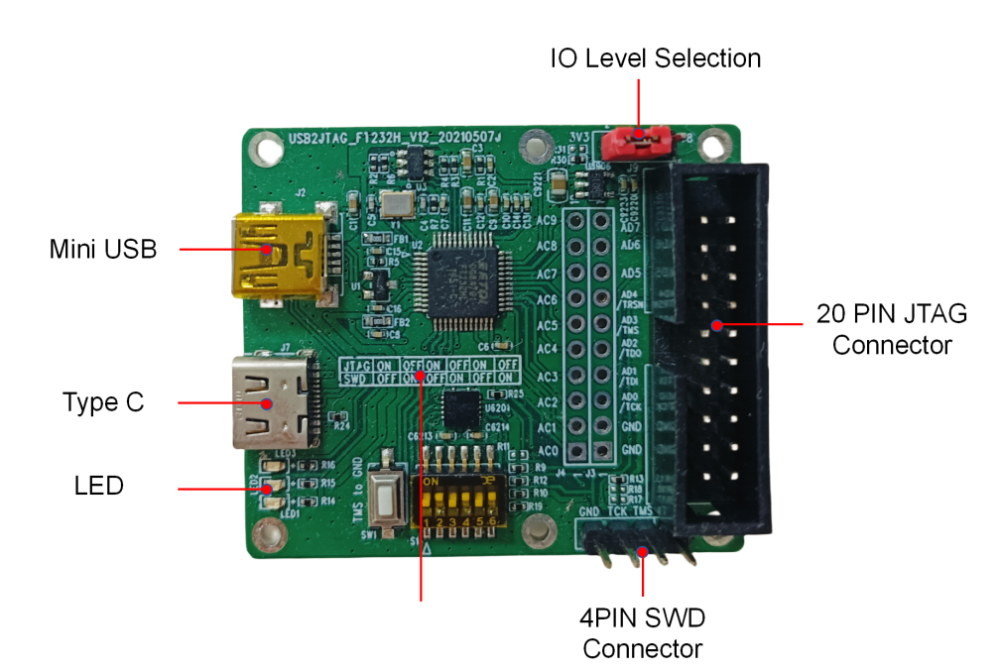

The FT232H mini board is shown in the figure above:

LED indicator lights, LED1: Power indicator; LED2: Off: Not connected, Flashing: Connected; LED3: Undefined at present

ARM 20PIN JTAG interface

USB interface: There are two types, TYPEC interface and mini USB interface

Dip switch

In SWD mode, 1, 3, 5 off, 2, 4, 6 on

In JTAG mode, 1, 3, 5 on, 2, 4, 6 off

Pin header, VCC, TCS, TCK, GND, which can be connected to the board with flying wires

Pin header, 3.3V, VCCIO, 1.8V, which can be connected with jumpers from VCCIO to 3.3V or 1.8V, this must be connected, otherwise JTAG communication will fail.

#### 9.2.2 Usage Example

Taking the RK3562 as an example, set up the OpenOCD development environment:

1. Refer to the document "Rockchip_Developer_Guide_GNU_MCU_Eclipse_OpenOCD_CN.pdf", create the configuration item for the target SoC.

2. Run eclipse.exe to enter the "Debug Configurations" item, open the "Debugger" tab, and add the following to the "Config options" item:

```text
-c "set SMPMASK 0x8"                   # 0x8 represents CPU3, configure CPU3 to run
RT_Thread
-r rk3562                              # Specify the SoC
-c "cpu3 configure -rtos RT_Thread"    # Specify CPU3 to run RT_Thread
-c "adapter speed 15000"               # JTAG TCK rate, unit KHz
```

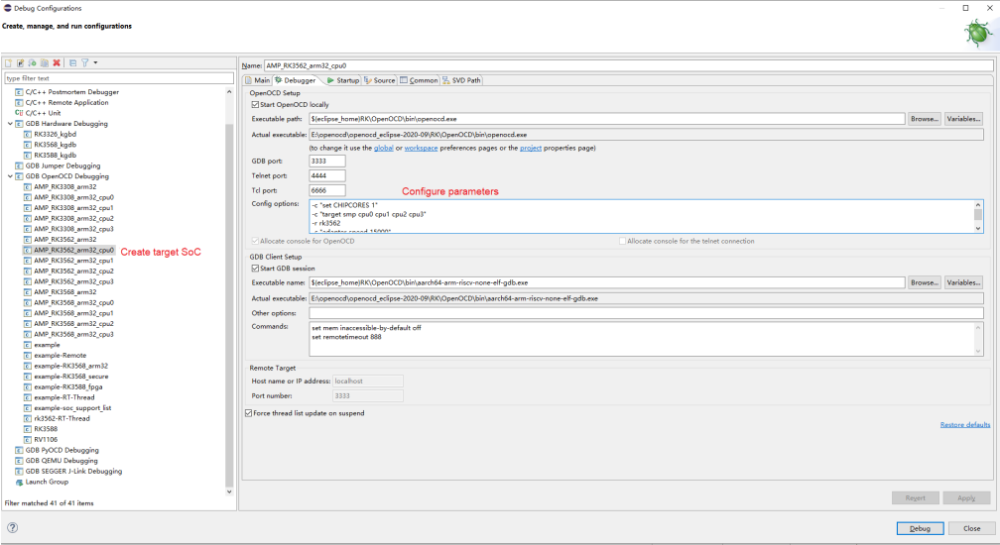

3. Enter the "Debug Configurations" configuration item, open the Source tab, and edit the "Path Mapping: New Mapping" item, add or modify the project path of the RK356x AMP SDK:

```text
<AMP_SDK>/hal/         # Project path for GCC compilation
D:<AMP_SDK>\hal        # Project path for source code debugging tracking under Windows
```

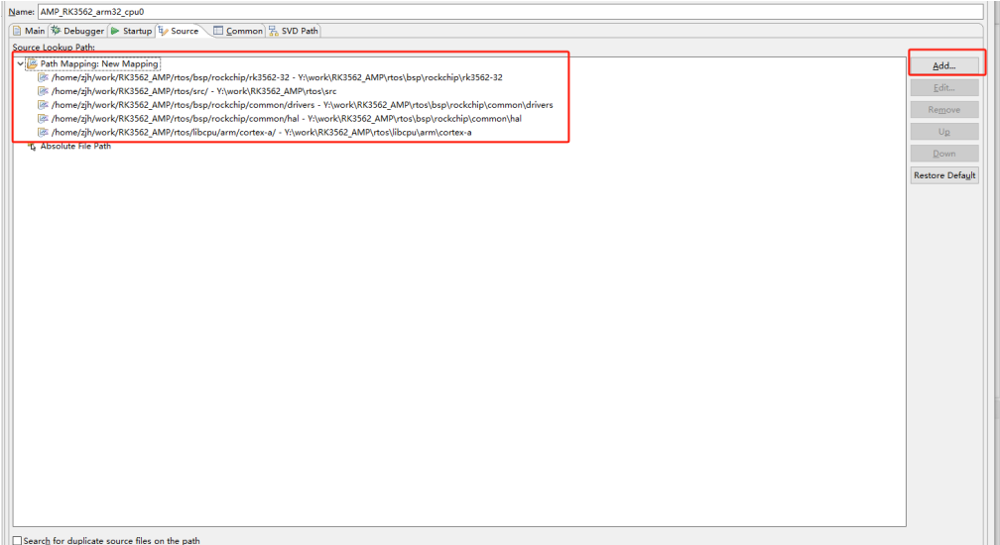

The above two paths are actually the same, <AMP_SDK>/rk3562/hal/ is the path information needed for symbol table resolution. D:<AMP_SDK>\hal\ is the path for loading project source code under Windows. It is also necessary to ensure that the firmware downloaded to the development board is consistent with the debugging code.

4. After the above configurations are completed, start debugging by clicking the "Debug" button under "Debug Configurations". At this time, the debugging information will be displayed in the "Debugger Console" window:

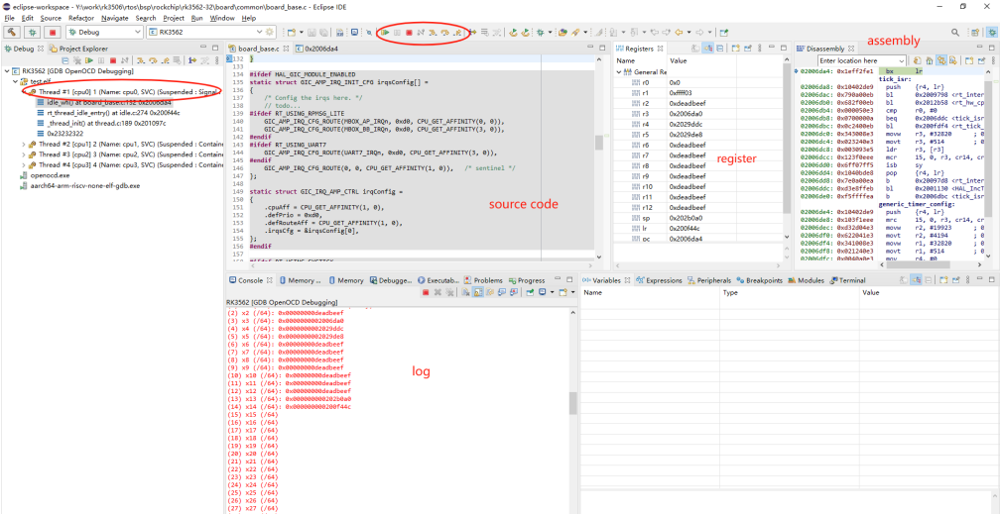

In the Console window, add the *.elf files for the 4 CPUs respectively with the following commands:

```text
    # ......
    For help, type "help".
    Type "apropos word" to search for commands related to "word".
    # ......
    add-symbol-file D:/rk3562/hal/project/rk3562/GCC/0_TestDemo.elf
    add-symbol-file D:/rk3562/hal/project/rk3562/GCC/1_TestDemo.elf
    add-symbol-file D:/rk3562/hal/project/rk3562/GCC/2_TestDemo.elf
    add-symbol-file D:/rk3562/hal/project/rk3562/GCC/3_TestDemo.elf
```

### 9.3 MCU Debugging with Ozone

#### 9.3.1 Setting Up the Windows Environment

The Ozone tool is a commonly used embedded debugging tool with a convenient graphical interface. With the help of J-Link hardware, it can achieve real-time tracking of code, step-by-step execution, and multi-breakpoint triggering functions. Official website: Ozone – The Performance Analyzer (segger.com). The official provides two modes of commercial use license and non-commercial use license. Users should choose the appropriate license mode according to actual needs to ensure legal use.


Taking RK3562 as an example:

1. Connect the J-Link device and the debugging board, open the Ozone software, the default pops up the project configuration option, or click File->New->New Project Wizard

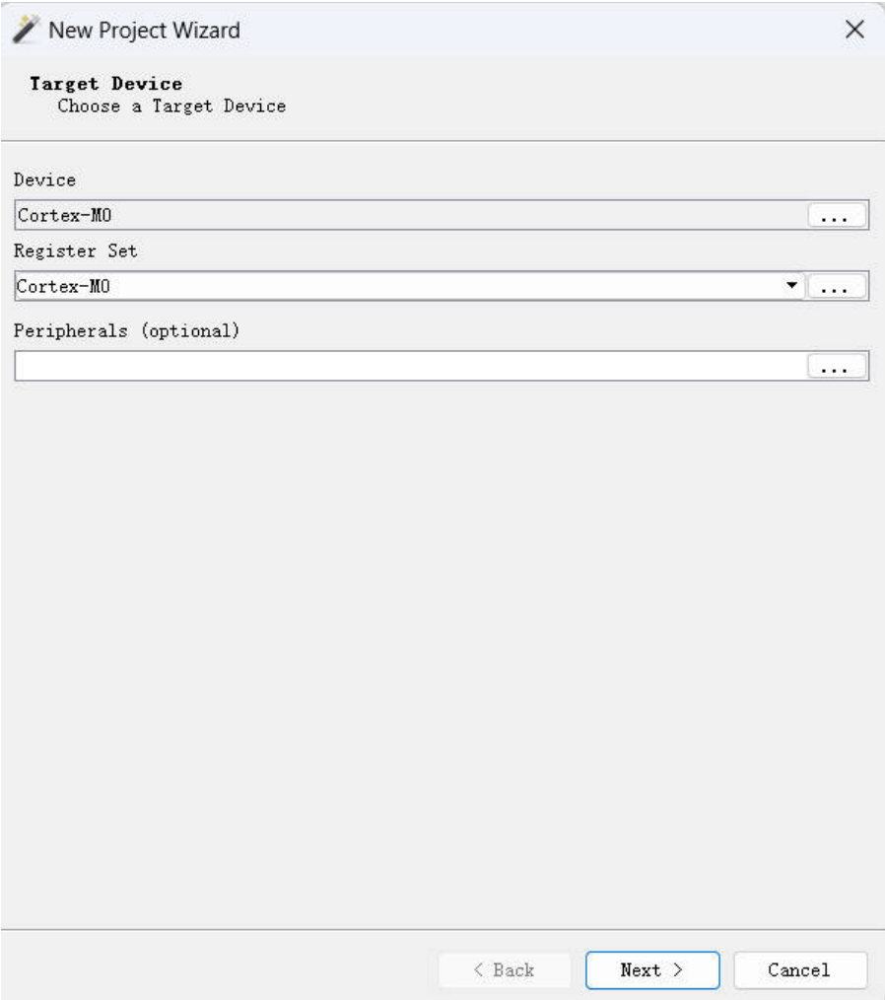

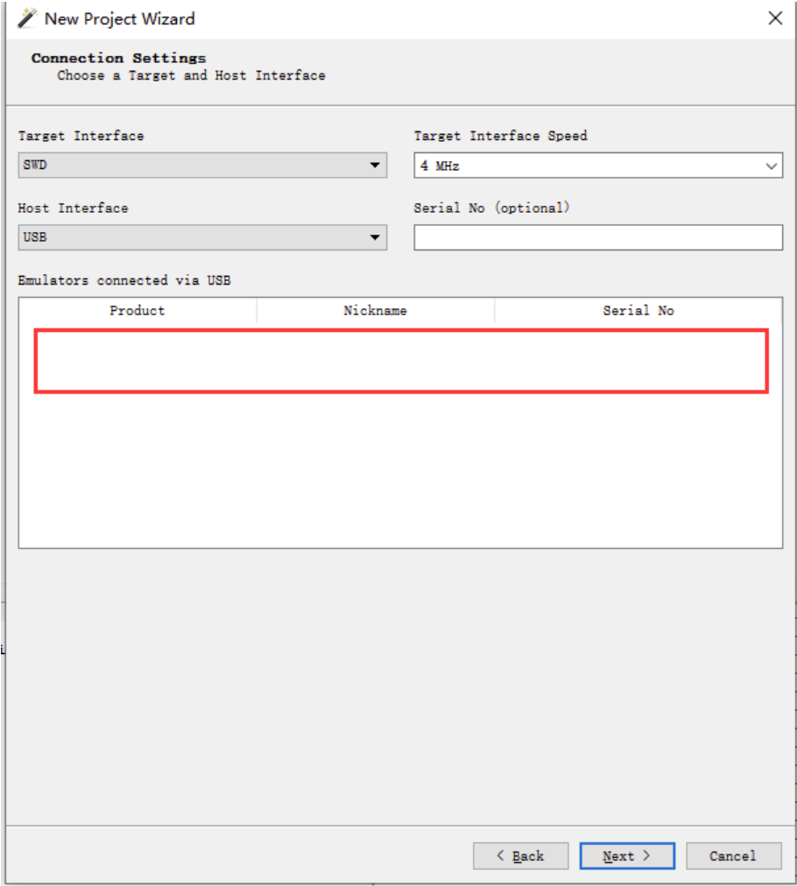

Select the connected J-Link device in the red box.

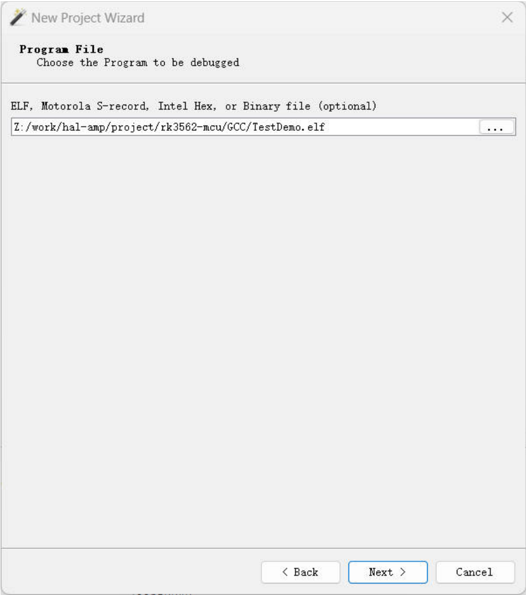

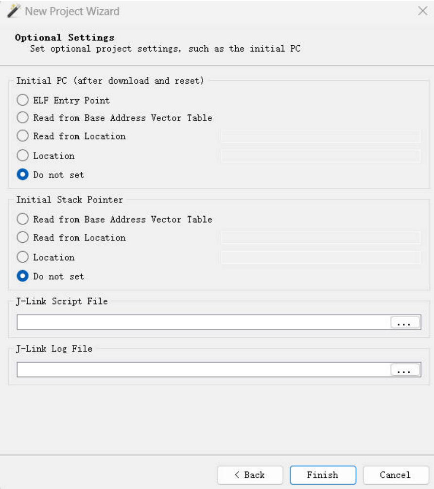

2. Load the target file: Use Ozone's loading function to load the target file (usually the generated executable file) into the debugger. If the RK HAL code repository is in the Linux environment, and the Ozone debugging tool is installed in the Windows environment, you need to map the Linux path to a network disk in the Windows system first, for example, map "/home/xxx" in the Linux system to "Z:" in the Windows system. Then, in the lower left corner of the Ozone software interface, use the following command in the command line to map the project path, where the parameter "/home/xxx" is the Linux path mounted to Windows, and "Z:" is the corresponding Windows path.

```text
Project.AddPathSubstitute "/home/xxx" "Z:"
```

After completing this series of operations, you can get the following Ozone interface.

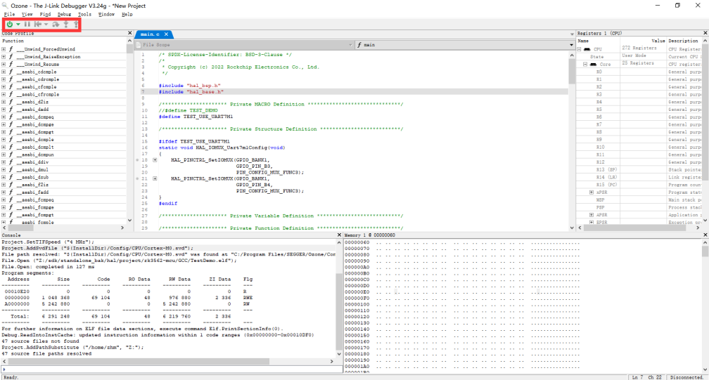

The buttons inside the red box are debug switches, which can achieve step-by-step debugging functions, and also add breakpoints directly on the code window for debugging.

## 10. Chapter-10 Demos

### 10.1 Performance Testing

#### 10.1.1 Integer Performance Testing

CoreMark is a benchmark program used to evaluate CPU performance, commonly used to measure the integer computing performance of the processor. Running Coremark generates a single numerical score, allowing users to quickly compare different processors. It is used to measure the performance of microcontrollers (MCUs) and central processing units (CPUs) in embedded systems. The following table summarizes the Coremark test data for various platforms:

| Processor | RK3568 AP HAL | RK3562 AP HAL | RK3562 MCU | RK3576 MCU |
| --- | --- | --- | --- | --- |
| Clock Frequency | 816MHZ | 816MHZ |  |  |
| Operation Mode | DDR4<br>1560MHZ | DDR4<br>1332MHZ |  |  |
| Cache | Enabled | Enabled |  |  |
| TCM | None | None |  |  |
| Coremark | 3273 | 2387 |  |  |
| Coremark<br>/MHz | 4.0 | 2.92 |  |  |

The bare-metal testing method is as follows:

Enable the test code by opening the following macro switches.

Code Path: hal/project/rkxxx/src/main.c

```text
-//#define TEST_DEMO
+#define TEST_DEMO
```

Code Path: hal/project/rkxxx/src/test_demo.c

```text
-//#define PERF_TEST
+#define PERF_TEST
```

Code Path: /hal/middleware/benchmark/benchmark

```text
INCLUDES += -I"$(BENCHMARK_PATH)" -I"$(BENCHMARK_PATH)/coremark" -
I"$(BENCHMARK_PATH)/coremark/barebones" SRC_DIRS += $(BENCHMARK_PATH)
$(BENCHMARK_PATH)/coremark $(BENCHMARK_PATH)/coremark/barebones
```

Code Path: /hal/middleware/benchmark/benchmark.h

```text
#define HAL_BENCHMARK_COREMARK
//#define HAL_BENCHMARK_LINPACK
//#define HAL_BENCHMARK_TINYMEMBENCH
```

#### 10.1.2 Floating Point Performance Testing

Utilize the Linpack for testing the performance of floating point operations. The primary metric of the Linpack test is the floating-point operations per second (FLOPS), which represents the number of floating point operations the system can execute per second. It is commonly measured in MFLOPS (million floating-point operations per second). The following table summarizes the Linpack test data for various platforms:

| Processor | RK3568 AP HAL | RK3562 AP HAL | RK3562 MCU | RK3576 MCU |
| --- | --- | --- | --- | --- |
| Clock Frequency | 816MHZ | 816MHZ |  |  |
| Operation Mode | DDR4<br>1560MHZ | DDR4<br>1332MHZ |  |  |
| Cache | Enabled | Enabled |  |  |
| TCM | None | None |  |  |
| Linpack<br>MFLOPS | 154.7 | 79.38 |  |  |

The bare-metal end testing method is as follows:

Enable the test code by turning on the following macro switches.

Code Path: hal/project/rkxxx/src/main.c

```text
-//#define TEST_DEMO
+#define TEST_DEMO
```

Code Path: hal/project/rkxxx/src/test_demo.c

```text
-//#define PERF_TEST
+#define PERF_TEST
```

Code Path: /hal/middleware/benchmark/benchmark.mk

```text
INCLUDES += -I"$(BENCHMARK_PATH)" -I"$(BENCHMARK_PATH)/linpack" SRC_DIRS +=
$(BENCHMARK_PATH) $(BENCHMARK_PATH)/linpack
```

Code Path: /hal/middleware/benchmark/benchmark.h

```text
//#define HAL_BENCHMARK_COREMARK
#define HAL_BENCHMARK_LINPACK
//#define HAL_BENCHMARK_TINYMEMBENCH
```

#### 10.1.3 Memory Testing

RTOS / Bare-metal utilizes tinymembench to test memory performance. Tinymembench is a straightforward memory benchmarking tool designed to assess the memory performance of computer systems. It evaluates key metrics such as memory bandwidth, latency, and random access performance. The following table summarizes the data from the tinymembench tests on various platforms:

| Processor | RK3568 AP HAL | RK3562 AP<br>HAL | RK3562<br>MCU | RK3576<br>MCU |
| --- | --- | --- | --- | --- |
| Clock Speed | 816MHZ | 816MHZ |  |  |
| Operation Mode | DDR4<br>1560MHZ | DDR4<br>1332MHZ |  |  |
| Cache | Enabled | Enabled |  |  |
| TCM | None | None |  |  |
| Memory Bandwidth<br>Test | See detailed data<br>below | None |  |  |
| Memory Latency Test | See detailed data<br>below | None |  |  |

RK3568 AP HAL Data

```text
==========================================================================
== Memory bandwidth tests                                               ==
==                                                                      ==
== Note 1: 1MB = 1000000 bytes                                          ==
== Note 2: Results for 'copy' tests show how many bytes can be          ==
==         copied per second (adding together read and written           == ==         bytes would have provided twice higher numbers)              ==
== Note 3: 2-pass copy means that we are using a small temporary buffer ==
==         to first fetch data into it, and only then write it to the   ==
==         destination (source -> L1 cache, L1 cache -> destination)    ==
== Note 4: If sample standard deviation exceeds 0.1%, it is shown in    ==
==         brackets                                                     ==
==========================================================================
 C copy backwards                                     :   1673.8 MB/s
 C copy backwards (32 byte blocks)                    :   1687.0 MB/s
 C copy backwards (64 byte blocks)                    :   1673.8 MB/s
 C copy                                               :   1920.2 MB/s
 C copy prefetched (32 bytes step)                    :   1563.7 MB/s
 C copy prefetched (64 bytes step)                    :   1941.1 MB/s (0.1%)
 C 2-pass copy                                        :    995.7 MB/s
 C 2-pass copy prefetched (32 bytes step)             :   1036.3 MB/s
 C 2-pass copy prefetched (64 bytes step)             :   1007.0 MB/s
 C fill                                               :   3297.4 MB/s
 C fill (shuffle within 16 byte blocks)               :   3297.4 MB/s
 C fill (shuffle within 32 byte blocks)               :   3297.4 MB/s
 C fill (shuffle within 64 byte blocks)               :   3292.3 MB/s
 ---
 standard memcpy                                      :   1165.1 MB/s
 standard memset                                      :   3322.9 MB/s
 ---
 ARM fill (STM with 8 registers)                      :   3343.7 MB/s
 ARM fill (STM with 4 registers)                      :   3322.9 MB/s
==========================================================================
== Memory latency test                                                  ==
==                                                                      ==
== Average time is measured for random memory accesses in the buffers   ==
== of different sizes. The larger is the buffer, the more significant   ==
== are relative contributions of TLB, L1/L2 cache misses and SDRAM      ==
== accesses. For extremely large buffer sizes we are expecting to see   ==
== page table walk with several requests to SDRAM for almost every      ==
== memory access (though 64MiB is not nearly large enough to experience == == this effect to its fullest).                                         ==
==                                                                      ==
== Note 1: All the numbers are representing extra time, which needs to  ==
==         be added to L1 cache latency. The cycle timings for L1 cache ==
==         latency can be usually found in the processor documentation. ==
== Note 2: Dual random read means that we are simultaneously performing ==
==         two independent memory accesses at a time. In the case if    ==
==         the memory subsystem can't handle multiple outstanding       ==
==         requests, dual random read has the same timings as two       ==
==         single reads performed one after another.                    ==
==========================================================================
block size : single random read / dual random read
      1024 :    0.0 ns          /     0.0 ns
      2048 :    0.0 ns          /     0.0 ns
      4096 :    0.0 ns          /     0.0 ns
      8192 :    0.0 ns          /     0.0 ns
     16384 :    0.0 ns          /     0.0 ns
     32768 :   11.2 ns          /     0.3 ns
     65536 :   22.4 ns          /    32.7 ns
    131072 :   33.3 ns          /    43.9 ns
    262144 :   39.4 ns          /    47.2 ns
    524288 :   48.8 ns          /    56.1 ns
   1048576 :  176.3 ns          /   253.8 ns
   2097152 :  240.5 ns          /   317.2 ns
   4194304 :  272.0 ns          /   339.1 ns
   8388608 :  285.9 ns          /   328.5 ns
```

Bare-metal testing method is as follows:

Enable the test code by opening the following macro switches.

Code path: hal/project/rkxxx/src/main.c

```text
-//#define TEST_DEMO
+#define TEST_DEMO
```

Code path: hal/project/rkxxx/src/test_demo.c

```text
-//#define PERF_TEST
+#define PERF_TEST
```

Code path: /hal/middleware/benchmark/benchmark.mk

```text
INCLUDES += -I"$(BENCHMARK_PATH)" -I"$(BENCHMARK_PATH)/tinymembench" SRC_DIRS +=
$(BENCHMARK_PATH) $(BENCHMARK_PATH)/tinymembench
```

Code path: /hal/middleware/benchmark/benchmark.h

```text
//#define HAL_BENCHMARK_COREMARK
//#define HAL_BENCHMARK_LINPACK
#define HAL_BENCHMARK_TINYMEMBENCH
```

#### 10.1.4 Interrupt Response Time Testing

Use the built-in interrupt delay test demo in HAL for testing. Interrupt response latency refers to the time interval from the occurrence of an interrupt event to the system's start of handling the interrupt, which is a test method used to evaluate the performance of computer system interrupt handling. The following table summarizes the data of interrupt response delay tests for various platforms:

| Processor | RK3568 AP HAL | RK3562 AP HAL | RK3562 MCU | RK3576 MCU |
| --- | --- | --- | --- | --- |
| Clock Frequency | 816MHZ | 816MHZ |  |  |
| Operation Mode | DDR4<br>1560MHZ | DDR4<br>1332MHZ |  |  |
| Cache | Enabled | Enabled |  |  |
| TCM | None | None |  |  |
| Irq Latency Test | avg = 3.42 us<br>max = 4.13 us<br>min = 3.21 us | avg = 1.543296 us<br>max = 2.916667 us<br>min = 0.875000 us |  |  |

Bare-metal end testing method is as follows:

To test the interrupt delay response data in a bare-metal system, the following macro switches need to be enabled.

hal/project/rkxxx/src/main.c

```text
-//#define TEST_DEMO
+#define TEST_DEMO
```

hal/project/rkxxx/src/test_demo.c

```text
-//#define IRQ_LATENCY_TEST
+#define IRQ_LATENCY_TEST
```

### 10.2 Real-Time Performance Demo

Taking the RK3568 platform as an example, this demo shows the real-time performance of the Linux operating system and RTOS under the AMP solution. Through this presentation, it facilitates an understanding of the capabilities of the AMP solution in real-time data processing, as well as its associated features and tools.

#### 10.2.1 Test Method

Linux systems utilize the cyclictest tool to assess the system's response time and latency. The cyclictest tool can be downloaded and installed from the Linux distribution's software repository or the official website of cyclictest.

RTOS employs interrupt latency tests to evaluate the system's response time and latency. Example code path: hal/project/rk3568/src/test_demo.c

#### 10.2.2 Testing Principle

The testing principle involves creating one or more real-time threads that operate with a fixed loop time. Each thread records the time in each cycle and then calculates the actual loop time and deviation. This allows for the measurement of the system's response time and latency.

#### 10.2.3 Test Results

The test will output the results, including the current delay time and maximum delay time for each cycle, etc. The test results are shown in the following figure:

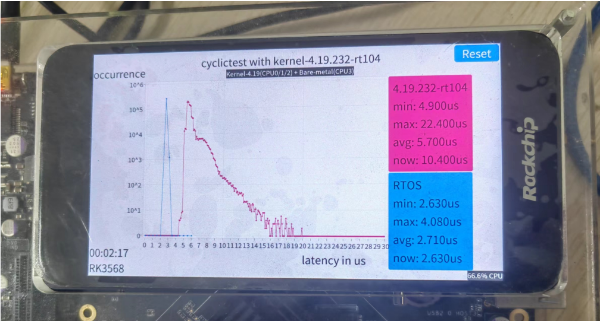

The output of the test includes some key indicators, such as the following examples:

Min: The minimum cycle time measured.

Avg: The average cycle time measured.

Max: The maximum cycle time measured.

Now: Records the current time value.

Occurrence: Record the number of times the delay time interval occurs.

Latency in us: The delay time interval

These indicators can be used to evaluate the real-time performance of the system. The smaller the maximum delay time, the better the real-time performance of the system.

## 11. Chapter-11 Appendix

### 11.1 Terms and Interpretation

```text
Definition
```

| Abbreviation | Full Name | Definition |
| --- | --- | --- |
| OpenAMP | Open Asymmetric<br>Multi-Processing | An open-source asymmetric multi-processing system |
| AMP | Asymmetric Multi-<br>Processing | Asymmetric multi-processing system |
| HAL | Hardware<br>Abstraction Layer | Hardware Abstraction Layer |
| Bare-metal | Bare-metal | A development library based on the hardware abstraction<br>layer for bare-metal development. |
| MailBox | MailBox | A simple APB peripheral that allows CPUs and MCU cores to<br>communicate with each other through interrupts generated<br>by write operations. |
| RPMsg | Remote Processor<br>Messaging | A protocol for inter-core communication in multi-core<br>processors. |
| RTOS | Real-time Operating<br>System | An operating system designed for real-time applications that<br>requires timely response to events. |
| RTT | RT-Thread | An open-source real-time operating system primarily<br>developed by the Chinese open-source community. |
| SDK | Software<br>Development Kit | A set of software development tools that allows for the<br>creation of applications for a certain software package. |
| Linux | Linux | A free and open-source Unix-like operating system. |
| Kernel | Linux Kernel | The core part of the Linux operating system, responsible for<br>managing the computer's hardware resources and providing<br>basic system services. |
| Hypervisor | Virtual Machine<br>Monitor | Software, firmware, or hardware that creates and runs virtual<br>machines, allowing them to share physical hardware<br>resources. |
| Jailhouse | Jailhouse | A small hypervisor designed for creating industrial-grade<br>applications. |

### 11.2 Document Index

```text
Reference Document
```

| Reference Document | Description | Document Path |
| --- | --- | --- |
| Rockchip_Developer_Guide_FT232H_USB2JTAG.pdf | Introduction to the FHT232 Mini<br>Board | openocd_eclipse-2020-<br>09\RK\OpenOCD\doc |
| Rockchip_Developer_Guide_GNU_MCU_Eclipse_OpenOCD_CN.pdf | OpenOCD Usage Instructions | openocd_eclipse-2020-<br>09\RK\OpenOCD\doc |
| Rockchip_Developer_Guide_UBoot_Nextdev_CN.pdf | U-Boot Development<br>Documentation | docs\cn\Common\UBOOT |
| Rockchip_Developer_Guide_Linux_AB_System_CN.pdf | AB Dual Partition Description | docs\cn\Common\UBOOT |
| Rockchip_Developer_Guide_SDMMC_SDIO_eMMC_CN.pdf | eMMC Usage Instructions | docs\cn\Common\MMC |
| Rockchip_Developer_Guide_UART_CN.pdf | UART Usage Instructions | docs\cn\Common\UART |
| Rockchip_Developer_Guide_RT-Thread_SPIFLASH_CN.pdf | SPI FLASH Usage Instructions | docs\cn\Common\NVM |
