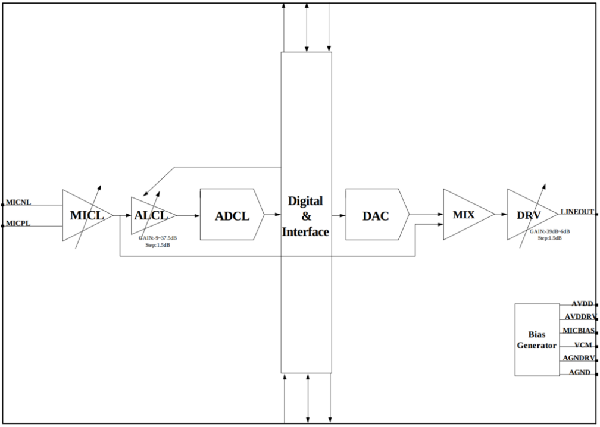
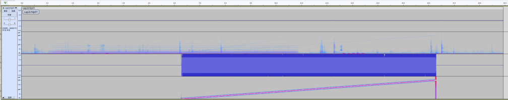
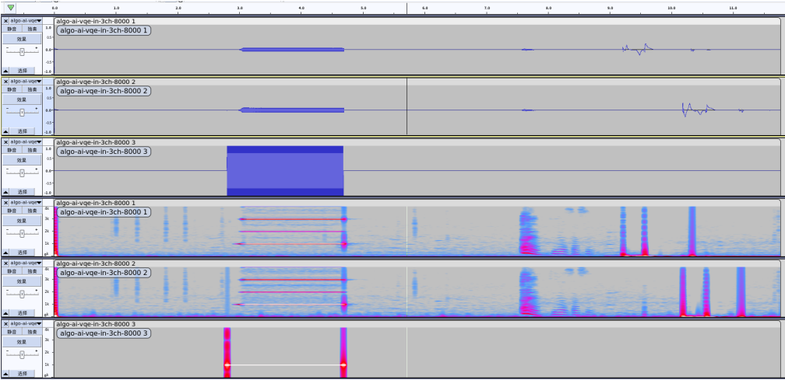

# Rockchip RV Series ACodec: Complete Configuration, Capture and Playback Guide

This article is a Rockchip RV audio reference in the ArmSoM technical library. It covers the internal ACodec in RV1106/RV1103, RV1106B/RV1103B and RV1126B/RV1126BP. The first two groups use the documented 5.10 kernel baseline; RV1126B/RV1126BP uses 6.1. It is not an internal-codec configuration guide for Sige7 / AIM7 (RK3588) or Sige5 / CM5 / AIM5 (RK3576): do not copy its DTS, GPIO or mixer controls to those boards. No matching ArmSoM RV board has been verified here. For a custom RV design, use its exact SoC, SDK, schematic and enumerated sound card. Source specifications and test examples are not ArmSoM measurements.

Source: Rockchip_Developer_Guide_Linux_RV_Series_ACodec_EN.pdf, V1.6.0. Technical chapters are retained; cover declarations, intended audience and revision history are omitted. See the [editorial notes](/docs/rockchip-rv-acodec/EDITORIAL-NOTES.md) for corrections and unresolved issues.

[ArmSoM Docs](https://docs.armsom.org/) · [Sige7](https://docs.armsom.org/armsom-sige7) · [Sige5](https://docs.armsom.org/armsom-sige5) · [CM5](https://docs.armsom.org/armsom-cm5)

<!-- source-page: 4; block: en-0000 -->

## 1. Overview

<!-- source-page: 4; block: en-0001 -->

### 1.1 Function Introduction

<!-- source-page: 4; block: en-0002 -->

The ACodec mentioned here is the audio IP module built into the SoCs of RV1106/RV1103/RV1106B/RV1103B. It can be used to connect an external analog microphone and transmit the external signal recording to the CPU through analog-to-digital conversion. The CPU can also convert the local PCM audio digital signal through digital-to-analog conversion and then play it out.

<!-- source-page: 4; block: en-0003 -->

The ACodec IP contained in RV1106 and RV1103 is exactly the same, including 2 ADCs and 1 DAC. The RV1106B/RV1103B SoC was launched in 2024, and the internal ACodec IP is exactly the same. Compared with RV1106/RV1103, its ACodec has deleted one ADC and is 1 ADC and 1 DAC. When operating ACodec, you will usually encounter the scenario of retrieving channel configuration, which will be explained in detail later in the document.

<!-- source-page: 4; block: en-0004 -->

The RV1126B/RV1126BP, released in 2025, supports two low-power, high-performance ADCs, making them suitable for single- and dual-microphone voice pickup scenarios. ADC0 supports AOA (Always On Audio) technology, enabling ultra-low-power continuous recording and wake-up in sleep mode. For detailed instructions, refer to the AOA module section in the SDK documentation, "Rockchip Developer Guide Linux AOV CN.pdf" or "Rockchip Developer Guide Linux AOV EN.pdf."

<!-- source-page: 4; block: en-0005 -->

## 2. ACodec Introduction

<!-- source-page: 4; block: en-0006 -->

### 2.1 ACodec Features

<!-- source-page: 4; block: en-0007 -->

The basic features of RV1106/RV1103/RV1106B/RV1103B ACodec are as follows:

<!-- source-page: 4; block: en-0008 -->

24 bits DAC with 93dB(A-weighted) SNR

<!-- source-page: 4; block: en-0009 -->

Support 600Ω line output

<!-- source-page: 4; block: en-0010 -->

Low power: 2.5mA for playback

<!-- source-page: 4; block: en-0011 -->

24 bits ADC with 92dB(A-weighted) SNR

<!-- source-page: 4; block: en-0012 -->

Support differential and single-ended microphone or line input

<!-- source-page: 4; block: en-0013 -->

Low power: 5mA for stereo recording

<!-- source-page: 4; block: en-0014 -->

Automatic Level Control (ALC) for smooth audio recording

<!-- source-page: 4; block: en-0015 -->

Low power: less than 0.05mA for standby

<!-- source-page: 4; block: en-0016 -->

Programmable input and output analog gains

<!-- source-page: 4; block: en-0017 -->

Digital interpolation and decimation filter integrated

<!-- source-page: 4; block: en-0018 -->

Sampling rate of 8kHz/12kHz/16kHz/24kHz/32kHz/44.1KHz/48KHz/96KHz

<!-- source-page: 5; block: en-0019 -->

1.8V supply for analog and 0.9V supply for digital

<!-- source-page: 5; block: en-0020 -->

The basic features of the RV1126B/RV1126BP ACodec are as follows:

<!-- source-page: 5; block: en-0021 -->

Support APB bus slave interface

<!-- source-page: 5; block: en-0022 -->

Support Analog gain between 0~48dB with 3dB/step

<!-- source-page: 5; block: en-0023 -->

Support 96dB SNR

<!-- source-page: 5; block: en-0024 -->

Support 1-channel Differential-mode/Single-mode/Pseudo-differential mode ADC

<!-- source-page: 5; block: en-0025 -->

Support I2S/PCM master and slave mode

<!-- source-page: 5; block: en-0026 -->

Support I2S normal, left and right justified mode serial audio data transfer

<!-- source-page: 5; block: en-0027 -->

Support PCM early, late1, late2, late3 mode serial audio data transfer

<!-- source-page: 5; block: en-0028 -->

Support MSB or LSB first serial audio data transfer

<!-- source-page: 5; block: en-0029 -->

Support 16~32bit sample resolution

<!-- source-page: 5; block: en-0030 -->

Support sample rate: 8kHz, 16kHz, 32kHz, 64kHz, 128kHz, 11.025kHz, 22.05kHz, 44.1kHz, 88.2kHz, 176.4kHz, 12kHz, 24kHz, 48kHz, 96kHz, 192kHz

<!-- source-page: 5; block: en-0031 -->

The passband of filters is 0.45625 * FS

<!-- source-page: 5; block: en-0032 -->

Support passband ripple within +/-0.1dB

<!-- source-page: 5; block: en-0033 -->

The stopband of filters is 0.5 * FS

<!-- source-page: 5; block: en-0034 -->

Support stopband attenuation at least 60dB

<!-- source-page: 5; block: en-0035 -->

Support Digital Audio ADC volume control

<!-- source-page: 5; block: en-0036 -->

Support programmable negative volume gain and positive volume gain

<!-- source-page: 6; block: en-0037 -->

### 2.2 ACodec Block Diagram

<!-- source-page: 6; block: en-0038 -->


<!-- source-page: 6; block: en-0039 -->

RV1106/RV1103 ACodec Block Diagram

<!-- source-page: 6; block: en-0040 -->

From the block diagram, it can be found that both RV1106 and RV1103 support 2 ADC inputs (for recording) and 1 DAC output (for playback). It's important to note that in differential mode, RV1106 can support a maximum of 2 microphones, while RV1103, in differential mode, only supports the connection of 1 microphone. In single-ended mode, both RV1106 and RV1103 can support a maximum of 2 microphones each.

<!-- source-page: 7; block: en-0041 -->



<!-- source-page: 7; block: en-0042 -->

RV1106B/RV1103B ACodec Block Diagram

<!-- source-page: 7; block: en-0043 -->

The RV1106B/RV1103B ACodec removes one ADC in terms of function, and supports one ADC input (capture) and one DAC output (playback). However, the ADC input still maintains the two access modes of differential input or single-ended input.

<!-- source-page: 7; block: en-0044 -->

The RV1126B/RV1126BP supports two low-power, high-performance ADCs by default, and both support differential inputs by default. The block diagram is as follows:

<!-- source-page: 8; block: en-0045 -->


<!-- source-page: 8; block: en-0046 -->

RV1126B/RV1126BP ACodec Block Diagram

<!-- source-page: 8; block: en-0047 -->

Therefore, according to the SoC ID, the main differences of the following ACodec MIC access are:

<!-- source-page: 8; block: en-0048 -->

| SoC ID | Maximum number of MICs in single-ended mode | Maximum number of MICs in differential mode |
| --- | --- | --- |
| RV1106 | 2 | 2 |
| RV1103 | 2 | 1 |
| RV1106B/RV1103B | 1 | 1 |
| RV1126B/RV1126BP | 2 | 2 |

<!-- source-page: 8; block: en-0049 -->

For typical MIC connection methods, please refer to RK EVB drawings and hardware design reference guide.

<!-- source-page: 8; block: en-0050 -->

## 3. ACodec Software Configuration

<!-- source-page: 8; block: en-0051 -->

### 3.1 RV1106/RV1103 ACodec Kernel Configuration

<!-- source-page: 8; block: en-0052 -->

Taking Rockchip kernel-5.10 SDK code as an example, you can refer to the following dtsi file:

<!-- source-page: 8; block: en-0053 -->

```text
arch/arm/boot/dts/rv1106-evb-v10.dtsi
```

<!-- source-page: 9; block: en-0054 -->

Firstly, define an acodec_sound node, which describes some basic information of the sound card and references the DAI (Digital Audio Interface) i2s0_8ch on the controller side and the DAI acodec on the peripheral side:

<!-- source-page: 9; block: en-0055 -->

```text
    acodec_sound: acodec-sound {
        compatible = "simple-audio-card";
        simple-audio-card,name = "rv1106-acodec";
        simple-audio-card,format = "i2s";
        simple-audio-card,mclk-fs = <256>;
        simple-audio-card,cpu {
            sound-dai = <&i2s0_8ch>;
        };
        simple-audio-card,codec {
            sound-dai = <&acodec>;
        };
    };
```

<!-- source-page: 9; block: en-0056 -->

Enable I2S0:

<!-- source-page: 9; block: en-0057 -->

```text
&i2s0_8ch {
    #sound-dai-cells = <0>;
    status = "okay";
};
```

<!-- source-page: 9; block: en-0058 -->

Enable ACodec and define the GPIO pin that controls the external power amplifier:

<!-- source-page: 9; block: en-0059 -->

```text
&acodec {
    #sound-dai-cells = <0>;
    pa-ctl-gpios = <&gpio1 RK_PA1 GPIO_ACTIVE_HIGH>;
    status = "okay";
};
```

<!-- source-page: 9; block: en-0060 -->

In the above example, the I2S0 inside RV1106/RV1103 can be bound to ACodec.

<!-- source-page: 9; block: en-0061 -->

It should be noted that there is only one I2S controller inside RV1106/RV1103, which is I2S0. If the internal ACodec is enabled, I2S0 will be occupied at this time, and it is connected to ACodec through the SoC internal lead wires. Therefore, in this scenario, the pins connected to external IO by I2S0 will be unavailable.

<!-- source-page: 9; block: en-0062 -->

### 3.2 RV1106B/RV1103B ACodec Kernel Configuration

<!-- source-page: 9; block: en-0063 -->

The configuration of RV1106B/RV1103B ACodec can refer to

<!-- source-page: 9; block: en-0064 -->

```text
arch/arm/boot/dts/rv1103b-evb.dtsi
    acodec_sound: acodec-sound {
        compatible = "simple-audio-card";
        simple-audio-card,name = "rv1103b-acodec";
        simple-audio-card,format = "i2s";
        simple-audio-card,mclk-fs = <256>;
        simple-audio-card,cpu {
            sound-dai = <&sai>;
        };
        simple-audio-card,codec {
            sound-dai = <&acodec>;
        };
    };
```

<!-- source-page: 10; block: en-0066 -->

It can be seen that the digital audio interface controller of RV1106B/RV1103B has been upgraded from I2S to SAI, which needs to be enabled:

<!-- source-page: 10; block: en-0067 -->

```text
&sai {
    status = "okay";
};
```

<!-- source-page: 10; block: en-0068 -->

You also need to enable the acodec node:

<!-- source-page: 10; block: en-0069 -->

```text
&acodec {
    pa-ctl-gpios = <&gpio0 RK_PA3 GPIO_ACTIVE_HIGH>;
    status = "okay";
};
```

<!-- source-page: 10; block: en-0070 -->

### 3.3 RV1106/RV1103 ACodec User Level Configuration

<!-- source-page: 10; block: en-0071 -->

Usually, we can use the common and authoritative tinymix tool to obtain and set the control node information that the codec exposes to user layer. However, since tinymix tool was cropped in the SDK, rockit integrates the rk_mpi_amix_test tool that is equivalent to tinymix and can be used to list all contents information:

<!-- source-page: 10; block: en-0072 -->

```text
# rk_mpi_amix_test --list_contents
cmd parse result:
sound control id      : 0
control name          : (null)
control value         : (null)
list controls         : 0
list contents         : 1
Number of controls: 26
ctl     type    num     name                                    value
0       ENUM    1       I2STDM Digital Loopback Mode            , DisabledMode1Mode2Mode2 Swap
1       INT     1       ADC MIC Left Gain                       2 (range 0->3)
2       INT     1       ADC MIC Right Gain                      2 (range 0->3)
3       INT     1       ADC ALC Left Volume                     6 (range 0->31)
4       INT     1       ADC ALC Right Volume                    6 (range 0->31)
5       INT     1       ADC Digital Left Volume                 195 (range 0->255)
6       INT     1       ADC Digital Right Volume                195 (range 0->255)
7       ENUM    1       ADC HPF Cut-off                         , OffOn
8       INT     1       ALC AGC Left Volume                     12 (range 0->31)
9       INT     1       ALC AGC Right Volume                    12 (range 0->31)
10      INT     1       ALC AGC Left Max Volume                 7 (range 0->7)
11      INT     1       ALC AGC Right Max Volume                7 (range 0->7)
12      INT     1       ALC AGC Left Min Volume                 0 (range 0->7)
13      INT     1       ALC AGC Right Min Volume                0 (range 0->7)
14      ENUM    1       ALC AGC Left Switch                     , OffOn
15      ENUM    1       ALC AGC Right Switch                    , OffOn
16      ENUM    1       AGC Left Approximate Sample Rate        , 96KHz48KHz44.1KHz32KHz24KHz16KHz12KHz8KHz
17      ENUM    1       AGC Right Approximate Sample Rate       , 96KHz48KHz44.1KHz32KHz24KHz16KHz12KHz8KHz
18      ENUM    1       ADC Mode                                , DiffadcLSingadcLDiffadcRSingadcRSingadcLRDiffadcLR
19      ENUM    1       ADC MICBIAS Voltage VREFx0_8VREFx0_825VREFx0_85VREFx0_875, VREFx0_9VREFx0_925VREFx0_95VREFx0_975
20      ENUM    1       ADC Main MICBIAS                        Off, On
21      ENUM    1       ADC MIC Left Switch                     , WorkMute
22      ENUM    1       ADC MIC Right Switch                    , WorkMute
23      INT     1       DAC LINEOUT Volume                      26 (range 0->30)
24      INT     1       DAC HPMIX Volume                        1 (range 0->2)
25      ENUM    1       DAC Control Manually                    , NoneOffOn
```

<!-- source-page: 11; block: en-0074 -->

There are lots of nodes, and it is going to introduce some commonly used node information here:

<!-- source-page: 11; block: en-0075 -->

```text
0       ENUM    1       I2STDM Digital Loopback Mode            , DisabledMode1Mode2Mode2 Swap
```

<!-- source-page: 11; block: en-0076 -->

This node is actually the control node exposed to users by I2S0, but it is closely related to ACodec. It indicates whether the I2STDM controller is working in recovery mode. In the node information:

<!-- source-page: 11; block: en-0077 -->

Disabled: Default state, recovery mode is disabled

<!-- source-page: 11; block: en-0078 -->

Mode1: Suitable for 4ch usage scenarios. Channels 1-2 are data of MIC pickup, and channels 3-4 are recovery data.

<!-- source-page: 11; block: en-0079 -->

Mode2: Suitable for 2ch usage scenarios. The left channel is data of MIC pickup, and the right channel is the playback data of the right channel.

<!-- source-page: 11; block: en-0080 -->

Mode2 Swap: suitable for 2ch usage scenarios. The left channel is the recovery data of the left channel played, and the right channel is the MIC pickup data. Mode2 Swap and Mode2 channel order are opposite

<!-- source-page: 11; block: en-0081 -->

Therefore, if Mode2 and Mode2 Swap are playing 2ch data, it is best to perform software MIX before sending data to ACodec DAC, so that the recovery reference signal is closer to the signal of the real echo path.

<!-- source-page: 11; block: en-0082 -->

Remarks: the selected item displayed in tinymix style is added with a comma "," on the left. For example, the displayed ", Disabled" means that the "Disabled" state is currently selected, and so on.

<!-- source-page: 12; block: en-0083 -->

```text
1       INT     1       ADC MIC Left Gain                       2 (range 0->3)
2       INT     1       ADC MIC Right Gain                      2 (range 0->3)
```

<!-- source-page: 12; block: en-0084 -->

ACodec ADC Boost Gain is the codec analog volume. The actual valid value range is 1 ~ 3:

<!-- source-page: 12; block: en-0085 -->

vol 0: Disabled and not recommended

<!-- source-page: 12; block: en-0086 -->

vol 1: 0dB

<!-- source-page: 12; block: en-0087 -->

vol 2: 20dB

<!-- source-page: 12; block: en-0088 -->

vol 3: 12dB

<!-- source-page: 12; block: en-0089 -->

```text
3       INT     1       ADC ALC Left Volume                     6 (range 0->31)
4       INT     1       ADC ALC Right Volume                    6 (range 0->31)
```

<!-- source-page: 12; block: en-0090 -->

ACodec ADC ALC PGA Gain is the codec analog volume. The value range is 0~31:

<!-- source-page: 12; block: en-0091 -->

min: -9dB (vol: 0)

<!-- source-page: 12; block: en-0092 -->

max: +37.5dB (vol: 31)

<!-- source-page: 12; block: en-0093 -->

step: +1.5dB

<!-- source-page: 12; block: en-0094 -->

location: 0dB (vol: 6)

<!-- source-page: 12; block: en-0095 -->

```text
5       INT     1       ADC Digital Left Volume                 195 (range 0->255)
6       INT     1       ADC Digital Right Volume                195 (range 0->255)
```

<!-- source-page: 12; block: en-0096 -->

ACodec ADC Digital Gain is the codec digital volume. The value range is 0~255:

<!-- source-page: 12; block: en-0097 -->

min: -97.5dB (vol: 0)

<!-- source-page: 12; block: en-0098 -->

max: +30dB (vol: 255)

<!-- source-page: 12; block: en-0099 -->

step: +0.5dB

<!-- source-page: 12; block: en-0100 -->

location: 0dB (vol: 195)

<!-- source-page: 12; block: en-0101 -->

```text
18      ENUM    1       ADC Mode                                , DiffadcLSingadcLDiffadcRSingadcRSingadcLRDiffadcLR
```

<!-- source-page: 12; block: en-0102 -->

"Diff" is the abbreviation of "Differential"; "Sing" is the abbreviation of "Single-end". Used to configure the ACodec ADC to work in differential or single-ended mode. The default is "Diff" differential mode. And in order to minimize power consumption to the greatest extent, the ADC only enables the L left channel. Therefore, "DiffadcL" is the default preference.

<!-- source-page: 12; block: en-0103 -->

It should be noted that due to different chip orientation, RV1103 does not support two-channel pickup in differential mode, that is, it does not support the "DiffadcLR" option.

<!-- source-page: 12; block: en-0104 -->

```text
23      INT     1       DAC LINEOUT Volume                      26 (range 0->30)
```

<!-- source-page: 12; block: en-0105 -->

ACodec DAC Lineout Gain, the volume value range is 0~30:

<!-- source-page: 12; block: en-0106 -->

min: -39dB (vol: 0)

<!-- source-page: 12; block: en-0107 -->

max: +6dB (vol: 30)

<!-- source-page: 13; block: en-0108 -->

step: +1.5dB

<!-- source-page: 13; block: en-0109 -->

location: 0dB (vol: 26)

<!-- source-page: 13; block: en-0110 -->

```text
24      INT     1       DAC HPMIX Volume                        1 (range 0->2)
```

<!-- source-page: 13; block: en-0111 -->

ACodec DAC HPMIX Gain, which is the preamp Gain of Lineout, is usually not set. The value range of the volume value is actually 1 and 2:

<!-- source-page: 13; block: en-0112 -->

vol 0: Disabled and not recommended

<!-- source-page: 13; block: en-0113 -->

vol 1: 0dB

<!-- source-page: 13; block: en-0114 -->

vol 2: 6dB

<!-- source-page: 13; block: en-0115 -->

```text
25      ENUM    1       DAC Control Manually                    , NoneOffOn
```

<!-- source-page: 13; block: en-0116 -->

Developers usually use the media framework with the AO Stream is always on (always enabled the sound card). When stopping playback, they only need to quickly turn off and on the peripheral PA. Therefore, a "DAC Control Manually" node is added here:

<!-- source-page: 13; block: en-0117 -->

None: Default status, the media framework should be actually closed and AO Stream be enabled to control the sound card's off and on.

<!-- source-page: 13; block: en-0118 -->

Off: When the AO Stream is always on, you can just manually turn off the peripheral PA to make the speaker playback silent.

<!-- source-page: 13; block: en-0119 -->

On: When the AO Stream is always on and the previous state is Off, you can manually turn on the peripheral PA again to resume playback of the speaker.

<!-- source-page: 13; block: en-0120 -->

The above are codec control node that are commonly used by developers during the development process. For other options, you can refer to the control name and options and configure and adjust them according to the specific project.

<!-- source-page: 13; block: en-0121 -->

### 3.4 RV1106B/RV1103B ACodec User Level Configuration

<!-- source-page: 13; block: en-0122 -->

We can also use rk_mpi_amix_test to list the control nodes related to RV1106B/RV1103B ACodec:

<!-- source-page: 13; block: en-0123 -->

```text
# rk_mpi_amix_test --list_contents
cmd parse result:
sound control id      : 0
control name          : (null)
control value         : (null)
list controls         : 0
list contents         : 1
Number of controls: 54
ctl     type    num     name                                    value
0       ENUM    1       SAI Transmit Start Mode Sel             , StandaloneChained
1       ENUM    1       SAI Receive Start Mode Sel              , StandaloneChained
2       ENUM    1       SAI Transmit SDOx Select                , AutoSDOx1SDOx2SDOx3SDOx4
3       ENUM    1       SAI Receive SDIx Select                 , AutoSDIx1SDIx2SDIx3SDIx4
4       INT     1       SAI Receive Mono Slot Select            0 (range 0->128)
5       ENUM    1       SAI Receive Mono Switch                 , DisableEnable
6       ENUM    1       SAI Transmit Mono Switch                , DisableEnable
7       ENUM    1       SAI SDI3 Loopback I2S LR Channel Sel    , L:MIC R:LPL:LP R:MIC
8       ENUM    1       SAI SDI2 Loopback I2S LR Channel Sel    , L:MIC R:LPL:LP R:MIC
9       ENUM    1       SAI SDI1 Loopback I2S LR Channel Sel    , L:MIC R:LPL:LP R:MIC
10      ENUM    1       SAI SDI0 Loopback I2S LR Channel Sel    , L:MIC R:LPL:LP R:MIC
11      ENUM    1       SAI SDI3 Loopback I2S LR Switch         , DisableEnable
12      ENUM    1       SAI SDI2 Loopback I2S LR Switch         , DisableEnable
13      ENUM    1       SAI SDI1 Loopback I2S LR Switch         , DisableEnable
14      ENUM    1       SAI SDI0 Loopback I2S LR Switch         , DisableEnable
15      ENUM    1       SAI SDI3 Loopback Src Select            , From SDO0From SDO1From SDO2From SDO3
16      ENUM    1       SAI SDI2 Loopback Src Select            , From SDO0From SDO1From SDO2From SDO3
17      ENUM    1       SAI SDI1 Loopback Src Select            , From SDO0From SDO1From SDO2From SDO3
18      ENUM    1       SAI SDI0 Loopback Src Select            , From SDO0From SDO1From SDO2From SDO3
19      ENUM    1       SAI SDI3 Loopback Switch                , DisableEnable
20      ENUM    1       SAI SDI2 Loopback Switch                , DisableEnable
21      ENUM    1       SAI SDI1 Loopback Switch                , DisableEnable
22      ENUM    1       SAI SDI0 Loopback Switch                , DisableEnable
23      ENUM    1       SAI Sync Out Switch                     , From CRUFrom IO
24      ENUM    1       SAI Sync In Switch                      , From IOFrom Sync Port
25      ENUM    1       SAI Receive PATH3 Source Select         From SDI0From SDI1From SDI2, From SDI3
26      ENUM    1       SAI Receive PATH2 Source Select         From SDI0From SDI1, From SDI2From SDI3
27      ENUM    1       SAI Receive PATH1 Source Select         From SDI0, From SDI1From SDI2From SDI3
28      ENUM    1       SAI Receive PATH0 Source Select         , From SDI0From SDI1From SDI2From SDI3
29      ENUM    1       SAI Transmit SDO3 Source Select         From PATH0From PATH1From PATH2, From PATH3
30      ENUM    1       SAI Transmit SDO2 Source Select         From PATH0From PATH1, From PATH2From PATH3
31      ENUM    1       SAI Transmit SDO1 Source Select         From PATH0, From PATH1From PATH2From PATH3
32      ENUM    1       SAI Transmit SDO0 Source Select         , From PATH0From PATH1From PATH2From PATH3
33      BOOL    1       SAI Clk Auto Switch                     Off
34      INT     1       SAI PCM Read Wait Time MS               0 (range 0->10000)
35      INT     1       SAI PCM Write Wait Time MS              0 (range 0->10000)
36      INT     1       ADC MIC Left Gain                       2 (range 0->3)
37      INT     1       ADC ALC Left Volume                     6 (range 0->31)
38      INT     1       ADC Digital Left Volume                 195 (range 0->255)
39      ENUM    1       ADC HPF Cut-off                         , OffOn
40      INT     1       ALC AGC Left Volume                     12 (range 0->31)
41      INT     1       ALC AGC Left Max Volume                 7 (range 0->7)
42      INT     1       ALC AGC Left Min Volume                 0 (range 0->7)
43      ENUM    1       ALC AGC Left Switch                     , OffOn
44      ENUM    1       AGC Left Approximate Sample Rate        , 96KHz48KHz44.1KHz32KHz24KHz16KHz12KHz8KHz
45      ENUM    1       ADC Mode                                , DiffadcLSingadcLDiffadcRSingadcRSingadcLRDiffadcLR
46      ENUM    1       ADC MICBIAS Voltage VREFx0_8VREFx0_825VREFx0_85VREFx0_875, VREFx0_9VREFx0_925VREFx0_95VREFx0_975
47      ENUM    1       ADC Main MICBIAS                        Off, On
48      ENUM    1       ADC MIC Left Switch                     , WorkMute
49      INT     1       DAC LINEOUT Volume                      26 (range 0->30)
50      INT     1       DAC HPMIX Volume                        1 (range 0->2)
51      ENUM    1       DAC Control Manually                    , NoneOffOn
52      ENUM    1       DAC VCM Manually                        , NoneOffOn
53      ENUM    1       Audio Mux Select                        , Path0Path1Path2Path3Path4Path5
```

<!-- source-page: 15; block: en-0126 -->

As you can see, because the RV1106B/RV1103B ACodec has only one ADC input, the ADC "Right" part is removed compared to the RV1106/RV1103, leaving only the "Left" part, and the functional configuration is exactly the same as that of the RV1106/RV1103. A new "Audio Mux Select" function is added for the SAI controller to connect the internal ACodec and external IO channel switching function:

<!-- source-page: 15; block: en-0127 -->

```text
53      ENUM    1       Audio Mux Select                        , Path0Path1Path2Path3Path4Path5
```

<!-- source-page: 15; block: en-0128 -->

There are 6 Path control states for channel switching:

<!-- source-page: 15; block: en-0129 -->

Path0: Play: Output only from ACodec Lineout; Record: Input only from ACodec Mic (default)

<!-- source-page: 15; block: en-0130 -->

Path1: Play: Output only from ACodec Lineout; Record: Input only from SAI SDI IO

<!-- source-page: 15; block: en-0131 -->

Path2: Play: Output from ACodec Lineout and SAI SDO IO at the same time; Record: Input only from ACodec Mic

<!-- source-page: 15; block: en-0132 -->

Path3: Play: Output from ACodec Lineout and SAI SDO IO at the same time; Record: Input only from SAI SDI IO

<!-- source-page: 15; block: en-0133 -->

Path4: Play: Output only from SAI SDO IO; Record: Input only from ACodec Mic

<!-- source-page: 15; block: en-0134 -->

Path5: Play: Output only from SAI SDO IO; Record: Input only from SAI SDI IO (for testing only, usually not used)

<!-- source-page: 15; block: en-0135 -->

In addition, due to the upgrade of the controller SAI, the original RV1106/RV1103 The I2S part is quite different from the current SAI, but we mainly focus on the configuration related to the RV1106B/RV1103B digital loopback. Because the RV1103B/RV1106B ACodec has only one ADC input, the Data Lane related to the SAI input is only the SDI0 part:

<!-- source-page: 15; block: en-0136 -->

```text
10      ENUM    1       SAI SDI0 Loopback I2S LR Channel Sel    , L:MIC R:LPL:LP R:MIC
```

<!-- source-page: 15; block: en-0137 -->

L:MIC R:LP: SAI SDI0 Lane left and right channel selection for loopback mode: left channel is MIC, right channel is loopback

<!-- source-page: 15; block: en-0138 -->

L:LP R:MIC: SAI SDI0 Lane left and right channel selection for loopback mode: right channel is MIC, left channel is loopback

<!-- source-page: 15; block: en-0139 -->

```text
14      ENUM    1       SAI SDI0 Loopback I2S LR Switch         , DisableEnable
```

<!-- source-page: 16; block: en-0140 -->

SAI SDI0 Lane left and right channel selection mode switch of the acquisition mode is disabled by default and remains in data pass-through mode. Enable it when digital acquisition is required.

<!-- source-page: 16; block: en-0141 -->

```text
18      ENUM    1       SAI SDI0 Loopback Src Select            , From SDO0From SDO1From SDO2From SDO3
```

<!-- source-page: 16; block: en-0142 -->

Indicates the selection of the reference output data Lane after SAI SDI0 starts digital acquisition. Since RV1106B/RV1103B ACodec only supports mono recording and mono playback, only SDO0 is supported as a reference here. Keep the default state.

<!-- source-page: 16; block: en-0143 -->

```text
22      ENUM    1       SAI SDI0 Loopback Switch                , DisableEnable
```

<!-- source-page: 16; block: en-0144 -->

Digital retrieving switch of SAI SDI0 Lane. It is off by default and can be turned on when retrieving is needed.

<!-- source-page: 16; block: en-0145 -->

In summary, if you want to fully configure single MIC single retrieving, you can configure it according to the following command:

<!-- source-page: 16; block: en-0146 -->

```text
rk_mpi_amix_test --control "SAI SDI0 Loopback I2S LR Channel Sel" --value "L:MIC R:LP"
rk_mpi_amix_test --control "SAI SDI0 Loopback Src Select" --value "From SDO0"
rk_mpi_amix_test --control "SAI SDI0 Loopback I2S LR Switch" --value "Enable"
rk_mpi_amix_test --control "SAI SDI0 Loopback Switch" --value "Enable"
```

<!-- source-page: 16; block: en-0147 -->

Since the "SAI SDI0 Loopback I2S LR Channel Sel" and "SAI SDI0 Loopback Src Select" registers maintain the required state after power-on, the configuration command for enabling digital acquisition can usually be omitted as follows:

<!-- source-page: 16; block: en-0148 -->

```text
rk_mpi_amix_test --control "SAI SDI0 Loopback I2S LR Switch" --value "Enable"
rk_mpi_amix_test --control "SAI SDI0 Loopback Switch" --value "Enable"
```

<!-- source-page: 16; block: en-0149 -->

RV1106B/RV1103B 2-channel capture example, the left channel is MIC, and the right channel is loopback:

<!-- source-page: 16; block: en-0150 -->



<!-- source-page: 16; block: en-0151 -->

### 3.5 RV1126B/RV1126BP ACodec User-Level Configuration

<!-- source-page: 16; block: en-0152 -->

Currently, the latest SDK kernel code enables ADC0 and ADC1 by default:

<!-- source-page: 17; block: en-0153 -->

```text
commit b69407b9ad1232f35ae108fd8755d962fcdeda84
Author: Xing Zheng <zhengxing@rock-chips.com>
Date:   Tue Jul 1 18:44:24 2025 +0800
    arm64: dts: rockchip: rv1126b-evb: enable both acodec_pmu and acodec for 4ch capture by
default
```

<!-- source-page: 17; block: en-0154 -->

You can refer to the following patch through the engineering code to confirm whether it is enabled:

<!-- source-page: 17; block: en-0155 -->

```text
diff --git a/arch/arm64/boot/dts/rockchip/rv1126b-evb2-v10.dtsi b/arch/arm64/boot/dts/rockchip/rv1126b-evb2-v10.dtsi
index 1ca72d41c5ab..cf6b5788ea5e 100644
--- a/arch/arm64/boot/dts/rockchip/rv1126b-evb2-v10.dtsi
+++ b/arch/arm64/boot/dts/rockchip/rv1126b-evb2-v10.dtsi
@@ -445,7 +445,6 @@ &rtc {
 };
 &sai2 {
-       rockchip,sai-rx-route = <1 0 2 3>;
        status = "okay";
        /delete-property/ pinctrl-names;
        /delete-property/ pinctrl-0;
diff --git a/arch/arm64/boot/dts/rockchip/rv1126b-evb.dtsi b/arch/arm64/boot/dts/rockchip/rv1126b-evb.dtsi
index eb3879ca4c5f..8ca9b5b9a32c 100644
--- a/arch/arm64/boot/dts/rockchip/rv1126b-evb.dtsi
+++ b/arch/arm64/boot/dts/rockchip/rv1126b-evb.dtsi
@@ -20,7 +20,7 @@ acodec_sound: acodec-sound {
                rockchip,format = "i2s";
                rockchip,mclk-fs-mapping = <256 1024>;
                rockchip,cpu = <&sai2>;
-               rockchip,codec = <&audio_codec>, <&acdcdig_dsm>;
+               rockchip,codec = <&audio_codec_pmu>, <&audio_codec>, <&acdcdig_dsm>;
        };
        adc-keys {
diff --git a/arch/arm64/boot/dts/rockchip/rv1126b-evb1-v10.dtsi b/arch/arm64/boot/dts/rockchip/rv1126b-evb1-v10.dtsi
index 31faaa3ad88b..da82560304cd 100644
--- a/arch/arm64/boot/dts/rockchip/rv1126b-evb1-v10.dtsi
+++ b/arch/arm64/boot/dts/rockchip/rv1126b-evb1-v10.dtsi
@@ -132,6 +132,10 @@ &acodec_sound {
        status = "okay";
 };
+&audio_codec_pmu {
+       status = "okay";
+};
+
 &audio_codec {
        status = "okay";
 };
```

<!-- source-page: 18; block: en-0157 -->

Therefore, the contents of a default sound card typically look like this:

<!-- source-page: 18; block: en-0158 -->

```text
# rk_mpi_amix_test --list_contents 1
cmd parse result:
sound control id      : 0
control name          : (null)
control value         : (null)
list controls         : 0
list contents         : 1
ctl     type    num     name                            value
0       BOOL    1       Headphone Switch                1
1       BOOL    1       ACodec ADC Switch               0
2       INTE    1       ACodec Digital Gain Volume      0(0->127)
3       ENUM    1       ACodec HPF Cutoff               ,"3.79Hz" "60Hz" "243Hz" "493Hz"
4       BOOL    1       ACodec HPF Switch               0
5       INTE    1       ACodec PGA Gain Volume          16(0->31)
6       BOOL    1       ACodec_LP ADC Switch            0
7       INTE    1       ACodec_LP Digital Gain Volume   0(0->127)
8       ENUM    1       ACodec_LP HPF Cutoff            ,"3.79Hz" "60Hz" "243Hz" "493Hz"
9       BOOL    1       ACodec_LP HPF Switch            0
10      INTE    1       ACodec_LP PGA Gain Volume       16(0->31)
11      INTE    2       DAC Digital Volume              255(0->510) 255(0->510)
12      ENUM    1       DAC HPF Cutoff                  ,"80Hz" "100Hz" "120Hz" "140Hz"
13      BOOL    1       DAC HPF Switch                  0
14      BOOL    1       Headset Mic Switch              1
15      BOOL    1       Main Mic Switch                 1
16      ENUM    1       Power Amplifier                 ,"Off" "On"
17      BOOL    1       SAI2 Clk Auto Switch            0
18      INTE    1       SAI2 Receive Mono Slot Select   0(0->128)
19      ENUM    1       SAI2 Receive Mono Switch        ,"Disable" "Enable"
20      ENUM    1       SAI2 Receive PATH0 Source Sele  ,"From SDI0" "From SDI1" "From SDI2" "From SDI3"
21      ENUM    1       SAI2 Receive PATH1 Source Sele  "From SDI0" ,"From SDI1" "From SDI2" "From SDI3"
22      ENUM    1       SAI2 Receive PATH2 Source Sele  "From SDI0" "From SDI1" ,"From SDI2" "From SDI3"
23      ENUM    1       SAI2 Receive PATH3 Source Sele  "From SDI0" "From SDI1" "From SDI2" ,"From SDI3"
24      ENUM    1       SAI2 Receive SDIx Select        ,"Auto" "SDIx1" "SDIx2" "SDIx3" "SDIx4"
25      ENUM    1       SAI2 Receive Start Mode Sel     ,"Standalone" "Chained"
26      ENUM    1       SAI2 SDI0 Loopback I2S LR Chan  ,"L:MIC R:LP" "L:LP R:MIC"
27      ENUM    1       SAI2 SDI0 Loopback I2S LR Swit  ,"Disable" "Enable"
28      ENUM    1       SAI2 SDI0 Loopback Src Select   ,"From SDO0" "From SDO1" "From SDO2" "From SDO3"
29      ENUM    1       SAI2 SDI0 Loopback Switch       ,"Disable" "Enable"
30      ENUM    1       SAI2 SDI1 Loopback I2S LR Chan  ,"L:MIC R:LP" "L:LP R:MIC"
31      ENUM    1       SAI2 SDI1 Loopback I2S LR Swit  ,"Disable" "Enable"
32      ENUM    1       SAI2 SDI1 Loopback Src Select   ,"From SDO0" "From SDO1" "From SDO2" "From SDO3"
33      ENUM    1       SAI2 SDI1 Loopback Switch       ,"Disable" "Enable"
34      ENUM    1       SAI2 SDI2 Loopback I2S LR Chan  ,"L:MIC R:LP" "L:LP R:MIC"
35      ENUM    1       SAI2 SDI2 Loopback I2S LR Swit  ,"Disable" "Enable"
36      ENUM    1       SAI2 SDI2 Loopback Src Select   ,"From SDO0" "From SDO1" "From SDO2" "From SDO3"
37      ENUM    1       SAI2 SDI2 Loopback Switch       ,"Disable" "Enable"
38      ENUM    1       SAI2 SDI3 Loopback I2S LR Chan  ,"L:MIC R:LP" "L:LP R:MIC"
39      ENUM    1       SAI2 SDI3 Loopback I2S LR Swit  ,"Disable" "Enable"
40      ENUM    1       SAI2 SDI3 Loopback Src Select   ,"From SDO0" "From SDO1" "From SDO2" "From SDO3"
41      ENUM    1       SAI2 SDI3 Loopback Switch       ,"Disable" "Enable"
42      ENUM    1       SAI2 Sync In Switch             ,"From IO" "From Sync Port"
43      ENUM    1       SAI2 Sync Out Switch            ,"From CRU" "From IO"
44      ENUM    1       SAI2 Transmit Mono Switch       ,"Disable" "Enable"
45      ENUM    1       SAI2 Transmit SDO0 Source Sele  ,"From PATH0" "From PATH1" "From PATH2" "From PATH3"
46      ENUM    1       SAI2 Transmit SDO1 Source Sele  "From PATH0" ,"From PATH1" "From PATH2" "From PATH3"
47      ENUM    1       SAI2 Transmit SDO2 Source Sele  "From PATH0" "From PATH1" ,"From PATH2" "From PATH3"
48      ENUM    1       SAI2 Transmit SDO3 Source Sele  "From PATH0" "From PATH1" "From PATH2" ,"From PATH3"
49      ENUM    1       SAI2 Transmit SDOx Select       ,"Auto" "SDOx1" "SDOx2" "SDOx3" "SDOx4"
50      ENUM    1       SAI2 Transmit Start Mode Sel    ,"Standalone" "Chained"
51      BOOL    1       Speaker Switch                  1
52      BOOL    1       hp switch                       0
53      BOOL    1       spk switch                      0
54      INTE    1       SAI2 PCM Read Wait Time MS      0(0->10000)
55      INTE    1       SAI2 PCM Write Wait Time MS     0(0->10000)
```

<!-- source-page: 19; block: en-0160 -->

Because the RV1126B's ADC0 and ADC1 each occupy an I2S data line, SDI0 and SDI1, respectively, each SDI line receives two identical channels of data during recording. For example, the left and right channels on SDI0 are connected to MIC0 data from ADC0, and the left and right channels on SDI1 are connected to MIC1 data from ADC1.

<!-- source-page: 19; block: en-0161 -->

Therefore, whether using a single or dual microphone, it's recommended to enable the capture function on both SDI0 and SDI1:

<!-- source-page: 19; block: en-0162 -->

```text
rk_mpi_amix_test --control 'SAI2 SDI0 Loopback I2S LR Switch' --value 'Enable'
rk_mpi_amix_test --control 'SAI2 SDI0 Loopback Switch' --value 'Enable'
rk_mpi_amix_test --control 'SAI2 SDI1 Loopback I2S LR Switch' --value 'Enable'
rk_mpi_amix_test --control 'SAI2 SDI1 Loopback Switch' --value 'Enable'
```

<!-- source-page: 19; block: en-0163 -->

This way, the digital audio data played back via SAI2 SDO0 by default can be directly obtained from the right channel of SDI0 and SDI1.

<!-- source-page: 19; block: en-0164 -->

For a common 2-channel mic + 1-channel audio capture scenario, the RV1126B uses the full alsa-lib architecture by default and supports asound.conf configuration (note that asound.conf must be placed in the /etc directory):

<!-- source-page: 19; block: en-0165 -->

```text
# Copyright (c) 2025 Rockchip Electronics Co. Ltd.
# Author: Xing Zheng <zhengxing@rock-chips.com>
pcm.!default {
    type asym
    playback.pcm "play_plug"
    capture.pcm "capt_softvol"
}
ctl.!default {
    type hw
    card 0
}
# ---------- Capture ----------
pcm.cap_multi {
    type multi
    slaves.a.pcm "hw:0,0"
    slaves.a.channels 4
    bindings.0.slave a
    bindings.0.channel 0
    bindings.1.slave a
    bindings.1.channel 2
    bindings.2.slave a
    bindings.2.channel 1
}
pcm.capt_plug {
    type plug
    slave.pcm "cap_multi"
}
pcm.capt_softvol {
    type softvol
    slave.pcm "capt_plug"
    control.name "Master Capture Volume"
    control.card 0
    min_dB -51.0
    max_dB 0.0
    resolution 101
}
# ---------- Playback ----------
pcm.play_softvol {
    type softvol
    slave.pcm "hw:0,0"
    control.name "Master Playback Volume"
    control.card 0
    min_dB -51.0
    max_dB 0.0
    resolution 101
}
pcm.play_plug {
    type plug
    slave.pcm "play_softvol"
}
```

<!-- source-page: 21; block: en-0168 -->

Next, refer to test_mpi_ai.cpp on the application side and modify it as follows to adjust the layout bitmaps of Rec 2ch and Ref 1ch respectively during 3-channel recording:

<!-- source-page: 21; block: en-0169 -->

```text
diff --git a/src/tests/rt_mpi/mod/test_mpi_ai.cpp b/src/tests/rt_mpi/mod/test_mpi_ai.cpp
index 682467c03..798907c0d 100644
--- a/src/tests/rt_mpi/mod/test_mpi_ai.cpp
+++ b/src/tests/rt_mpi/mod/test_mpi_ai.cpp
@@ -757,9 +760,13 @@ RK_S32 test_init_ai_vqe(TEST_AI_CTX_S *params) {
     stAiVqeConfig.s32WorkSampleRate = params->s32SampleRate;
     stAiVqeConfig.s32FrameSample = params->s32SampleRate * params->s32VqeGapMs / 1000;
+    /* FIXME: for capture with more channel */
     if (params->s32DeviceChannel == 4) {
         stAiVqeConfig.s64RefChannelType = 0x0c;
         stAiVqeConfig.s64RecChannelType = 0x03;
+    } else if (params->s32DeviceChannel == 3) {
+        stAiVqeConfig.s64RefChannelType = 0x04;
+        stAiVqeConfig.s64RecChannelType = 0x03;
     } else {
         stAiVqeConfig.s64RefChannelType = 0x02;
         stAiVqeConfig.s64RecChannelType = 0x01;
```

<!-- source-page: 21; block: en-0170 -->

Use rk_mpi_ai_test 3ch recording, and specify the entry node as "default" for sound_card_name:

<!-- source-page: 21; block: en-0171 -->

```text
export rt_dump_skv_inout=true
rk_mpi_ai_test --sound_card_name=default --device_rate 8000 --device_ch 3 --out_rate 8000 --out_ch 1 --output /tmp --vqe_enable 1 --vqe_cfg /tmp/config_aivqe.json
```

<!-- source-page: 21; block: en-0172 -->

The expected arrangement of MIC0/MIC1/Loopback0 data is as follows. The following diagrams are the time and frequency domain diagrams of these three channels:

<!-- source-page: 21; block: en-0173 -->



<!-- source-page: 22; block: en-0174 -->

## 4. ACodec Commonly Used Test Commands

<!-- source-page: 22; block: en-0175 -->

Since RV1106/RV1103/RV1106B/RV1103B operating environment is usually based on the rockit framework, the following are combination of basic examples and rockit related commands.

<!-- source-page: 22; block: en-0176 -->

### 4.1 Commonly Used Playback Test Commands

<!-- source-page: 22; block: en-0177 -->

The following uses a PCM with a sampling rate of 16kHz/2ch/16bit as the playback sound source. The rk_mpi_ao_test command handles 16bit depth by default. in which, the parameters "device_rate=16000" and "input_rate=16000" are the same, indicating that the re-sampling function does not need to be enabled; the parameter "input_ch=2" needs to correspond to the original sound source 2ch:

<!-- source-page: 22; block: en-0178 -->

```text
rk_mpi_ao_test -i /tmp/sine_16k_500_1000_0dbfs.wav --sound_card_name=hw:0,0 --device_ch=2 --device_rate=16000 --input_rate=16000 --input_ch=2
```

<!-- source-page: 22; block: en-0179 -->

The sine_16k_500_1000_0dbfs.wav file can be downloaded from: https://redmine.rock-chips.com/attachments/2297743.

<!-- source-page: 22; block: en-0180 -->

For more command parameter usage, please refer to the "MPI" related documents in the SDK Rockit project directory and the relevant test cases in the mpi example directory.

<!-- source-page: 22; block: en-0181 -->

### 4.2 Commonly Used Capture Test Commands

<!-- source-page: 22; block: en-0182 -->

The following uses PCM format recording with a sampling rate of 16kHz/2ch/16bit. The rk_mpi_ai_test command also processes 16 bit depth by default. in which, the parameters "device_rate=16000" and "input_rate=16000" are the same, indicating that the re-sampling function does not need to be enabled; the parameters "device_ch=2" and "input_ch=2" are the same, indicating that channel processing is not required. The data generated by recording is the cap_out.pcm file in the /tmp directory.

<!-- source-page: 22; block: en-0183 -->

```text
rk_mpi_ai_test --sound_card_name=hw:0,0 --device_rate=16000 --device_ch=2 --out_rate=16000 --out_ch=2 --output=/tmp
```

<!-- source-page: 22; block: en-0184 -->

For more command parameter usage, please refer to the "AO/AI debugging steps" chapter in "Rockchip_Developer_Guide_MPI_FAQ.pdf".
