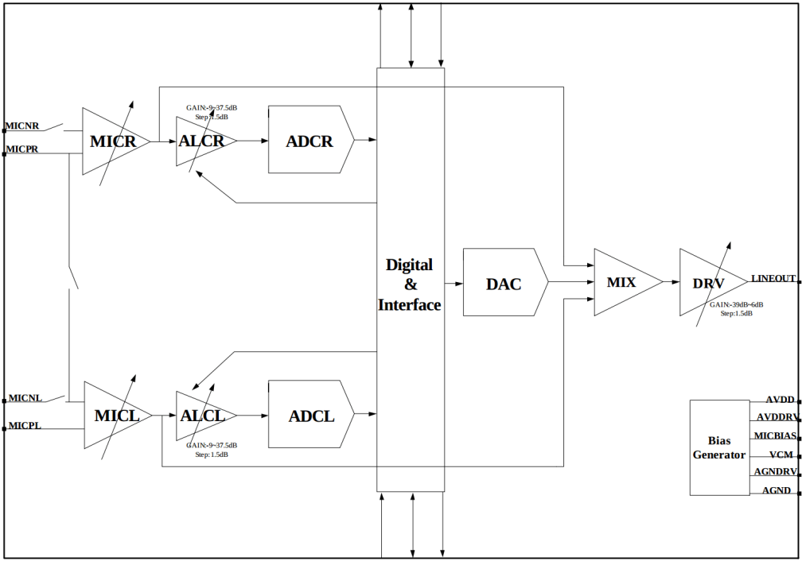
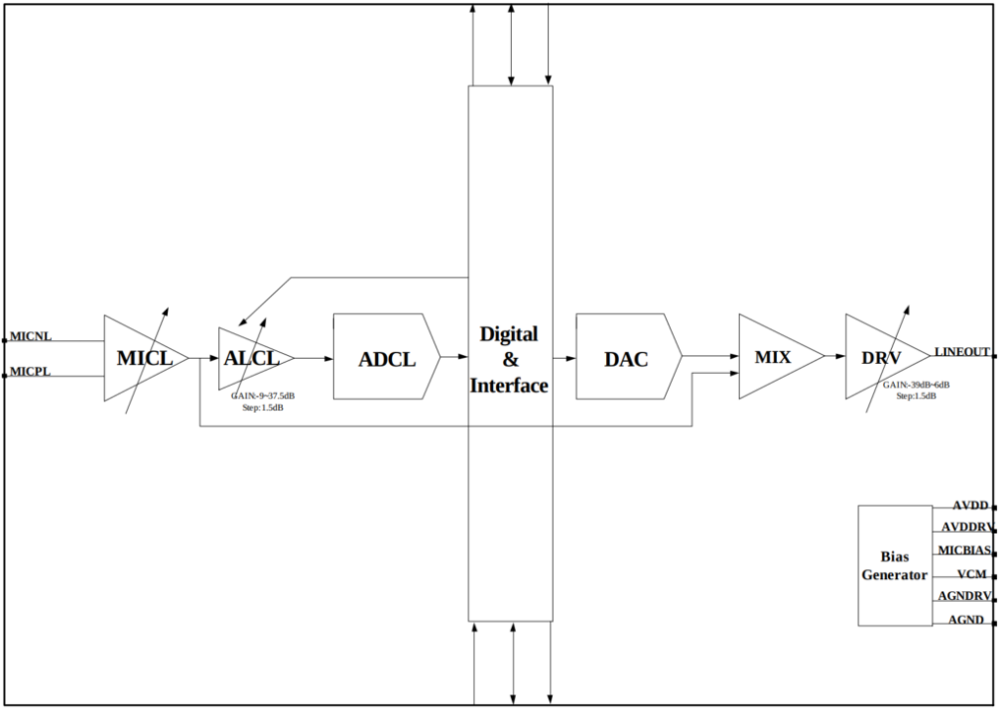
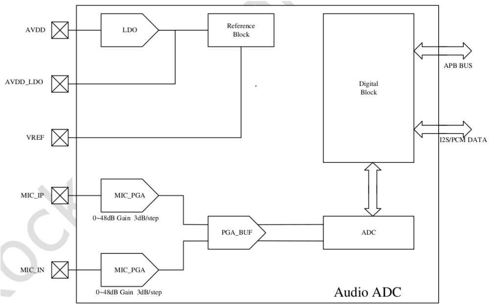
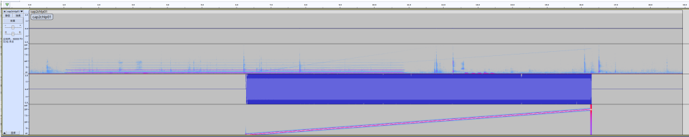
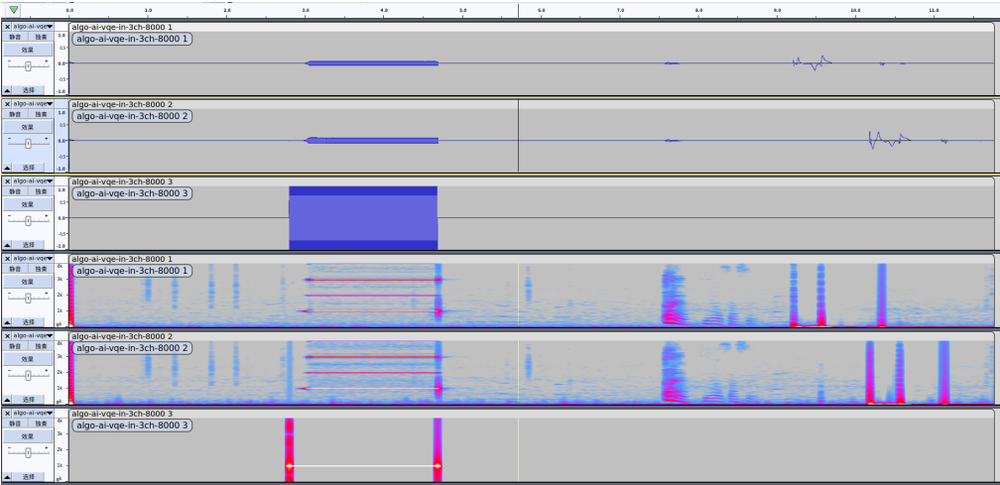

# Rockchip RV 系列 ACodec 完整指南：配置、录音与播放

本文作为 ArmSoM 技术资料库中的 Rockchip RV 音频参考，针对 RV1106/RV1103、RV1106B/RV1103B 与 RV1126B/RV1126BP 的内置 ACodec。前两组配套内核为 5.10，RV1126B/RV1126BP 为 6.1。它不是 Sige7 / AIM7（RK3588）或 Sige5 / CM5 / AIM5（RK3576）的内置 Codec 配置教程，不能直接套用其中 DTS、GPIO 或 mixer 控件。当前未核实与本指南匹配的 ArmSoM RV 板卡；若用于定制 RV 项目，应以实际 SoC、SDK、原理图和声卡枚举为准。原文参数及测试示例均不代表 ArmSoM 实测。

技术来源：Rockchip_Developer_Guide_Linux_RV_Series_ACodec_CN.pdf，V1.6.0。正文保留技术章节，删除封面声明、读者对象与修订记录。疑点与修正见[校对记录](/docs/rockchip-rv-acodec/EDITORIAL-NOTES.md)。

[ArmSoM Docs](https://docs.armsom.org/) · [Sige7](https://docs.armsom.org/armsom-sige7) · [Sige5](https://docs.armsom.org/armsom-sige5) · [CM5](https://docs.armsom.org/armsom-cm5)

<!-- source-page: 4; block: zh-0000 -->

## 1. 概述

<!-- source-page: 4; block: zh-0001 -->

### 1.1 功能描述

<!-- source-page: 4; block: zh-0002 -->

这里提到的ACodec,是指Rockchip RV系列SoC内置的音频IP模块,可以通过它外接模拟麦克风,通过模-数转换,将外部信号录音采集传给CPU;CPU也可以将本地的PCM音频数字信号,通过数-模转换后再播放出来。

<!-- source-page: 4; block: zh-0003 -->

RV1106和RV1103内部所包含的ACodec IP完全相同,包含2个ADC和1个DAC;RV1106B/RV1103B SoC于2024年推出,内部ACodec IP完全相同。与RV1106/RV1103相比,其ACodec删除了一个ADC,为1个ADC和1个DAC。操作 ACodec通常会遇到回采通路配置的场景,文档后续会详细说明。

<!-- source-page: 4; block: zh-0004 -->

RV1126B/RV1126BP于2025年推出,支持两颗低功耗高性能的ADC,适用于单、双麦克风拾音通话场景。其中, ADC0支持AOA(Always On Audio)技术,可实现休眠场景下超低功耗持续录音或唤醒的功能。具体使用请参考SDK 文档《Rockchip_Developer_Guide_Linux_AOV_CN.pdf》或《Rockchip_Developer_Guide_Linux_AOV_EN.pdf》 中,关于AOA模块的章节说明部分。

<!-- source-page: 4; block: zh-0005 -->

## 2. ACodec 基本介绍

<!-- source-page: 4; block: zh-0006 -->

### 2.1 ACodec Features

<!-- source-page: 4; block: zh-0007 -->

RV1106/RV1103/RV1106B/RV1103B ACodec的基本特性如下:

<!-- source-page: 4; block: zh-0008 -->

24 bits DAC with 93dB(A-weighted) SNR

<!-- source-page: 4; block: zh-0009 -->

Support 600Ω line output

<!-- source-page: 4; block: zh-0010 -->

Low power: 2.5mA for playback

<!-- source-page: 4; block: zh-0011 -->

24 bits ADC with 92dB(A-weighted) SNR

<!-- source-page: 4; block: zh-0012 -->

Support differential and single-ended microphone or line input

<!-- source-page: 4; block: zh-0013 -->

Low power: 5mA for stereo recording

<!-- source-page: 4; block: zh-0014 -->

Automatic Level Control (ALC) for smooth audio recording

<!-- source-page: 4; block: zh-0015 -->

Low power: less than 0.05mA for standby

<!-- source-page: 4; block: zh-0016 -->

Programmable input and output analog gains

<!-- source-page: 4; block: zh-0017 -->

Digital interpolation and decimation filter integrated

<!-- source-page: 4; block: zh-0018 -->

Sampling rate of 8kHz/12kHz/16kHz/24kHz/32kHz/44.1KHz/48KHz/96KHz

<!-- source-page: 4; block: zh-0019 -->

1.8V supply for analog and 0.9V supply for digital

<!-- source-page: 4; block: zh-0020 -->

RV1126B/RV1126BP ACodec的基本特性如下:

<!-- source-page: 4; block: zh-0021 -->

Support APB bus slave interface

<!-- source-page: 4; block: zh-0022 -->

Support Analog gain between 0~48dB with 3dB/step

<!-- source-page: 5; block: zh-0023 -->

Support 96dB SNR

<!-- source-page: 5; block: zh-0024 -->

Support 1-channel Differential-mode/Single-mode/Pseudo-differential mode ADC

<!-- source-page: 5; block: zh-0025 -->

Support I2S/PCM master and slave mode

<!-- source-page: 5; block: zh-0026 -->

Support I2S normal, left and right justified mode serial audio data transfer

<!-- source-page: 5; block: zh-0027 -->

Support PCM early, late1, late2, late3 mode serial audio data transfer

<!-- source-page: 5; block: zh-0028 -->

Support MSB or LSB first serial audio data transfer

<!-- source-page: 5; block: zh-0029 -->

Support 16~32bit sample resolution

<!-- source-page: 5; block: zh-0030 -->

Support sample rate: 8kHz, 16kHz, 32kHz, 64kHz, 128kHz, 11.025kHz, 22.05kHz, 44.1kHz, 88.2kHz, 176.4kHz, 12kHz, 24kHz, 48kHz, 96kHz, 192kHz

<!-- source-page: 5; block: zh-0031 -->

The passband of filters is 0.45625 * FS

<!-- source-page: 5; block: zh-0032 -->

Support passband ripple within +/-0.1dB

<!-- source-page: 5; block: zh-0033 -->

The stopband of filters is 0.5 * FS

<!-- source-page: 5; block: zh-0034 -->

Support stopband attenuation at least 60dB

<!-- source-page: 5; block: zh-0035 -->

Support Digital Audio ADC volume control

<!-- source-page: 5; block: zh-0036 -->

Support programmable negative volume gain and positive volume gain

<!-- source-page: 5; block: zh-0037 -->

### 2.2 ACodec Block Diagram

<!-- source-page: 5; block: zh-0038 -->



<!-- source-page: 5; block: zh-0039 -->

RV1106/RV1103 ACodec Block Diagram

<!-- source-page: 6; block: zh-0040 -->

从框图可以看到,RV1106、RV1103均支持2个ADC输入(录音),1个DAC输出(播放)。需要注意的是,RV1106差分模式下最大可以支持接入2个MIC,而RV1103差分模式下,仅支持接入1个MIC。单端模式下,二者最多均可接入2 个MIC。

<!-- source-page: 6; block: zh-0041 -->



<!-- source-page: 6; block: zh-0042 -->

RV1106B/RV1103B ACodec Block Diagram

<!-- source-page: 6; block: zh-0043 -->

而RV1106B/RV1103B ACodec在功能上删除了1个ADC,支持1个ADC输入(录音),1个DAC输出(播放)。不过ADC 输入仍然保持了差分输入或单端输入两种接入方式。

<!-- source-page: 6; block: zh-0044 -->

RV1126B/RV1126BP的默认支持两个低功耗高性能的ADC,默认均支持差分输入。框图如下:

<!-- source-page: 7; block: zh-0045 -->



<!-- source-page: 7; block: zh-0046 -->

RV1126B/RV1126BP ACodec Block Diagram

<!-- source-page: 7; block: zh-0047 -->

因此,根据SoC ID,以下ACodec MIC接入的主要区别是:

<!-- source-page: 7; block: zh-0048 -->

| SoC ID | 最大单端MIC数 | 最大差分MIC数 |
| --- | --- | --- |
| RV1106 | 2 | 2 |
| RV1103 | 2 | 1 |
| RV1106B/RV1103B | 1 | 1 |
| RV1126B/RV1126BP | 2 | 2 |

<!-- source-page: 7; block: zh-0049 -->

典型MIC接法,请参考我司的EVB图纸,以及硬件设计参考指南。

<!-- source-page: 7; block: zh-0050 -->

## 3. ACodec 软件开发配置

<!-- source-page: 7; block: zh-0051 -->

### 3.1 RV1106/RV1103 ACodec 内核配置

<!-- source-page: 7; block: zh-0052 -->

以我司的SDK kernel-5.10代码为例,可以参考该dtsi文件:

<!-- source-page: 7; block: zh-0053 -->

```text
arch/arm/boot/dts/rv1106-evb-v10.dtsi
```

<!-- source-page: 7; block: zh-0054 -->

先定义一个acodec_sound节点,它描述了声卡的一些基本信息,并引用到了主控端的DAI(数字音频接口) i2s0_8ch,以及外设端的DAI acodec:

<!-- source-page: 8; block: zh-0055 -->

```text
    acodec_sound: acodec-sound {
        compatible = "simple-audio-card";
        simple-audio-card,name = "rv1106-acodec";
        simple-audio-card,format = "i2s";
        simple-audio-card,mclk-fs = <256>;
        simple-audio-card,cpu {
            sound-dai = <&i2s0_8ch>;
        };
        simple-audio-card,codec {
            sound-dai = <&acodec>;
        };
    };
```

<!-- source-page: 8; block: zh-0056 -->

使能I2S0:

<!-- source-page: 8; block: zh-0057 -->

```text
&i2s0_8ch {
    #sound-dai-cells = <0>;
    status = "okay";
};
```

<!-- source-page: 8; block: zh-0058 -->

使能ACodec,并定义了控制外部功放的GPIO引脚:

<!-- source-page: 8; block: zh-0059 -->

```text
&acodec {
    #sound-dai-cells = <0>;
    pa-ctl-gpios = <&gpio1 RK_PA1 GPIO_ACTIVE_HIGH>;
    status = "okay";
};
```

<!-- source-page: 8; block: zh-0060 -->

以上的示例,可以将RV1106/RV1103内部的I2S0与ACodec绑定起来。

<!-- source-page: 8; block: zh-0061 -->

需要注意的是,因为RV1106/RV1103内部仅有一个I2S控制器,即I2S0。如果使能了内部的ACodec,这时I2S0将被占用,它通过SoC内部引线与ACodec连接。因此,此场景下,I2S0引到外部IO上的引脚将不可用。

<!-- source-page: 8; block: zh-0062 -->

### 3.2 RV1106B/RV1103B ACodec 内核配置

<!-- source-page: 8; block: zh-0063 -->

RV1106B/RV1103B ACodec的配置可以参考

<!-- source-page: 8; block: zh-0064 -->

```text
arch/arm/boot/dts/rv1103b-evb.dtsi
    acodec_sound: acodec-sound {
        compatible = "simple-audio-card";
        simple-audio-card,name = "rv1103b-acodec";
        simple-audio-card,format = "i2s";
        simple-audio-card,mclk-fs = <256>;
        simple-audio-card,cpu {
            sound-dai = <&sai>;
        };
        simple-audio-card,codec {
            sound-dai = <&acodec>;
        };
    };
```

<!-- source-page: 9; block: zh-0066 -->

可以看到,RV1106B/RV1103B的数字音频接口控制器由I2S升级为了SAI,需要将其使能:

<!-- source-page: 9; block: zh-0067 -->

```text
&sai {
    status = "okay";
};
```

<!-- source-page: 9; block: zh-0068 -->

同样需要使能acodec节点:

<!-- source-page: 9; block: zh-0069 -->

```text
&acodec {
    pa-ctl-gpios = <&gpio0 RK_PA3 GPIO_ACTIVE_HIGH>;
    status = "okay";
};
```

<!-- source-page: 9; block: zh-0070 -->

### 3.3 RV1106/RV1103 ACodec 用户层配置

<!-- source-page: 9; block: zh-0071 -->

通常,我们可以使用常用且权威的tinymix工具,获取和设置codec暴露给用户层的control节点信息。但由于SDK会对 tinymix工具进行裁剪,rockit上集成了使用上与tinymix相当的rk_mpi_amix_test工具,可用它来列出所有的 contents信息:

<!-- source-page: 9; block: zh-0072 -->

```text
# rk_mpi_amix_test --list_contents
cmd parse result:
sound control id      : 0
control name          : (null)
control value         : (null)
list controls         : 0
list contents         : 1
Number of controls: 26
ctl     type    num     name                                    value
0       ENUM    1       I2STDM Digital Loopback Mode            , DisabledMode1Mode2Mode2 Swap
1       INT     1       ADC MIC Left Gain                       2 (range 0->3)
2       INT     1       ADC MIC Right Gain                      2 (range 0->3)
3       INT     1       ADC ALC Left Volume                     6 (range 0->31)
4       INT     1       ADC ALC Right Volume                    6 (range 0->31)
5       INT     1       ADC Digital Left Volume                 195 (range 0->255)
6       INT     1       ADC Digital Right Volume                195 (range 0->255)
7       ENUM    1       ADC HPF Cut-off                         , OffOn
8       INT     1       ALC AGC Left Volume                     12 (range 0->31)
9       INT     1       ALC AGC Right Volume                    12 (range 0->31)
10      INT     1       ALC AGC Left Max Volume                 7 (range 0->7)
11      INT     1       ALC AGC Right Max Volume                7 (range 0->7)
12      INT     1       ALC AGC Left Min Volume                 0 (range 0->7)
13      INT     1       ALC AGC Right Min Volume                0 (range 0->7)
14      ENUM    1       ALC AGC Left Switch                     , OffOn
15      ENUM    1       ALC AGC Right Switch                    , OffOn
16      ENUM    1       AGC Left Approximate Sample Rate        , 96KHz48KHz44.1KHz32KHz24KHz16KHz12KHz8KHz
17      ENUM    1       AGC Right Approximate Sample Rate       , 96KHz48KHz44.1KHz32KHz24KHz16KHz12KHz8KHz
18      ENUM    1       ADC Mode                                , DiffadcLSingadcLDiffadcRSingadcRSingadcLRDiffadcLR
19      ENUM    1       ADC MICBIAS Voltage VREFx0_8VREFx0_825VREFx0_85VREFx0_875, VREFx0_9VREFx0_925VREFx0_95VREFx0_975
20      ENUM    1       ADC Main MICBIAS                        Off, On
21      ENUM    1       ADC MIC Left Switch                     , WorkMute
22      ENUM    1       ADC MIC Right Switch                    , WorkMute
23      INT     1       DAC LINEOUT Volume                      26 (range 0->30)
24      INT     1       DAC HPMIX Volume                        1 (range 0->2)
25      ENUM    1       DAC Control Manually                    , NoneOffOn
```

<!-- source-page: 10; block: zh-0074 -->

节点比较多,这里介绍一些常用的节点信息:

<!-- source-page: 10; block: zh-0075 -->

```text
0       ENUM    1       I2STDM Digital Loopback Mode            , DisabledMode1Mode2Mode2 Swap
```

<!-- source-page: 10; block: zh-0076 -->

该节点其实是I2S0暴露给用户的control节点,但是其与acodec关联比较大,它表明I2STDM控制器是否工作在回采模式下。其中:

<!-- source-page: 10; block: zh-0077 -->

Disabled:默认状态,不开启回采模式 Mode1:适用于4ch使用场景。1-2声道为MIC拾音数据,3-4声道为回采数据 Mode2:适用于2ch使用场景。左声道为MIC拾音数据,右声道为播放的右声道的回采数据 Mode2 Swap:适用于2ch使用场景。左声道为播放的左声道的回采数据,右声道为MIC拾音数据。与Mode2 声道顺序相反

<!-- source-page: 10; block: zh-0078 -->

因此,如果Mode2和Mode2 Swap在对2ch的数据播放时,送给ACodec DAC之前最好先进行软件MIX,这样回采的参考信号越接近真实回声路径的信号。

<!-- source-page: 10; block: zh-0079 -->

补充:tinymix风格显示的被选中项,是在左侧加上逗号“,”。比如显示的“, Disabled”,表示目前选中“Disabled”状态,依次类推。

<!-- source-page: 10; block: zh-0080 -->

```text
1       INT     1       ADC MIC Left Gain                       2 (range 0->3)
2       INT     1       ADC MIC Right Gain                      2 (range 0->3)
```

<!-- source-page: 10; block: zh-0081 -->

ACodec ADC Boost Gain,为codec模拟音量,数值实际有效取值范围为1〜3:

<!-- source-page: 10; block: zh-0082 -->

vol 0: Disabled and not recommended

<!-- source-page: 11; block: zh-0083 -->

vol 1: 0dB

<!-- source-page: 11; block: zh-0084 -->

vol 2: 20dB

<!-- source-page: 11; block: zh-0085 -->

vol 3: 12dB

<!-- source-page: 11; block: zh-0086 -->

```text
3       INT     1       ADC ALC Left Volume                     6 (range 0->31)
4       INT     1       ADC ALC Right Volume                    6 (range 0->31)
```

<!-- source-page: 11; block: zh-0087 -->

ACodec ADC ALC PGA Gain,为codec模拟音量,数值取值范围为0〜31,其中:

<!-- source-page: 11; block: zh-0088 -->

min: -9dB (vol: 0)

<!-- source-page: 11; block: zh-0089 -->

max: +37.5dB (vol: 31)

<!-- source-page: 11; block: zh-0090 -->

step: +1.5dB

<!-- source-page: 11; block: zh-0091 -->

location: 0dB (vol: 6)

<!-- source-page: 11; block: zh-0092 -->

```text
5       INT     1       ADC Digital Left Volume                 195 (range 0->255)
6       INT     1       ADC Digital Right Volume                195 (range 0->255)
```

<!-- source-page: 11; block: zh-0093 -->

ACodec ADC Digital Gain,为codec数字音量,数值取值范围为0〜255,其中:

<!-- source-page: 11; block: zh-0094 -->

min: -97.5dB (vol: 0)

<!-- source-page: 11; block: zh-0095 -->

max: +30dB (vol: 255)

<!-- source-page: 11; block: zh-0096 -->

step: +0.5dB

<!-- source-page: 11; block: zh-0097 -->

location: 0dB (vol: 195)

<!-- source-page: 11; block: zh-0098 -->

```text
18      ENUM    1       ADC Mode                                , DiffadcLSingadcLDiffadcRSingadcRSingadcLRDiffadcLR
```

<!-- source-page: 11; block: zh-0099 -->

“Diff”为差分“Differential”的缩写;“Sing”为单端“Single-end”的缩写。用于配置ACodec ADC工作在差分或者单端模式。默认为“Diff”差分模式。且为了最大限度节省功耗,ADC仅使能L左声道。因此,“DiffadcL”为默认首选项。

<!-- source-page: 11; block: zh-0100 -->

需要注意的是,由于芯片定位的不同,RV1103差分模式下不支持双声道拾音,即不支持“DiffadcLR”选项。

<!-- source-page: 11; block: zh-0101 -->

```text
23      INT     1       DAC LINEOUT Volume                      26 (range 0->30)
```

<!-- source-page: 11; block: zh-0102 -->

ACodec DAC Lineout Gain,音量数值取值范围为0〜30,其中:

<!-- source-page: 11; block: zh-0103 -->

min: -39dB (vol: 0)

<!-- source-page: 11; block: zh-0104 -->

max: +6dB (vol: 30)

<!-- source-page: 11; block: zh-0105 -->

step: +1.5dB

<!-- source-page: 11; block: zh-0106 -->

location: 0dB (vol: 26)

<!-- source-page: 11; block: zh-0107 -->

```text
24      INT     1       DAC HPMIX Volume                        1 (range 0->2)
```

<!-- source-page: 11; block: zh-0108 -->

ACodec DAC HPMIX Gain,它为Lineout的前级Gain,通常不做设置。音量数值取值范围实际为1和2,其中:

<!-- source-page: 11; block: zh-0109 -->

vol 0: Disabled and not recommended

<!-- source-page: 12; block: zh-0110 -->

vol 1: 0dB

<!-- source-page: 12; block: zh-0111 -->

vol 2: 6dB

<!-- source-page: 12; block: zh-0112 -->

```text
25      ENUM    1       DAC Control Manually                    , NoneOffOn
```

<!-- source-page: 12; block: zh-0113 -->

开发者通常会使用媒体框架常开AO Stream(即常开声卡),停止播放的时候仅仅需要快速关、开外设PA的动作,因此,这里新增了"DAC Control Manually"节点,其中:

<!-- source-page: 12; block: zh-0114 -->

None: 默认状态,媒体框架需要实际关闭、打开AO Stream来控制声卡的关和开 Off: 可以在AO Stream常开的情况下,仅仅手动关闭外设PA,使喇叭播放无声 On: 可以在AO Stream常开,上一状态为Off的情况下,重新手动打开外设PA,使喇叭恢复播放

<!-- source-page: 12; block: zh-0115 -->

上述是codec control节点在开发过程中较常被开发者使用到的。另外的一些选项,可以参照control name和选项,根据具体项目自行配置调整。

<!-- source-page: 12; block: zh-0116 -->

### 3.4 RV1106B/RV1103B ACodec 用户层配置

<!-- source-page: 12; block: zh-0117 -->

我们同样可以用rk_mpi_amix_test列出RV1106B/RV1103B ACodec相关的控制节点:

<!-- source-page: 12; block: zh-0118 -->

```text
# rk_mpi_amix_test --list_contents
cmd parse result:
sound control id      : 0
control name          : (null)
control value         : (null)
list controls         : 0
list contents         : 1
Number of controls: 54
ctl     type    num     name                                    value
0       ENUM    1       SAI Transmit Start Mode Sel             , StandaloneChained
1       ENUM    1       SAI Receive Start Mode Sel              , StandaloneChained
2       ENUM    1       SAI Transmit SDOx Select                , AutoSDOx1SDOx2SDOx3SDOx4
3       ENUM    1       SAI Receive SDIx Select                 , AutoSDIx1SDIx2SDIx3SDIx4
4       INT     1       SAI Receive Mono Slot Select            0 (range 0->128)
5       ENUM    1       SAI Receive Mono Switch                 , DisableEnable
6       ENUM    1       SAI Transmit Mono Switch                , DisableEnable
7       ENUM    1       SAI SDI3 Loopback I2S LR Channel Sel    , L:MIC R:LPL:LP R:MIC
8       ENUM    1       SAI SDI2 Loopback I2S LR Channel Sel    , L:MIC R:LPL:LP R:MIC
9       ENUM    1       SAI SDI1 Loopback I2S LR Channel Sel    , L:MIC R:LPL:LP R:MIC
10      ENUM    1       SAI SDI0 Loopback I2S LR Channel Sel    , L:MIC R:LPL:LP R:MIC
11      ENUM    1       SAI SDI3 Loopback I2S LR Switch         , DisableEnable
12      ENUM    1       SAI SDI2 Loopback I2S LR Switch         , DisableEnable
13      ENUM    1       SAI SDI1 Loopback I2S LR Switch         , DisableEnable
14      ENUM    1       SAI SDI0 Loopback I2S LR Switch         , DisableEnable
15      ENUM    1       SAI SDI3 Loopback Src Select            , From SDO0From SDO1From SDO2From SDO3
16      ENUM    1       SAI SDI2 Loopback Src Select            , From SDO0From SDO1From SDO2From SDO3
17      ENUM    1       SAI SDI1 Loopback Src Select            , From SDO0From SDO1From SDO2From SDO3
18      ENUM    1       SAI SDI0 Loopback Src Select            , From SDO0From SDO1From SDO2From SDO3
19      ENUM    1       SAI SDI3 Loopback Switch                , DisableEnable
20      ENUM    1       SAI SDI2 Loopback Switch                , DisableEnable
21      ENUM    1       SAI SDI1 Loopback Switch                , DisableEnable
22      ENUM    1       SAI SDI0 Loopback Switch                , DisableEnable
23      ENUM    1       SAI Sync Out Switch                     , From CRUFrom IO
24      ENUM    1       SAI Sync In Switch                      , From IOFrom Sync Port
25      ENUM    1       SAI Receive PATH3 Source Select         From SDI0From SDI1From SDI2, From SDI3
26      ENUM    1       SAI Receive PATH2 Source Select         From SDI0From SDI1, From SDI2From SDI3
27      ENUM    1       SAI Receive PATH1 Source Select         From SDI0, From SDI1From SDI2From SDI3
28      ENUM    1       SAI Receive PATH0 Source Select         , From SDI0From SDI1From SDI2From SDI3
29      ENUM    1       SAI Transmit SDO3 Source Select         From PATH0From PATH1From PATH2, From PATH3
30      ENUM    1       SAI Transmit SDO2 Source Select         From PATH0From PATH1, From PATH2From PATH3
31      ENUM    1       SAI Transmit SDO1 Source Select         From PATH0, From PATH1From PATH2From PATH3
32      ENUM    1       SAI Transmit SDO0 Source Select         , From PATH0From PATH1From PATH2From PATH3
33      BOOL    1       SAI Clk Auto Switch                     Off
34      INT     1       SAI PCM Read Wait Time MS               0 (range 0->10000)
35      INT     1       SAI PCM Write Wait Time MS              0 (range 0->10000)
36      INT     1       ADC MIC Left Gain                       2 (range 0->3)
37      INT     1       ADC ALC Left Volume                     6 (range 0->31)
38      INT     1       ADC Digital Left Volume                 195 (range 0->255)
39      ENUM    1       ADC HPF Cut-off                         , OffOn
40      INT     1       ALC AGC Left Volume                     12 (range 0->31)
41      INT     1       ALC AGC Left Max Volume                 7 (range 0->7)
42      INT     1       ALC AGC Left Min Volume                 0 (range 0->7)
43      ENUM    1       ALC AGC Left Switch                     , OffOn
44      ENUM    1       AGC Left Approximate Sample Rate        , 96KHz48KHz44.1KHz32KHz24KHz16KHz12KHz8KHz
45      ENUM    1       ADC Mode                                , DiffadcLSingadcLDiffadcRSingadcRSingadcLRDiffadcLR
46      ENUM    1       ADC MICBIAS Voltage VREFx0_8VREFx0_825VREFx0_85VREFx0_875, VREFx0_9VREFx0_925VREFx0_95VREFx0_975
47      ENUM    1       ADC Main MICBIAS                        Off, On
48      ENUM    1       ADC MIC Left Switch                     , WorkMute
49      INT     1       DAC LINEOUT Volume                      26 (range 0->30)
50      INT     1       DAC HPMIX Volume                        1 (range 0->2)
51      ENUM    1       DAC Control Manually                    , NoneOffOn
52      ENUM    1       DAC VCM Manually                        , NoneOffOn
53      ENUM    1       Audio Mux Select                        , Path0Path1Path2Path3Path4Path5
```

<!-- source-page: 14; block: zh-0120 -->

可以看到,因为RV1106B/RV1103B ACodec只有1个ADC输入,因此相比RV1106/RV1103,去除了ADC "Right"部分,仅保留"Left"部分,功能配置与RV1106/RV1103的完全相同。并新增了"Audio Mux Select"用于SAI控制器连接内部ACodec和外部IO的通路切换功能:

<!-- source-page: 14; block: zh-0121 -->

```text
53      ENUM    1       Audio Mux Select                        , Path0Path1Path2Path3Path4Path5
```

<!-- source-page: 14; block: zh-0122 -->

通路切换共有6个Path控制状态:

<!-- source-page: 14; block: zh-0123 -->

Path0: 播放:仅从ACodec Lineout输出;录音:仅从ACodec Mic输入(默认) Path1: 播放:仅从ACodec Lineout输出;录音:仅从SAI SDI IO输入 Path2: 播放:从ACodec Lineout和SAI SDO IO同时输出;录音:仅从ACodec Mic输入 Path3: 播放:从ACodec Lineout和SAI SDO IO同时输出;录音:仅从SAI SDI IO输入 Path4: 播放:仅从SAI SDO IO输出;录音:仅从ACodec Mic输入 Path5: 播放:仅从SAI SDO IO输出;录音:仅从SAI SDI IO输入(仅测试,通常并不会使用)

<!-- source-page: 14; block: zh-0124 -->

另外,由于控制器SAI的升级,原先RV1106/RV1103 I2S的部分与当前SAI的差异较大,但是我们主要关注和 RV1106B/RV1103B数字回采相关的配置即可。也正因为RV1106B/RV1103B ACodec只有1个ADC输入,因此和SAI输入相关的Data Lane只有SDI0部分:

<!-- source-page: 14; block: zh-0125 -->

```text
10      ENUM    1       SAI SDI0 Loopback I2S LR Channel Sel    , L:MIC R:LPL:LP R:MIC
```

<!-- source-page: 14; block: zh-0126 -->

L:MIC R:LP:SAI SDI0 Lane回采模式的左右通道选择:左声道为MIC,右声道为回采 L:LP R:MIC:SAI SDI0 Lane回采模式的左右通道选择:右声道为MIC,左声道为回采

<!-- source-page: 14; block: zh-0127 -->

```text
14      ENUM    1       SAI SDI0 Loopback I2S LR Switch         , DisableEnable
```

<!-- source-page: 14; block: zh-0128 -->

SAI SDI0 Lane回采模式的左右通道选择模式开关,默认Disable,保持为数据直通模式,需要数字回采的情况下将其 Enable。

<!-- source-page: 14; block: zh-0129 -->

```text
18      ENUM    1       SAI SDI0 Loopback Src Select            , From SDO0From SDO1From SDO2From SDO3
```

<!-- source-page: 14; block: zh-0130 -->

表示SAI SDI0开启数字回采后参考输出数据Lane的选择,因为RV1106B/RV1103B ACodec仅支持单声道录音和单声道播放,因此这里仅支持从SDO0作为参考。保持缺省状态即可。

<!-- source-page: 14; block: zh-0131 -->

```text
22      ENUM    1       SAI SDI0 Loopback Switch                , DisableEnable
```

<!-- source-page: 14; block: zh-0132 -->

SAI SDI0 Lane的数字回采开关。默认关闭,需要回采时可将其打开。

<!-- source-page: 14; block: zh-0133 -->

综上所述,若要完全配置单MIC单回采,可以按照以下命令以此配置:

<!-- source-page: 14; block: zh-0134 -->

```text
rk_mpi_amix_test --control "SAI SDI0 Loopback I2S LR Channel Sel" --value "L:MIC R:LP"
rk_mpi_amix_test --control "SAI SDI0 Loopback Src Select" --value "From SDO0"
rk_mpi_amix_test --control "SAI SDI0 Loopback I2S LR Switch" --value "Enable"
rk_mpi_amix_test --control "SAI SDI0 Loopback Switch" --value "Enable"
```

<!-- source-page: 15; block: zh-0135 -->

由于"SAI SDI0 Loopback I2S LR Channel Sel"和"SAI SDI0 Loopback Src Select"上电后寄存器均保持所需要状态, 因此,开启数字回采的配置命令通常可以省略为:

<!-- source-page: 15; block: zh-0136 -->

```text
rk_mpi_amix_test --control "SAI SDI0 Loopback I2S LR Switch" --value "Enable"
rk_mpi_amix_test --control "SAI SDI0 Loopback Switch" --value "Enable"
```

<!-- source-page: 15; block: zh-0137 -->

RV1106B/RV1103B 2通道录音示例,左声道为MIC,右声道为回采:

<!-- source-page: 15; block: zh-0138 -->



<!-- source-page: 15; block: zh-0139 -->

### 3.5 RV1126B/RV1126BP ACodec 用户层配置

<!-- source-page: 15; block: zh-0140 -->

目前,最新的SDK Kernel代码默认都开启了ADC0和ADC1:

<!-- source-page: 15; block: zh-0141 -->

```text
commit b69407b9ad1232f35ae108fd8755d962fcdeda84
Author: Xing Zheng <zhengxing@rock-chips.com>
Date:   Tue Jul 1 18:44:24 2025 +0800
    arm64: dts: rockchip: rv1126b-evb: enable both acodec_pmu and acodec for 4ch capture by
default
```

<!-- source-page: 15; block: zh-0142 -->

可通过工程代码参考如下patch确认是否开启:

<!-- source-page: 15; block: zh-0143 -->

```text
diff --git a/arch/arm64/boot/dts/rockchip/rv1126b-evb2-v10.dtsi b/arch/arm64/boot/dts/rockchip/rv1126b-evb2-v10.dtsi
index 1ca72d41c5ab..cf6b5788ea5e 100644
--- a/arch/arm64/boot/dts/rockchip/rv1126b-evb2-v10.dtsi
+++ b/arch/arm64/boot/dts/rockchip/rv1126b-evb2-v10.dtsi
@@ -445,7 +445,6 @@ &rtc {
 };
 &sai2 {
-       rockchip,sai-rx-route = <1 0 2 3>;
        status = "okay";
        /delete-property/ pinctrl-names;
        /delete-property/ pinctrl-0;
diff --git a/arch/arm64/boot/dts/rockchip/rv1126b-evb.dtsi b/arch/arm64/boot/dts/rockchip/rv1126b-evb.dtsi
index eb3879ca4c5f..8ca9b5b9a32c 100644
--- a/arch/arm64/boot/dts/rockchip/rv1126b-evb.dtsi
+++ b/arch/arm64/boot/dts/rockchip/rv1126b-evb.dtsi
@@ -20,7 +20,7 @@ acodec_sound: acodec-sound {
                rockchip,format = "i2s";
                rockchip,mclk-fs-mapping = <256 1024>;
                rockchip,cpu = <&sai2>;
-               rockchip,codec = <&audio_codec>, <&acdcdig_dsm>;
+               rockchip,codec = <&audio_codec_pmu>, <&audio_codec>, <&acdcdig_dsm>;
        };
        adc-keys {
diff --git a/arch/arm64/boot/dts/rockchip/rv1126b-evb1-v10.dtsi b/arch/arm64/boot/dts/rockchip/rv1126b-evb1-v10.dtsi
index 31faaa3ad88b..da82560304cd 100644
--- a/arch/arm64/boot/dts/rockchip/rv1126b-evb1-v10.dtsi
+++ b/arch/arm64/boot/dts/rockchip/rv1126b-evb1-v10.dtsi
@@ -132,6 +132,10 @@ &acodec_sound {
        status = "okay";
 };
+&audio_codec_pmu {
+       status = "okay";
+};
+
 &audio_codec {
        status = "okay";
 };
```

<!-- source-page: 16; block: zh-0145 -->

因此,默认声卡的contents信息通常如下所示:

<!-- source-page: 16; block: zh-0146 -->

```text
# rk_mpi_amix_test --list_contents 1
cmd parse result:
sound control id      : 0
control name          : (null)
control value         : (null)
list controls         : 0
list contents         : 1
ctl     type    num     name                            value
0       BOOL    1       Headphone Switch                1
1       BOOL    1       ACodec ADC Switch               0
2       INTE    1       ACodec Digital Gain Volume      0(0->127)
3       ENUM    1       ACodec HPF Cutoff               ,"3.79Hz" "60Hz" "243Hz" "493Hz"
4       BOOL    1       ACodec HPF Switch               0
5       INTE    1       ACodec PGA Gain Volume          16(0->31)
6       BOOL    1       ACodec_LP ADC Switch            0
7       INTE    1       ACodec_LP Digital Gain Volume   0(0->127)
8       ENUM    1       ACodec_LP HPF Cutoff            ,"3.79Hz" "60Hz" "243Hz" "493Hz"
9       BOOL    1       ACodec_LP HPF Switch            0
10      INTE    1       ACodec_LP PGA Gain Volume       16(0->31)
11      INTE    2       DAC Digital Volume              255(0->510) 255(0->510)
12      ENUM    1       DAC HPF Cutoff                  ,"80Hz" "100Hz" "120Hz" "140Hz"
13      BOOL    1       DAC HPF Switch                  0
14      BOOL    1       Headset Mic Switch              1
15      BOOL    1       Main Mic Switch                 1
16      ENUM    1       Power Amplifier                 ,"Off" "On"
17      BOOL    1       SAI2 Clk Auto Switch            0
18      INTE    1       SAI2 Receive Mono Slot Select   0(0->128)
19      ENUM    1       SAI2 Receive Mono Switch        ,"Disable" "Enable"
20      ENUM    1       SAI2 Receive PATH0 Source Sele  ,"From SDI0" "From SDI1" "From SDI2" "From SDI3"
21      ENUM    1       SAI2 Receive PATH1 Source Sele  "From SDI0" ,"From SDI1" "From SDI2" "From SDI3"
22      ENUM    1       SAI2 Receive PATH2 Source Sele  "From SDI0" "From SDI1" ,"From SDI2" "From SDI3"
23      ENUM    1       SAI2 Receive PATH3 Source Sele  "From SDI0" "From SDI1" "From SDI2" ,"From SDI3"
24      ENUM    1       SAI2 Receive SDIx Select        ,"Auto" "SDIx1" "SDIx2" "SDIx3" "SDIx4"
25      ENUM    1       SAI2 Receive Start Mode Sel     ,"Standalone" "Chained"
26      ENUM    1       SAI2 SDI0 Loopback I2S LR Chan  ,"L:MIC R:LP" "L:LP R:MIC"
27      ENUM    1       SAI2 SDI0 Loopback I2S LR Swit  ,"Disable" "Enable"
28      ENUM    1       SAI2 SDI0 Loopback Src Select   ,"From SDO0" "From SDO1" "From SDO2" "From SDO3"
29      ENUM    1       SAI2 SDI0 Loopback Switch       ,"Disable" "Enable"
30      ENUM    1       SAI2 SDI1 Loopback I2S LR Chan  ,"L:MIC R:LP" "L:LP R:MIC"
31      ENUM    1       SAI2 SDI1 Loopback I2S LR Swit  ,"Disable" "Enable"
32      ENUM    1       SAI2 SDI1 Loopback Src Select   ,"From SDO0" "From SDO1" "From SDO2" "From SDO3"
33      ENUM    1       SAI2 SDI1 Loopback Switch       ,"Disable" "Enable"
34      ENUM    1       SAI2 SDI2 Loopback I2S LR Chan  ,"L:MIC R:LP" "L:LP R:MIC"
35      ENUM    1       SAI2 SDI2 Loopback I2S LR Swit  ,"Disable" "Enable"
36      ENUM    1       SAI2 SDI2 Loopback Src Select   ,"From SDO0" "From SDO1" "From SDO2" "From SDO3"
37      ENUM    1       SAI2 SDI2 Loopback Switch       ,"Disable" "Enable"
38      ENUM    1       SAI2 SDI3 Loopback I2S LR Chan  ,"L:MIC R:LP" "L:LP R:MIC"
39      ENUM    1       SAI2 SDI3 Loopback I2S LR Swit  ,"Disable" "Enable"
40      ENUM    1       SAI2 SDI3 Loopback Src Select   ,"From SDO0" "From SDO1" "From SDO2" "From SDO3"
41      ENUM    1       SAI2 SDI3 Loopback Switch       ,"Disable" "Enable"
42      ENUM    1       SAI2 Sync In Switch             ,"From IO" "From Sync Port"
43      ENUM    1       SAI2 Sync Out Switch            ,"From CRU" "From IO"
44      ENUM    1       SAI2 Transmit Mono Switch       ,"Disable" "Enable"
45      ENUM    1       SAI2 Transmit SDO0 Source Sele  ,"From PATH0" "From PATH1" "From PATH2" "From PATH3"
46      ENUM    1       SAI2 Transmit SDO1 Source Sele  "From PATH0" ,"From PATH1" "From PATH2" "From PATH3"
47      ENUM    1       SAI2 Transmit SDO2 Source Sele  "From PATH0" "From PATH1" ,"From PATH2" "From PATH3"
48      ENUM    1       SAI2 Transmit SDO3 Source Sele  "From PATH0" "From PATH1" "From PATH2" ,"From PATH3"
49      ENUM    1       SAI2 Transmit SDOx Select       ,"Auto" "SDOx1" "SDOx2" "SDOx3" "SDOx4"
50      ENUM    1       SAI2 Transmit Start Mode Sel    ,"Standalone" "Chained"
51      BOOL    1       Speaker Switch                  1
52      BOOL    1       hp switch                       0
53      BOOL    1       spk switch                      0
54      INTE    1       SAI2 PCM Read Wait Time MS      0(0->10000)
55      INTE    1       SAI2 PCM Write Wait Time MS     0(0->10000)
```

<!-- source-page: 18; block: zh-0148 -->

因为RV1126B的ADC0和ADC1分别各自占用一根I2S数据线,即SDI0和SDI1,默认录音的时候每根SDI会得到2ch数据一致的数据,比如:SDI0数据线上的左右声道均为接入ADC0的MIC0数据,SDI1数据线上的左右声道均为接入ADC1 的MIC1数据。

<!-- source-page: 18; block: zh-0149 -->

所以,无论是单麦克风场景或者双麦克风场景,都先建议开启SDI0和SDI1的回采使能功能:

<!-- source-page: 18; block: zh-0150 -->

```text
rk_mpi_amix_test --control 'SAI2 SDI0 Loopback I2S LR Switch' --value 'Enable'
rk_mpi_amix_test --control 'SAI2 SDI0 Loopback Switch' --value 'Enable'
rk_mpi_amix_test --control 'SAI2 SDI1 Loopback I2S LR Switch' --value 'Enable'
rk_mpi_amix_test --control 'SAI2 SDI1 Loopback Switch' --value 'Enable'
```

<!-- source-page: 18; block: zh-0151 -->

这样,默认通过SAI2 SDO0播放的数字回采数据,可以直接从SDI0和SDI1的右声道获取。

<!-- source-page: 18; block: zh-0152 -->

举个较为常见的2ch Mic + 1ch回采的使用场景:RV1126B默认使用full alsa-lib架构,支持asound.conf配置(注意, asound.conf务必放到/etc目录下):

<!-- source-page: 18; block: zh-0153 -->

```text
# Copyright (c) 2025 Rockchip Electronics Co. Ltd.
# Author: Xing Zheng <zhengxing@rock-chips.com>
pcm.!default {
    type asym
    playback.pcm "play_plug"
    capture.pcm "capt_softvol"
}
ctl.!default {
    type hw
    card 0
}
# ---------- Capture ----------
pcm.cap_multi {
    type multi
    slaves.a.pcm "hw:0,0"
    slaves.a.channels 4
    bindings.0.slave a
    bindings.0.channel 0
    bindings.1.slave a
    bindings.1.channel 2
    bindings.2.slave a
    bindings.2.channel 1
}
pcm.capt_plug {
    type plug
    slave.pcm "cap_multi"
}
pcm.capt_softvol {
    type softvol
    slave.pcm "capt_plug"
    control.name "Master Capture Volume"
    control.card 0
    min_dB -51.0
    max_dB 0.0
    resolution 101
}
# ---------- Playback ----------
pcm.play_softvol {
    type softvol
    slave.pcm "hw:0,0"
    control.name "Master Playback Volume"
    control.card 0
    min_dB -51.0
    max_dB 0.0
    resolution 101
}
pcm.play_plug {
    type plug
    slave.pcm "play_softvol"
}
```

<!-- source-page: 19; block: zh-0155 -->

接着,应用端参考test_mpi_ai.cpp如下修改,分别调整3ch录音时Rec 2ch和 Ref 1ch的layout bitmap:

<!-- source-page: 19; block: zh-0156 -->

```text
diff --git a/src/tests/rt_mpi/mod/test_mpi_ai.cpp b/src/tests/rt_mpi/mod/test_mpi_ai.cpp
index 682467c03..798907c0d 100644
--- a/src/tests/rt_mpi/mod/test_mpi_ai.cpp
+++ b/src/tests/rt_mpi/mod/test_mpi_ai.cpp
@@ -757,9 +760,13 @@ RK_S32 test_init_ai_vqe(TEST_AI_CTX_S *params) {
     stAiVqeConfig.s32WorkSampleRate = params->s32SampleRate;
     stAiVqeConfig.s32FrameSample = params->s32SampleRate * params->s32VqeGapMs / 1000;
+    /* FIXME: for capture with more channel */
     if (params->s32DeviceChannel == 4) {
         stAiVqeConfig.s64RefChannelType = 0x0c;
         stAiVqeConfig.s64RecChannelType = 0x03;
+    } else if (params->s32DeviceChannel == 3) {
+        stAiVqeConfig.s64RefChannelType = 0x04;
+        stAiVqeConfig.s64RecChannelType = 0x03;
     } else {
         stAiVqeConfig.s64RefChannelType = 0x02;
         stAiVqeConfig.s64RecChannelType = 0x01;
```

<!-- source-page: 19; block: zh-0157 -->

使用 rk_mpi_ai_test 3ch录音,sound_card_name指定入口节点为“default”:

<!-- source-page: 19; block: zh-0158 -->

```text
export rt_dump_skv_inout=true
rk_mpi_ai_test --sound_card_name=default --device_rate 8000 --device_ch 3 --out_rate 8000 --out_ch 1 --output /tmp --vqe_enable 1 --vqe_cfg /tmp/config_aivqe.json
```

<!-- source-page: 19; block: zh-0159 -->

期望可以得到常见的 MIC0 / MIC1 / Loopback0 数据排列方式。下图即对应该3ch数据的时域和频域图:

<!-- source-page: 20; block: zh-0160 -->



<!-- source-page: 20; block: zh-0161 -->

## 4. ACodec 常用测试命令

<!-- source-page: 20; block: zh-0162 -->

由于RV1106/RV1103/RV1106B/RV1103B运行环境通常基于rockit框架,因此这里结合基础示例和rockit相关命令来举例:

<!-- source-page: 20; block: zh-0163 -->

### 4.1 常用播放测试命令

<!-- source-page: 20; block: zh-0164 -->

以下使用一个采样率16kHz/2ch/16bit的PCM作为播放音源,rk_mpi_ao_test命令默认处理16bit位深。其中,参数 “device_rate=16000”和“input_rate=16000”相同,表明不需要启用重采样功能;参数“input_ch=2”需要与原始音源 2ch对应:

<!-- source-page: 20; block: zh-0165 -->

```text
rk_mpi_ao_test -i /tmp/sine_16k_500_1000_0dbfs.wav --sound_card_name=hw:0,0 --device_ch=2 --device_rate=16000 --input_rate=16000 --input_ch=2
```

<!-- source-page: 20; block: zh-0166 -->

其中,sine_16k_500_1000_0dbfs.wav文件可以从:https://redmine.rock-chips.com/attachments/2297743 处下载。

<!-- source-page: 20; block: zh-0167 -->

更多的命令参数使用请参考SDK Rockit工程目录下“MPI”相关文档,以及mpi example目录下的相关测试用例。

<!-- source-page: 20; block: zh-0168 -->

### 4.2 常用录音测试命令

<!-- source-page: 20; block: zh-0169 -->

以下使用采样率16kHz/2ch/16bit的PCM格式录音,rk_mpi_ai_test命令同样默认处理16bit位深。其中,参数 “device_rate=16000”和“input_rate=16000”相同,表明不需要启用重采样功能;参数“device_ch=2”和“input_ch=2” 相同,表明不需要做通道处理。录音生成的数据为/tmp目录下的cap_out.pcm文件。

<!-- source-page: 21; block: zh-0170 -->

```text
rk_mpi_ai_test --sound_card_name=hw:0,0 --device_rate=16000 --device_ch=2 --out_rate=16000 --out_ch=2 --output=/tmp
```

<!-- source-page: 21; block: zh-0171 -->

更多的命令参数使用请参考《Rockchip_Developer_Guide_MPI_FAQ.pdf》的“AO/AI对接调试步骤”章节。
